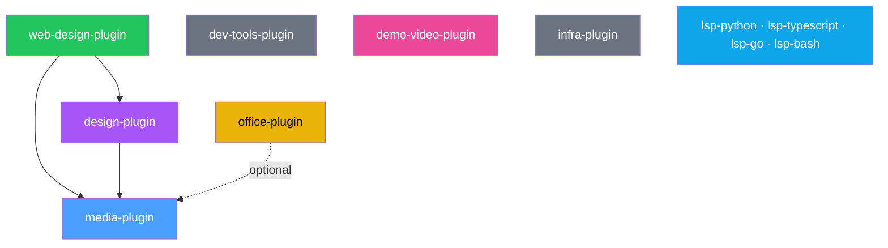

# claude-my-marketplace

[](https://github.com/lukaskellerstein/claude-my-marketplace)
[](plugins/)
[](plugins/)
[](https://code.claude.com/docs)

> A curated collection of [Claude Code](https://code.claude.com/docs) plugins for design, development, documentation, media generation, video production, and infrastructure management.

This marketplace bundles **12 plugins** contributing **56 skills**, **22 agents**, **4 commands**, **9 MCP servers**, and **4 LSP servers** — capabilities spanning the software development lifecycle from design direction through implementation, documentation, deployment, and demo video production. Every plugin installs and works on its own; the two that build on others declare it, so their dependencies install automatically.

## Features

- **Design → code, end to end** — creative direction, styleguides and design systems (`design-plugin`) feeding a parallel per-page React/Vite build with visual testing (`web-design-plugin`)
- **Media generation** — images, video, music, speech, icons, charts and diagrams behind a single visual-planning gate (`media-plugin`)
- **Automated demo videos** — repo → storyboard → recorded UI take (Playwright or OBS) → voiceover → rendered cut or Final Cut Pro project with MotionVFX graphics (`demo-video-plugin`)
- **Developer workflow** — read-only thinking and Q&A, autonomous multi-repo PR flow, dead-code sweeps, dependency upgrades, docs and README generation (`dev-tools-plugin`)
- **Spec-driven development** — a raw idea is talked into a spec, the spec becomes EARS requirement records, another hand writes the proof plan, the records become tasks sized for one agent run, the tests come before the code, and a bundled script gates every stage, decides when a task is done, verifies the feature and ships it; replaces spec-kit at about a tenth of the context per run (`spex`)
- **Infrastructure** — Kubernetes/GKE, Istio, Helm, Terraform, Traefik and Keycloak/OAuth2-proxy auth (`infra-plugin`)
- **Office documents** — PowerPoint, Word and Excel generation (`office-plugin`)
- **Opt-in code intelligence** — per-language LSP navigation loaded per session, never globally (`lsp-python`, `lsp-typescript`, `lsp-go`, `lsp-bash`)

## Plugins

| Plugin | Version | What it does | Skills | Agents |
|---|---|---|---|---|
| [media-plugin](plugins/media-plugin) | `v1.15.1` | Image, video, music, speech, icon and data-viz generation | 10 | 1 |
| [web-design-plugin](plugins/web-design-plugin) | `v1.6.0` | Brief → working React/Vite site | 4 | 11 |
| [dev-tools-plugin](plugins/dev-tools-plugin) | `v1.9.0` | Thinking/Q&A, git, code hygiene, deps, docs — all user-invoked | 8 | 1 |
| [spex](plugins/spex) | `v2.0.0` | Idea → spec (or a roadmap of steps) → EARS records → proof plan → one-run tasks → red tests → develop → verify → ship, script-gated | 13 | 7 |
| [demo-video-plugin](plugins/demo-video-plugin) | `v1.3.0` | Repo → narrated demo video | 9 | 5 |
| [infra-plugin](plugins/infra-plugin) | `v1.1.0` | K8s, Istio, Helm, Terraform, auth | 6 | — |
| [design-plugin](plugins/design-plugin) | `v1.3.0` | Creative direction and design review | 4 | 1 |
| [office-plugin](plugins/office-plugin) | `v5.1.0` | PPTX, DOCX, XLSX generation | 3 | — |
| [lsp-python](plugins/lsp-python) | `v1.0.0` | Python navigation via basedpyright | — | — |
| [lsp-typescript](plugins/lsp-typescript) | `v1.0.0` | TS/JS navigation via vtsls | — | — |
| [lsp-go](plugins/lsp-go) | `v1.0.0` | Go navigation via gopls | — | — |
| [lsp-bash](plugins/lsp-bash) | `v1.0.0` | Shell navigation via bash-language-server | — | — |

### [media-plugin](plugins/media-plugin) `v1.15.1`

Media generation and manipulation — images, videos/GIFs, music, text-to-speech, and data visualizations (charts, graphs, diagrams, maps) via Google Gemini, ElevenLabs, D3.js, Mermaid and Draw.io. A single visual-planning gate plus `media-prompt-craft` ensure every asset is clarified, styled and reviewed before it is produced.

- **Skills:** visual-planning, media-prompt-craft, image-generation, image-sourcing, video-generation, music-generation, speech-generation, icon-library, graph-generation, svg-mastery
- **Agents:** media-director
- **Commands:** `/media-generate`, `/media-assets`
- **MCP:** media-mcp (Gemini), ElevenLabs, Mermaid, Draw.io, Playwright
- **Hooks:** draw.io edge-routing post-processor and SVG sanity check after every write

### [web-design-plugin](plugins/web-design-plugin) `v1.6.0`

End-to-end website/webapp design and implementation — from brief to working React/Vite code. Orchestrates design direction, content architecture, media generation, parallel per-page implementation and visual testing with an opinionated anti-slop workflow.

- **Skills:** animation-system, page-architecture, css-architecture, variation
- **Agents:** page-builder, scaffold-builder, assembler, variation-generator, visual-fixer-app, visual-fixer-page, design-doc-foundation, design-doc-animation, design-doc-data, design-doc-media, design-doc-pages
- **Commands:** `/web-design`
- **MCP:** Playwright
- **Depends on:** design-plugin, media-plugin — installed automatically

### [dev-tools-plugin](plugins/dev-tools-plugin) `v1.9.0`

General developer tooling — git workflows, code hygiene, dependency management and project documentation generation. `git-pr` runs the whole commit → PR → squash-merge → back-to-main round trip across every repo in a folder — or in the `claude -w` worktree you are in — with no permission prompts: every step goes through one guarded script (`skills/git-pr/scripts/git-pr.sh`) that the skill pre-approves in `allowed-tools`. It asks one question per run — PR + merge, or PR only — and when the PR would conflict with the base branch it merges the base in and resolves the conflicts before merging (`abort` backs out when it can't do that with confidence). In a worktree, where git won't check out the base branch a second time, it fast-forwards the base in the main checkout and parks the worktree on the latest base. The script never force-pushes, resets, rebases or merges with `--admin`, and it stops for a human on anything doubtful — a new file that looks like a secret, a diverged branch, a merge GitHub blocks.

Every skill here is **invoked by you only** — none is ever auto-selected, so none costs context until you type it. That is deliberate: these skills commit and merge, rewrite lockfiles, and regenerate whole doc trees, and when that happens should be your call, not an inference. `/brainstorm` is for when there's a decision to make: options, trade-offs, a recommendation. `/question` is for when there's a fact to find: it investigates the current state, answers with citations, and never writes anything.

- **Skills (all user-invoked):** brainstorm, question, git-pr, dead-code, update-dependencies, update-docs, update-feature-docs, update-readme
- **Agents:** dead-code-analyzer
- **MCP:** Mermaid (diagram validation for `update-docs` and `update-feature-docs`)

### [spex](plugins/spex) `v2.0.0`

Spec-driven development in small, checkable files, built to replace GitHub spec-kit, with one rule under everything: the one who writes a claim never writes its proof. `/spex:new` shapes a raw idea into `specs/NNN-slug/spec.md` in rounds until you say done — one closed question or one sized hole (`●●●` `●●○` `●○○`) per round, research in parallel `researcher` subagents before any verdict, the file written as it goes, and `spex approve` to mark it ready. A big design is sized into a roadmap: one stub folder per step with `status: planned`, `depends_on` and the design sections it covers, the first step shaped now and each later one when its dependencies are shipped, with `spex show --inherited` handing it the decisions and signatures of the steps before it and `/spex:ship` routing what a finished step learned into the stubs it changes. In auto mode a `decider` subagent on the session's model settles every question from the design sections, the stub, the inherited decisions and the code, with its evidence, and the person reads the verdicts at `/spex:approve` instead of answering one question per round. It is the only way in: `spex gate requirements` refuses anything but a folder under `specs/` whose `spec.md` a person approved. `/spex:requirements` turns that into `requirements.yaml` — EARS requirement records with real-valued scenarios, the questions answered and the unknowns researched in the same run — and a `test-analyst` subagent, which never wrote a claim, writes `tests.yaml`, the proof plan: one test per scenario, as a script a driver runs, a shell test, or a session a browser performs when no script can judge. `/spex:tasks` turns the approved records into `tasks.yaml`: an approach, boundaries, a design block and one task per agent run, each with a write allowlist, a capped read list and exact signatures, and the test analyst adds one test per task. A person approves three readings — the spec, the records with their proof plan, the design block with the task tests — each past gate 1 as a hash of what they read, so a changed file goes back to them. Then `/spex:tests` has `test-developer` subagents write every script from its record, never from the source, and the script proves each one red before the code exists; `/spex:develop <dir>` orchestrates every ready task through `developer` subagents a wave at a time, and `spex done` runs the task's tests itself and flips the status only on a pass at that moment; a wrong test is judged by the `decider` (test, code or spec?) and rewritten by a test developer, never by the developer and never by the person. `/spex:verify` runs every script and every session at the tree that ships — a `tester` subagent performs each session with the bundled Playwright MCP and records what it saw with `spex session` — and routes each failure to one owner: a rewritten test, a fix task the test now covers, or a question. `/spex:review` reads the diff for what no test sees, one `reviewer` per task slice, and `/spex:ship` marks the records built, commits and merges through `ship.cmd`, with no click. Every skill ends with a NEXT block that names the next command, says when the chat can be cleared and whether auto mode is on. The bundled script `scripts/spex.mjs` (Node 20+, no install) owns everything a program can check: 95 rules with a `fix` text each, the stage gates, `needs` and `live` for the real systems a test touches, a skip that counts as neither red nor green, and a computed index of the living requirements across features. A develop run reads about 1–3 KB of spec instead of spec-kit's 190 KB, measured on a 12-phase Dex feature. Every skill is user-invoked only and at most 6,000 bytes, and no skill reads the plugin README. Dex adopts it as spec 017. See its [README](plugins/spex/README.md) for the design, the file formats, the rules and the sources (spec-kit, BMAD, Superpowers, OpenSpec, nex).


Yellow is you, blue is a skill you type, grey is the script. Every skill ends with the one command to run next. The plugin README has the full picture: who does what at each stage, what a status can do, the wrong-test loop, and [what each skill does when you run it again](plugins/spex/README.md#running-a-skill-again). For the whole process as one animated picture, open [`plugins/spex/README.html`](plugins/spex/README.html) in a browser: a feature travels eleven stops, files appear, statuses flip, and a click on any stop says what must be on disk there and what you type.

- **Skills:** init, update, new, approve, requirements, clarify, research, tasks, tests, develop, verify, review, ship
- **Agents:** researcher (one question in, the answer with the links it opened and a confidence out, on `sonnet`), decider (every open question of one step, or one failing test — test, code or spec? — in, a verdict with its evidence and a confidence out, on the session's model), test-analyst (the proof plan: one test per scenario and per task in `tests.yaml`; it never wrote the claim and never reads the source), test-developer (the code of a script test from its record, proved red or by a mutation; it never reads the source and never opens `tests.yaml`), developer (one task inside its paths, eleven lines back; the orchestrator runs `spex done`; a wrong test is a `test-bug`, never an edit), tester (one session performed in a browser or over an API and recorded with `spex session`; it changes nothing), reviewer (one task slice, read only, blocking findings with file and line) — seven, four that write, no two of them holding a claim and its proof, each started in parallel by a skill with a one-line brief
- **MCP:** Playwright (npx, headless) — the browser the `tester` subagent performs session tests in; screenshots land in `.spex/artifacts/`
- **Script:** `spex init | update | new | check | approve | gate | show | roadmap | next | run | verify | session | done | block | unblock | coverage | index | ship | report`, every command with `--json`
- **Tests:** `npm test` in the plugin folder — 127 rule, lifecycle, agent and skill-size tests on two fixtures (the README example and nex FEAT-142 converted)

### [demo-video-plugin](plugins/demo-video-plugin) `v1.3.0`

Turns a project repo into a narrated, edited demo video. Reads the codebase, writes a storyboard, prepares deterministic demo state, drives the UI with Playwright (web, launched Electron, or an already-running app attached over CDP) recording one clip per section — with Playwright video, or with **OBS** over obs-websocket for crisp native-pixel window capture that pauses through long waits — generates ElevenLabs voiceover, reconciles *measured* durations into a timeline, and renders the final cut with Remotion or exports the same timeline as a **Final Cut Pro** project. The FCP finish is dressed with Motion templates, **MotionVFX** DesignStudio elements first-class: it tells downloaded elements from mExtension placeholders, picks one look and one element per role from thumbnails against real frames — and from MotionVFX's public catalog for the 10,000 elements this Mac has not downloaded — places click callouts where the pointer went, and never exports a placeholder. Before the film it exports a ten-second probe to import first, because a DTD-valid FCPXML can still import wrong. See its [README](plugins/demo-video-plugin/README.md) for the pipeline.

- **Skills:** demo-video, demo-setup, demo-scripting, demo-app-prep, demo-capture, demo-voiceover, demo-assembly, demo-graphics, demo-review
- **Agents:** demo-capture-operator, demo-frame-critic, demo-graphics-scout, demo-remotion-builder, demo-researcher
- **MCP:** Playwright (demo capture), ElevenLabs
- **Hooks:** clip post-processing, audio probing, artifact validation

### [infra-plugin](plugins/infra-plugin) `v1.1.0`

Infrastructure management for Kubernetes/GKE, Istio service mesh, and authentication (Keycloak, OAuth2-proxy). Includes Helm charts, Terraform IaC and Traefik reverse proxy.

- **Skills:** auth, helm, istio, kubernetes, terraform, traefik

### [design-plugin](plugins/design-plugin) `v1.3.0`

Design direction and creative guidance — the "taste layer" that makes AI-assisted design intentional rather than generic. Styleguides, aesthetic strategy, typography pairings, color mood systems and design review.

- **Skills:** styleguide, frontend-aesthetics, design-review, design-system
- **Agents:** design-director
- **Commands:** `/design`
- **Depends on:** media-plugin — installed automatically

### [office-plugin](plugins/office-plugin) `v5.1.0`

Office document generation — professional PowerPoint presentations, polished Word documents and Excel spreadsheets.

- **Skills:** pptx, docx, xlsx
- **Optional:** media-plugin — used for charts, diagrams and images when installed; otherwise native PPTX charts and DOCX tables

### LSP plugins

[lsp-python](plugins/lsp-python), [lsp-typescript](plugins/lsp-typescript), [lsp-go](plugins/lsp-go), [lsp-bash](plugins/lsp-bash) — all `v1.0.0`. Manifest-only plugins giving Claude real code navigation — go to definition, find references, hover types — one plugin per language.

| Plugin | Server | Extensions | Requires on `PATH` |
|---|---|---|---|
| lsp-python | basedpyright | `.py`, `.pyi` | `uv tool install basedpyright` |
| lsp-typescript | vtsls | `.ts`, `.tsx`, `.js`, `.jsx` | `npm i -g @vtsls/language-server` |
| lsp-go | gopls | `.go` | `go install golang.org/x/tools/gopls@latest` |
| lsp-bash | bash-language-server | `.sh`, `.bash`, `.zsh` | `npm i -g bash-language-server` |

`lsp-bash` backs **five** of the nine LSP operations, not nine — `goToDefinition`, `findReferences`, `hover`, `documentSymbol`, `workspaceSymbol` (measured from bash-language-server v5.6.0's `initialize` response). It advertises no `implementationProvider` or `callHierarchyProvider`, so `goToImplementation` and the call-hierarchy calls return empty. It pays off navigating large shell trees where functions are `source`d across files, not as a bug-catcher — shellcheck diagnostics are unreachable through the LSP tool.

> [!IMPORTANT]
> **Do not `/plugin install` these.** They are meant to be loaded **per session**, not enabled globally — see [Using the LSP plugins](#using-the-lsp-plugins).

## Architecture



- **Every plugin works on its own, with two exceptions.** web-design-plugin depends on design-plugin and media-plugin, and design-plugin depends on media-plugin. Both declare it in `dependencies`, so installing them installs what they need.
- **design-plugin** provides creative direction, consumed by web-design-plugin for styleguides and design review
- **media-plugin** generates the assets for design-plugin and web-design-plugin
- **office-plugin** works alone; if media-plugin is installed, it uses it for charts, diagrams and images
- **dev-tools-plugin**, **spex**, **demo-video-plugin**, **infra-plugin** and the **LSP plugins** are standalone

### Commands

| Plugin | Command | Purpose |
|---|---|---|
| design-plugin | `/design-plugin:design` | Design direction workflow |
| media-plugin | `/media-plugin:media-generate` | Generate a media asset with guided prompts |
| media-plugin | `/media-plugin:media-assets` | List and manage generated media assets |
| web-design-plugin | `/web-design-plugin:web-design` | End-to-end website design workflow |

Every skill is also invocable as `/<plugin-name>:<skill-name>` — e.g. `/design-plugin:styleguide`, `/demo-video-plugin:demo-video`. Plugin commands and skills are always namespaced; the rest of this README uses the short name (`/git-pr`) for readability.

The eight `dev-tools-plugin` skills and the thirteen `spex` skills are invocable **only** that way. They set `disable-model-invocation: true`, so Claude never selects them on its own and their descriptions cost no context: `/git-pr` merges when you say so, not when your work looks finished, and `/spex:develop` never starts a task you did not name.

### MCP server integrations

| Plugin | MCP server | Purpose |
|---|---|---|
| media-plugin | `media-mcp` (uvx) | AI media generation via Google Gemini |
| media-plugin | `elevenlabs-mcp` (uvx) | Text-to-speech and voice cloning |
| media-plugin | Mermaid (HTTP) | Diagram generation |
| media-plugin | `@drawio/mcp` (npx) | Draw.io diagram editing |
| media-plugin | Playwright (npx) | D3.js chart rendering |
| dev-tools-plugin | Mermaid (HTTP) | Diagram validation for generated docs |
| web-design-plugin | Playwright (npx) | Visual testing of built websites |
| demo-video-plugin | Playwright (npx) | UI recording with devtools video capture |
| demo-video-plugin | `elevenlabs-mcp` (uvx) | Demo voiceover generation |
| spex | Playwright (npx) | Session tests performed by the tester subagent |

### LSP servers

| Plugin | Server | Config |
|---|---|---|
| lsp-python | `basedpyright-langserver --stdio` | [`.lsp.json`](plugins/lsp-python/.lsp.json) |
| lsp-typescript | `vtsls --stdio` | [`.lsp.json`](plugins/lsp-typescript/.lsp.json) |
| lsp-go | `gopls` | [`.lsp.json`](plugins/lsp-go/.lsp.json) |
| lsp-bash | `bash-language-server start` | [`.lsp.json`](plugins/lsp-bash/.lsp.json) |

## Quick Start

### 1. Add the marketplace

Inside Claude Code:

```
/plugin marketplace add lukaskellerstein/claude-my-marketplace
```

Or via the CLI:

```bash
claude plugin marketplace add lukaskellerstein/claude-my-marketplace
```

### 2. Install a plugin

```
/plugin install dev-tools-plugin@claude-my-marketplace
/plugin install media-plugin@claude-my-marketplace
/plugin install design-plugin@claude-my-marketplace
/plugin install web-design-plugin@claude-my-marketplace
/plugin install demo-video-plugin@claude-my-marketplace
/plugin install office-plugin@claude-my-marketplace
/plugin install infra-plugin@claude-my-marketplace
```

Installing `web-design-plugin` or `design-plugin` also installs the plugins they depend on.

The four `lsp-*` plugins are deliberately **not** in this list — see below.

### 3. Update

```
/plugin marketplace update
```

## Usage

Commands take arguments; model-invoked skills trigger from a plain request.

```
# Design and build a site from a brief (--fast skips checkpoints, --no-media skips asset generation)
/web-design-plugin:web-design Landing page for a specialty coffee roaster --fast

# Design direction and styleguide only
/design-plugin:design Brand refresh for a specialty coffee roaster

# Generate and organize media
/media-plugin:media-generate image A futuristic city skyline at sunset, cyberpunk style
/media-plugin:media-assets organize

# Developer workflow — user-invoked only
/dev-tools-plugin:question Where is the auth token refreshed?
/dev-tools-plugin:brainstorm Split the monolith API or keep it?
/dev-tools-plugin:git-pr
```

Office documents, infrastructure and demo videos need no command — ask in plain words. *"Make a 6-slide pitch deck about our Q3 results"* triggers the `pptx` skill.

## Using the LSP plugins

Language servers are the largest per-session memory cost — measured at ~0.85 GB for vtsls and 0.3–0.6 GB for basedpyright, *per instance*. With many Claude Code sessions open at once, enabling one globally multiplies that across every session in every repo.

So the LSP plugins are **off by default and opted into per session**, with `--plugin-dir`:

```bash
claude --plugin-dir /path/to/claude-my-marketplace/plugins/lsp-python
```

A plain `claude` then has no LSP at all, and the server starts lazily — only once a matching file is actually touched, and only for that session. Exiting the session takes the process with it.

**Never add these to `enabledPlugins`** in any settings file, and don't `/plugin install` them — either would silently re-add hundreds of MB to every session. One plugin per language is the same idea one level down: a session that loads only `lsp-python` cannot start vtsls, however many `.ts` files sit in the directory.

Each plugin installs nothing and bundles nothing; it fails soft until its binary exists on `PATH`. Install those separately — see the table in [LSP plugins](#lsp-plugins) above and each plugin's README.

## Environment Variables

**media-plugin** and **demo-video-plugin** require environment variables. **design-plugin** and **web-design-plugin** install media-plugin as a dependency, so set them for those too (or run `/web-design` with `--no-media`). All other plugins work without any configuration.

| Variable | Required by | Description |
|---|---|---|
| `GEMINI_API_KEY` | media-plugin | Google Gemini API key for image, video and music generation via `media-mcp`. Get one at [aistudio.google.com](https://aistudio.google.com/apikey). |
| `ELEVENLABS_API_KEY` | media-plugin, demo-video-plugin | ElevenLabs API key for text-to-speech, voice cloning and demo voiceover. Get one at [elevenlabs.io](https://elevenlabs.io). |
| `OBS_WEBSOCKET_PASSWORD` | demo-video-plugin (optional) | Only for the OBS recorder. OBS → Tools → WebSocket Server Settings → Show Connect Info. `OBS_WEBSOCKET_URL` overrides `ws://127.0.0.1:4455`. |
| `MEDIA_OUTPUT_DIR` | media-plugin | Absolute path where generated media is saved. When set, MCP servers return file paths instead of base64, keeping context clean. Falls back to the current directory. |

### Setup by OS

#### macOS / Linux (bash / zsh)

Add to your `~/.bashrc`, `~/.bash_profile` or `~/.zshrc`:

```bash
export GEMINI_API_KEY="your-gemini-api-key"
export ELEVENLABS_API_KEY="your-elevenlabs-api-key"
export MEDIA_OUTPUT_DIR="/path/to/media/output"
```

Then reload your shell:

```bash
source ~/.zshrc   # or ~/.bashrc
```

#### Windows (PowerShell)

```powershell
[System.Environment]::SetEnvironmentVariable("GEMINI_API_KEY", "your-gemini-api-key", "User")
[System.Environment]::SetEnvironmentVariable("ELEVENLABS_API_KEY", "your-elevenlabs-api-key", "User")
[System.Environment]::SetEnvironmentVariable("MEDIA_OUTPUT_DIR", "C:\path\to\media\output", "User")
```

Restart your terminal for changes to take effect.

#### Windows (Command Prompt)

```cmd
setx GEMINI_API_KEY "your-gemini-api-key"
setx ELEVENLABS_API_KEY "your-elevenlabs-api-key"
setx MEDIA_OUTPUT_DIR "C:\path\to\media\output"
```

Restart your terminal for changes to take effect.

## Repository Structure

```
├── .claude-plugin/
│   └── marketplace.json      # The marketplace manifest — every published plugin
├── plugins/
│   ├── <plugin-name>/
│   │   ├── .claude-plugin/
│   │   │   └── plugin.json   # Metadata: name, version, description, dependencies, skills, MCP servers
│   │   ├── skills/           # <skill-name>/SKILL.md — invocable as /<skill-name>
│   │   ├── agents/           # Subagent definitions
│   │   ├── commands/         # Slash commands
│   │   ├── hooks/            # hooks.json + scripts
│   │   ├── scripts/          # Deterministic helpers called by skills
│   │   └── .lsp.json         # Language server config (LSP plugins)
│   └── ...
└── _archive/                 # Retired plugins, not published
```

## Adding a Plugin

1. Create `plugins/<name>/.claude-plugin/plugin.json` with `name`, `version`, `description`, `author` and `keywords`
2. Add skills under `skills/<skill-name>/SKILL.md` (auto-discovered), plus `agents/`, `commands/`, `hooks/` as needed
3. Keep it independent — don't name another plugin's skills or tools. If the plugin truly needs another one, list it in `dependencies` in `plugin.json`; if it is only nice to have, write "if `<plugin>` is installed, use …" with a fallback
4. Register it in `.claude-plugin/marketplace.json` as `{ "name": "<name>", "source": "./plugins/<name>" }` and bump the marketplace `version`
5. Validate before shipping:

```bash
claude plugin validate ./plugins/<name>   # manifest + components
claude plugin validate .                  # marketplace manifest
claude --plugin-dir "$PWD/plugins/<name>" plugin details <name>   # inventory + token cost
```

For a plugin with `dependencies`, pass each dependency with its own `--plugin-dir` as well.

## Archive

`_archive/` holds retired plugins kept for reference but **not** published — they are absent from `.claude-plugin/marketplace.json` and cannot be installed.

- `_archive/paperclip-plugin` — AI company advisor for the [Paperclip](https://paperclip.ing) platform (last published `v2.0.3`)
- `_archive/company.md` — design spec for the above

To bring one back, move it into `plugins/` and re-add its marketplace entry.

## Author

Lukas Kellerstein
