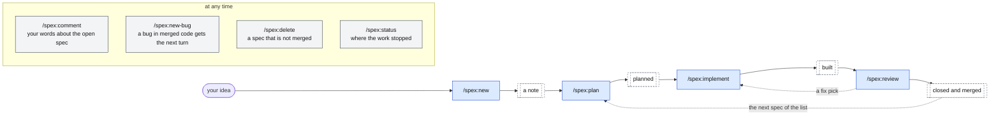

# spex

Spec-driven development in small, checkable files. An idea becomes a list of
specs, and each spec goes through four commands. `new` splits the idea and
writes one note for each spec. `plan` turns one note into the full spec, its
requirements, its tasks and its test plan. `implement` writes the tests red,
builds the code and proves it. `review` reads the diff and closes the spec. A
script, not the model, says when each step is done. The one who writes a claim
never writes its proof.

> **Status:** spex 3.0.0 · 2026-11-13 · data format 3. `spex update` moves a
> repo from format 2. [What changed in v3.0](#what-changed-in-v30) lists the
> differences from spex 2.2.
>
> **The design:** [`README.html`](README.html) is the design of the process:
> one playable map with every step and every fork, 48 cases with their way
> out, and every decision with its number. This file is the reference: the
> files, the commands, the script and its rules. GitHub does not render HTML,
> so open the page in a browser.
>
> **Sources studied:** spec-kit 1.3.1, BMAD Method (HEAD `022be931`), Superpowers
> 7.0.2, OpenSpec 1.16.0, and nex's own EARS format (`nex/platform/schemas/`,
> `nex/platform/nex/runner/spec_check.py`, ADR-001, ADR-018, ADR-020, ADR-044).

## The commands

Four commands take an idea to merged code. Four more are for any time. Two
are setup.

| Command | What it does | What it leaves on disk |
|:--|:--|:--|
| `/spex:new <idea>` | keeps your words, sizes the idea, splits it into specs, writes one note for each; a second agent reads the notes against your text | `specs/<NNN>-<slug>/source.md` (your text, word for word) and `spec.md` (a note), on the base branch; for a design file also `specs/<name>.roadmap.md` |
| `/spex:plan <dir>` | checks the note against the real code, asks at most 3 questions, writes the full spec, the requirements, the tasks and the test plan; the script checks that every line of yours has a record | the branch `spex/<spec>` and the worktree `.claude/worktrees/<spec>`; in it `spec.md` (full), `requirements.yaml`, `tasks.yaml`, `tests.yaml`, `status.yaml` (`plan`, `done`); one commit |
| `/spex:implement <dir>` | writes every test and proves it red, builds each task with a fresh agent, runs every test on the final tree and in the real app; a red test goes to the decider | the test files, the code, `status.yaml` (`implement`, `done`); one commit |
| `/spex:review <dir>` | reads the diff for what no test sees, shows every finding with a pick, takes your one-word answer; a clean review closes the spec | the records `built`, `status.yaml` (`review`, `done`); the branch merged, the worktree and the branch removed |
| `/spex:comment <your words>` | a question about the open spec gets an answer from its files; a change is put into the spec, the tasks and the test plan; no code is written | an entry in `corrections.md`; for a change, the corrected and stamped plan, one commit |
| `/spex:new-bug <report>` | a bug in merged code gets one note with the next turn | one note; each note that waits moves one number up |
| `/spex:delete <dir> <reason>` | takes a spec that is not merged off the list | `.spex/archive/<spec>-<day>/` (the folder, `code.patch`, `DROPPED.md`); the later notes move one number down |
| `/spex:status` | prints where the work stopped, and the one command to go on | nothing |
| `/spex:init` | once for a repo: scans it | `.spex/config.yaml`, `.spex/.gitignore` |
| `/spex:update` | after a plugin update: adds new config keys, runs the format migrations | the config at `format: 3`; from format 2, a `status.yaml` for each spec that has records |



A box is a command you type. A dashed box is the state of a spec after it. You
run `new` one time for an idea, and the other three one time for each spec.
You run `/clear` between two commands: the state is in the files, never in
the chat.

**Three rules.**

1. **What you said stays said.** Your text is kept word for word in
   `source.md`. No agent changes a decision of yours. If the code makes it
   not possible, the run stops and asks you. Only you change it, with
   `/spex:comment`.
2. **The next command is the approval.** There is no `approve`. Each reply
   ends with a digest of what the agents decided. When you type the next
   command, you approve it. To say no, you type `/spex:comment` first.
3. **Who writes a claim never writes its proof.** One agent writes what must
   be true. Another plans the test, a third writes it, a fourth writes the
   code. A script says when it is done.

`/spex:*` are skills. `spex` is the bundled script (`scripts/spex.mjs`), which
the skills call. In Claude Code the path is
`node ${CLAUDE_PLUGIN_ROOT}/scripts/spex.mjs`.

**Install** (Claude Code 2.1.275 or later, one step):

```text
/plugin install spex --marketplace lukaskellerstein/claude-my-marketplace
```

**First use**, in a git repository:

```text
/spex:init                              # once: writes .spex/config.yaml from what the repo has
/spex:new Add an Export button to the Orders page. It downloads all orders as a CSV file. …
/clear
/spex:plan specs/007-csv-export         # each reply ends with a NEXT block that names this line
/clear
/spex:implement specs/007-csv-export    # typing it approves the plan
/clear
/spex:review specs/007-csv-export       # a clean review merges and removes the worktree
```

Set `commit: true` in `.spex/config.yaml`, or commit the notes yourself after
`new`: a worktree gets only what is committed, so `plan` refuses a note that
is not (`GATE-COMMIT`). Set `close.cmd` to the command that merges, or to
`local`; with no command the close waits for you to merge.

With a merge command and a remote, the notes must be on the remote before a
spec starts. Else the request of the spec carries them, and after a squash
merge the base branch here and on the remote hold the same change in two
commits: no pull works then. So with `commit: true` the script also pushes
the notes, and without it you push them. A start and the close refuse a base
branch that is ahead of its remote (`GATE-PUSH`).

The plugin also starts a Playwright MCP server (`@playwright/mcp`, headless)
for the `tester` subagent; `npx` fetches it on first use, and its screenshots
land in `.spex/artifacts/`. For `spex` on your `PATH` as well, run `npm link`
in `plugins/spex/`.

## Why spex

spec-kit gives good results, but its cost grows with every fresh agent:

- **Big prompts.** Its nine core commands are 128 KB of prompt text. About 4 KB
  of each is extension-hook boilerplate (21 to 50 percent of a prompt), paid on
  every run even when no extension exists. `checklist` alone is 22 KB.
- **Expansion.** In Dex, the 24 KB input document of feature 015 became a
  248 KB spec folder. Across features 007–015 the folder is 4 to 11 times its
  input.
- **Read everything, every run.** `implement` reads `tasks.md` and `plan.md`,
  and `data-model.md`, `contracts/`, `research.md`, `constitution.md` and
  `quickstart.md` when they exist. In Dex they all exist. For Dex 015 that is
  186 KB (about 47k tokens) before any code is read. Dex starts a fresh agent
  per phase, and 015 has 12 phases. The same context is then sent again on
  every turn of every run.
- **Most of it is noise for the phase that runs.** Measured on Dex 015: each
  implement phase points at 5 to 41 KB of those 186 KB (its own tasks, the
  research sections, contracts, data-model sections and decisions it names).
  The mean is 22 KB. The tasks file already names what a phase needs — 25
  research pointers, 15 contract pointers, 8 decision pointers — but prose has
  no ids to slice by, so spec-kit loads the folder.
- **Prose that only a model can check.** `FR-006` sentences, acceptance
  scenarios hung off user stories instead of requirement ids, tasks that point
  at stories, and `analyze` matching tasks to requirements by id first and by
  keyword second. Gates live in prompt text. The model ticks its own `[X]`.
- **The same hand writes the claim and its proof.** The agent that wrote a
  requirement writes the test that checks it, and the agent that wrote the
  code decides when it passes. A test bent to the code, or a task closed on a
  skipped test, looks green.

spec-kit's `presets/lean` cuts its five core prompts from 61.5 KB to 3.7 KB. That
fixes the prompt size, but not the prose specs, the model-graded gates, the
read-everything `implement`, or the per-agent `/speckit-*` syntax. spex keeps
what spec-kit does well — research, contracts, clarify, cross-checks — and moves
every check that a program can do into a program.

The saving has two mechanisms. The base context of a fresh agent drops from
about 47k tokens to about 5k, and that base is paid on every turn. And three
model runs — `analyze`, `checklist`, the constitution stage — become one script.
What can eat the saving: an uncapped `context` list, check-fix loops, and the
count of fresh agents, because every fresh agent pays its harness's own system
prompt. A spec with N tasks, S script tests and M sessions costs, in `plan`,
one analyst (three short runs), one planner, one test analyst and one
researcher for each missing fact; in `implement`, ⌈S/K⌉ test developers (K
script tests per batch, capped by `limits.tests_scenarios`), N developers, M
testers and one decider for each failing round; in `review`, one reviewer for
each task slice. Those numbers were measured on spex 2.x. spex 3.0 is not
measured yet: see [Open questions](#open-questions).

## Design rules

These rules keep spex cheap and honest. Each one names the failure it
prevents.

1. **A run reads only its inputs, by default.** Every skill and every agent
   lists what it reads. A developer reads `spex show <dir> <task>` (the task,
   its tests from the proof plan, its requirement records, the boundaries, the
   decisions and the design slice for its paths) and the files in the task's
   `context`. It may pull more by id — `spex show <dir> REQ-007-003`, `spex
   show <dir> --design`, `spex show <dir> --decisions` — and it lists every
   pull in its report, so the planner learns to include them.
   *(spec-kit and OpenSpec `apply` read every artifact; BMAD's retired
   create-story said "when in doubt, LOAD IT".)*
2. **Records, not prose.** Anything a program checks is a YAML record with an
   id. *(OpenSpec's Markdown route needs 1,600 lines of parsers plus 3,100 of
   validation and merge, and still loses to new heading shapes; Superpowers
   fixed task-heading parsing again in 7.0.2.)*
3. **Rules live in code.** EARS shapes, banned words, coverage, file overlap,
   pointers, size limits, a person named as an actor: all checked by `spex
   check`, not described in prompt prose. Every finding carries a `fix` text,
   and that text is the only place the rule is explained. A skill names the
   rule; it does not repeat it. *("LLMs miscount IDs and miss literal
   placeholders; a grep does not." — BMAD `lint_spine.py`.)*
4. **The script runs the check at the moment it decides.** A phase starts
   only when `spex start <phase>` exits 0, and ends only when `spex end
   <phase>` (for review: `spex close <dir> built`) exits 0. A task is done only
   when `spex done` exits 0: it runs the task's tests itself. None of them
   reads a file an agent could have written. `.spex/evidence/` holds records
   of runs, never the proof. No skill grades its own work.
5. **Small skills, no boilerplate.** Each `SKILL.md` is at most 6,000 bytes.
   Text a skill needs only in one case is a part: one more file of that
   skill, also at most 6,000 bytes, read only when the run gets there. The
   frame of every reply is one shared file, `reply.md` (at most 4,500 bytes),
   and each agent file is at most 3,600. A test in this plugin enforces every
   cap. No hook tables, no personas, no routing tables in a skill.
   *(Superpowers caps at 20,000
   bytes because Claude Code truncates there; 6,000 is spex's own choice, so a
   skill re-attached after compaction — the first 5,000 tokens — is never
   cut.)*
6. **Nothing is always on.** Every skill has `disable-model-invocation: true`.
   Claude Code then keeps the description out of context until the skill is
   invoked. spex adds no bootstrap hook and no always-loaded text.
   *(Superpowers' session-start bootstrap is 3.6 KB, paid by every session.)*
7. **Decisions, not code, in the plan.** A task carries exact paths,
   signatures and named values. It does not carry function bodies, and it does
   not carry its own proof: that is a test record in `tests.yaml`.
   *(Superpowers measured, on one report, plans that record decisions at about
   a third of the tokens of plans that carry code, with the same blind-judged
   quality.)*
8. **Closed questions with a pick.** Every question lists options and marks
   one as the pick, so one word (`ok`) answers a whole screen. An answer says
   who gave it: `by: human`, `by: agent` (with evidence and a confidence) or
   `by: default`. The close prints every answer no person gave, so you read
   them once more at the end.
9. **Plain text in the skills.** A skill names actions ("ask the person",
   "start one agent for each task"), with two exceptions that are Claude Code
   tools: `EnterWorktree` and `ExitWorktree`, which move the chat into and
   out of the worktree of a spec.
10. **This README is for people.** No skill tells the agent to read it. If one
    did, every run would pay for the whole process again.
11. **The wall: the one who writes a claim never writes its proof.** The
    analyst writes the spec and the records, the planner writes the tasks,
    and neither opens `tests.yaml`. The test analyst writes `tests.yaml` from
    the claims and never reads the source. The test developer writes the test
    code from a test record and never reads the source or edits `tests.yaml`.
    The developer writes code and never edits a test. The tester performs a
    session and changes nothing. The decider judges and fixes nothing. A test
    bent to the code, a test written from the code, and a claim proved by its
    own author are the three ways a green run lies, and each one needs two of
    those roles in one hand. *(nex 028: the agent that wrote the test also
    decided it could skip.)*
12. **No manual step.** A task's `instructions` and `done_when`, and a test's
    `steps` and `expect`, name no person as an actor: not "ask Lukas", not "a
    go-ahead", not "by hand", not a name from `people[]` (`TASK-PERSON`,
    `TEST-PERSON`). A merge is `close.cmd`; a press is a browser step in a
    session a tester performs; a credential or a running system is a `needs[]`
    entry the script checks and names when it is missing; a real system a test
    writes is in `live[]`, the one-time yes a person gives in the config.
    *(nex 028, T10: "Ask Lukas for the go-ahead" in the instructions, and a
    live test that skipped without a token and counted as green.)*
13. **One state file.** `status.yaml` in the folder of a spec holds the phase
    and if it is done. The script writes it only where the script runs: at the
    start and at the end of a phase. `spec.md` has no line for the state, so
    the state is never in two places.
14. **One spec is open at a time, in the order of the numbers.** `plan`
    starts only when every spec with a lower number is closed (`GATE-TURN`,
    `GATE-OPEN`). So a later spec is planned from the real code of the specs
    before it, never from the first guess.
15. **A branch and a worktree for each spec.** The script makes both when
    `plan` starts and removes both at the close. The base branch holds only
    notes and closed specs.
16. **The script commits on the branch of a spec.** That branch is its own,
    so it commits there at the end of each phase with no config line. On the
    base branch it commits only with `commit: true`.
17. **Your words are kept, and marked.** `source.md` is your text, word for
    word, and nobody rewrites it (`PLAN-SOURCE`). A line of the spec that
    comes from you is marked `(you)` and keeps its link back to your text
    (`PLAN-LINE-LOST`). Every line of yours has a record, or a reason
    (`PLAN-LINE`).
18. **The plan is stamped, not approved.** `spex end plan` stores a hash of
    the spec, the records, the tasks and the test plan. `spex start implement`
    refuses a plan that a hand changed after that (`GATE-PLAN-CHANGED`). A
    change the process made is stamped again by `spex stamp`.
19. **A change is small or big.** An agent corrects what is small, and you
    read it in the digest. What is big stops for you. `corrections.md` keeps
    each change with its reason, in git, so it stays when the worktree goes.

## The process

[`README.html`](README.html) is the map of the process: every box, every
fork, and 48 cases you can play. This section says the same in short, with
what the script does at each point.

### The three phases

A phase starts and ends in the script, and nowhere else. `spex start` runs
the gate of the command and writes `state: started`. `spex end` runs the last
check, writes `state: done`, and commits what the phase wrote on the branch of
the spec. A command that names a spec works in the worktree of that spec, from
any folder of the repo.

| Phase | The start | The work | The end |
|:--|:--|:--|:--|
| **plan** | `spex start plan <dir>`: it is the turn of this spec (`GATE-TURN`, `GATE-OPEN`, `GATE-CLOSED`), and the note is committed on the base branch (`GATE-COMMIT`). It makes the branch `spex/<spec>` and the worktree, runs `worktree.setup` one time, writes `plan`, `started`, and adds the empty sections of the full spec to the note | The analyst checks the note against the code. The decider sizes what does not fit. The analyst drafts the spec. You answer at most 3 questions. One researcher gets each missing fact. The analyst writes the full spec and the records, the planner writes the tasks, the test analyst writes the test plan | `spex end plan <dir>`: every file is there (`PLAN-MISSING`), no question and no unknown is open (`PLAN-QUESTION`, `PLAN-UNKNOWN`), `spex check` has no error, and all is linked. Then the stamp, `plan`, `done`, and one commit |
| **implement** | `spex start implement <dir>`: the plan is done (`GATE-PLAN`) and as it was stamped (`GATE-PLAN-CHANGED`). The records go from `draft` to `approved`. It writes `implement`, `started`, checks every `needs` of the tests and runs `env.up` (`GATE-NEEDS`, `ENV-UP`) | Test developers write each script test and prove it red. One developer builds each task, and `spex done` closes it. `spex verify` runs every test on the final tree, and testers perform the sessions in the real app. A red test goes to the decider | `spex end implement <dir>`: every task is done (`GATE-TASKS`), the plan is stamped, and the proof is green on this tree (`GATE-VERIFY`). Then `implement`, `done`, and one commit |
| **review** | `spex start review <dir>`: the spec is built (`GATE-BUILT`), every task is done, and the proof is green on this tree. It writes `review`, `started` | Reviewers read the diff against every record. You answer the findings in one word. A fix pick goes back to `implement` with no command typed. With no fix pick, the close runs | `spex close <dir> built` writes `review`, `done` and commits. The other steps of the close merge and clean up |

**All linked?** is the last check of `plan`, and `spex stamp` runs it again.
It starts at your lines: each bullet under `## From your idea` (or `## From
the design`) ends with `→ REQ-…` or with `→ no record: <why>` (`PLAN-LINE`).
Every line the note had is still in the full spec, with its link
(`PLAN-LINE-LOST`). `source.md` is as it was on the base branch
(`PLAN-SOURCE`). Every record has a task (`TASK-COVERAGE`), and every scenario
and every task has a test (`TEST-COVER`). A check that fails goes back to the
agent that owns the file, at most 3 times in one run. Then the run stops and
names the gap.

**The stamp.** `spex end plan` stores four hashes: `tasks`, `spec` and
`requirements` in the `approvals` block of `tasks.yaml`, and `tests` in the
`approvals` block of `tests.yaml`. Typing `implement` is the approval, so
`spex start implement` computes them again. A file changed by hand sends you
back to `plan`, which checks it and stamps it again. Statuses, the `deferred`
list and the fix tasks of an answered review are left out of the hashes.

**What carries a status.** Only the script writes one past its first value.

| Thing | Values | Who moves it |
|:--|:--|:--|
| A spec, in `status.yaml` | no file: a note · `plan` · `implement` · `review`, each `started` or `done` | `spex start`, `spex end`, `spex close <dir> built`, `spex stamp`, `spex review accept` |
| A record | `draft` → `approved` → `built`, or `retired` | `spex start implement` and `spex stamp` approve; the close builds, and retires a record that a new one supersedes |
| A task | `todo` → `done`, or `blocked` | `spex done` (its tests pass now), `spex block`, `spex unblock` |
| A session | `pending` → `pass` or `fail`, `stale` when the tree changed | `spex session`, `spex verify` |

### The close

A clean review closes the spec with no extra word. The close is six calls of
`spex close <dir> <step>`, in this order, because an agent works between some
of them.

| Step | What the script does | When it cannot |
|:--|:--|:--|
| `sync` | Commits the work of the review. If the base branch moved (a teammate merged, or `new`, `new-bug` or `delete` wrote notes), it merges the base branch into the branch of the spec | `CLOSE-CONFLICT`: a developer reads both changes and joins them, then the step runs again |
| `later` | Lists the notes with a higher number, the deferred findings, and what was passed on already. The decider sizes what the spec learned, and the analyst corrects the later notes | With no later spec, no agent runs, and the last reply lists a deferred finding |
| `prove` | Is the proof still good? The same tree: yes. Only notes changed since the proof: yes, and no test runs. The code changed: no | `CLOSE-PROOF` (exit 7): the deploy, `spex verify` and each session run again. A red test goes to the decider, as in `implement` |
| `built` | Records `approved` → `built`, superseded records → `retired`, `status.yaml`: `review`, `done`, one commit. It prints the answers no person gave | `CLOSE-TASKS`, `CLOSE-REVIEW`, `CLOSE-PROOF` |
| `merge` | Merges each other repo of the spec first, then runs `close.cmd` (push, open the request, merge it). With `local`, the merge is in the next step. With no command, the run waits for you (`CLOSE-WAIT`) | `CLOSE-MERGE-FAILED`: a developer fixes the cause, the fix is tested, at most 3 tries. When the forge wants a person, the run waits |
| `finish` | Runs in the main folder, after the chat left the worktree (`CLOSE-LEAVE`). It pulls the base branch, merges the branch itself with `close.cmd: local`, checks that the base branch has the spec as closed, runs `env.down`, and removes the worktree and the branch | `CLOSE-WORKTREE` (exit 8): the folder is not fully removed. Run the printed command one time outside the sandbox |

`review, done` is written before the merge, so the base branch gets it. A spec
is closed when that commit is on the base branch, by a merge of any kind. So
after a merge that you made by hand, you type `/spex:review <dir>` again: each
step finds its work done, and `finish` removes the worktree.

### Stop at any time

You can close the terminal in any step of `plan`, `implement` or `review`.
Nothing is kept in the chat. `status.yaml` keeps the phase, and if it is done.
It keeps no step inside a phase: a step is a line of text in a skill, and no
code can see if an agent did it.

When you type the same command again, the gate lets it in, and the phase runs
again from its first step. The files of the first run are on disk, and each
agent reads them. A task that `tasks.yaml` marks as done is not built again.
Only the end of the phase writes `state: done`.

`/spex:status` runs no agent. It prints the open spec, its phase, a correction
or a comment that is not finished, and the one command to go on:

```text
📍 006 delete-old-backups · implement, started · worktree 006-delete-old-backups · 3 days ago
   worktree: /path/to/repo/.claude/worktrees/006-delete-old-backups
────────────────────────────────────────
NEXT   /spex:implement specs/006-delete-old-backups
       The phase runs again; a task that is done stays done.
────────────────────────────────────────
```

### Small or big

The decider names one of four causes of a red test: the test, the code, the
tasks or the spec. The first three are never yours to answer: a test developer
rewrites the test, a developer fixes the code, the planner splits the task or
gives it one more file. A task that stays red after its developer is done goes
to the decider at once. The loop has at most `verify_rounds` rounds (3), then
the run stops for you.

When the spec is wrong, the decider sizes the change. It is **big**, and stops
for you, when it touches one of these three:

| It touches | Example |
|:--|:--|
| Something you said: a line marked `(you)`, or an answer you gave | You said "all orders". The API gives a user only the orders of one shop |
| The Success or the Not this of the spec | The export cannot finish in the request for 200 000 orders |
| The list of specs: a spec is added, dropped or replaced | The tool must be a CLI, so the dashboard spec is dropped |

Everything else is **small**: the analyst corrects the spec, the plan follows,
and you read it in the digest of `implement`. Small or big, a new test must be
red before any code changes. `plan` uses the same rule before it drafts: a
note that does not fit the real code is corrected by the analyst (small), or
decided by you (big). A wrong name or a wrong fact in a later note is small:
the close corrects it.

With `auto: true` in the config, nobody is asked. The decider answers each
question and picks for each finding, with its evidence, and each digest lists
its answers. Three things still stop for you, because they are not questions:
a `needs` that only you can give, the limit of the fix loop, and a write to a
real system with no undo.

### Your words at any time: `comment`

You can stop a run at any moment and type `/spex:comment` with your words. It
works on the one spec that is open, so it needs no spec name. The script keeps
your words in `corrections.md`, word for word, before any agent reads them. It
writes no code and runs no other command: the reply names the command, and you
type it.

| Your words are | What happens | The reply names |
|:--|:--|:--|
| A question | The answer comes from the files of the spec: who decided it, and why. Nothing else changes on disk | The command that was next anyway |
| A change, and no plan exists yet | The analyst puts your words into the spec, marked `(you)` | `plan`: the phase runs again, with your line |
| A change, and a plan exists | The analyst corrects the spec, the planner adds tasks, the test analyst plans the tests. `spex stamp` checks the links, stamps the plan and commits. A spec that was built goes back to `implement`, `started` | `implement`: the new tests are red first, and a done task stays done |
| Anything, and no spec is open | Refused (`COMMENT-NO-SPEC`). Nothing changes | `plan` for the next spec, or `new` |

A decision that comes from your words is marked `(you)`, so no agent changes
it later. The command you type next is your ok to what `comment` changed.

### The environment contract

spex knows no tool. Your project gives it four scripts and one address, under
`env` in `.spex/config.yaml`. With no `env` key, no environment is used.

| Key | The script runs it | If it fails |
|:--|:--|:--|
| `up` | At the start of `implement`, with the other needs | `ENV-UP`: the run stops for you, before any code is written |
| `deploy`, `check` | Before every full test run (`spex verify`), so also after each fix | `ENV-DEPLOY`: it counts as a red test, and the decider names the cause |
| `down` | At the close, in the step `finish` | The close goes on, and the reply says so |
| `url` | `spex verify` gives it to the test commands as `SPEX_ENV_URL` | — |

### Branches and worktrees

Each spec gets its own branch, `spex/<spec>`, and its own worktree (a second
folder of the same repo, on that branch), `.claude/worktrees/<spec>`.

| Moment | What the script does | Where the chat works |
|:--|:--|:--|
| `new`, `new-bug` | Writes the notes on the base branch. `spex commit` commits them with `commit: true`, and pushes them when `close.cmd` merges through a remote. Without it, the reply names the files, and you commit and push them | The main folder |
| `plan` starts | Makes the branch and the worktree from the base branch (`base` in the config, or the branch the main folder is on). Runs `worktree.setup` one time | Moves into the worktree |
| `implement`, `review`, `comment` | Find the worktree of the spec. All files of the spec are there | Moves into the worktree |
| A phase ends | Commits what the phase wrote, on the branch of the spec | In the worktree |
| The close | The six steps above | Back in the main folder for `finish` |
| `delete`, for a spec with a worktree | Copies the folder of the spec and the script's work folders to `.spex/archive/` in the main folder, with the code of the branch as `code.patch`. Then removes the worktree and the branch. Then takes the note off the base branch and moves the later notes down | The main folder |

While a spec is open, the base branch can still change: a teammate merges, or
you type `new`, `new-bug` or `delete`. The open spec does not see that until
its close, so the close takes in the base branch first.

**What the worktree test showed** (2026-11-13, in a Claude Code session with
the sandbox on):

| Question | Result | What spex does |
|:--|:--|:--|
| Can a skill move the chat into a worktree that the script made? | Yes: the tool `EnterWorktree` takes the path | `plan`, `implement`, `review` and `comment` move in with one tool call |
| Does an agent that starts after the move work in the worktree? | Yes | No agent gets a path to change into |
| Can the chat still change the main folder after the move? | No: the sandbox refuses the write | The close leaves the worktree first (`ExitWorktree`, `action: keep`), then runs `finish` |
| Can the script remove the worktree? | Not alone, in a sandbox: `.claude/settings.json` and `.claude/.cc-writes` in the worktree are write-protected | The script checks that the folder is gone. If not: exit 8, and the same command runs one time outside the sandbox |
| Does git ignore `.claude/worktrees/`? | No | The script adds it to `.git/info/exclude` when it makes the first worktree |

### The list, and the other specs

**The list** is every spec in `specs/` that is not closed, in the order of the
numbers. A repo has one list. `spex list` prints it.

- `new` only adds: a new spec at the end, with the next number. It never
  changes or drops a spec that exists.
- `new-bug` gives a bug in merged code the next turn: the number after the
  last spec that is closed or open. Each note that waits moves one number up.
  A bug found while its spec is open is fixed in that spec, with `comment`.
- `delete` takes a spec that is not merged off the list, also a started one.
  The later notes move one number down. An open spec keeps its number, because
  its branch and its worktree have that name (`DELETE-NUMBERS`).
- A closed spec is never rewritten. When it must change, a new spec replaces
  it, and its records supersede the old ones.
- What a spec learned reaches the later notes at its close (the step `later`),
  as one line with the pointer `← <spec>`. `plan` of the later spec reads
  that line, and the real code.

## Running a skill again

Every skill reads its inputs from files, and the state is in `status.yaml`.
So a second run is safe. A phase that started and did not end runs again from
its first step: the files of the first run are on disk, each agent reads them,
and a done task stays done.

| Skill | A second run |
|:--|:--|
| `/spex:init` | The config exists: the skill runs `spex update` instead (the bare `spex init` refuses with `INIT-EXISTS`). `--force` is a new scan and loses hand edits |
| `/spex:update` | Adds nothing the second time. A migration runs once, because `format` moved |
| `/spex:new <idea>` | Adds new specs at the end of the list, with the next numbers. It never changes a spec that exists, and it never decides if the idea is the same |
| `/spex:plan <dir>` | `plan`, `started`: the phase runs again. A spec that is planned already: the phase runs again on the files that are there, checks them and stamps them again, which is the way back after a change by hand. Another spec is open or comes first: refused (`GATE-OPEN`, `GATE-TURN`). A closed spec: refused (`GATE-CLOSED`) |
| `/spex:implement <dir>` | `implement`, `started`: the phase runs again, and an open entry of `corrections.md` is finished first. No finished plan: refused (`GATE-PLAN`). A plan changed by hand: refused (`GATE-PLAN-CHANGED`) |
| `/spex:review <dir>` | `review`, `started`: the findings that wait for your answer are shown again. `review`, `done` with the worktree still there: it finishes the merge and the removal. Not built: refused (`GATE-BUILT`) |
| `/spex:comment` | With no words: it goes on with a comment that is not finished. With words: a new entry |
| `/spex:new-bug <report>` | A new note each time. The script cannot know that two reports are one bug |
| `/spex:delete <dir>` | The folder is gone: refused (`SPEC-UNKNOWN`). After exit 8 it goes on from where it stopped: the archive has the folder already |
| `/spex:status` | The same lines. It changes nothing |

## Files

```text
specs/                             on the base branch: notes, and closed specs
├── reports.roadmap.md             only for a design file: the idea, the order, one coverage row per design section
├── 008-dashboard/                 a note: no status.yaml yet
│   ├── source.md                  your text, word for word
│   └── spec.md                    the boundary, your details with their links, what is open
└── 007-csv-export/                the open spec: this folder is in its worktree until the close
    ├── source.md                  your text, word for word; nobody rewrites it
    ├── spec.md                    the full spec in words, by the analyst
    ├── requirements.yaml          EARS records + scenarios, the answers and the decisions of the research: the claim, by the analyst
    ├── research.md                optional: one section per missing fact, with its sources; for people
    ├── tests.yaml                 the proof plan, by the test analyst: one test per scenario and per task
    ├── tasks.yaml                 approach, design, one task record per agent run, by the planner
    ├── contracts/                 optional: OpenAPI, JSON Schema, CLI usage, IPC events
    ├── status.yaml                the phase, and if it is done; only the script writes it
    └── corrections.md             what changed after the plan, and why; only the script writes it
tests/acceptance/                  the script tests, by the test developers; a driver's folder (tests/e2e) too
.claude/worktrees/007-csv-export/  the worktree of the open spec, on the branch spex/007-csv-export
.spex/                             everything else spex owns in the repo
├── .gitignore                     written by spex init: ignores all of .spex/ but config.yaml
├── config.yaml                    written by /spex:init, edited by hand, committed
├── evidence/007/T01.json          one task's run (T01.red.json: the red check), keyed by the tree id
├── evidence/007/TS02.red.json     one test's red run, by the test developer
├── evidence/007/TS09.session.json what a tester observed, at which tree
├── evidence/007/verify.json       the latest whole-spec run; verify-1.json, verify-1.log … one per round
├── artifacts/TS09-3.png           a tester's screenshots and logs
├── runs/007/review.json           a run report (spex report); block-T03.json a block's reason; paths-T03.json a widened task
├── review/007-1.diff              the diff a reviewer reads
├── review/007-1.findings.yaml     the round's findings, worst first, each with a pick; spex review accept reads it
└── archive/005-restore-2026-11-13/   a deleted spec: spec/, code.patch, DROPPED.md with your reason
```

`specs/` is for people and reviewers, and it is in git. `.spex/` is spex's one
folder: the config is a person's file and travels with the repo; evidence,
runs, review files, artifacts and the archive are the script's and the
testers' work and never reach git (`.spex/.gitignore` ignores every file but
itself and the config). While a spec is open, its work folders are in its
worktree, and they go with it at the close: they are records, never the proof.
The archive is in the main folder. No task may write under `specs/`, `.spex/`,
`acceptance_dir` or any driver's folder (`protected`), so a developer cannot
change the checks it is graded by. Scripts and schemas stay in the plugin, so
there is one copy to update, never one per repo (spec-kit's
`.specify/scripts/` goes stale that way).

"Spec" means two things here, on purpose. `specs/007-csv-export/` is spec 007:
one folder with everything about one change. `spec.md` inside it is the spec
in words. The records in `requirements.yaml` are the claim the script reads,
and `tests.yaml` is how each claim is proved.

There is no `plan.md`, `data-model.md`, `quickstart.md`, checklist folder or
constitution, and spec-kit's `spec.md` is a different file. Their jobs moved:

| spec-kit file | In spex |
|:--|:--|
| `spec.md` (the requirements, in prose) | `requirements.yaml`; spex's `spec.md` is the idea in words, written before the records |
| `plan.md` | `approach`, `boundaries` and `design` at the top of `tasks.yaml` |
| `data-model.md` | `design.entities[]`, or a JSON Schema in `contracts/` |
| `quickstart.md` | `tests.yaml` names the runnable checks; the test files are them |
| `checklists/` | `spex check` |
| `constitution.md` | the repo's `AGENTS.md` / `CLAUDE.md` and `.spex/config.yaml` |
| user stories | `goal`, and `spec.md` stays the narrative; every record points back with `source` |

### `source.md`

Your text, word for word. `spex new <slug> --words <file>` copies the file
into the folder of the spec, and the front matter of the note names it
(`source: ["source.md"]`). No agent and no command changes it after that:
`spex end plan` compares it with the base branch (`PLAN-SOURCE`). A change of
mind goes into `spec.md`, marked `(you)`, through `/spex:comment`. An idea
that is a design file has no `source.md`: the note names the sections of the
file (`--source docs/design.md#3.4`).

```markdown
Add an Export button to the Orders page.
It downloads all orders as a CSV file.
Columns: id, date, customer, total.
The file name is orders-YYYY-MM-DD.csv.
Use a semicolon as the separator. Our accountants use Excel in Czech.
```

### `spec.md`

The spec in words, for people. It has two lives: a note after `new`, and the
full spec after `plan`. It has no line for the state: a folder with no
`status.yaml` is a note.

**A note** holds the boundary of the spec and what you gave, nothing more.
`spex new` writes the skeleton, and the `new` skill fills it. Each detail of
your text is one bullet under `## From your idea`, in your words, with a link
back to its line. `spex cover <text file> <dir>…` fails with `COVER-LINE`
while a line of your text is linked from no note. A line that belongs in no
spec gets a bullet too, with its reason.

```markdown
---
source: ["source.md"]
---
# 007 CSV export of orders

> A note: /spex:plan writes the full spec when the turn of this spec comes. Until then it holds the boundary and what you gave, nothing more.

## Why
The accountants need the orders in Excel.

## What
An Export button on the Orders page downloads a CSV file.

## Not this
(you named nothing)

## From your idea
- Export button on the Orders page ← source.md#L1
- all orders ← source.md#L2
- format: CSV ← source.md#L2
- columns, in this order: id, date, customer, total ← source.md#L3
- file name: orders-YYYY-MM-DD.csv ← source.md#L4
- separator: semicolon ← source.md#L5
- the readers use Excel in Czech ← source.md#L5

## Open questions
- 🟧 What does an empty table give? Pick: the header row only.
- 🟨 Which text encoding? Settles: research (Excel in Czech).
```

Each open question starts with its size, and ends with `Pick: …` or
`Settles: …` (`SPEC-OPEN-PICK` warns when it has neither):

| Mark | Size | Means |
|:--|:--|:--|
| 🟥 | big | the idea does not work without the answer |
| 🟧 | medium | the answer changes scope, cost or a decision |
| 🟨 | small | wording, a nice-to-have |

The dots of v2.0 (`●●●`, `●●○`, `●○○`) still count.

**The full spec.** `spex start plan` removes the note line and adds the
sections the note lacks, empty. The analyst fills them. Every decision says
who made it and why. A line marked `(you)` is fixed for every agent after
this. Each line under `## From your idea` keeps its link, and ends with the
record that makes it true, or with the reason why none does. That arrow is
what "All linked?" checks.

```markdown
## From your idea
- Export button on the Orders page ← source.md#L1 (you) → REQ-007-001
- all orders ← source.md#L2 (you) → REQ-007-001
- format: CSV ← source.md#L2 (you) → REQ-007-001
- columns, in this order: id, date, customer, total ← source.md#L3 (you) → REQ-007-002
- file name: orders-YYYY-MM-DD.csv ← source.md#L4 (you) → REQ-007-001
- separator: semicolon ← source.md#L5 (you) → REQ-007-002
- the readers use Excel in Czech ← source.md#L5 (you) → no record: it is the reason for D2

## Success
A user clicks Export and gets orders-2026-11-11.csv. Excel in Czech opens it
with 4 columns and the right letters (ž, č, ř).

## Decisions
- D1 An empty table gives a file with the header row only. (by agent, high)
  Why: an import of an empty file fails in Excel.
- D2 The file is UTF-8 with a BOM. (by agent, high)
  Why: without the BOM, Excel in Czech shows "ž" for "ž". Source: research.
- D3 The total is written as 12,50 with a comma. (you, question 1)

## Constraints
- The Orders page reads its rows from GET /api/orders, 100 rows a page.
```

The nine sections of a full spec, and the field of `requirements.yaml` that
each one feeds:

| Section | Feeds |
|:--|:--|
| Why | `goal` |
| What | the requirement records |
| Not this | `out_of_scope`, `unwanted-behavior` records |
| Who | `interfaces`, `applies_to` |
| Constraints | `scope`, the limits; what the code gives |
| Success | `measure` on the scenarios |
| Alternatives | `decisions`, with the why-not |
| Open questions | `questions[]` (a person decides), `unknowns[]` (research) |
| Decisions | kept as they are: each with who made it, and why |

`spex check` warns (`SPEC-SECTIONS`) while a note has no words under Why, What
or Not this, or while a full spec has none under Why, What, Not this or
Success; a template hint alone does not count. A note is listed with
`SPEC-NOTE` (info), which names the specs it waits for. A spec document kept
elsewhere is named by `spec:` in `requirements.yaml`; `SPEC-POINTER` fails
when it is gone.

**A note of a roadmap** comes from a design file. Its front matter has three
more keys, written once by `spex new` and never changed:

```yaml
---
roadmap: reports                     # the idea this spec belongs to
step: 3                              # its place in the order
depends_on: [014-ticket-model, 015-runner]   # folders under specs/ it builds on
source: ["docs/design.md#3.4"]       # the sections of the design it covers; the file must exist
---
```

In place of From your idea it has `## From the design`: every name and value
its sections fix, one bullet each, with a tag at the end: `[new]`, `[built:
…]` or `[changes: …]` (`SPEC-TAG`). A `[built: …]` line needs no record. It
also lists the names it takes and gives, one per line:

```markdown
## Introduces

- `nex:rung-fix`: the label of a ticket built on a rung's branch

## Uses

- `deployed` ← 029-deploy-one-push
- `AutoMerge` ← built (spec 23)
```

A used name comes from a spec this one depends on, directly or through others
(`USES-DEPENDS`), which lists it under Introduces (`USES-INTRODUCES`), from
what is built, or from outside (`← outside (who)`); a line with no source is
`USES-FROM`. Two specs that introduce one name are a boundary to fix
(`INTRODUCES-TWICE`), and a spec that introduces more than
`limits.step_introduces` (10) names is two specs (`SPEC-SIZE`). A note names
other specs by folder, never by a bare number (`SPEC-STEPREF`).
`SPEC-DEPENDS` and `SPEC-CYCLE` keep the order sound, and `SPEC-SOURCE` warns
when the design file moved.

### `status.yaml`

Two lines, written only by the script, at the start and at the end of a phase:

```yaml
# specs/006-delete-old-backups/status.yaml      in the worktree of 006
command: implement
state: started
```

| The file says | The spec is |
|:--|:--|
| (no file) | a note |
| `plan`, `started` · `implement`, `started` · `review`, `started` | open, in that phase |
| `plan`, `done` | planned |
| `implement`, `done` | built |
| `review`, `done` | closed. The close writes it before the merge, so the base branch gets it |

The file keeps no step inside a phase. A commit of it never makes a proof
stale: the tree id leaves it out.

### `corrections.md`

One file for each spec, never shared. `spec.md` says what is true now.
`corrections.md` says how the spec got there. The script writes each entry
(`spex comment`, `spex correction`, `spex review accept`), never an agent by
hand. The file is in git, so it stays when the close removes the worktree. A
spec with no change has no such file.

```markdown
## C1 · implement, round 1 · the spec was wrong (small)
Found: the browser test TS09: "Novák; syn" breaks the column
Was: no record says what a semicolon in a text field does
Changed: D4 (by agent, high) · REQ-007-007 new · TS10 new · T05 new
Why: Excel splits a column at a semicolon that is not in quotes
Reaches: no other spec
State: closed: every test is green

## C2 · review, round 1 · finding F1, P2
Found: src/export.ts:42: a customer name is cut at 40 letters
Pick: defer (you)
Why: no customer has a name that long
State: closed: the close reads it for the later specs

## C3 · comment · your words
You said: "the export must also have the email of the customer"
Changed: "From your idea" + 1 line (you) · REQ-007-002 corrected · T06 new · TS01 planned again
State: closed: the script stamped the changed plan
```

An entry has a head (`## C<n> · <title>`), the lines it needs of `You said`,
`Found`, `Was`, `Changed`, `Pick`, `Why` and `Reaches`, and a last line
`State: open` or `State: closed: <what closed it>`. An entry is open until its
work is done: the fix is built, or the script stamped the changed plan. When a
chat ends before that, the entry stays open, `/spex:status` names it, and the
same command, typed again, finishes it.

| An entry is written when | It holds | Who reads it |
|:--|:--|:--|
| `plan` finds that the note does not fit the code | what did not fit, its size, what was corrected | the digest of `plan` |
| The decider names the cause of a red test | the test, the cause, what was corrected, and why | the digest of `implement` |
| You answer a question in `implement` or at the close | the question, your answer, what it changed | the review, and the close |
| You type `comment` | your words, word for word, and what they changed | the digest of the next phase, and the close |
| You pick fix, defer or skip for a finding | the finding, your pick, the reason | the next review; the close reads a deferred finding |
| The close passes something to a later spec | the line, and the notes that got it (`Reaches`) | `plan` of the later spec, through the pointer `← <spec>` |

### `requirements.yaml`

| Field | Meaning |
|:--|:--|
| `feature`, `slug`, `title` | `"007"`, `csv-export`, a short title |
| `spec` | the spec in words, only when it is not `spec.md` in this folder |
| `goal` | one or two sentences: what changes for whom |
| `out_of_scope` | what this feature does not do |
| `interfaces[]` | `id`, `kind` (`http-api`, `cli`, `ui`, `ipc`, `event`, `library`, `job`), optional `contract` path |
| `glossary` | term → meaning, for words the feature uses in a narrow sense |
| `questions[]` | for a person: `id`, `ask`, `why`, `options[]` (one `recommended`), then `answer` and `by` (`human`, `agent` or `default`); an agent's answer carries `evidence` (the design section, file and line, or finding it rests on) and `confidence` (`high` or `medium`) |
| `unknowns[]` | the facts of the research: `id`, `ask`, then a one-line `decision` that keeps its "because", and a `ref` into `research.md` (`research.md#u1`) |
| `requirements[]` | the records below |

Each requirement record:

| Field | Meaning |
|:--|:--|
| `id` | `REQ-<feature>-<NNN>`, never renumbered |
| `type` | `ubiquitous`, `event-driven`, `state-driven`, `optional-feature`, `unwanted-behavior`, `complex` |
| `text` | one EARS sentence with one `shall` and one duty |
| `scope` | the capability it belongs to (`export`, `auth`); the living index groups by it; `.spex/config.yaml` lists the known scopes |
| `applies_to` | interface ids |
| `acceptance[]` | `id`, `given`, `when`, `then` with real values; `measure` (`metric`, `operator`, `value`, `unit`, optional `percentile`) when the text has a number with a unit. A scenario says what is observed, never how it is tested: no file, no tool, no person |
| `priority` | `must`, `should`, `could` |
| `status` | `draft` → `approved` → `built`, or `retired` |
| `source` | where it came from: `spec#L12`, `Q1`, `U1`, `assumption`, `review`, `bug` — a reviewer sees which records nobody asked for |
| `relationships[]` | `depends-on`, `related-to`, `conflicts-with`, `supersedes` + `target` id |
| `rationale` | why, when the reason is not obvious, or the assumption made |

A record says nothing about how it is proved. That was the `verification`
field of format 1, which `spex update` removes: the proof is a test record in
`tests.yaml`, written by another hand.

```yaml
feature: "007"
slug: csv-export
title: Export open tasks as CSV
goal: Users move their open tasks into a spreadsheet without copying them by hand.
out_of_scope:
  - Import from CSV.
  - Export of finished tasks.
interfaces:
  - {id: cli, kind: cli, contract: specs/007-csv-export/contracts/cli.md}
questions:
  - id: Q1
    ask: Does the export include tasks from archived lists?
    why: It changes which rows the acceptance test expects.
    options:
      - {key: A, text: Active lists only, recommended: true}
      - {key: B, text: All lists}
    answer: A
    by: human
unknowns:
  - id: U1
    ask: Which library quotes RFC 4180 CSV in Node 20?
    decision: csv-stringify 6.x, because the repo already depends on it.
    ref: package.json:14
requirements:
  - id: REQ-007-001
    type: event-driven
    text: When a user runs `todo export --csv`, the CLI shall write every open task of the active lists to stdout as RFC 4180 CSV.
    scope: export
    applies_to: [cli]
    acceptance:
      - id: AC-1
        given: active list "home" with open tasks "buy milk" and "fix tap, kitchen"
        when: the user runs `todo export --csv`
        then: 'stdout is `title,list`, `buy milk,home`, `"fix tap, kitchen",home` and the exit code is 0'
    priority: must
    status: approved
    source: spec#L4
  - id: REQ-007-002
    type: unwanted-behavior
    text: If the output file exists and `--force` is absent, then the CLI shall exit with code 3 without changing the file.
    scope: export
    applies_to: [cli]
    acceptance:
      - id: AC-1
        given: a file `out.csv` that contains "old"
        when: the user runs `todo export --csv -o out.csv`
        then: the exit code is 3 and `out.csv` still contains "old"
    priority: must
    status: approved
    source: Q1
```

### `tests.yaml`

The proof plan: how every claim is proved, written by the `test-analyst`
subagent and never by the analyst who wrote the claim. One test record per
scenario at least, and one per task; a test may cover several claims, and a
claim may have several tests. A `script` is code the spex script runs: a test
file under a driver, found by its name, or `driver: shell` steps run as
commands. A `session` is a procedure a `tester` subagent performs and records,
because no script can judge it. Sessions count at `spex verify` only and never
close a task, so every task has a script too.

| Field | Meaning |
|:--|:--|
| `feature` | `"007"`, the same as in `requirements.yaml` (`TEST-FEATURE`) |
| `approvals` | written by the script, never by a skill: `tests`, a hash of this file as it was when `plan` ended (`spex end plan`), or when the process changed it and `spex stamp` checked it. `spex start implement` computes it again (`GATE-PLAN-CHANGED`) |
| `tests[]` | the records below |

Each test record:

| Field | Meaning |
|:--|:--|
| `id` | `TS01`, `TS02`, … never renumbered |
| `covers` | what it proves: a scenario `REQ-007-001/AC-1`, a whole record `REQ-007-001`, or a task `T09`; every id must exist (`TEST-COVERS`) |
| `kind` | `script` or `session` |
| `driver` | script: a key of `drivers` in the config (`playwright`), `shell` (the steps are commands), or absent for the default (`acceptance_cmd`); session: `browser`, `api`, `cli` |
| `name` | script under a driver: the test's name in its file, exactly. It starts with the token of the first id in `covers`: `REQ_007_001_AC_1_…`, `REQ_007_001_…`, `TASK_007_09_…` (`TEST-NAME`). The script finds the test by this name, so there is no mapping to drift |
| `file` | script: the file that holds it, once written; the test analyst may name the intended file. `TEST-FILE` is an info while the file is missing and an error when the file exists without the name |
| `steps` | what runs, with which values; for a session, what the tester does, step by step |
| `expect` | what is observed, with its exact value |
| `needs` | an env var (`GITLAB_TOKEN`) or a command (`test -f .env`, `kubectl get nodes`) the test needs met; `spex start implement`, `gate develop` and `gate verify` check them and name the one that is missing (`GATE-NEEDS`). A credential is a need, never a step |
| `touches` | the real systems the test writes (`github:acme/playground`); each must be in `live[]` of the config, the one-time yes (`TEST-TOUCHES`) |
| `why` | session only: why a script cannot judge this (`TEST-SESSION-WHY`) |

No `steps`, `expect` or `why` line names a person as an actor
(`TEST-PERSON`): a merge is an API call, a press is a browser step, a
credential is a `needs`. A test that needs a live system fails without it; a
test that skips is neither red nor green (`RUN-SKIPPED`), and `spex done`
refuses it.

```yaml
feature: "007"
tests:
  - id: TS01
    covers: [REQ-007-001/AC-1]
    kind: script
    name: REQ_007_001_AC_1_writes_open_tasks_as_csv
    file: tests/acceptance/export.test.mjs
    steps:
      - create the list "home" with the open tasks "buy milk" and "fix tap, kitchen"
      - run `todo export --csv`
    expect:
      - 'stdout is exactly `title,list`, `buy milk,home`, `"fix tap, kitchen",home`'
      - the exit code is 0
  - id: TS02
    covers: [REQ-007-002/AC-1]
    kind: script
    name: REQ_007_002_AC_1_refuses_overwrite
    file: tests/acceptance/export.test.mjs
    steps:
      - write "old" to `out.csv`
      - run `todo export --csv -o out.csv`
    expect:
      - the exit code is 3
      - '`out.csv` still contains "old"'
  - id: TS03
    covers: [T03]
    kind: script
    driver: shell
    steps:
      - test -f src/cli/commands/export.ts
      - npm run typecheck
    expect:
      - every command exits 0
  - id: TS04
    covers: [REQ-007-001]
    kind: session
    driver: cli
    why: whether the sheet opens with two rows in a spreadsheet app is a visual judgment no script here can make
    steps:
      - run `todo export --csv -o out.csv`
      - open out.csv in the spreadsheet app
    expect:
      - two rows under the header, the second quoted as `"fix tap, kitchen"`
```

`spex coverage` prints which test proves each claim and which script has no
file yet. `TEST-COVER` (a gap, exit 5) names a scenario or a task with no test
at all. `spex end plan` refuses the plan until the test analyst adds it.

### `tasks.yaml`

A spex task is **one agent run**: about the size of a spec-kit *phase*, not a
spec-kit task. Inside the run the agent keeps its own step list.

| Field | Meaning |
|:--|:--|
| `feature` | `"007"` |
| `approach` | at most `limits.approach_bytes`: the shape of the solution |
| `boundaries` | `always[]` and `never[]`: rules every task obeys |
| `design` | `modules[]` (`id` M1, `path`, `role`), `entities[]` (`id` E1, `name`, `fields[]` or `schema` path), `decisions[]` (`id` D1, `text`, `why`) — the part of `plan.md` and `data-model.md` that tasks need |
| `deferred[]` | review findings left for later, each with `finding`, `why`, `by` and `severity`. `spex review accept` writes one for each `defer` pick, and the close reads them for the later specs |
| `approvals` | written by the script, never by a skill: `tasks`, `spec` and `requirements`, the hashes of this file, of `spec.md` and of the records as the plan ended. Statuses, `deferred` and the fix tasks of an answered review are left out. `spex start implement` computes them again, so a file changed by hand goes back to `plan` |
| `tasks[]` | the records below |

Each task record:

| Field | Meaning |
|:--|:--|
| `id`, `title` | `T01`, one line |
| `kind` | `setup`, `foundational`, `story`, `polish`, `fix` |
| `requirements` | the ids this task makes true; a setup task may have none, its own test proves it |
| `depends_on`, `parallel_group` | order; tasks in one group must have disjoint `paths`, and never read a sibling's `paths` |
| `repo` | the repo it writes, a key of `repos` in the config; absent: this repo. Its `paths` and `context` are inside it |
| `paths` | the files it may write — the write allowlist; never a `protected` path and never a test folder |
| `context` | the files it reads, as `path` or `path:from-to`; the total is capped by `limits.context_kb` |
| `design` | ids of design entities and decisions this task needs; modules are matched by path on their own |
| `interfaces` | `consumes[]` and `produces[]`: exact signatures shared with other tasks; every `consumes` must be a `produces` of a task it depends on |
| `instructions` | at most `limits.instructions_bytes`: decisions, quoted constraints, one name per value. Every file or id it names must be in `context`, `paths`, `design` or `requirements`. No person is an actor in it (`TASK-PERSON`) |
| `done_when` | one observable sentence a script can check; the test analyst turns it into a test record. No person in it either |
| `source`, `severity`, `review` | on `fix` tasks: the finding it answers, its severity, and `<feature>-<round>/F<n>` for a fix pick of the review, written by `spex review accept` |
| `status` | `todo`, `done`, `blocked` — written only by `spex done`, `spex block` and `spex unblock` |

A task carries no `verify` commands and the file carries no `quick` block any
more: a task's proof is its test records in `tests.yaml` (`spex show <task>`
prints them under `## tests` and the composed commands under `## verify`), and
the small-change path is gone. `spex update` moves the old `verify` commands
into shell tests.

```yaml
feature: "007"
approach: |
  Add an `export` subcommand next to `list` in src/cli/commands/. Read tasks
  through TaskStore.openTasks() and format them with csv-stringify (U1). Write
  to stdout, or to -o after an existence check that runs before any write.
boundaries:
  always:
    - Read tasks through TaskStore; never open the database file directly.
  never:
    - Change the TaskStore API.
design:
  modules:
    - id: M1
      path: src/cli/commands/export.ts
      role: the export subcommand and its CSV formatting
  decisions:
    - id: D1
      text: Rows follow list order, then task order.
      why: The spec shows the spreadsheet grouped by list.
tasks:
  - id: T01
    title: "`todo export --csv` writes open tasks to stdout"
    kind: story
    requirements: [REQ-007-001]
    paths: [src/cli/commands/export.ts, src/cli/index.ts, tests/unit/export.test.ts]
    context: [src/cli/commands/list.ts, "src/store/TaskStore.ts:40-90"]
    design: [D1]
    interfaces:
      produces: ["exportCsv(store: TaskStore, out: Writable): Promise<number>"]
    instructions: |
      The header row is exactly `title,list`. Row order is D1. Use
      csv-stringify defaults for quoting.
    done_when: The REQ-007-001 acceptance test passes.
    status: todo
  - id: T02
    title: "`-o` refuses to overwrite without `--force`"
    kind: story
    requirements: [REQ-007-002]
    depends_on: [T01]
    paths: [src/cli/commands/export.ts, src/cli/exit.ts, tests/unit/export.test.ts]
    context: [src/cli/commands/export.ts, src/cli/exit.ts]
    interfaces:
      consumes: ["exportCsv(store: TaskStore, out: Writable): Promise<number>"]
    instructions: |
      Add `OutputExists = 3` to ExitCode in src/cli/exit.ts. Check that the file
      exists before opening it for writing.
    done_when: The REQ-007-002 acceptance test passes.
    status: todo
```

### `research.md` and `contracts/`

In `plan`, one researcher gets each missing fact, from its source and never
from memory. `research.md` has one section for each fact (`## U1 — <the
question>`): the options that were looked at, the answer, why, and the
sources. It is for people, and `/spex:comment` answers a "why" from it. No
later run reads it whole.

Each fact is also one entry of `unknowns[]` in `requirements.yaml`: the
`decision` is one line that keeps its "because", and `ref` points into the
file (`research.md#u1`). So the planner and the developers read the decision
without reading the research. The rejected options stay out of their context
on purpose: a model with every option in front of it can pick a rejected one.
*(spec-kit plan phase 0: Decision / Rationale / Alternatives.)*

`contracts/` exists only when the spec has an interface that other code or
people call: OpenAPI, JSON Schema, CLI usage, IPC events. The analyst writes
the file with the records. `interfaces[].contract` in `requirements.yaml`
names it, and `REQ-INTERFACE` fails when it is missing. The test analyst and
the test developers read it: a script test talks to an interface, never to
internals. A developer reads it only when it is in the task's `context`.

### `.spex/config.yaml`

```yaml
format: 3                           # the shape of specs/ and .spex/, one integer; spex update changes it, nothing else does
acceptance_dir: tests/acceptance
acceptance_cmd: npm run test:acceptance -- -t "{ids}"   # the default driver. {ids} = REQ_007_001|REQ_007_002; {ids_k} = "A or B" for pytest
drivers: {playwright: {cmd: 'npx playwright test --grep "{ids}"', dir: tests/e2e}}   # more ways to run script tests; a test record picks one with driver:. shell is built in
repos: {}                           # other git repos a task may write (repo: in the task): web: {path: /abs/path/web-ui}
fast_checks: [npm run typecheck, npm test]   # run by spex done and spex verify; must not run the test folders
source_dirs: [src]                  # the test analyst and the test developers never read these
protected: [specs/, .spex/, tests/acceptance/, .github/]   # no task may write these; every driver's folder is protected too
scopes: [export, auth]              # known capabilities; a new scope is a warning
banned_words: []                    # added to the built-in list
live: []                            # real systems a test may write (github:org/repo, gitlab:group/project, cluster:laptop): the one-time yes
people: [Dana]                      # names that never appear as an actor in a task or a test step
limits:
  task_files: 12
  instructions_bytes: 1500
  approach_bytes: 1200
  context_kb: 24
  diff_kb: 120
  file_kb: 40
  tests_scenarios: 12               # script tests per batch of test developers
  verify_minutes: 20                # the timeout of one command the script runs
  step_introduces: 10               # names one spec of a roadmap may introduce; more is two specs (SPEC-SIZE)
review_rounds: 3
verify_rounds: 3                    # whole-spec verify rounds before a person reads it
auto: false                         # true: nobody is asked; the decider agent answers every question with evidence, and each digest lists its answers
commit: false                       # true: the script commits the notes of new, new-bug and delete on the base branch, and with a merge command and a remote it pushes them. On the branch of a spec it always commits
base: ""                            # the branch a spec starts from and merges into. Empty: the branch the main folder is on
close: {cmd: "gh pr create --fill && gh pr merge --squash --delete-branch"}   # push, open the request, merge it. local: the script merges in the main folder. Empty: you merge, then type /spex:review again
worktree: {setup: "npm ci"}         # runs one time in a new worktree
env: {up: ./scripts/env/up.sh, deploy: ./scripts/env/deploy.sh, check: ./scripts/env/check.sh, down: ./scripts/env/down.sh, url: "http://localhost:8080"}   # optional: the environment the tests need
```

| Key | Default | Meaning |
|:--|:--|:--|
| `format` | `3` | the version of the data, not of the plugin; a missing line means 1 |
| `acceptance_dir` | `tests/acceptance` | where the default driver's tests live; the test developers write there |
| `acceptance_cmd` | empty | the default driver: one command that runs only the tests whose names match `{ids}` (joined by `\|`) or `{ids_k}` (joined by ` or `) |
| `drivers` | `{}` | more drivers by name, each `{cmd, dir, repo}` with the same placeholders; `repo` runs the command in another repo of `repos`, and `dir` is inside it; `spex init` adds `playwright` when `@playwright/test` is a dependency. `shell` needs no entry: its steps are the commands |
| `repos` | `{}` | other git repos a task may write, by name: `{path, base, fast_checks, protected, close}`. See **Other repos** below |
| `fast_checks` | `[]` | the repo's own checks (typecheck, lint, unit tests); `spex done` and `spex verify` run them first |
| `source_dirs` | `[src]` | what the test analyst and the test developers never read |
| `protected` | `[specs/, .spex/, tests/acceptance/, .github/]` | no task may write these; `acceptance_dir` and every driver's `dir` are protected as well |
| `scopes` | `[]` | known capabilities; `REQ-SCOPE` warns on a new one when the list is not empty |
| `banned_words` | `[]` | added to the built-in list `REQ-BANNED` checks |
| `live` | `[]` | the real systems a test may write; a test's `touches` must be in here (`TEST-TOUCHES`). The one-time yes, given in the config, never in a chat |
| `people` | `[]` | names that make a step a person's step when they appear in a task's `instructions` or `done_when` or a test's `steps`, `expect` or `why` (`TASK-PERSON`, `TEST-PERSON`) |
| `limits` | see above | byte and count caps; `verify_minutes` is the timeout of each command the script runs (a test run, `close.cmd`, `worktree.setup`, an `env` script) |
| `review_rounds` | `3` | review rounds before only a P1 is a fix (`REVIEW-ROUNDS`) |
| `verify_rounds` | `3` | verify rounds before a person reads it (`VERIFY-ROUNDS`) |
| `auto` | `false` | nobody is asked; the decider answers with evidence, and each digest lists its answers |
| `commit` | `false` | `true`: `spex commit` and `spex delete` commit `specs/` on the base branch. `false`: they name the files, and you commit them. On the branch of a spec the script always commits, at the end of each phase |
| `base` | empty | the branch a spec starts from and merges into; empty: the branch the main folder is on |
| `close` | `{cmd: ""}` | `cmd` pushes, opens the request and merges it; it gets `SPEX_BRANCH`, `SPEX_BASE` and `SPEX_SPEC`. `local`: no forge, the script merges the branch into the base branch in the main folder. Empty: the close waits, you merge, and `/spex:review` typed again finishes it |
| `worktree` | `{setup: ""}` | `setup` runs one time in a new worktree: install the packages, copy `.env`. A failure is a warning (`WORKTREE-SETUP`), and the phase goes on |
| `env` | absent | the environment contract: `up`, `deploy`, `check`, `down`, `url`. See [The environment contract](#the-environment-contract) |

There is no `approvals` key and no `ship` key any more: the next command is the
approval, and `ship` became `commit` and `close`. `spex update` moves an old
file.

**Other repos.** A spec can change code in more than one git repo: an API here
and its UI in a repo next to it. The specs, the records and `.spex/` stay in
this repo (the home repo). The other repos get a name in `repos`:

```yaml
repos:
  web: {path: /Users/dana/work/web-ui, fast_checks: ['npm run type-check'], close: {cmd: ''}}
drivers:
  web-jest: {repo: web, cmd: 'npx jest -t "{ids}"', dir: src/__tests__/export}
```

- A task with `repo: web` writes in that repo: its `paths` and `context` are
  inside it. One task writes one repo; a change in two repos is two tasks with
  `depends_on`.
- A driver with `repo:` runs its command there, and its `dir` is protected
  there. The repo's `protected` and `fast_checks` work as the home repo's do.
- Write `path` absolute (`/…` or `~/…`). A spec works in its worktree, and a
  path like `../web-ui` from that folder points at nothing.
- The worktree is made in the home repo only. In another repo, the tasks write
  the branch that repo is on, so move it to a branch first: the close refuses a
  repo that is on its own base (`CLOSE-BRANCH`).
- Every path spex prints is from the home root, or absolute when `path` is, so
  an agent that starts here can open it. The review diff has one part per repo.
- The tree id covers each repo the spec names, so a change in any of them
  makes a green run stale.
- A repo's review diff starts at `base` when it is set, else at the commit the
  repo was at when its first task opened (`.spex/runs/<feature>/start.json`).
- The close step `merge` commits and merges each other repo first, with its
  own `close` (`commit: false` leaves the commit to you; an empty `cmd` means
  you merge it, and the close waits), and this repo last. A second run skips
  the repos merged already (`.spex/runs/<feature>/ship.json`).
- Claude Code writes only inside its working folders. Add each repo with
  `/add-dir` or `additionalDirectories`, or every write there asks first.

`spex init` fills the config from what the repo already has — `package.json`
scripts, `pyproject.toml`, `go.mod`, `Cargo.toml`, the test folders,
`@playwright/test` in the dependencies. It never asks what a scan can answer,
and it writes no project documentation. *(BMAD retired its documentation
generator as "large, unverified, stale on arrival".)*

**`format`** is the version of the data, not of the plugin. `spec.md`,
`status.yaml`, `requirements.yaml`, `tests.yaml`, `tasks.yaml` and this file
are one contract, so one integer covers them, and one migration per repo. It
goes up when a key changes meaning, moves or goes away; never for a new
optional key. The script carries the one format it reads: `spex --version`
prints `spex 3.0.0 (format 3)`. A repo on a newer format fails with
`CONFIG-FORMAT` (update the plugin: an older script would read changed keys
wrong). A repo on an older format is told to run `spex update`. *(Git's
`core.repositoryformatversion`, Cargo's `version` in `Cargo.lock`, Terraform's
`version` in the state file: an integer the tool refuses to read when it is
too new.)*

**After a plugin update, run `/spex:update`, never `spex init --force`.**
`init --force` is a new scan: it rewrites the file and loses every value you
edited by hand. `update` keeps your values and your comments. It adds a key
the new plugin introduced, with its default and its comment; it runs the
format migrations in order when `format` is behind; and it sets `format`.

| Migration | What it does |
|:--|:--|
| 1 → 2 (spex 2.0) | removes `verification` from every record and `verify`, `quick` and `approvals.tests` from every `tasks.yaml`, and writes a `tests.yaml` per folder from what is there. That file is a start, not a plan: `/spex:update` starts a test analyst per folder to complete it |
| 2 → 3 (spex 3.0) | in the config, `ship.commit` becomes `commit`, `ship.cmd` becomes `close.cmd` (also in each entry of `repos`), and `approvals` goes. In each spec folder, the state moves from `spec.md` to `status.yaml`: a shipped spec is `review`, `done`; a spec with no records is a note, with no file; a spec with a full plan is `plan`, `done`, or `implement`, `started` when a task is done, and its plan is stamped as it is; a spec with records and less than a full plan is `plan`, `started` |

A spec that the migration finds in the middle has no branch `spex/<spec>` yet.
Its next command makes the worktree from the base branch, so its files must be
committed there first.

### Evidence

Every run writes a record under `.spex/evidence/<feature>/`, keyed by the tree
id. The tree id is git's own hash of every file as it is on disk now, tracked
or new. It is the same before and after a commit, so the commit that ends a
phase never makes a proof stale. The work folders under `.spex/`, and
`status.yaml` and `corrections.md` of every spec, are left out of it. `spex
done` and the phase commands never read a record of a task as proof; they run
the check again at the moment they decide. The records are for people and for
the decider.

| File | Written by | Holds |
|:--|:--|:--|
| `T01.json`, `T01.red.json` | `spex run <dir> <task>`, `spex done`, `spex gate develop` | the composed commands of one task, their exit codes and tails, the test ids, `ids_seen`, `expect` |
| `TS02.json`, `TS02.red.json` | `spex run <dir> --test TS02 [--expect fail]` | one script test's run, the test developer's red proof |
| `TS09.session.json` | `spex session` | a tester's claim: `result`, `observed`, `artifacts[]`, the tree, the time |
| `verify.json` | `spex verify` | the latest whole-spec run: `ok`, `round`, `tree`, `code` (the tree id without `specs/`), `fast_checks`, one line per script (`ok`, `cmd`, `exit`, `tail`), one per session (`status`: `pass`, `fail`, `pending`, `stale`) |
| `verify-<n>.json`, `verify-<n>.log` | `spex verify` | round n, kept; the count of these is the round number |
| `../artifacts/TS09-3.png` | a tester | screenshots and logs a session names with `--artifact` |
| `../runs/<feature>/<stage>[-<task>].json` | `spex report` | each run's `status`, `summary`, `concerns[]`, `questions[]`, `files_changed[]`, `pulled[]`; `block-<task>.json` holds a block's reason and `ask`; `paths-<task>.json` each file added to a task's `paths`, and why |
| `../review/<feature>-<n>[-<task>].diff` | `spex show <dir> --review` | the diff a reviewer reads |
| `../review/<feature>-<n>.findings.yaml` | `/spex:review` | the round's findings: `id`, `severity`, `title`, `file`, `line`, `when`, `effect`, `fix`, `done_when`, `requirements`, `paths`, `pick`; `spex review accept` reads it |
| `../runs/<feature>/start.json`, `ship.json` | `spex gate develop`, `spex close <dir> merge` | per other repo: the commit its review diff starts at; the repos merged already |
| `../archive/<spec>-<day>/` | `spex delete` | `spec/` (the folder of the spec), `DROPPED.md` (when, what it was, your reason); for a spec that had a worktree also `code.patch` and its work folders |

`spex verify` is green for a tree when every script passed and every session
is a `pass` recorded at that tree. `spex end implement`, `spex start review`
and `spex close <dir> built` read exactly that. So a code change after the run
sends the spec back to the proof. When only files under `specs/` changed (the
base branch brought notes, or the close corrected one), the `code` id is the
same, and `spex close <dir> prove` keeps the proof with no test run.

### Ids and test names

`REQ-007-002`, `REQ-007-002/AC-1`, `T02`, `TS03`, `Q1`, `U1`, `M1`, `E1`, `D1`,
and `C1` for an entry of `corrections.md`. A script test carries the token of
the first claim it covers in its name — `REQ_007_002_AC_1_refuses_overwrite`
for a scenario, `REQ_007_002_…` for a whole record, `TASK_007_03_…` for a task
— so `spex coverage` finds the test for each record of `tests.yaml` with a
search, and no mapping file exists to drift. `{ids}` in a driver command is
those names joined by `|`.

## Skills

A command is one skill: `skills/<name>/SKILL.md`, at most 6,000 bytes, with
`disable-model-invocation: true`. A part is one more file of that skill. The
chat reads a part only when the run gets there, so a run with no question
never reads `clarify.md`. The chat orchestrates: it starts the agents, runs
the script, and holds ids and results, never the content of a file.

Every skill ends its turn with one reply, in the frame of `reply.md`:

```text
━━━━━━━━━━━━━━━━━━━━━━━━━━━━━━━━━━━━━━━━
✅ PLANNED · 007 CSV export
🗂️ plan · worktree 007-csv-export · 6 records · 4 tasks · 9 tests
━━━━━━━━━━━━━━━━━━━━━━━━━━━━━━━━━━━━━━━━
Filled in (you did not say):
  · an empty table gives the header row only
  · UTF-8 with a BOM, so Excel opens it right
You answered: 1 · An agent decided: 2
────────────────────────────────────────
NEXT   /clear
       /spex:implement specs/007-csv-export
       Typing it approves the plan. To say no, type /spex:comment with your words first.
────────────────────────────────────────
```

| Part of the reply | Holds |
|:--|:--|
| Banner | the verdict and what it is about; then the phase, where the work is, and the counts a `spex` command printed |
| What | one to three lines: what is true now, for the user |
| The digest | what an agent decided for you, each with its reason. There is no approve: the next command you type is your ok |
| Questions | one block each, big first, all on one screen, each closed, with options and a pick. `ok` takes every pick; `2=B` changes one |
| You | one line, only when you must act before NEXT works: a token, a merge, a commit |
| NEXT | the block as the script printed it: `/clear`, then the one command |

The verdicts: `✅` and the word of the skill (`SPECS WRITTEN`, `PLANNED`,
`IMPLEMENTED`, `CLOSED`, `COMMENT TAKEN`, `BUG NOTED`, `DELETED`, `SET UP`,
`UPDATED`) · `💬 ANSWER` · `⏸ WAITING FOR YOU` (one step is yours) · `⛔ NOT
STARTED` (a gate refused, nothing changed) · `⛔ STOPPED` (it started and
could not finish) · `❓ QUESTIONS`.

`auto` after the arguments of `new`, `plan`, `implement` or `review` turns
auto mode on for that run. `auto: true` in the config turns it on for all.

### `/spex:new <idea>`

| File | Holds |
|:--|:--|
| `SKILL.md` | keep your words, read the list that exists, split the idea into specs, one spec or many |
| `notes.md` | one note for each spec, the roadmap file for a design, the coverage check, the second read, the commit |

The idea is pasted text, a file or a folder. Pasted text is kept word for word
and becomes `source.md`. With one spec the run does not stop. With many, it
stops once with the list (number, name, goal, depends on) and asks only about
the split, never about the content. `ok` takes the list. Then it writes the
notes, runs `spex cover` (a text) or `spex roadmap <name> --coverage` (a
design) at most 3 times, starts one `roadmap-reviewer` for each 10 notes, and
runs `spex commit`. `/spex:new split it` cuts the last note of the list into
many. Replies `✅ SPECS WRITTEN`, with the count of details kept.

### `/spex:plan <dir>`

| File | Holds |
|:--|:--|
| `SKILL.md` | the gate, the worktree, the order of the parts, "All linked?", the digest |
| `fit.md` | check the note against the code, size what does not fit, correct the note |
| `shape.md` | draft the full spec, sort what is open: an assumption, a missing fact, a question |
| `research.md` | one researcher for each missing fact; facts come before questions |
| `clarify.md` | at most 3 questions on one screen, to you, or to the decider in auto mode |
| `records.md` | the full spec and the requirement records |
| `tasks.md` | the tasks, then the test plan |

It runs `spex start plan`, moves the chat into the worktree, and does the
parts in order. `spex end plan` is tried at most 3 times: each gap goes to the
writer of the file (the analyst, the planner, a fresh test analyst). Replies
`✅ PLANNED` with the counts, `The note did not fit the code:` for each
correction, `Filled in (you did not say):` for each assumption, and `You:` for
what a test needs from you.

### `/spex:implement <dir>`

| File | Holds |
|:--|:--|
| `SKILL.md` | the start, the needs, the order of the parts, the loop and its limit, the digest |
| `tests.md` | write each script test in batches, prove each one red |
| `develop.md` | build the tasks, one fresh developer for each; a file outside `paths`; a write with no undo waits for your yes |
| `prove.md` | the deploy, every test on the final tree, the sessions in the real app |
| `wrong.md` | the decider and its four causes, the plan that follows a corrected spec, a fix pick of the review, an entry that is open |

It runs `spex start implement`. A need that is not met stops the run with `⏸
WAITING FOR YOU` before any code is written. A run with every test green never
reads `wrong.md`. One round is one pass through `wrong.md`; past
`verify_rounds` the run stops with `⛔ STOPPED`, each red test and every
verdict it got. You are asked four things only: a need, the limit, a write
with no undo, and a big change of the spec. Replies `✅ IMPLEMENTED`, one line
for each round, and `Fixed on the way:` from `corrections.md`.

### `/spex:review <dir> [ok | 2=defer 3=fix]`

| File | Holds |
|:--|:--|
| `SKILL.md` | read the diff, list the findings, take your answer |
| `close.md` | the six steps of the close, and the last reply |

It runs `spex start review`, then one `reviewer` for each task slice. Every
finding comes at once, worst first, with a severity (P1, P2, P3, nit), a fix
plan and a pick: `fix`, `defer` or `skip`. The reply is `❓ QUESTIONS`, and
you answer in one line. `spex review accept` turns the answer into fix tasks,
`deferred[]` entries and entries of `corrections.md`. With a fix pick, the run
goes on in `implement` with no command typed, and the next round reads only
the fixes. With none, the close runs and the reply is `✅ CLOSED`: the
findings, the spec changes an agent made, what the later specs got, and a
deferred finding that no later spec took.

### `/spex:comment <your words>`

One file, no part. It keeps your words first (`spex comment --words`), moves
into the worktree, and sorts a question from a change. A question is answered
from the files of the spec. A change goes to the analyst (`Comment <C-id>.`),
then, when a plan exists, to the planner and the test analyst, and `spex
stamp` closes the entry. With no words, it goes on with a comment that is not
finished. Replies `💬 ANSWER`, or `✅ COMMENT TAKEN` with `You said:`, what
changed, and `No code is written.`

### `/spex:new-bug <report>`

One file, no part, no agent. It keeps the report word for word, runs `spex
new-bug <slug> --words <file>`, writes the note from the report only (no
cause, no fix, no guess), checks it with `spex cover`, and runs `spex commit`.
Replies `✅ BUG NOTED` with `Moved: 006 → 007 · 007 → 008`.

### `/spex:delete <dir>… <reason>`

One file, no part, no agent. It runs `spex delete <dir>… --reason "…"` with
your reason, and never invents one. `DELETE-LEAVE`: it leaves the worktree and
runs it again. Exit 8: it runs the printed command one time outside the
sandbox. Replies `✅ DELETED` with `Kept:` (the archive folder) and `Moved:`.
It never restores a spec from the archive.

### `/spex:status`

One file, no part, no agent. It prints what `spex status` printed, as it is:
the `📍` line, each `not finished:` line, and the NEXT block. `spex list` for
the whole list. It has no banner and no verdict.

### `/spex:init`

One file. `spex init` scans the repo and writes the config. The skill then
fixes what the scan got wrong, proves `acceptance_cmd` with one throwaway test
that must fail, and runs `spex check`. With a config already there, it runs
`spex update`. Replies `✅ SET UP`, with every guess you must confirm under
`You:`, `live` above all.

### `/spex:update`

One file. It runs `spex update` and says what changed. After the migration
from format 1 it starts one test analyst for each folder to complete
`tests.yaml`. It does not commit. Replies `✅ UPDATED`, each change, and the
output of `spex --version`.

## The script: `spex`

`scripts/spex.mjs` is one bundled file. Node 20 or newer is its only runtime
need. The source is TypeScript under `src/`, bundled with esbuild together with
its YAML parser (`yaml`, core schema, so `no` and dates stay strings) and its
JSON Schema validator (`ajv`), so the plugin works with no install step. `spex
--version` prints `spex 3.0.0 (format 3)`. This is `spex --help`:

```text
spex — spec-driven development in small, checkable files. The claim and its proof are never written by the same hand.

A spec is a folder under specs/. Its state is in one file, status.yaml: no file is a note; plan, implement and review each start and end in this script.

  setup
  spex init [--force]                          write .spex/config.yaml (and .spex/.gitignore) from a scan of the repo; --force is a new scan and loses hand edits
  spex update                                  after a plugin update: add the new keys, run the format migrations (2 → 3: status.yaml, close:, commit:), keep every value of yours

  new, new-bug, delete, status (in the main folder, on the base branch)
  spex list                                    every spec by its number, with its state; the next number at the end
  spex new <slug> [--words <file>] [--number <n>] [--roadmap <name> --step <n>] [--depends-on <dir,dir>] [--source <file#section>]…
                                               one note: specs/<NNN>-<slug>/spec.md, and source.md with the text of <file>, word for word
  spex cover <text file> <dir>…                every line of the person's text is linked from a note (← source.md#L3), or has its reason there
  spex new-bug <slug> --words <file>           one note for a bug in merged code, with the next turn; each note that waits moves one number up
  spex delete <dir>… --reason "…"              take a spec off the list: a spec with a worktree is saved to .spex/archive/ (the folder, code.patch) first; then the worktree, the branch, the note; the later notes move down
  spex commit --message "…"                    commit specs/ on the base branch, only with commit: true (and push it when close.cmd merges through a remote); without it, name the files
  spex status                                  where the work stopped: the open spec, its phase, the one command to go on
  spex roadmap [name] | <name> --init --source <file>… | <name> --coverage
  spex outline <file>…                         a design's sections, with the anchor a source or a coverage row names

  the phases of a spec
  spex start plan <dir>                        the gate (its turn, the note is committed), the branch spex/<spec> and the worktree, status.yaml: plan, started
  spex end plan <dir>                          "All linked?" (your line → record → task → test), the stamp, status.yaml: plan, done, one commit on the branch of the spec
  spex start implement <dir>                   the plan is as stamped (typing implement approves it), draft → approved, the needs and env.up, status.yaml: implement, started
  spex end implement <dir>                     every task done, the proof green on this tree; status.yaml: implement, done, one commit
  spex start review <dir>                      built and green, status.yaml: review, started
  spex close <dir> <sync|later|prove|built|merge|finish>
                                               the close, in this order: the base branch in · the later notes · still green? · records → built, review, done, commit · close.cmd · (main folder) pull, env.down, remove the worktree
  spex comment [--words <file> | --text "…"]   keep the person's words in corrections.md of the open spec, as an open entry; no words: go on with one that is not finished
  spex stamp <dir> [--close <C-id>…] [--changed "…"]
                                               the process changed the plan: check the links, stamp it, close the entry, commit; a built spec goes back to implement, started
  spex correction <dir> --title "…" [--found …] [--was …] [--changed …] [--pick …] [--why …] [--reaches …] [--you-said …] [--closed]
  spex correction <dir> --close <C-id>… [--done "what closed it"]
                                               one entry of corrections.md: a verdict, an answer, a pick, a line passed to a later spec

  inside a phase
  spex check [dir…] [--base <ref>] [--no-branches]
  spex show <dir> <task>                       the input of one developer: the task, its tests, its records
  spex show <dir> --ready                      the tasks that can start now, as waves (T03 + T04 run together), and each task that waits
  spex show <dir> --plan                       the input of the test analyst: every claim without a test, the interfaces, the rules of the plan
  spex show <dir> --tests [TS…]                the input of one test developer: the named tests, or the next batch of script tests without a file
  spex show <dir> --session <TS>               the brief of one tester: the session to perform, and how to record it
  spex show <dir> --verify                     after spex verify: each failure with its claim, its file and the task behind it, for the decider
  spex show <dir> --review [--task T] [--base <ref>]
  spex show <dir> <REQ-id> | --design | --decisions
  spex show <dir> --inherited                  what the specs in depends_on settled: goals, interfaces, decisions, entities, produced signatures
  spex show <dir> --lessons                    what a finished spec recorded for the specs after it
  spex gate <tests|develop|verify> <dir> [id…] tests: the batch of script tests without a file · develop: one task (its tests exist, its needs are met, the red check runs) · verify: every task done, every need met
  spex run <dir> <task> [--expect fail]        run the task's tests, write the record (the developer's loop)
  spex run <dir> --test <TS> [--expect fail]   run one script test (the test developer's red run)
  spex done <dir> <task>                       runs the task's tests now; todo → done only if they pass
  spex block <dir> <task> --reason "…" [--ask "…"] | spex unblock <dir> <task>
  spex paths <dir> <task> --add <path>… --reason "…"
                                               a decider said the task must write a file outside its paths: add it, under the check rules
  spex verify <dir>                            the whole spec now: env.deploy and env.check, fast_checks, every script, every session's evidence at this tree; round n of verify_rounds
  spex session <dir> <TS> --result pass|fail --observed "…" [--artifact <path>]…
  spex coverage <dir>                          which test proves each claim, and which script has no file yet
  spex index [--scope s] [--branches] [--all]  the live requirements
  spex review accept <dir> [ok | F2=defer | 3=fix | all=skip]… [--by agent]
                                               the answer to the newest review round: a fix pick → a fix task and implement, started · defer → deferred[] · skip → noted; each pick is an entry in corrections.md
  spex report <dir> <stage> [task] --status s --summary "…" [--concern c]* [--question q]* [--file f]* [--pulled p]*

A command that names a spec works in the worktree of that spec when it has one, from any folder of the repo.
Every command takes --json. Exit codes: 0 ok · 2 usage · 4 invalid · 5 gap · 6 refused · 7 failed · 8 a worktree is not removed (run the printed command outside the sandbox).
```

With `--json` a command prints one document:
`{ok, command, findings: [{severity, code, message, fix, path, id}], ...}`.

| Exit code | Means |
|:--|:--|
| `0` | ok |
| `2` | usage: a flag, an argument or an id the command does not take |
| `4` | invalid: a file does not parse, or breaks a rule |
| `5` | a gap: a claim with no task or no test, a line of your text in no note |
| `6` | refused: a gate said no, and nothing changed |
| `7` | failed: a test, a merge or a commit |
| `8` | a worktree is not fully removed: run the printed command one time outside the sandbox |

The commands of spex 2.2 that are gone say so: `spex approve`, `spex next`,
`spex ship` and `spex drop` end with a usage error that names the 3.0 way.

**Records, not proof.** Every run writes a record under `.spex/evidence/`:
the commands, their exit codes and tails, and the tree id. `spex done` never
reads a record; it runs the check again at the moment it decides. So an agent
that writes or edits a record forges nothing. The one record that is a claim
and not a run is a session's: a tester's observation with its artifacts, which
`spex verify` counts only at the tree it was recorded on.

### Rules

Each rule has a code. `error` blocks; `warning` does not; `gap` is a hole in
the coverage (exit 5); `info` is a fact. Every finding carries its `fix` text.
The config:

| Code | Severity | Rule |
|:--|:--|:--|
| `CONFIG-YAML` | error | `.spex/config.yaml` parses |
| `CONFIG-SCHEMA` | error | its keys are the ones in the table above |
| `CONFIG-FORMAT` | error | `format` is the one this script reads; newer: update the plugin, older: `spex update` |
| `CONFIG-MISSING` | error | `spex update` found no config: `spex init` writes the first one |
| `CONFIG-REPO` | error | a driver's `repo` is a key of `repos` |
| `CONFIG-ACCEPTANCE` | error | a test under the default driver has no command: `acceptance_cmd` is not set |

The spec in words:

| Code | Severity | Rule |
|:--|:--|:--|
| `SPEC-POINTER` | error | `spec:` names a file that exists |
| `SPEC-SECTIONS` | warning | a note has words under Why, What and Not this (a note of a roadmap also under Uses and Introduces); a full spec also under Success; a template hint does not count |
| `SPEC-NOTE` | info | the folder is a note; the message names the specs it waits for |
| `SPEC-OPEN-PICK` | warning | an Open question of a note has no `Pick:` and no `Settles:`, so "ok" takes nothing for it |
| `SPEC-DEPENDS` | error | every `depends_on` entry is a folder under `specs/`, and not this one |
| `SPEC-CYCLE` | error | `depends_on` across folders forms no cycle |
| `SPEC-SOURCE` | warning | every `source` file exists (the `#section` part is for people) |
| `REQ-MISSING` | info | a folder with `spec.md` and no `requirements.yaml` yet: `/spex:plan` writes it |
| `SPEC-MISSING` | error | a folder with none of the spec files; or a command that needs a file the folder lacks: `/spex:plan` writes it |
| `SPEC-UNKNOWN` | error | a command names a folder that is no spec under `specs/` (exit 2) |

Requirements:

| Code | Severity | Rule |
|:--|:--|:--|
| `REQ-YAML` | error | the file parses and is a mapping |
| `REQ-SCHEMA` | error | the file matches the schema: fields, enums, id formats |
| `REQ-ID` | error | ids are unique and well formed |
| `REQ-EARS` | error | `text` matches its EARS shape and contains ` shall ` |
| `REQ-UBIQ-COND` | error | a `ubiquitous` sentence has no `if`, `when`, `whenever`, `while`, `unless` |
| `REQ-ONE-SHALL` | warning | exactly one `shall` |
| `REQ-ONE-DUTY` | warning | the clause after `shall` has no top-level `and`, `or`, `except` outside quotes and backticks |
| `REQ-BANNED` | error | no banned words: fast, quick, robust, user-friendly, intuitive, appropriate, adequate, easy, gracefully, as needed, etc, plus `banned_words` |
| `REQ-MEASURE` | error | a number with a unit in `text` needs a `measure` on one scenario |
| `REQ-SCENARIO` | error | every record has a scenario; `given`, `when`, `then` are not empty, and `then` has at least 12 characters |
| `REQ-PLACEHOLDER` | error | no `TODO`, `TBD`, `TKTK`, `???`, `NEEDS CLARIFICATION`, `<…>` |
| `REQ-REL-TARGET` | error | relationship targets exist (other specs through the index, on disk or on a branch) |
| `REQ-INTERFACE` | error | `applies_to` names declared interfaces; contract files exist |
| `REQ-SCOPE` | warning | `scope` is in `config.yaml` `scopes[]` when that list is not empty |
| `REQ-FROZEN` | error | with `--base`: a record that exists at the ref as `approved` or `built` has the same `text` and `acceptance` |
| `REQ-SUPERSEDE-DUP` | error | two specs do not both supersede the same record |
| `REQ-DEP-SUPERSEDED` | warning | a `depends-on` target is superseded by another spec: the behavior this record builds on is being replaced |
| `REQ-QUESTION-OPEN` | info | a question has no answer; `spex end plan` refuses it as `PLAN-QUESTION` |
| `REQ-AGENT-EVIDENCE` | warning | a question answered `by: agent` has no `evidence`: a verdict without the section, file and line, or finding it rests on is a guess |
| `FILE-SIZE` | warning | `requirements.yaml`, `tasks.yaml` or `tests.yaml` above `limits.file_kb`: a spec that big is two specs |

Tasks:

| Code | Severity | Rule |
|:--|:--|:--|
| `TASK-YAML`, `TASK-SCHEMA` | error | the file parses and matches the schema; ids are unique |
| `TASK-DEP` | error | `depends_on` targets exist and form no cycle |
| `TASK-REQ` | error | every requirement a task names exists |
| `TASK-COVERAGE` | gap | every requirement that is not `retired` is covered by a task (exit 5) |
| `TASK-PROTECTED` | error | no `paths` entry is under `protected`, `acceptance_dir` or a driver's `dir` |
| `TASK-PARALLEL` | error | tasks in one `parallel_group` have disjoint `paths`, globs included, and no `context` inside a sibling's `paths` |
| `TASK-REPO` | error | a task's `repo` is a key of `repos` |
| `REPO-UNKNOWN` | error | a repo a command or a driver names is a key of `repos` |
| `REPO-PATH` | error | `repos.<name>.path` is relative: from the worktree of a spec it names another folder. Write it absolute, or with `~/` |
| `REPO-MISSING` | warning / error | a repo a task names exists at its `path` and is a git repo; an error for a command that must use the repo |
| `TASK-CONTEXT` | error | every `context` file exists, or is in the `paths` of a task this one depends on; a line range is inside the file; the total is under `limits.context_kb` |
| `TASK-DONE-WHEN` | error | `done_when` is not empty |
| `TASK-PERSON` | error | `instructions` and `done_when` name no person as an actor: "by hand", "manually", "go-ahead", "sign-off", "a person's yes", "ask the user", "waits for someone", or a name from `people[]` |
| `TASK-LIMITS` | error | `paths`, `instructions` and `approach` stay inside `limits` |
| `TASK-POINTER` | warning | every file or id that `instructions` names is in `context`, `paths`, `design`, `requirements`, or is a known record id |
| `TASK-CONSUMES` | warning | every `consumes` signature is a `produces` of a task it depends on |
| `TASK-DESIGN` | error | `design` ids exist in the `design` block |
| `TASK-REVIEW` | error / warning | a task's `review` field names a finding that was accepted as `fix` (a warning when the findings file is gone, as on a fresh clone) |

The proof plan:

| Code | Severity | Rule |
|:--|:--|:--|
| `TEST-MISSING` | info | a folder with records and no `tests.yaml` yet: no proof plan |
| `TEST-YAML`, `TEST-SCHEMA` | error | the file parses and matches the schema: `TS` ids, `covers` shapes, a name of 8+ characters, `steps` and `expect` not empty |
| `TEST-REQ` | error | `tests.yaml` has a `requirements.yaml` next to it |
| `TEST-FEATURE` | error | its `feature` is the records' `feature` |
| `TEST-ID` | error | ids are unique |
| `TEST-COVERS` | error | every id in `covers` exists: a scenario or a record in `requirements.yaml`, a task in `tasks.yaml` |
| `TEST-RETIRED` | warning | a test covers a retired record |
| `TEST-DRIVER` | error | `driver` is `shell` or a key of `drivers` in the config |
| `TEST-NAME` | error | a script under a driver has a `name`, it starts with the token of the first id in `covers`, and no two tests share one |
| `TEST-FILE` | info / error | `file` does not exist yet (info: the test developer writes it); it exists without a test of that name (error) |
| `TEST-SESSION-WHY` | error | a session says `why` a script cannot judge it |
| `TEST-TOUCHES` | error | every system in `touches` is in `live[]` of the config |
| `TEST-PERSON` | error | no line of `steps`, `expect` or `why` names a person as an actor (the same patterns as `TASK-PERSON`) |
| `TEST-COVER` | gap | every scenario of a live record and every task has at least one test (exit 5) |
| `TEST-STALE` | warning | no test file under any driver's folder still carries the id of a record this spec supersedes |

Roadmaps. `spex check` runs the note rules on every note that names a
roadmap; `spex roadmap <name> --coverage` runs the file rules:

| Code | Severity | Rule |
|:--|:--|:--|
| `SPEC-TAG` | warning | every bullet under From the design ends with `[new]`, `[built: …]` or `[changes: …]` |
| `SPEC-STEPREF` | warning | another spec is named by its folder, never by a bare number; a named folder exists |
| `SPEC-SIZE` | warning | a spec introduces at most `limits.step_introduces` (10) names; more is two specs |
| `USES-FROM` | error | every Uses line ends with `← <spec folder>`, `← built (where)` or `← outside (who)`, and the folder exists |
| `USES-DEPENDS` | error | a name used from a spec comes from a spec this one depends on, directly or through others |
| `USES-INTRODUCES` | error | the spec a name is used from lists it under Introduces |
| `USES-MISSING` | warning | What, From the design or Success names a name another spec introduces, with no Uses line for it |
| `INTRODUCES-TWICE` | warning | two specs introduce one name: one brings it, the other uses or changes it |
| `ROADMAP-FILE` | error / warning | `specs/<name>.roadmap.md` exists and its front matter parses (`--init` on an existing file is refused); a warning when `spex roadmap` finds no file, or the file names no `design:` |
| `ROADMAP-DESIGN` | error | every file in `design:` exists and is Markdown or HTML |
| `ROADMAP-ROW` | error | a row names a file of `design:` and a section that file has, and its Where is not empty: spec folders, or `built`, `not planned`, `outside`, `context` |
| `ROADMAP-WHY` | error | a row that is `built`, `not planned`, `outside` or `context` says why |
| `ROADMAP-STEP` | error | every spec folder a row names is a spec of this roadmap |
| `ROADMAP-UNCOVERED` | error | every design section has a row; a row covers the sections under it |
| `ROADMAP-IDLE` | warning | every spec covers at least one design section |
| `ROADMAP-SOURCE` | warning | a note's `source` names a section its design has, and cites every section its rows give it |
| `ROADMAP-NAMES` | warning | every name in `code` (and every key of a YAML, JSON or TOML block) in a covered section is in a note, or under `## Names left out` with why |
| `ROADMAP-PROSE` | warning | the covered sections mark at least 2 names each; else the names check sees little, and the second read is the reading |
| `DESIGN-FORMAT` | error / warning | `spex outline` and `--init` read Markdown and HTML only; the fix names the convert command. A warning for such a file in a design folder |
| `DESIGN-HEADINGS` | warning | a design over 8 KB has a heading per 8 KB at least, so a spec and a row can name its parts |

The phases:

| Code | Severity | Rule |
|:--|:--|:--|
| `GIT-REQUIRED` | error | a phase, a run, a session, `new-bug` or `commit` needs a git repository (exit 2) |
| `GATE-TURN` | error | `start plan`: a spec with a lower number is not closed. The fix names the command to type |
| `GATE-OPEN` | error | `start plan`: another spec is open. One spec is open at a time |
| `GATE-CLOSED` | error | a phase or `stamp` on a closed spec. Closed on its branch: `/spex:review` finishes the merge. Merged: only a new spec changes it |
| `GATE-COMMIT` | error | a start that makes the worktree: files of the spec, or `.spex/config.yaml`, are not committed on the base branch, or the repo has no commit. Commit them, or set `commit: true` |
| `GATE-PUSH` | error | a start that makes the worktree, `close sync`, `close merge`: `close.cmd` merges through a remote, and the base branch has commits the remote lacks. Push it; on a protected branch, send them as a small pull request |
| `WORKTREE-FAILED` | error | git could not make the worktree (exit 7): read the output, fix the cause |
| `WORKTREE-SETUP` | warning | `worktree.setup` failed in the new worktree: fix the command, run it one time by hand |
| `PHASE-NOT-STARTED` | error | `end plan`, `end implement` or `stamp` for a phase that did not start: type the command of the phase |
| `PHASE-COMMIT` | error | git commit failed (an identity, a hook, a protected branch): fix git, run the step again (exit 7) |
| `PLAN-MISSING` | error | `end plan`: `requirements.yaml`, `tasks.yaml` or `tests.yaml` is not there. The fix names the agent that writes it |
| `PLAN-QUESTION`, `PLAN-UNKNOWN` | error | `end plan`: a question has no answer (you, or the decider); an unknown has no decision (a researcher) |
| `PLAN-LINE` | error | a line under From your idea or From the design has no `→ REQ-…` and no `→ no record: <why>`, or names a record that does not exist |
| `PLAN-LINE-LOST` | error | a line the note had, with its link, is not in the full spec: put it back |
| `PLAN-SOURCE` | error | `source.md` is not as it is on the base branch: `git checkout <base> -- <file>` |
| `GATE-PLAN` | error | `start implement`: the spec has no finished plan: `/spex:plan` |
| `GATE-PLAN-CHANGED` | error | `start implement`: a file of the plan changed by hand since the stamp. `/spex:plan` checks and stamps it again; `/spex:comment` says a change in words. At `end implement`: a change of the process with no stamp: `spex stamp` |
| `GATE-TASKS-STAMPED`, `GATE-TESTS-STAMPED` | error | `gate tests`, `gate develop`, `gate verify`: `tasks.yaml` or `tests.yaml` is not as the script stamped it |
| `GATE-NEEDS` | error | a `needs` entry is not met: the env var is not set, or the command exited non-zero. The fix names the one thing a person gives |
| `ENV-UP` | error | `start implement`: `env.up` exited non-zero. Start the environment, or fix the script |
| `ENV-DEPLOY` | error | `spex verify`: `env.deploy` or `env.check` failed. It counts as a red test |
| `GATE-APPROVED` | error | `gate tests`: a record of the batch is still `draft`; `spex start implement` approves the records |
| `GATE-DONE`, `GATE-DEPENDS` | error | `gate develop`: the task is done already; a `depends_on` task is not done |
| `GATE-COVERAGE` | error | `gate develop`: the task has no test in `tests.yaml`, or a named script is not in its file |
| `GATE-RED` | error | `gate develop`: the gate's own run of the task's tests did not fail (`RUN-GREEN`, `RUN-SKIPPED` or `RUN-NO-TESTS` says why) |
| `GATE-TASKS` | error | a task is not done (`gate verify`, `end implement`, `start review`); a blocked one names its reason file and the way back |
| `GATE-VERIFY` | error | `end implement`, `start review`: the proof of the whole spec is missing, red, or from another tree |
| `GATE-BUILT` | error | `start review`: the spec is not built: implement it first |

The close, and the commands for any time:

| Code | Severity | Rule |
|:--|:--|:--|
| `CLOSE-ORDER` | error | a step of the close out of order: the spec is not in review, or `finish` came before `built` |
| `CLOSE-CONFLICT` | error | `sync`: files are in conflict after the merge of the base branch (exit 7). A developer joins both changes, then the step runs again |
| `CLOSE-SYNC` | error | `sync`: git could not merge the base branch for another reason (exit 7) |
| `CLOSE-PROOF` | error | `prove`, `built`: the code changed since the proof. The proof runs again on this tree (exit 7 at `prove`) |
| `CLOSE-TASKS`, `CLOSE-REVIEW` | error | `built`: a task is not done; a review round waits for your answer |
| `CLOSE-BRANCH` | error | `merge`: another repo of the spec is on its own base branch. Move its work to a branch |
| `CLOSE-MERGE-FAILED` | error | `close.cmd` exited non-zero, or the local merge failed (exit 7). Fix the cause, test the fix, try again, at most 3 times |
| `CLOSE-WAIT` | error | no `close.cmd`, or the base branch does not have the spec as closed yet. You merge, then type `/spex:review` again |
| `CLOSE-LEAVE` | error | `finish` in a worktree: leave it first, then run the step in the main folder |
| `CLOSE-BASE` | error | `finish`: the main folder is not on the base branch |
| `CLOSE-PULL` | warning | `finish`: `git pull --ff-only` failed in the main folder. Pull by hand, run the step again |
| `CLOSE-WORKTREE` | error | `finish`: the worktree is not fully removed (exit 8). Run the printed command one time outside the sandbox |
| `COMMENT-NO-SPEC` | error | `comment` with no spec open. The fix names `plan`, `new`, `new-bug` or `delete` |
| `CORRECTION-NONE` | error | `correction --close` names no open entry (exit 2) |
| `COVER-LINE` | gap | `spex cover`: a line of the text is linked from no note (exit 5). Add its detail to a note, or a bullet with its reason |
| `COMMIT-YOURS` | warning | `spex commit` without `commit: true`: files under `specs/` are not committed. Commit them yourself |
| `COMMIT-PUSH` | warning | `spex commit`, `spex delete`: the push of the notes failed, or without `commit: true` the base branch is ahead of its remote. Push it; on a protected branch, send the notes as a small pull request |
| `COMMIT-BASE` | error | `spex commit`: the main folder is on another branch than the base branch. Check out the base branch, or set `base:` |
| `COMMIT-LEAVE`, `NEWBUG-LEAVE`, `DELETE-LEAVE` | error | the command changes the main folder, and the chat is in a worktree: leave it first |
| `DELETE-MERGED` | error | the spec is closed and merged. A merged spec stays; a new spec changes it |
| `DELETE-DEPENDED` | error | another spec depends on it. Delete both in one command, or correct `depends_on` in that note |
| `DELETE-WORKTREE` | error | the worktree is not fully removed (exit 8). The archive has the folder and the code already |
| `DELETE-ROWS` | warning | the roadmap file still gives the deleted spec a coverage row |
| `DELETE-NUMBERS` | warning | an open spec has a higher number, so no number moves: an open spec keeps its number |

Runs and other commands:

| Code | Severity | Rule |
|:--|:--|:--|
| `RUN-FAILED` | error | a composed command exited non-zero on a `pass` run |
| `RUN-GREEN` | error | the tests pass on an `--expect fail` run: a test that passes before the code exists asserts nothing new |
| `RUN-NO-TESTS` | error | the run failed but never mentioned the test names, or a task has no test: the tests crashed or were not collected |
| `RUN-SKIPPED` | error | a test of the task skips: neither red nor green; a test that needs a live system must fail without it, or declare it in `needs[]` |
| `RUN-NO-RED` | info | a task has no test under a driver (only shell tests or a session), so nothing can be red; the develop gate opens with this on record |
| `DONE-FAILED` | error | `spex done`: a command failed now, so the status stays |
| `UNBLOCK-STATUS` | error | `unblock` on a task that is not blocked |
| `PATHS-DONE`, `PATHS-REASON`, `PATHS-NONE` | error | `spex paths` on a done task; with no `--reason`; with nothing new to add |
| `COVERAGE` | gap | `spex coverage`: a claim with no test, or a script with no file |
| `VERIFY-ROUNDS` | warning | a verify round past `verify_rounds` in this run: the loop did not converge. `spex start implement` starts a run, and its rounds at 1. A call on the same tree with no red script is the same round |
| `VERIFY-MISSING` | error | `show --verify` without a `spex verify` run |
| `REVIEW-DIFF-BIG`, `REVIEW-ROUNDS` | error, warning | the diff is above `limits.diff_kb` (review per task); a review round past `review_rounds` (only a P1 is a fix) |
| `REVIEW-NONE`, `REVIEW-FIX`, `REVIEW-UNKNOWN` | error | `spex review accept` with no round waiting; a fix pick without `done_when` or `paths`; a pick for a finding the round does not have |
| `REVIEW-YAML`, `REVIEW-SCHEMA` | error | a findings file that does not parse, or is off its schema |
| `GIT-BASE` | error | `show --review` with no `main`, `master` or `--base`; another repo with no `base` and no start commit |
| `INIT-EXISTS` | error | `init` with a config already there (use `update`, or `--force`) |
| `INDEX-BRANCH` | info | a branch's records did not parse; skipped |
| `TASK-UNKNOWN`, `TEST-UNKNOWN`, `REQ-UNKNOWN` | error | an id that is not in the file (exit 2) |
| `USAGE` | error | a flag or an argument the command does not take (exit 2) |

What only a model can judge stays with a model: whether two requirements
conflict in meaning, which rare cases are missing, whether a session's
observation matches its `expect`, and whether the design fits the repo. The
analyst, the tester, the decider and the reviewer carry those.

## Living requirements

OpenSpec keeps the current truth in one spec per capability and merges each
change's deltas into it at archive. Its merge code now refuses to drop a
scenario, but its own `/opsx:sync` and `/opsx:archive` skills have the model
edit the specs and `mv` the folder instead of calling it, and two parallel edits
of one requirement end with the last archive winning.

spex avoids the merge altogether:

- **A record is frozen once it is on the base branch.** On the branch of its
  spec, the analyst corrects it, and `spex stamp` stamps the changed plan.
  After the merge, a new behavior is a new record with `supersedes`. `spex
  check --base main` enforces exactly that line (`REQ-FROZEN`). *(nex edits
  approved records in place in a spec PR, ADR-018 and ADR-012; spex does the
  same before the merge.)*
- **Spec folders stay where they are.** They are the history, with their
  provenance: `source.md`, the decisions with who made them, `corrections.md`.
- **The current truth is computed.** `spex index --scope export` prints the
  live records for one capability. The analyst reads that, a few records,
  instead of other folders.
- **Conflicts are found before the merge.** Two specs that supersede the same
  record fail `spex check` (`REQ-SUPERSEDE-DUP`). `spex index --branches`
  reads `specs/` on every branch, so an open spec on its branch counts.
- **A superseded record keeps its test until the superseding spec retires
  it.** `spex show <dir> --tests` lists the tests to retire; `TEST-STALE`
  warns while one is left. The close flips the superseded record to `retired`.

## Roadmaps: a big design, one spec at a time

A design document for a whole product is not one spec. Dex 020 measures the
nex design at about 125k tokens, 93 diagrams and 161 headings: no agent reads
that next to the code, and a spec that covers all of it is wrong before its
second part is built. Two things go wrong when every spec is written out in
full up front: the later specs describe code that does not exist yet, and spec
5 changes something that specs 6 to 20 already assumed. spex avoids both by
construction.

- **Two layers, bound at two times.** What the design says for a spec does
  not change when the code does, so `new` writes all of it into the note at
  once: every name, key, value, file, command, label, check, signal and record
  path of its sections, each tagged `[new]`, `[built: …]` or `[changes: …]`,
  the names it uses and introduces, and the design's open items as Open
  questions. What the code says (Constraints, the research, the decisions that
  rest on them) is written by `plan` when the turn of the spec comes, from
  the base branch as it is then, because the specs before it change the code.
  *(Dex 020, D-020-3 and D-020-7: a roadmap of steps, briefs per step at the
  time it starts. Measured on nex 029 to 057 and on a second project: notes of
  3 to 6 bullets left design sections in no spec, and dependencies a reader
  had to guess.)*
- **The order is the numbers; the coverage is a file.** `spex roadmap <name>`
  reads the folders: `roadmap`, `step` and `depends_on` are in the front
  matter of each note, and `SPEC-DEPENDS` and `SPEC-CYCLE` keep them sound.
  What the folders cannot say is in `specs/<name>.roadmap.md`: the idea, why
  the order is this one, what the roadmap needs from outside, the decisions,
  and one coverage row per design section (`spex roadmap <name> --init
  --source <file>…` writes the skeleton). `spex roadmap <name> --coverage`
  fails on a row that names a spec that is gone, on a spec no row names, and
  on a section with no row, so the file cannot drift silently.
- **The same design gives the same list.** `new` starts from `spex outline`,
  the design's own sections, and from the design's own list of work and order
  when it has one; each merge, split and change of order is a line with its
  reason. Two sessions on one design cut 16 and 14 specs, with different
  dependencies, when the list came from a free reading.
- **A missing dependency is found by a program.** Each note lists the names
  it uses, each with the spec it comes from, and the names it introduces.
  `USES-DEPENDS` fails when that spec is not among its dependencies.
- **A spec opens only when its turn comes.** `spex start plan` refuses a note
  while a spec with a lower number is not closed (`GATE-TURN`). The order is a
  gate, not a convention.
- **What a spec needs from the specs before it is read, not remembered.**
  `spex show <dir> --inherited` prints the goals, interfaces, decisions,
  entities and produced signatures of the `depends_on` folders. The analyst
  and the planner read that; they never open the other folders. A record that
  builds on an earlier record says so with `depends-on`, and
  `REQ-DEP-SUPERSEDED` warns when that target is being replaced.
- **Lessons are routed, not collected.** A handover file that every spec reads
  grows without bound, is addressed to nobody, is pruned by nobody, and turns
  unreviewed model text into an instruction for every later run. *(Dex 018
  cites a 2026 study with about 50% success for an instruction planted in
  agent memory.)* Instead, the close step `later` gathers what the spec
  recorded in places it already has (`spex show <dir> --lessons`,
  `corrections.md`, the Decisions, `deferred[]`), the decider sizes each
  thing, and the analyst gives each later note it reaches one line with its
  source (`Files are in S3 now ← 003`). The entry gets a `Reaches` line, so
  nothing is passed on twice. A lesson that changes live behavior is a
  `supersedes` record in the spec that builds it. *(BMAD's retrospective
  routes action items with an owner; Dex 018, D-018-5 and D-018-7: lessons
  are proposed edits a person approves.)*
- **The list is corrected at every close, while it is fresh.** Small: an
  agent corrects the later notes. Big (a spec is added, dropped or replaced):
  one answer from you, unless you accepted that list in `implement` already.
  `spex delete` takes a dropped spec off the list and keeps its folder in
  `.spex/archive/`. A closed spec is never rewritten. *(Dex 020, D-020-6: a
  re-plan after every merged step, "no change" passing without the person.)*

What the script does not check: that a row's reason is a good one, or that a
note's bullets hold everything its sections say. Those are the second read of
`new` (the `roadmap-reviewer`), and your reading of the list.

## Agents

- **Claude Code:** `.claude-plugin/plugin.json`. Install it from this
  marketplace at project scope. The skills appear as `/spex:<name>`. The
  manifest also declares the Playwright MCP server the tester uses.
- **Codex, OpenCode (later):** the skill text is plain, but 3.0 moves the chat
  with two Claude Code tools (`EnterWorktree`, `ExitWorktree`) and starts
  subagents by name. A port must give both.

**Subagents.** The plugin ships ten, each with a one-line brief in and a
fixed shape out, so the main context never holds what they read. A skill says
`Research: 3 facts → 3 agents`, `Write: TS01 TS02 → 1 developer`, `Develop:
T03 + T04 → 2 agents`, `Perform: TS07 TS08 → 2 testers` or `Review: 4 tasks →
4 agents` before it starts them, so you see what is happening and how much.
The wall (rule 11) is drawn between them: five of the ten write, and no two
of those five may hold the same claim and its proof.

| Agent | Started by | Brief | Returns | Never | Model | Color |
|:--|:--|:--|:--|:--|:--|:--|
| `roadmap-reviewer` | `new`: one per 10 notes, in parallel | the notes, and what to read them against: `source.md`, or the roadmap file and the design files | at most 60 lines, only the specs with a finding: a detail a note lacks (quoted, with its line or anchor), a `[new]` name the code has, a Success no spec builds, a design open item that is no Open question, a coverage row that drops work | writes anything, judges the order, the cut or the size, starts agents | `inherit` | red |
| `analyst` | `plan`, `implement`, the close of `review`, `comment` | `<dir>.` and one job: `Fit.`, `Note: …`, `Draft.`, `Spec.`, `Correct: …`, `Comment <C-id>.`, `Later notes: …` | at most 12 lines: `STATUS: done \| blocked`, what changed, the misfits, the assumptions, the missing facts, at most 3 questions | opens `tests.yaml`, writes `tasks.yaml`, code, `source.md` or `corrections.md`, changes a line marked `(you)`, starts agents | `inherit` | red |
| `researcher` | `plan`: one per missing fact, in parallel | the question and what it decides | at most 20 lines: answer, the links it opened, confidence, what it did not find | writes anything (`Edit`, `Write`, `NotebookEdit`), starts agents | `sonnet` | cyan |
| `planner` | `plan`, `implement`, `comment` | `<dir>. Plan.`, `Add: <records, a fix pick, or a comment entry>`, `Add: split <task>`, `Add: <task> needs <file>` | at most 10 lines: `STATUS: done \| blocked`, the tasks added or changed, needs, concerns | writes a record, a test or code, opens `tests.yaml`, rewrites a done task, starts agents | `inherit` | orange |
| `test-analyst` | `plan` for every claim; `implement` and `comment` for each claim that changes, or a test record that proved wrong; `update` per migrated folder | `<dir>. Plan a test for every claim spex show --plan lists.` or `<dir> TS03: <why>` | at most 10 lines: `STATUS: done \| blocked`, tests by kind, sessions with `why`, `needs`, `touches`, blocked, concerns | reads `source_dirs`, edits any file but `tests.yaml`, writes a test file, starts agents | `inherit` | pink |
| `test-developer` | `implement`: one per group of a batch, and one per wrong test | `<dir> TS01 TS02. Write them; the orchestrator checks.` or `<dir> TS05: <what is wrong>` | at most 10 lines: `STATUS: done \| blocked`, each test with its file, line and proof (red, or a mutation), the old assertion it replaced, blocked, concerns | reads `source_dirs`, opens `tests.yaml`, runs `spex done`, touches the code, starts agents | `inherit` | yellow |
| `developer` | `implement`: one per ready task, in parallel for a parallel group; the close: a conflict, or a failed merge | `<dir> <task>. Build it; the orchestrator runs spex done.`, `<dir>. Conflict: <files>`, `<dir>. Merge failed: <tail>` | at most 12 lines: `STATUS: done \| test-bug \| blocked \| too-big \| paths`, the run result, files, pulls, concerns, `needs`, an `ask` | edits a test or `tests.yaml`, writes outside `paths` (or outside its `repo:`), runs `spex done`, commits, starts agents; it stops after ten runs | `inherit` | green |
| `tester` | `implement`, and the close when the proof runs again: one per session that is pending or stale | `<dir> TS07. Perform it and record it.` | at most 8 lines: `STATUS: pass \| fail`, the session and its claims, every value seen next to the value expected, artifacts, the step it failed at | writes anything (`Edit`, `Write`, `NotebookEdit`), fixes anything, records a `pass` for a step it did not see, starts agents | `inherit` | blue |
| `decider` | `plan`, `implement`, `review`: one per question set; every question in auto mode | the questions with their options: `TS09: is the test, the code, the tasks or the spec wrong?`, a size for a misfit, what a spec learned | at most 8 lines per question: answer, `size: small \| big`, evidence, confidence, needs | writes anything, fixes anything, starts agents | `inherit` | purple |
| `reviewer` | `review`: one per task slice; in later rounds one per accepted fix, to check it | `<dir> <task>. Review its slice.` or `<dir> <task>. Check the fix of <ref>.` | at most 25 lines: a verdict per record (or `fixed` / `not-fixed`), unrequested changes, findings with a severity, file and line, `when`, `effect`, `fix` and `done_when`, a finding for a person | writes anything, reruns the tests, starts agents | `inherit` | orange |

The manifest names no `agents` field: Claude Code scans `agents/` itself. With
the documented array form (`"agents": ["./agents/researcher.md", …]`),
`claude plugin details spex` reported `Agents (0)` on Claude Code 2.1.319,
and a probe plugin showed the same: the array form counts nothing, the folder
scan counts every file. So the plugin relies on the scan, and a test fails if
the field comes back.

No agent has a `tools:` allowlist. An agent without one inherits every tool
the session has, so a code intelligence plugin's `LSP` tool, the session's MCP
servers and other plugins' tools reach the subagent. The tester needs exactly
that: the plugin's own Playwright MCP server (`browser_navigate`,
`browser_snapshot`, `browser_click`, `browser_type`,
`browser_take_screenshot`) reaches it only because nothing shuts it out.
`disallowedTools` names the few things an agent must never do: the researcher,
the decider, the tester, the reviewer and the roadmap reviewer change nothing
(no `Edit`, `Write` or `NotebookEdit`), and no agent starts agents of its own,
so the orchestrator sees all the work. The rest of the wall is prose, not a
tool list, because no tool list can say it: the test analyst and the test
developer never read a source folder, the test developer never opens
`tests.yaml`, the developer never edits a test, the tester never records what
it did not see. Each rule shuts one way for a green run to lie.

Nine of the ten run on the session's model (`inherit`): a spec written from a
note and the code, a plan, a verdict, a proof plan written from a claim, a
test written from a record, a task built from prose, a session judged in a
browser and a review need the model you chose, not a cheaper one. The
researcher reads and summarizes with sources, where `sonnet` is enough and
three or five run at once; it brings facts and never decides. *(Claude Code
docs, subagents: "Inherits every tool available to subagents if omitted";
Superpowers: the capable model is the floor for reviewers and for implementers
working from prose.)*

## Use from Dex

Dex is an orchestrator that runs one fresh agent per stage. Its adoption of
spex 2.x is Dex spec 017. spex 3.0 changes the interface, so Dex must change
before it can run 3.0. This table says where.

| Dex stage (spex 2.x) | In spex 3.0 | What Dex must change |
|:--|:--|:--|
| new queue entry: `spex new <slug> --from <document>`, then `spex approve` | `/spex:new <document>`; the script part is `spex new <slug> --words <file>` or `--source <file#section>` | `--from` and `spex approve` are gone. A note needs no approval |
| `requirements`, `clarify`, `research`, `tasks` | `/spex:plan <dir>`, one run | four stages become one; the run needs the `Agent` tool for its subagents |
| `tests`, `implement` (one run per task, then `spex done`), `verify` | `/spex:implement <dir>`, one run that starts a fresh subagent per task | Dex's own loop per task is not needed. `spex gate develop`, `spex run`, `spex done` and `spex verify` still exist for a caller that keeps it, between `spex start implement` and `spex end implement` |
| `review`, then `ship` or `spex ship <dir> --merged` | `/spex:review <dir>`, which ends with the close | `spex ship` is gone. After a merge that Dex makes itself, `/spex:review <dir>` again finishes the close |
| the branch per feature | the script makes `spex/<spec>` and the worktree at `spex start plan` | Dex must not make the branch, and must run each stage where `enter: <path>` of the `start` output says |
| `spex next <dir>` for the stage | `spex status --json` (`open`, `next`), `spex list --json` | the stage names of `spex next` are gone: the state is `status.yaml` |
| `roadmap.json` | `spex roadmap --json`, as before | a step is a note now, and the order is the order of the numbers |

- The gates still run the checks at the moment they decide, so no agent can
  skip them, and no file an agent wrote is trusted. The `--json` output is
  Dex's evidence.
- Dex can read `.spex/runs/*.json` (`spex report`) for status, concerns and
  pulls, and `corrections.md` for what changed and why. Both are in the
  worktree of the spec while it is open.
- With `auto: true`, no run stops for a question. Three things still stop: a
  `needs` only a person can give, the limit of the fix loop, and a write to a
  real system with no undo.

## Where each idea comes from

| Idea | From |
|:--|:--|
| EARS records with scenarios, the checker rules, test-author and implementer as separate runs, write allowlists, named values, exit codes | nex (ADR-001, ADR-018, `spec_check.py`, `plan.md`, `test-author.md`) |
| Few commands in a fixed order, the person's text kept in the spec, at most 3 questions and the rest as assumptions, a recommended option, research as Decision / Rationale / Alternatives, contracts only for real interfaces, a branch per feature, the four kinds of gap in a review (missing, partial, contradicts, unrequested), append-only convergence | spec-kit (`specify`, `clarify`, `plan`, `analyze`, `converge`) |
| Status read from a file, the place kept per phase and not per step, compiled per-task context (`compile-epic-context`, since retired), routed review triage, scripts for mechanics and models for judgment | BMAD (`bmad-build`, docs/build, `lint_spine.py`) |
| One task per fresh agent with files handed over, one reviewer with two verdicts, "treat the report as unverified claims", decisions not code in plans, a scripted done gate (`executing-plans/scripts/task-done`), a skill size cap, portable skill text | Superpowers (`subagent-driven-development`, `writing-plans`, `executing-plans`, `test-skill-size.sh`, porting guide) |
| Living truth per capability, validation before archive, a JSON agent contract | OpenSpec (`specs-apply.ts`, `validator.ts`, `docs/agent-contract.md`) |
| The planning phase that takes as long as it needs; shaped work is "rough, solved, bounded"; the pitch's Problem, Appetite, Solution, Rabbit holes and No-gos are `spec.md`'s Why, Constraints, What, Open questions and Not this | Shape Up (Basecamp: "Principles of Shaping", "Write the Pitch") |
| A big design sized into a list of specs with `depends_on`, each one folder and one branch, written in full only when its turn comes, a re-plan after every merged step that never rewrites a started one; lessons as proposed edits a person approves; retrospective action items routed with an owner | Dex 020 (`design-roadmap`, D-020-3, 6, 7), Dex 018 (`living-docs`, D-018-5, 7, 8), BMAD `bmad-retrospective` |
| The wall between a claim and its proof, test-first with a separate test author, a decider between the developer and the test, a session performed by an agent in a browser, no manual step in a task | nex 028 (T05, T10), the v2.0 brainstorm in this repo |
| A worktree per spec, in `.claude/worktrees/`, and the tools that move a chat into it | Claude Code (`EnterWorktree`, `ExitWorktree`) |
| Four commands, no approve, your words kept and marked, `comment`, `new-bug`, `delete` with its order, one spec at a time, stop at any time | the author's own rules, decided on 2026-11-11 to 2026-11-13 ([`README.html`](README.html), section 10) |

## Left out

| Left out | Why |
|:--|:--|
| Constitution | `AGENTS.md`, `CLAUDE.md` and `.spex/config.yaml` already cover it; one more always-read file costs every run |
| Personas (BMAD) | BMAD's activation boilerplate is about 5 KB per skill |
| Session-start bootstrap (Superpowers) | paid by every session; spex skills cost nothing until called |
| Extension hooks in prompts (spec-kit) | about 4 KB per command; mandatory hooks run only if the model obeys |
| Markdown as the machine format (OpenSpec) | thousands of lines of parsing that still break |
| Model-run merge of living specs (OpenSpec skills) | computed index and frozen records instead |
| `clarify`, `analyze`, `converge`, `checklist` as extra commands (spec-kit) | each is a step inside `plan` or `review`, or a check of the script. You do not have to remember to run them |
| `taskstoissues` | the person owns the tracker |
| Generated project docs (BMAD `document-project`) | stale on arrival; `spex index` and the code are the truth |
| User stories as a file section | `spec.md` is the narrative; records point back with `source` |
| An `approve` command (v0.x to v2.2) | the next command is the approval; the script stamps the plan and refuses a hand-changed one |
| The quick path (v0.2 to v1.x) | a small change that skips the proof plan is the hole v2.0 closed; a small change is a small spec with one test |
| `sync` (v1.x) | it edited approved records from the code; a change to behavior is a correction on the branch of the spec, or a `supersedes` record after the merge |
| Two specs open at the same time | one spec at a time keeps every later spec a note, so numbers can move and no plan goes stale. Each spec has its own worktree, so parallel specs can come later |

## What changed in v0.2

| Hole in v0.1 | v0.2 |
|:--|:--|
| "A record never changes after approval" broke the clarify, research and review loops | frozen only on `main`; on the branch, edits set the record back to `draft` |
| evidence keyed by `HEAD`, which never moves while implement works | keyed by `HEAD` plus a hash of the working tree |
| `context`, the review diff and the `tests` run had no cap | `limits.context_kb`, `limits.diff_kb`, `tests` per batch (`limits.tests_scenarios`, v0.3) |
| `skip_spec` let the living index drift | the quick path writes one record |
| no home for the design and the data model | `design` block in `tasks.yaml`, sliced by `spex show` |
| a record superseded by an open feature still needed a passing test | `show --tests` lists the tests to retire; `TEST-STALE` warns |
| a wrong acceptance test had no fix path | review `test-bug` → `/spex:tests --fix` |
| records had no provenance | `source` on every record |
| `verify` repeated `config.yaml` | the script composes it; `verify` is extras only |
| `scope` was free text | `scopes[]` in `config.yaml`, `REQ-SCOPE` warns |
| line limits, easy to game | byte limits |
| one-shall and one-duty as errors with no measurement | warnings in v1 |
| `--expect fail` could not tell a crash from a failure | the run must mention the test ids |
| `NNN` collided across branches | `spex new` counts branch names |
| rule 1 forbade reading more | pulls by id, listed in `pulled[]` |
| no check that `instructions` pointers are loadable | `TASK-POINTER`, `TASK-CONSUMES` |
| wrong attributions (Superpowers' gate, BMAD's retired scripts, OpenSpec's line count, an outside token test with no source) | corrected; the outside test is gone, the Dex per-phase measurement replaces it |

## What changed in v0.3

The Dex 017 brief (`dex/docs/my-specs/017-dex-runs-on-spex`) took two of its
defaults from gaps in v0.2. Both are closed here, so the brief can drop them.

| Hole in v0.2 | v0.3 |
|:--|:--|
| `gate implement` and `done` read evidence files, which an agent with a shell can write; Dex had to run `spex run` and `spex done` a second time (017 default 6) | a gate or `done` runs the check itself at the moment it decides; records are logs, never proof; `spex done` is Dex's second run |
| the red-first gate needed a `tests` *run* per task, so N tasks cost 2N fresh agents (017 default 1: "20 instead of 11") | the gate needs red *tests*, which it checks itself; `tests` covers a batch of tasks up to `limits.tests_scenarios`, so N tasks cost N + ⌈N/K⌉ agents |
| no whole-feature run for the verify stage | `spex run <dir> --all` |
| no `spex` on `PATH` | a `bin` entry: `npm link` in the plugin folder, or `npm i -g` |
| the config sat in `specs/` beside the spec folders, while the script's records sat in a gitignored `.spex/` | `.spex/` is spex's one folder: `config.yaml` is committed, `.spex/.gitignore` ignores the rest, `.spex/` is `protected` from tasks; `specs/` holds only what a person approves |

## What changed in v0.4

Real use (the first `/spex:init` in Dex, the Dex 017 phase 0) and one request:
a step before the records, where a raw idea is talked into shape.

| Hole in v0.3 | v0.4 |
|:--|:--|
| nothing before `specify`: the person wrote the input document alone, as with spec-kit | `/spex:spec`: restates the idea, asks closed questions, says where it is weak, lays out alternatives with a pick, and writes `spec.md` with nine sections, each feeding a field of `requirements.yaml`; `SPEC-SECTIONS` warns while a required section is empty |
| the input document was called a brief and lived wherever | `specs/NNN-slug/spec.md`, written by `spex new` from the template or copied in with `--from`; `spec:` in `requirements.yaml` only for a document kept elsewhere (`SPEC-POINTER` checks it); a folder with only `spec.md` is a feature being shaped, not an error |
| `spec` and `specify` would have meant two different files | skills are named for what they leave behind: `requirements` (was `specify`), `tasks` (was `plan`), `spex gate tasks` |
| the skill picked its own number, so Dex's folder and the skill's folder could disagree (017 phase 0) | `/spex:requirements <document> --dir <specDir>` writes into the folder that exists |
| the init scan trusted the dependency list and the `test` script; in Dex it picked vitest, whose `include` stops at `src/renderer` | the scan reads every script, prefers the runner whose config reaches `acceptance_dir`, and the init skill proves the command with a throwaway test |

## What changed in v0.5

A second look at the step before the records: six questions and one write at
the end was a form, not a planning phase.

| Hole in v0.4 | v0.5 |
|:--|:--|
| the skill asked at most six questions, then wrote; the person could not tell when the phase was over, or how big the holes still were | `/spex:new` runs in rounds until the person says done; every hole carries a size (`●●●` `●●○` `●○○`); every reply ends with a state line that counts them |
| the file was written only at the end, so a long session that got compacted lost the early rounds | `spex new --shaping` writes the file in round 0 and every answer lands in it in the round it arrives; `/spex:new <dir>` resumes from a file that says `status: shaping` |
| nothing said that the shaping was done | `status: shaping` in the front matter; `spex approve <dir>` on a folder with only `spec.md` flips it to `ready`, and refuses while a required section is empty; `SPEC-SHAPING` (info) counts the open holes until then |
| the skill judged the idea from what the model remembers | research before any verdict: one `researcher` subagent per question, all at once, each returning the answer, the links it opened and a confidence; the links go into Alternatives and Decisions |
| `clarify` and `research` read like fixed steps after `requirements` | `requirements` picks the next command from the data: `clarify` only while a question has no answer, `research` only while an unknown has no decision; a shaped spec leaves both empty and goes straight to `spex approve` and `tasks` |
| the skill was called `spec`, which already named the folder and the file | `new`: it creates a new spec, and `spex new` is the script command it calls |

## What changed in v0.6

One question after v0.5: if a person approves the spec and the records, why not
the tasks and the tests they never read? And two wishes: subagents for the
implementation and the review, and a clear sign when the chat can go.

| Hole in v0.5 | v0.6 |
|:--|:--|
| the design block in `tasks.yaml` was first seen at review, with code on it | `spex approve` on `tasks.yaml`, by default: the person reads the approach, the design and the tasks; `approvals.tasks` is a hash of that text, so `spex gate tests` and `spex gate implement` refuse when a fix task or a sync changed the file since |
| a lenient acceptance test made `spex done` pass on wrong behavior, and only review read the test diff | `approvals: [tasks, tests]` in the config adds the person's reading of the acceptance files, one hash per file, checked by `spex gate implement` for the task's files |
| `spex approve` meant two things, and a third was coming | one verb, four stages in order: the spec, the records, `tasks.yaml`, the tests; `spex approve <dir>` takes the first that waits, `spex approve <dir> tests` names one |
| `/spex:implement` was one task per run, typed by hand ten times for ten tasks | given only the folder it orchestrates: `spex next --all` gives the waves, one `implementer` subagent per task in a wave, the orchestrator runs `spex done` itself, and its context holds results of ten lines, never code |
| one reviewer read the whole diff, record by record | more than three tasks: one `reviewer` subagent per task slice for the spec verdict; the main agent checks every blocking finding in the diff and keeps the quality verdict |
| `spex next` knew only the next task; the person did not know when a new context was safe | `spex next` answers "what now" for the whole lifecycle and prints the NEXT block; every skill ends with it; `/clear first` when the next step reads only files, `Stay in this chat` while shaping |
| the subagents listed their tools, which shut out `LSP` and every MCP server | no `tools:` line: each inherits the session's tools; `disallowedTools` names what it must never do; each has a color (cyan, green, orange) and a model (`sonnet` for research, `inherit` for code) |
| the files' shape changed three times this week and nothing said so to a repo on the old shape | `format: 1` in `.spex/config.yaml`, one integer for the whole file set; `CONFIG-FORMAT` refuses a newer repo and asks an older one to run `spex update`; `spex --version` and `spex check --json` name the format |
| after a plugin update the only way to get a new config key was `init --force`, which throws the hand edits away | `spex update`: adds the new keys with defaults and comments, keeps every value and comment, runs the format migrations, sets `format` |

## What changed in v0.7

Two wishes after v0.6: `/spex:new` as the only way in, so no record is written
from a document nobody shaped or read; and a big design sized into many specs
without fifteen detailed files going stale while the first five are built.

| Hole in v0.6 | v0.7 |
|:--|:--|
| `/spex:requirements` took a document path or pasted words, so the planning phase could be skipped | `spex gate requirements` opens only on a folder under `specs/` whose `spec.md` says `status: ready`; the skill's document and words forms are gone; a document a person brings in gets `ready` through `spex approve`, which reads its four sections |
| one idea was always one spec, however big | round 0 of `/spex:new` sizes it; more than one step is a roadmap: one stub folder per step (`spex new --planned --roadmap --step --depends-on --source`), the first step shaped now, the rest when their turn comes |
| nothing said in which order the steps go, or stopped step 6 from starting on an unbuilt step 5 | `depends_on` in the stub's front matter; `spex gate new` flips `planned` → `shaping` only when every dependency is archived; `SPEC-DEPENDS`, `SPEC-CYCLE`, `SPEC-PLANNED`; `spex next` on a built step names the next planned one |
| a roadmap file would drift from the folders | `spex roadmap <name>` is computed from the front matter; there is no file |
| the next step guessed the names and decisions of the steps before it | `spex show --inherited`: goals, interfaces, decisions, entities and produced signatures of the `depends_on` folders, read by `requirements` and `tasks`; `REQ-DEP-SUPERSEDED` warns when a `depends-on` target is being replaced |
| what a finished step learned reached the later steps only through a person's memory, or a handover file everyone reads whole | `spex show --lessons` gathers the step's concerns, questions, default answers, deferred findings, blocks, decisions and supersedes; `/spex:archive` routes each item into the stub it changes, as a sized Open question with its source, and re-plans the remaining stubs, never a started step |
| a document copied in with `--from` could not be shaped | `--from` with `--shaping` sets `status: shaping` on the copy, so a brief or a note goes through the same rounds as a pasted idea |
| after a plugin update, `spex update` was a node command with a long path | `/spex:update`: runs it, reports the lines added, runs `check`, names a new default the person has to decide on |
| `spex approve`, four times per feature, was the same long node command for a person without `npm link` | `/spex:approve`: shows what waits in a digest with the file path, asks one yes/no question, runs `spex approve` on yes; user-invoked only, so the model never approves on its own |

## What changed in v0.8

One observation after the first roadmap in nex: step 028 asked four questions,
one per round, and every one of them cited the design or the playground
repository in its own Context. The person answered "ok" four times. Nothing in
that exchange needed a person. The first idea, a `researcher` per question,
was wrong for the same reason the implementer is not on `sonnet`: the
researcher gathers facts, and a verdict on a design question needs the model
the person chose.

| Hole in v0.7 | v0.8 |
|:--|:--|
| every question went to the person, one per round, even when the design answered it | auto mode: a `decider` subagent on the session's model, one per step, reads the design sections, the stub, `spex show --inherited`, the code and the researchers' findings, and returns per question an answer, its evidence, a confidence and what it needs |
| a decision made for the person had no trace of where it came from | `by: agent` with `evidence` in `questions[]`, `(by agent)` with the source under Decisions; `REQ-AGENT-EVIDENCE` warns when the evidence is missing; `archive`, `show --lessons` and `/spex:approve` print every agent answer next to the default ones |
| the model's answer could not be checked before gate 1 | `/spex:approve` shows every agent decision with its evidence in the spec digest and the records digest, so the place to catch a wrong one is that reading |
| the questions the agent could not settle still came to the person | nothing does: a `low` is a verdict with what would raise it, and the person reads every verdict at `/spex:approve`, the gate that was theirs anyway |
| a `needs` from the agent meant a restart | the skill meets it (a file, a section) and asks the same agent again with its context intact; a new question the verdicts or the facts raise goes back the same way, never straight to the person |
| the first auto run in nex (step 028) still sent three questions to the person: which group presses the cut button, the rule for a multi-repo solution, how the cut writes on GitLab; the person: "I do not consider [they] need my attention" | no person-only list: auto means nobody is asked; access control, interfaces and mechanisms are the decider's, every verdict lands as `by: agent` with its `confidence` next to the evidence, and the skill never tells the decider that a question is the person's |
| the switch | `auto: true` in `.spex/config.yaml` (added by `spex init` and `spex update`), or the word "auto" to the skill, in any position; one word, nothing else to learn |
| the NEXT block put `/clear first:` in the prose under the command, so the two were not in the order to run them | `/clear` is the first line and the skill command the second; the block is run top to bottom as printed |
| skills asked the person mid-run: `tests` about a test that was green before its task, `review` before deferring a finding, `archive` whether the merge happened and about the re-plan | no skill asks mid-run but `new` in conversation mode and `quick` at gate 1; a call the steps do not cover goes to the decider and lands with `by: agent`; the merge is a git question; a green test has two named causes (the record is already met, closed by `spex done` after the decider agrees; a live-only scenario, tested red against a recorded run or a fake) |
| `/spex:tests` wrote one batch and its NEXT block said to run `/spex:tests` again, three times for ten tasks | it loops: after each batch it asks `spex next`, and while the stage is still `tests` it takes the next batch; the batch size is the size of one pass, and the person runs it once |
| `/spex:approve` showed a digest and asked "Approve …?", so the person approved twice: once by typing the command, once by answering | it runs `spex approve` at once and asks nothing; the digest of what it approved comes after, with the file path, for the person to read now |
| after `/spex:requirements` the person was told to run `/spex:clarify`, then `/spex:approve`, then `/spex:research`: three commands for work nobody chooses | `requirements` answers its questions and researches its unknowns in the same run, by reading the two skills' files (a skill cannot call a user-only skill, and a copy would break the byte cap); `spex next` puts research before gate 1, so the person reads records, answers and research in one digest; the two commands stay as the way back in |
| a shaped spec with nothing open still waited for the person to say done in a new chat | `spex next` on a `shaping` spec with every section filled and nothing open says `approve-spec`, so `/spex:approve` is the one stop; a person never starts the decider by hand, the skills are the only way in |
| `claude plugin details spex` reported `Agents (0)` although the manifest listed three agent files | the manifest's `agents` array is gone; Claude Code's default scan of `agents/` loads the four, and `details` now prints `Agents (4)` |

## What changed in v0.9

One observation from the first orchestrated implement in nex, step 028. The
implementer of T05 finished the code, ran the acceptance test and found an
assertion that could never pass: a sorted list compared with an unsorted
literal. It did the right thing by its rules, stopped and did not touch the
test. Then the process did the wrong thing: `spex block`, `NEXT (nothing)`,
and a person was expected to run `/spex:tests --fix` by hand, although no
person had written that test. Even after the fix there was no way to `done`
through the skills: the orchestrator dispatches only `todo` tasks, and the
single-task gate wants red tests, which a finished task with a fixed test
cannot give. The person asked the right question: the specs process wrote the
test, so the specs process must fix it.

| Hole in v0.8 | v0.9 |
|:--|:--|
| a wrong acceptance test ended the run: `blocked`, and a person had to run `/spex:tests --fix` | the implementer returns `STATUS: test-bug` with the exact assertion against the record; the skill asks one `decider` whether the test or the code is wrong (the scenario decides), and a wrong test goes to a new `tester` subagent, which rewrites that one test from the record and proves it; `spex done` then closes the task, or a fresh implementer finishes the code. A right test sends a fresh implementer back with the verdict. One round per task, then `spex block` with both verdicts |
| the implementer, the one agent that must never edit a test, was also the one who found it wrong, so the only honest move was to stop | the roles are split from both sides: the implementer never edits a test, the tester never reads the source. The decider between them means a test cannot be bent to the code, and a test cannot be written from it |
| `/spex:tests --fix` was the only fixer, and a user-only skill cannot be run by another skill | `--fix` stays as a person's way in; `implement` and `review` run the same fix through the `tester` agent, which a skill can start |
| a review `test-bug` finding also ended as a note for the person | the review starts the tester too; a red `spex run` after the fix is a `patch` with the finding as `source`, a green one means the record was met already |
| no path from `blocked` back: `next` and `gate review` said "unblock it", but no command did | `spex unblock <dir> <task>` writes `todo` again and keeps the reason file as a lesson. A person never types it: `/spex:implement <dir> <task>` on a blocked task runs it first, because naming the task is the sign that the person read the reason |
| `NEXT (nothing)` read as "finished" while it meant "only a person can move this" | the label is `(a person)`, next to `(wait)` for a step that waits on another; the why line names the reason file, the fix and the skill to run |
| the tests skill could not see a literal the code can never produce, because red first only proves that the test fails | before the red run it works every expected literal out from the scenario by hand (order, type, spacing); the T05 shape, a sorted left side against an unsorted literal, is named as the example |
| nobody could say what a second run of a skill does: `archive` would route the lessons into the stubs again, `tasks` and `requirements` had no line for "nothing to add" | the table [Running a skill again](#running-a-skill-again): each skill's second run, and who guarantees it. `spex archive` refuses a second run (`ARCHIVE-DONE`); `spex gate tasks` prints the records no task covers, or `nothing to add`; `requirements`, `clarify`, `tasks` and `sync` say when there is nothing to do and change nothing |
| the process was one flowchart of 20 boxes that mixed the person, the skills, the script and the agents | four pictures: the stage flow with one color per actor, a table of who does what at each stage, the state diagram of the three statuses, and the sequence of the wrong-test loop. All of it is Mermaid and HTML tables, the two things GitHub renders inside Markdown; inline SVG, `<style>` and `style=` are stripped there |

## What changed in v2.0

Two observations from nex step 028, after v0.9. Task T10 said "Ask Lukas for
the go-ahead" in its `instructions`, and nothing in spex refused it: the
orchestrator ran it, the developer stopped on that line, and the person who
had asked for a process with no manual step was asked. And the live test of
the same step skipped when its token was not set; the runner reported the
skip as not-a-failure, `spex done` counted the task green, and nothing had
been proved. Under both: the agent that wrote a claim also wrote its proof and
judged it. The analyst wrote the record and the `verification` line under it;
the implementer wrote the test and decided it could skip. A test bent to the
code, a test written from the code, and a claim proved by its own author all
look green. The person's rule, "if you write the requirement you do not write
how to test it; if you write the task you do not write how to test it", is
design rule 11, and the data format moved to 2 to carry it.

A third observation came from the first shaping run under v2.0, on
agent-flywheel-os the same day. Round 1 sat under a long report of a `.claude/`
cleanup the person had asked for in the same chat, and only the state line at
the very end said `shaping`. The rounds then asked one question each, and the
person could not tell whether a question was about the roadmap, the step, or
the plan, nor that "done" ends the phase: "done" came as the answer to round
3, and its question was carried over unanswered.

| Hole in v0.9 | v2.0 |
|:--|:--|
| `/spex:new` was called "the planning phase" in the docs and `shaping` in its state line, and the roadmap of round 0 looked like planning too | two words, never "planning": `SIZING` is round 0, `SHAPING specs/NNN-slug · step n of m · round r` is every round after; the banner is the first line of every reply, and a round is its own reply, never under a report of other work |
| one question per round, so the person saw the count of open questions in the state line but never the list | every round shows every open question known so far on one screen, numbered, big first, each with a pick; a hole an answer opened joins the next round as `new`; at most 5 asked per round, the rest named with their size |
| "done" ended the phase without a word about what it does; a `●●○` left open was carried over silently | the last line of every reply says what each word does (`answer by number · "ok" takes every pick · "done" approves the spec and ends shaping`); a "done" with an unanswered question is explained once and asked once |
| the proof of a record lived in its own `verification` field and the proof of a task in its own `verify` list, both written by the analyst who wrote the claim | `tests.yaml`, the proof plan, written by a `test-analyst` subagent from `spex show --plan` and never by the analyst: one test record per scenario and per task, `covers` pointing at the claim, `TEST-COVER` a gap until every claim has one. The analyst never opens the file; the test analyst never reads `source_dirs` |
| the test was written after the code could be seen, or by the one who wrote the code | a `test-develop` phase before `develop`: `test-developer` subagents write every script from its test record and the plan's names, never from the source, and prove each one red (`spex run --test TS01 --expect fail`) or by a mutation when the code is there; `gate develop` runs the red check again |
| a task could name a person as an actor, so "ask Lukas", "a go-ahead", "merge it by hand" ran as a step and stopped on the person | `TASK-PERSON` and `TEST-PERSON`: no `instructions`, `done_when`, `steps`, `expect` or `why` names a person as an actor, by pattern or by a name in `people[]`. A merge is `ship.cmd`, a press is a session step, a token is a `needs` |
| a test that skipped without a live system counted as green | a skip is neither red nor green: `RUN-SKIPPED` refuses `spex done`, and `spex verify` marks the test red. What a test needs is `needs[]` (an env var or a command), checked by `gate develop` and `gate verify` as `GATE-NEEDS`, which names the one thing a person gives. A real system a test writes is `touches[]`, each in `live[]` of the config: the one-time yes |
| a check only a browser or a person's eye can make had no place, so it was a manual step or nothing | `kind: session`: a procedure a `tester` subagent performs with the plugin's Playwright MCP server or an API, records with `spex session` (result, every value seen, artifacts), at the tree it saw; stale at another tree. Sessions count at `verify` and never close a task |
| `spex run --all` was the verify stage, with no loop behind it | `/spex:verify`: `spex verify` rounds (`verify.json`, `verify-<n>.json`), one tester per pending session, one `decider` per failing round with one question per failure (test, code or spec?), and one owner per verdict: a test developer, a `fix` task the test now covers, or a question. `gate review` and `gate ship` need verify green at this tree |
| `implementer` and `tester` were the names of the agent that writes code and the agent that fixes a test | `developer` writes code and never edits a test; `test-developer` writes tests and never reads the source; `tester` performs sessions and changes nothing; `test-analyst` plans and edits only `tests.yaml`; the `decider` judges and fixes nothing. Seven agents, four that write, no two of them holding a claim and its proof |
| `/spex:quick` skipped the records' proof for a small change; `/spex:sync` had the model edit approved records from the code; `/spex:archive` came after a merge a person made by hand | `quick` and `sync` are gone; `archive` is folded into `ship`: `spex ship` closes the records, commits (`ship.commit`), runs `ship.cmd` (push, open the request, merge it) on the feature branch, and `--merged` is the way after a merge a person made; `implement` is `develop` |
| `approvals.tests` hashed the acceptance files per task; a changed `tests.yaml` had no reading | `approvals.tests` lives in `tests.yaml`, stamped at gate 1 and with `tasks.yaml`, and read on its own only with `approvals: [tasks, tests]` |
| the migrations table had no entry, so the "older repo" branch of `CONFIG-FORMAT` could not run | format 1 → 2 is the first migration: `spex update` removes `verification` from every record, `verify`, `quick` and `approvals.tests` from every `tasks.yaml`, and writes a `tests.yaml` per folder (one script test per scenario, its name and file found in `acceptance_dir` when the test exists; one shell test per task that had `verify` commands); `/spex:update` then starts a test analyst per folder to complete it: a session where no script can judge, a test for every task, a name for every script. The new keys (`drivers`, `live`, `people`, `verify_rounds`, `ship`) arrive with their comments |
| the config had one way to run tests | `drivers`: named commands past the default (`playwright` when `@playwright/test` is a dependency), each with its folder, every folder protected; `shell` built in for steps that are commands |
| `spex go`, one command that runs the whole feature with no stop | deferred: every skill already ends with the NEXT block, the gates are the only stops, and auto mode removes every question; a runner over them is Dex's job (017) until a real repo shows a person typing the same seven commands |

## What changed in v2.1

One observation from nex step 028, after v2.0. Review round 1 found no
blocking finding, but two rare cases went to a decider, which said "patch".
Each fix task then went through the person's approval of `tasks.yaml`, the
test developers, develop, verify and a fresh review: about ten commands for
two small changes in one file. Round 3 read the new retry code with fresh
eyes and found a rare case in the fix itself, so a third fix task came. The
round after it would have been round 4, past `review_rounds`, and the skill
said "hand it to a person"; but `gate ship` needs a clean review report, and
no command let the person give one. The person said it plainly: a reviewer
always finds something, and the job is to fix the big things and skip the
small ones.

| Hole in v2.0 | v2.1 |
|:--|:--|
| every bug was blocking, however rare; a decider chose defer or patch and leaned to patch | a severity on every finding (`P1` likely or harmful, `P2` rare but real, `P3` rare and harmless, `nit` style) and a default pick for each |
| findings came one route at a time, inside the run, and the person saw only the result | every finding at once, worst first, with the finder's fix plan and a pick, in `.spex/review/<feature>-<round>.findings.yaml`; the person answers in one word, and `spex review accept` is the answer |
| a fix task the review wrote waited for a second `/spex:approve` of `tasks.yaml` | the accept is the approval: a task with `review` stays out of the approval hashes, and `TASK-REVIEW` refuses the field when no accept wrote it |
| a fix went through four commands (approve, tests, develop, verify) | `/spex:fix`: the test analyst plans the finder's scenario as a test of the task's own (a review fix is proved only by a test that names it), the test developers write it red, developers build, verify proves the feature |
| every round reviewed the whole diff again with fresh eyes, so new code always gave new rare cases | round 2 and later only checks the accepted fixes, and a new finding there counts only at P1; on the last round only a P1 is a fix |
| past `review_rounds` there was no way to ship | an answer with no fix pick writes the clean review report; `spex ship` lists every deferred item with its severity |

Three more from the same day, read in the person's own sessions: a develop
run in agent-flywheel-os 001, the roadmap of nex 028 to 056, and the shaping
of nex 029.

| Hole in v2.0 | v2.1 |
|:--|:--|
| every skill wrote its own reply; develop said `STATUS: blocked` for a task that was built and waited for one yes, the question sat in a paragraph, and NEXT pointed at the next task | one frame in `reply.md` that every skill reads: a bold verdict between heavy rules (`✅ IMPLEMENTED`, `⏸ WAITING FOR YOU`, `⛔ NOT STARTED`), `What:`, the question blocks, `You:`, NEXT. The agents' status words stay with the agents |
| the shaping banner said `step 2 of 29 · round 1`, which read as 29 questions; sizes were small dots; the questions ran together, and four of five had one option ("Pick: that") | `💎 SHAPING` and `spec 2 of 29 in roadmap nex-target · question round 1`, the total from `spex gate new`; 🟥 🟧 🟨; one block per question between `─` rules with **Context** and **👉 Pick**; one-option items under "I do this unless you say no" |
| a stub was Why, What and Not this, then five headings with only a hint; 28 of them looked like a run that failed, and none said what the design said | a stub has a first line that says when it is shaped, its three sections and From the design; `spex gate new` adds the other sections when it opens the step |
| shaping asked questions into a mostly empty file; after round 1 the person had seen no spec | round 1 drafts every section first, with one Mermaid diagram, and asks only what the draft cannot settle |

## What changed in v2.2

Two roadmaps, read in the person's own repos after v2.1: nex 028 to 057, cut
by `/spex:new` from `nex-design.html`, and agent-flywheel-os, whose UI lives
in forks next to it. Each nex stub had 3 to 6 bullets. Design sections fell
in no step, a reader had to guess the dependencies, and two sessions on one
design cut 16 and 14 steps. In the flywheel, the dashboard pages became
"outside", because a feature could write only one repo. The person's rule:
every spec has no gaps from round 0, and what is not settled is an open
question, not a hole.

| Hole in v2.1 | v2.2 |
|:--|:--|
| the step list came from a free reading of the design | round 0 (`skills/new/roadmap.md`) starts from `spex outline`, the design's own sections, and from its own list of work and order; each merge, split and change of order is a line with its reason |
| nothing said which design section went to which step | `spex roadmap <name> --init` writes `specs/<name>.roadmap.md`, one coverage row per section; `--coverage` fails on a section with no row (`ROADMAP-UNCOVERED`), a row with no reason (`ROADMAP-WHY`), a row that names a step that is gone (`ROADMAP-STEP`), and a step that covers nothing (`ROADMAP-IDLE`) |
| every section had a row, and still the nex stubs left out 222 names those sections fix: the cycle config keys, the run index's record paths, the deploy port's calls | `--coverage` warns (`ROADMAP-NAMES`) for each name in `code` in a section a step covers that no stub carries; the stub takes it, or `## Names left out` in the roadmap file says why (built, an example) |
| the names check saw only names in `code`: config files shown as blocks, a design in prose, a PDF or a Word file passed with nothing checked | the keys of YAML, JSON and TOML blocks count as names; a design whose step sections mark fewer than 2 names each gets `ROADMAP-PROSE`, so a clean check never reads as "all good"; `spex outline` refuses another format with the command that converts it (`DESIGN-FORMAT`: pandoc, markitdown) and warns when a long text has too few headings to name (`DESIGN-HEADINGS`) |
| a row that names no step was read by nobody: the second nex cut said the backlog was built, and ADR-027's status line says "not built: the groom agent" | a `built` row names what built it, and what a status line calls built in part is a step for the rest; what the design lists to build is not planned only by a question; the reviewer reads those rows against the status lines and the code |
| the agent that wrote the stubs was their only reader | round 0 ends with one `roadmap-reviewer` per 10 stubs: what each step's sections fix that the stub lacks, quoted with the anchor; a `[new]` name the code already has; a Success no step builds. The writer applies each finding or answers it under Decisions |
| the examples that skills and agents read came from nex (k3s, promote.py, 029 Deploy One Push) | neutral examples, and a test that keeps every project's names out of them |
| a stub held what the agent remembered of the design | From the design holds every name, key, value, file, command and signal its sections fix, each with its `#anchor` and a tag (`[new]`, `[built: spec 24]`, `[changes: spec 21]`, `SPEC-TAG`); another step is named by its folder, never by a number (`SPEC-STEPREF`) |
| a missing dependency showed up when a later step's shaping failed | Uses and Introduces in each stub: `USES-DEPENDS` fails when a name comes from a step outside `depends_on`, `USES-INTRODUCES` when that step does not introduce it, `USES-FROM` when the line names no source, `INTRODUCES-TWICE` warns when two steps bring one name; `← outside (who)` for what the Outside section lists |
| the design's picks and TBDs were lost, or written as facts | each one is an Open question of its step, with the design's pick as the recommendation |
| a re-cut deleted folders by hand | a re-cut starts from the list that exists: keep, change, add, drop. `spex drop <dir> --reason` moves a step and its work to `.spex/archive/`, refuses a step that has approved or built records (`DROP-LIVE`), and warns when another step still depends on it (`DROP-DEPENDED`) |
| one feature, one git repo: a UI in a fork was "outside" | `repos` in `.spex/config.yaml`, and `repo:` on a task or a driver. Paths print from the home root, or absolute for a repo at `/…` or `~/…` (a git worktree has another root). The evidence's tree covers every repo, so a change in any makes a green run stale. A repo's review diff starts at the commit of its first task. `spex ship` merges the other repos first and this one last, and a rerun skips what merged. See **Other repos** |
| `spex check specs/` failed with `SPEC-MISSING` | `specs/` means every folder, as no argument does |
| round 0 asked about the scope, and the person saw the step list only after the answers: how many steps, and what each covers, was a guess | the first reply holds the draft table, every pick taken, and each question says what its other options change in it (`B drops 031–034`); "ok" takes both, and the next reply writes the stubs. The banner says `round 0 · reply 1 of 2 · 31 steps in the draft` |
| a pick followed a rule or worked around spex: the flywheel's picked "restore the 13 folders you deleted" (HEAD wins), nex's "make the first folder by hand" (no way to set a number) | a pick is the best result for the person's goal, with that result as its reason, since they say ok nearly every time. What the person did is an answer: folders deleted in the working tree stay deleted. `spex new --number 29` starts the folders where the repo's other numbering is |
| the sizing banner was `🔍 SIZING` in one session and `❓ QUESTIONS` in the other | `new` names the phase in line 1 in place of `❓ QUESTIONS`, in every session |
| headless lab runs of round 0 in copies of both repos: the reviewers found 25 and 99 gaps, most of them a name that another step brings, used with no Uses line, or a failure path | `spex check` warns `USES-MISSING` when What, From the design or Success names a name that another step of the roadmap introduces and no Uses line says so; a stub's sources take the failure tables, and each failure with what follows it is a bullet |
| a lab pick dropped a decision from the person's own design as "not planned"; a Notes line hid a second way out; a reply still put `❓ QUESTIONS` in line 1, as `reply.md`'s verdict list said | a decision in the person's design is their answer, and a pick never drops it; a concern with another way out is a question with its pick; `reply.md` gives way to a skill's own line 1 |
| 63 of 79 Open questions in one lab roadmap had no pick | a stub's Open question that the design gives no pick gets the writer's best pick and its reason, or what settles it |
| lab round 2 still left 20 of 40 Open questions with no pick, and read a folder of three designs as its newest file only | `spex check` warns `SPEC-OPEN-PICK` for a planned or shaping step's Open question with no `Pick:` and no `Settles:`; a wait for a board or a review is an Outside line, not a question; `--init --source` takes a folder, and a design in it of another format gets its convert command |
| Dex 017, round 0 of a copied design: the person read the answer line as one sentence, said "ok", and expected the shaping to end; the next reply said "round 1 is next" while its NEXT block said `/spex:approve`, because the copy had nothing open; and the auto variant of a command was a sentence to remember, not a command | the answer line is two lines, `ok takes every pick, and shaping goes on · or answer by number` and `🏁 done approves the spec and ends shaping`, in the skill and in the NEXT block; an `approve-spec` block of a shaping spec adds what ok and done do in a shaping chat that is still open; with auto off, a skill that asks is printed twice, the plain command and then the same command with `auto`, each alone on its line |
| a `/spex:requirements` run asked one question mid-run and ended `Answer: A, B, or ok.`, with `reply 1 of 1` in the banner while research and the proof plan still came after, no NEXT block, and no word to let the decider answer | `clarify` step 4, which `requirements` runs too: the banner never says `1 of 1` while the run goes on, no NEXT block (the answer is the next step), and one answer line, `ok takes every pick · or answer by number · auto: an agent answers this and the rest`; `auto` sends every open question to the decider |
| the same run read the spec line `needs method: measure [changes: spec 01, which asks for a measure on a scenario]` as "the design contradicts itself", asked it as a question, and offered an option that retired the record: a decision of the approved spec, asked again | `requirements` step 5: a `[changes: …]` line is decided like Decisions and Alternatives; two rules in two places are no conflict; the work a decision brings (a schema value, a fixture) is a line under `I do this unless you say no` |
| a sizing reply (C1, 11 steps) ended with a prose `**NEXT:**` paragraph and two loose answer lines: round 0 has no folder, so `spex next` had nothing to print, and the words were buried in sentences | `spex next --sizing roadmap\|step --asked <n>` prints reply 1's block in the frame of every other NEXT; in sizing and shaping the block is the answer line, one row per word, and the skill prints no second one |
| C1 reply 2 (the roadmap written, no question in it) still offered `ok takes every pick` and `2=B`; the person could not tell what `2=B` meant, how to answer two questions, or if `🏁` was part of `done`, and the words ran into their text | `--asked <n>` prints only the rows that work: none asked, the next round's command (`/clear`, `/spex:new <dir>`, its `auto` twin) and no `ok`; else `ok`, then `B` or `1=B, 3=A` with the separator and "a question you leave out keeps my pick"; a `│` splits what to type from what it does; `done` is typed bare, the 🏁 sits in its text, and sizing offers no `done` |
| C1 001: the person said "done" before round 1; the reply asked an A/B question whose options were `ok` and `done`, then its own answer line, and no NEXT block | `SPEX next <dir> --ending` prints the two rows that end shaping (`ok` takes the picks and approves, `done` approves with the questions open), and the skill writes no question block for it |
| Dex 017, `/spex:develop`: T07 and T32 each needed one file outside their `paths`; the reply asked the person, said "on ok, I run `/spex:clarify`", and the call was refused, because every spex skill is user-only, and `clarify` writes `requirements.yaml`, not `tasks.yaml` | the developer returns `STATUS: paths` with `needs:`; a `decider` judges and `spex paths` widens the task under the check rules (`skills/develop/paths.md`); `reply.md`: no reply promises to start another skill, what ok takes happens in the chat that asked, and another skill's step is done by reading its `SKILL.md` |
| Dex 017, the next run: `spex paths … --add a b c` kept `a` and dropped `b` and `c` with no error; the reply asked the person to add them to `tasks.yaml` by hand and approve the plan again, after the person had said yes to those same files; T07 and T32 carried a `--ask` about files and a test, so each waited for its own typed `/spex:develop <dir> <task>` | one `--add` (and `--file`, `--pulled`) takes every value up to the next flag, and a stray path is a usage error; `paths.md`: a refusal is a block, never a hand edit; an approved plan stays approved and review lists each widening; `--ask` is for a write with no undo only, and the orchestrator sends an old block about a file or a test back through the decider |
| the person read `/spex:tests` as "the test stage" and `/spex:verify` as a check, not as "write the test code" and "run every test": the build half of the flow did not say its order | `/spex:tests` is `/spex:develop-tests` and `/spex:verify` is `/spex:run-tests`, so the names read in order: develop-tests, develop, run-tests, review. The CLI (`spex verify`, `spex gate tests\|verify`), the stage names in `spex next` and the files under `.spex/runs/` keep their names, so a repo set up before needs no `spex update` |
| a spec with a check error got `NEXT   spex check <dir>`: a CLI the person does not have on the PATH, and no skill to run | the `invalid` stage names `/spex:fix <dir>`, which fixes each error by its `fix` text (the test analyst for `tests.yaml`, the test developer for a test file) and goes on to the stage after it; a test fails when a NEXT command is not a `/spex:` skill |

## What changed in v3.0

Four commands, and no approve. spex 2.2 had 14 skills and asked for an
approval two or three times for each spec. spex 3.0 has eight commands plus
`init` and `update`, and the next command you type is the approval. The design,
with every decision, is [`README.html`](README.html).

| spex 2.2 | spex 3.0 | Why |
|:--|:--|:--|
| `new` splits the idea and shapes spec 1 in full, in rounds | `new` only splits and writes notes | One job. A note is written once; the thinking waits for the real code |
| `new <spec folder>`, `requirements`, `clarify`, `research`, `tasks` | `plan` | All the thinking for one spec in one command. Questions come from one place, at most 3 |
| `approve`, 2 to 3 times a spec | gone | The next command is the approval. The script stamps the plan |
| `develop-tests`, `develop`, `run-tests`, `fix` | `implement` | It was one loop already |
| `review`, `ship` | `review` | A clean review closes the spec |
| You make the branch by hand | The script makes a branch and a worktree at `plan`, and removes them at the close | The base branch holds only notes and closed specs |
| A spec gap sends the record back to a person | Small: an agent corrects it. Big: one question | You are asked only about what is yours |
| What a run learned is in `.spex/runs/`, which git ignores | `corrections.md` in the spec folder, in git | The close removes the worktree. What changed and why must stay |
| To change an open spec, you edit its files by hand, and the approval is lost | `comment`: you say it in words, agents correct the spec, the tasks and the test plan, and the script stamps them | You can stop any run and say what you want |
| `spex drop` moves a folder to the archive, and the later numbers stay | `delete` works for every spec that is not merged, also a started one, and the later numbers close up | The number is the order |
| A bug in merged code waits at the end of the list | `new-bug` gives it the next turn | A fix does not wait for the whole list |
| The script commits only with `ship.commit: true` | It always commits on the branch of a spec, at the end of each phase. `commit:` guards only the base branch | A worktree gets only what is committed |
| A `status:` line in `spec.md`, and `spex next` computes the stage | `status.yaml`: the phase, and `started` or `done`; `status` prints it | One place says where the work stopped |
| Eight agents; the spec, the records and the tasks are written in your chat | Ten: `analyst` and `planner` are new | The chat holds ids and results, never the content |

What stays as it is: `requirements.yaml`, `tasks.yaml` and `tests.yaml` and
their rules, the gates inside `implement`, the wall between a claim and its
proof, the roadmap file and its coverage check, `init` and `update`.

**The script.** Data format 3, and `spex update` migrates a repo from 2.

| New or changed | What it does |
|:--|:--|
| `status.yaml` | the state of a spec, in two lines; the `status:` line of `spec.md` is gone |
| `spex start plan\|implement\|review`, `spex end plan\|implement` | a phase starts and ends in the script: the gate, the state, the commit |
| The worktree | `spex start plan` makes `spex/<spec>` and `.claude/worktrees/<spec>`, runs `worktree.setup`, and adds the folder to `.git/info/exclude`; a command that names a spec works there from any folder |
| The stamp | `spex end plan` stores the hashes of the spec, the records, the tasks and the tests; `spex start implement` refuses a plan changed by hand; `spex stamp` stamps a change the process made |
| The links check | every line of yours ends with a record or a reason, no line of the note is lost, `source.md` is unchanged |
| The tree id | git's hash of the working tree, the same before and after a commit; `status.yaml` and `corrections.md` are left out. `verify.json` also keeps the id of the code alone, so a note that changed never makes a proof stale |
| `spex close <dir> <step>` | `sync`, `later`, `prove`, `built`, `merge`, `finish`; `close.cmd: local` merges with no forge; exit 8 when a worktree is not removed |
| `spex comment`, `spex correction` | the entries of `corrections.md`, open until their work is done |
| `spex new-bug` | one note with the next turn; the notes that wait move one number up |
| `spex delete` | the archive with `code.patch`, then the worktree and the branch, then the note, then the numbers |
| `spex status`, `spex list`, `spex commit`, `spex cover` | where the work stopped; the list; the notes on the base branch; every line of your text is in a note |
| `env` in the config | `up`, `deploy`, `check`, `down`, `url`: the environment as scripts of the project |
| The notes and the remote | with `commit: true` and a `close.cmd` that merges through a remote, `spex commit` and `spex delete` push the notes; a start and the close refuse a base branch that is ahead of its remote (`GATE-PUSH`) |
| `spex show <dir> --ready` | the tasks that can start now, as waves; a task that waits for your yes, with its question |
| The rounds of a run | `spex start implement` starts a run, and its verify rounds at 1; a call on the same tree with no red script is the same round |
| A write with no undo | `spex status`, a start and `show --ready` print the question of a blocked task; only the word yes runs the write |
| The config | `ship` became `commit` and `close`; `approvals` is gone; `base` and `worktree.setup` are new |
| Gone | `spex approve`, `spex next`, `spex ship`, `spex drop`, the gates `new`, `requirements`, `tasks`, `review` and `ship`, `spex new --from`, `--shaping` and `--planned` |

## Open questions

Five points of the design are open ([`README.html`](README.html), section 10).
A number stays with its point.

- **5 · A spec that writes two git repos.** The first version makes a worktree
  in the home repo only. A task with `repo:` writes the other repo on the
  branch that repo is on. One worktree in each repo comes later.
- **7 · A lighter path for a very small change.** Not yet. A change of 2
  tasks runs the same agents as a big one. The limit must come from numbers
  of a real spec.
- **8 · The tokens are not measured.** The numbers under [Why
  spex](#why-spex) are from spex 2.x. The cost test is still to do: one
  feature through spec-kit and through spex 3.0, with input tokens, cache
  reads, the count of fresh agents and the acceptance result written down.
- **21 · A finding that every later spec needs.** It belongs in the documents
  of the project, where a person and an agent that does not run spex can read
  it. Not in the first version: the close names such a finding in its reply,
  and you write it down.
- **50 · A worktree in a sandbox.** The script cannot remove a worktree
  alone, because two paths of Claude Code in it are write-protected. The close
  and `delete` check that the folder is gone, exit with 8, and print the
  command to run one time outside the sandbox.

What the build left open:

- **One clone only.** "One spec at a time" is checked in one clone. Two
  people can open two specs. Later, the check reads the branches `spex/*` of
  the remote (decided point 49).
- **A protected base branch.** The design sends the notes of `new` through
  your merge command as a small pull request (decided point 2). The script
  does not do that yet: `spex commit` commits on the base branch, or names the
  files.
- **No end-to-end run yet.** The script is tested phase by phase in throwaway
  repos. One real spec through all four commands in Claude Code, with no skill
  reading this README, is still to do.
- **Dex.** Dex runs spex 2.x. [Use from Dex](#use-from-dex) lists what it
  must change.
- **No person-only list.** Auto mode asks nobody about a question, money and
  law included; you read every answer in the digests. If a `low` or `medium`
  answer of the decider turns out wrong more than once, a threshold that
  sends those to you is a small change in the decider.
- **The Playwright MCP server.** `npx -y @playwright/mcp@latest --headless`
  fetches the server on first use and needs a browser installed (`npx
  playwright install chromium`). A repo without one gets a failed session.
- **The batch size.** `tests_scenarios: 12` is a guess: about four tasks of
  three scenarios.
- **YAML by hand.** The files are YAML, loaded with the core schema. The one
  trap left is a flow mapping whose value holds a comma, and a plain scalar
  that starts with a backtick: the agents write block style and quote those
  values.
- **`built` and `retired` as stored or derived.** Stored for now, so a person
  reads the file and knows.
