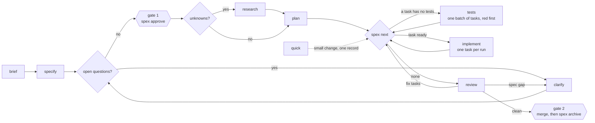

# spex

Spec-driven development in small, checkable files. A brief becomes EARS
requirements, the requirements become tasks sized for one agent run, and a
script — not the model — decides whether each step is done.

> **Status:** design v0.3 · 2026-11-05 · v1 built from this README. It replaces
> GitHub spec-kit in Dex and in any repo.
>
> **v0.3** answers the Dex 017 brief: a gate or `spex done` runs the check
> itself and never reads a file an agent could have written, and one `tests`
> run covers a batch of tasks, so a feature with N tasks costs N + ⌈N/K⌉ fresh
> agents, not 2N. See [What changed in v0.3](#what-changed-in-v03).
>
> **Sources studied:** spec-kit 1.3.1, BMAD Method (HEAD `022be931`), Superpowers
> 7.0.2, OpenSpec 1.16.0, and nex's own EARS format (`nex/platform/schemas/`,
> `nex/platform/nex/runner/spec_check.py`, ADR-001, ADR-018, ADR-020, ADR-044).
>
> **v0.2 closes the holes found in the v0.1 review:** approved text is frozen
> only on `main`; evidence is keyed by the working tree, not `HEAD`; every read
> has a cap; the quick path writes a record; the design has a home; a record
> keeps its `source`; pulls are allowed and counted; the script composes
> `verify`. The list is in [What changed in v0.2](#what-changed-in-v02).

```text
/spex:init                       # once per repo: writes specs/spex.yaml from what the repo already has
/spex:specify <brief>            # brief → specs/NNN-slug/requirements.yaml
/spex:clarify                    # open questions, one at a time, each with a recommended answer
spex approve specs/NNN-slug      # a person flips draft → approved (gate 1)
/spex:research                   # only when the spec lists unknowns
/spex:plan                       # requirements → tasks.yaml (approach, design, tasks)
/spex:tests                      # acceptance tests for the next batch of tasks; they must fail
/spex:implement T01              # one task per run, inside its paths
/spex:review                     # spec verdict, then quality verdict; fixes become tasks
spex archive specs/NNN-slug      # approved → built (after the merge, gate 2)
```

`/spex:*` are skills. `spex` is the bundled script (`scripts/spex.mjs`), which the
skills and Dex both call. In Claude Code the path is
`node ${CLAUDE_PLUGIN_ROOT}/scripts/spex.mjs`.

**Install** (Claude Code 2.1.275 or later, one step):

```text
/plugin install spex --marketplace lukaskellerstein/claude-my-marketplace
```

For `spex` on your `PATH` as well, run `npm link` in `plugins/spex/`. Dex does
not need that: it runs the script by its path (017, D-017-2).

## Why spex

spec-kit gives good results, but its cost grows with every fresh agent:

- **Big prompts.** Its nine core commands are 128 KB of prompt text. About 4 KB
  of each is extension-hook boilerplate (21 to 50 percent of a prompt), paid on
  every run even when no extension exists. `checklist` alone is 22 KB.
- **Expansion.** In Dex, the 24 KB brief of feature 015 became a 248 KB spec
  folder. Across features 007–015 the folder is 4 to 11 times the brief.
- **Read everything, every run.** `implement` reads `tasks.md` and `plan.md`,
  and `data-model.md`, `contracts/`, `research.md`, `constitution.md` and
  `quickstart.md` when they exist. In Dex they all exist. For Dex 015 that is
  186 KB (about 47k tokens) before any code is read. Dex starts a fresh agent
  per phase, and 015 has 12 phases. The same context is then sent again on
  every turn of every run.
- **Most of it is noise for the phase that runs.** Measured on Dex 015: each
  implement phase points at 5 to 41 KB of those 186 KB (its own tasks, the
  research sections, contracts, data-model sections and decisions it names).
  The mean is 22 KB. The tasks file already names what a phase needs — 25
  research pointers, 15 contract pointers, 8 decision pointers — but prose has
  no ids to slice by, so spec-kit loads the folder.
- **Prose that only a model can check.** `FR-006` sentences, acceptance
  scenarios hung off user stories instead of requirement ids, tasks that point
  at stories, and `analyze` matching tasks to requirements by id first and by
  keyword second. Gates live in prompt text. The model ticks its own `[X]`.

spec-kit's `presets/lean` cuts its five core prompts from 61.5 KB to 3.7 KB. That
fixes the prompt size, but not the prose specs, the model-graded gates, the
read-everything `implement`, or the per-agent `/speckit-*` syntax. spex keeps
what spec-kit does well — research, contracts, clarify, cross-checks — and moves
every check that a program can do into a program.

The saving has two mechanisms. The base context of a fresh agent drops from
about 47k tokens to about 5k, and that base is paid on every turn. And three
model runs — `analyze`, `checklist`, the constitution stage — become one script.
What can eat the saving: an uncapped `context` list, check-fix loops, and the
count of fresh agents, because every fresh agent pays its harness's own system
prompt. A feature with N tasks costs one `specify`, one `clarify`, one `plan`,
⌈N/K⌉ `tests` runs (K tasks per batch, capped by `limits.tests_scenarios`), N
`implement` runs and one `review`. All three have a limit in this design, and
the cost test measures all three.

## Design rules

These rules are what keep spex cheap. Each one names the failure it prevents.

1. **A run reads only its inputs, by default.** Every skill lists what it
   reads. `implement` reads `spex show <task>` (the task, its requirement
   records, the boundaries, the decisions and the design slice for its paths)
   and the files in the task's `context`. It may pull more by id — `spex show
   REQ-007-003`, `spex show --design`, `spex show --decisions` — and it lists
   every pull in its run report, so the cost test shows which pulls are
   frequent and `plan` learns to include them. *(spec-kit and OpenSpec `apply`
   read every artifact; BMAD's retired create-story said "when in doubt, LOAD
   IT".)*
2. **Records, not prose.** Anything a program checks is a YAML record with an
   id. *(OpenSpec's Markdown route needs 1,600 lines of parsers plus 3,100 of
   validation and merge, and still loses to new heading shapes; Superpowers
   fixed task-heading parsing again in 7.0.2.)*
3. **Rules live in code.** EARS shapes, banned words, coverage, file overlap,
   pointers and size limits are checked by `spex check`, not described in
   prompt prose. Every finding carries a `fix` text, and that text is the only
   place the rule is explained. A skill names the rule; it does not repeat it.
   *("LLMs miscount IDs and miss literal placeholders; a grep does not." —
   BMAD `lint_spine.py`.)*
4. **Gates run the check.** A stage starts only when `spex gate <stage>` exits
   0, and a task is done only when `spex done` exits 0. Both run the check at
   the moment they decide: `gate implement` runs the task's acceptance tests
   and needs them to fail, `done` runs every verify command and needs them to
   pass. Neither reads a file an agent could have written. `.spex/evidence/`
   holds records of runs, never the proof. No skill grades its own work.
5. **Small skills, no boilerplate.** Each `SKILL.md` is at most 6,000 bytes,
   and about 3,000 is the target. A test in this plugin enforces the cap. No
   hook tables, no personas, no routing tables in a skill: Dex or the person
   owns the order. *(Superpowers caps at 20,000 bytes because Claude Code
   truncates there; 6,000 is spex's own choice, so a skill re-attached after
   compaction — the first 5,000 tokens — is never cut.)*
6. **Nothing is always on.** Every skill has `disable-model-invocation: true`.
   Claude Code then keeps the description out of context until the skill is
   invoked. spex adds no bootstrap hook and no always-loaded text. A skill
   costs nothing until it is called. *(Superpowers' session-start bootstrap is
   3.6 KB, paid by every session.)*
7. **Decisions, not code, in the plan.** A task carries exact paths,
   signatures, named values and verify commands. It does not carry function
   bodies. *(Superpowers measured, on one report, plans that record decisions at
   about a third of the tokens of plans that carry code, with the same
   blind-judged quality.)*
8. **Closed questions with a default.** Every question lists options and marks
   one as recommended. With nobody to ask, the recommended answer is taken and
   recorded as `by: default`, so a person can review it later. `spex archive`
   prints every `by: default` answer, so gate 2 sees them.
9. **Portable text.** A skill names actions ("ask the user", "track your
   steps"), never one agent's tool names. The same `SKILL.md` then works in
   Claude Code, Codex and OpenCode. *(Superpowers: "Skills name actions, not
   tools.")*
10. **This README is for people.** No skill tells the agent to read it. If one
    did, every run would pay for the whole process again.

## The process



| Gate | Who | Passes when |
|:--|:--|:--|
| gate 1: `spex approve` | a person (or Dex policy) | `check` is clean and no question is open |
| `spex gate plan` | script | `check` is clean, every record is `approved`, every unknown has a decision |
| `spex gate tests [task…]` | script | `tasks.yaml` is clean and the batch's records are `approved` |
| `spex gate implement <task>` | script | every `depends_on` task is `done`, every scenario of the task has a test, and the gate's own run of those tests fails on an assertion (red first) |
| `spex done <task>` | script | its own run of every composed verify command passes, at that moment |
| `spex gate review` | script | every task is `done` |
| gate 2: merge, then `spex archive` | a person | review has no blocking finding, all tasks `done`, no question open |

After gate 1 the loop can still come back to `clarify`: research finds a
requirement wrong, or review finds a spec gap. On the feature branch that is an
edit: `clarify` changes the record and sets it back to `draft`, and gate 1 runs
again. `plan` and `tests` are then incremental — they add tasks and tests for
records that have none, and never rewrite a `done` task. A record is frozen only
once it is on `main` (see [Living requirements](#living-requirements)).

Small changes take the **quick** path: a bug or a change that touches one
interface, needs no data migration or other irreversible step, fits in about
three files, and leaves no open question. It writes a feature folder with one or
two records (a bug is an `unwanted-behavior` record with `source: bug`) and one
or two tasks, marked `quick:` in `tasks.yaml`. `spex check` enforces the three
facts. Gate 1 still runs; Dex policy may auto-approve a quick feature. Because
the quick path writes a record, `spex index` stays true. *(BMAD's docs route on
"intent gaps, irreversible actions, footprint"; nex ADR-020 caps XS at 3 files.)*

## Files

```text
specs/
├── spex.yaml                      config, written by /spex:init, edited by hand
└── 007-csv-export/
    ├── brief.md                   the person's text (or `brief:` points elsewhere)
    ├── requirements.yaml          EARS records + scenarios; gate 1 approves this
    ├── research.md                optional, for people; `unknowns[].ref` points into it
    ├── contracts/                 optional: OpenAPI, JSON Schema, CLI usage, IPC events
    └── tasks.yaml                 approach, design, one task record per agent run
.spex/                             gitignored work folder
├── evidence/007/T01.json          verify results, keyed by the working tree
├── runs/007/implement-T01.json    each run's status report
└── review/007-1.diff              the diff a reviewer reads
```

There is no `spec.md`, `plan.md`, `data-model.md`, `quickstart.md`, checklist
folder or constitution. Their jobs moved:

| spec-kit file | In spex |
|:--|:--|
| `spec.md` | `requirements.yaml` |
| `plan.md` | `approach`, `boundaries` and `design` at the top of `tasks.yaml` |
| `data-model.md` | `design.entities[]`, or a JSON Schema in `contracts/` |
| `quickstart.md` | the acceptance tests are the runnable checks |
| `checklists/` | `spex check` |
| `constitution.md` | the repo's `AGENTS.md` / `CLAUDE.md` and `specs/spex.yaml` |
| user stories | `goal`, and `brief.md` stays the narrative; every record points back with `source` |

### `requirements.yaml`

| Field | Meaning |
|:--|:--|
| `feature`, `slug`, `title` | `"007"`, `csv-export`, a short title |
| `brief` | path to the brief |
| `goal` | one or two sentences: what changes for whom |
| `out_of_scope` | what this feature does not do |
| `interfaces[]` | `id`, `kind` (`http-api`, `cli`, `ui`, `ipc`, `event`, `library`, `job`), optional `contract` path |
| `glossary` | term → meaning, for words the feature uses in a narrow sense |
| `questions[]` | for a person: `id`, `ask`, `why`, `options[]` (one `recommended`), then `answer` and `by` (`human` or `default`) |
| `unknowns[]` | for research: `id`, `ask`, then a one-line `decision` that keeps its "because", and a `ref` into `research.md` |
| `requirements[]` | the records below |

Each requirement record:

| Field | Meaning |
|:--|:--|
| `id` | `REQ-<feature>-<NNN>`, never renumbered |
| `type` | `ubiquitous`, `event-driven`, `state-driven`, `optional-feature`, `unwanted-behavior`, `complex` |
| `text` | one EARS sentence with one `shall` and one duty |
| `scope` | the capability it belongs to (`export`, `auth`); the living index groups by it; `spex.yaml` lists the known scopes |
| `applies_to` | interface ids |
| `verification` | `mode` (`isolated-interface` or `implementation-aware` + `rationale`), `method` (`test`, `property-test`, `measure`, `inspection` + `rationale`) |
| `acceptance[]` | `id`, `given`, `when`, `then` with real values; `measure` (`metric`, `operator`, `value`, `unit`, optional `percentile`) when the text has a number with a unit |
| `priority` | `must`, `should`, `could` |
| `status` | `draft` → `approved` → `built`, or `retired` |
| `source` | where it came from: `brief#L12`, `Q1`, `U1`, `assumption`, `review`, `bug` — a reviewer sees which records nobody asked for |
| `relationships[]` | `depends-on`, `related-to`, `conflicts-with`, `supersedes` + `target` id |
| `rationale` | why, when the reason is not obvious, or the assumption made |

```yaml
feature: "007"
slug: csv-export
title: Export open tasks as CSV
brief: specs/007-csv-export/brief.md
goal: Users move their open tasks into a spreadsheet without copying them by hand.
out_of_scope:
  - Import from CSV.
  - Export of finished tasks.
interfaces:
  - {id: cli, kind: cli, contract: specs/007-csv-export/contracts/cli.md}
questions:
  - id: Q1
    ask: Does the export include tasks from archived lists?
    why: It changes which rows the acceptance test expects.
    options:
      - {key: A, text: Active lists only, recommended: true}
      - {key: B, text: All lists}
    answer: A
    by: human
unknowns:
  - id: U1
    ask: Which library quotes RFC 4180 CSV in Node 20?
    decision: csv-stringify 6.x, because the repo already depends on it.
    ref: research.md#u1
requirements:
  - id: REQ-007-001
    type: event-driven
    text: When a user runs `todo export --csv`, the CLI shall write every open task of the active lists to stdout as RFC 4180 CSV.
    scope: export
    applies_to: [cli]
    verification: {mode: isolated-interface, method: test}
    acceptance:
      - id: AC-1
        given: active list "home" with open tasks "buy milk" and "fix tap, kitchen"
        when: the user runs `todo export --csv`
        then: 'stdout is `title,list`, `buy milk,home`, `"fix tap, kitchen",home` and the exit code is 0'
    priority: must
    status: approved
    source: brief#L4
  - id: REQ-007-002
    type: unwanted-behavior
    text: If the output file exists and `--force` is absent, then the CLI shall exit with code 3 without changing the file.
    scope: export
    applies_to: [cli]
    verification: {mode: isolated-interface, method: test}
    acceptance:
      - id: AC-1
        given: a file `out.csv` that contains "old"
        when: the user runs `todo export --csv -o out.csv`
        then: the exit code is 3 and `out.csv` still contains "old"
    priority: must
    status: approved
    source: Q1
```

### `tasks.yaml`

A spex task is **one agent run**: about the size of a spec-kit *phase*, not a
spec-kit task. Inside the run the agent keeps its own step list.

| Field | Meaning |
|:--|:--|
| `feature` | `"007"` |
| `approach` | at most `limits.approach_bytes`: the shape of the solution |
| `boundaries` | `always[]` and `never[]`: rules every task obeys |
| `design` | `modules[]` (`id` M1, `path`, `role`), `entities[]` (`id` E1, `name`, `fields[]` or `schema` path), `decisions[]` (`id` D1, `text`, `why`) — the part of `plan.md` and `data-model.md` that tasks need |
| `quick` | only on the quick path: `reason` |
| `deferred[]` | review findings a person chose to leave for later |
| `tasks[]` | the records below |

Each task record:

| Field | Meaning |
|:--|:--|
| `id`, `title` | `T01`, one line |
| `kind` | `setup`, `foundational`, `story`, `polish`, `fix` |
| `requirements` | the ids this task makes true |
| `depends_on`, `parallel_group` | order; tasks in one group must have disjoint `paths`, and never read a sibling's `paths` |
| `paths` | the files it may write — the write allowlist |
| `context` | the files it reads, as `path` or `path:from-to`; the total is capped by `limits.context_kb` |
| `design` | ids of design entities and decisions this task needs; modules are matched by path on their own |
| `interfaces` | `consumes[]` and `produces[]`: exact signatures shared with other tasks; every `consumes` must be a `produces` of a task it depends on |
| `instructions` | at most `limits.instructions_bytes`: decisions, quoted constraints, one name per value. Every file or id it names must be in `context`, `paths`, `design` or `requirements` |
| `verify` | extra shell commands; the script already runs `fast_checks` and the acceptance tests of the task's ids |
| `done_when` | one observable sentence |
| `source` | on `fix` tasks: the review finding it answers |
| `status` | `todo`, `done`, `blocked` — written only by `spex done` and `spex block` |

```yaml
feature: "007"
approach: |
  Add an `export` subcommand next to `list` in src/cli/commands/. Read tasks
  through TaskStore.openTasks() and format them with csv-stringify (U1). Write
  to stdout, or to -o after an existence check that runs before any write.
boundaries:
  always:
    - Read tasks through TaskStore; never open the database file directly.
  never:
    - Change the TaskStore API.
design:
  modules:
    - id: M1
      path: src/cli/commands/export.ts
      role: the export subcommand and its CSV formatting
  decisions:
    - id: D1
      text: Rows follow list order, then task order.
      why: The brief shows the spreadsheet grouped by list.
tasks:
  - id: T01
    title: "`todo export --csv` writes open tasks to stdout"
    kind: story
    requirements: [REQ-007-001]
    paths: [src/cli/commands/export.ts, src/cli/index.ts, tests/unit/export.test.ts]
    context: [src/cli/commands/list.ts, "src/store/TaskStore.ts:40-90"]
    design: [D1]
    interfaces:
      produces: ["exportCsv(store: TaskStore, out: Writable): Promise<number>"]
    instructions: |
      The header row is exactly `title,list`. Row order is D1. Use
      csv-stringify defaults for quoting.
    done_when: The REQ-007-001 acceptance test passes.
    status: todo
  - id: T02
    title: "`-o` refuses to overwrite without `--force`"
    kind: story
    requirements: [REQ-007-002]
    depends_on: [T01]
    paths: [src/cli/commands/export.ts, src/cli/exit.ts, tests/unit/export.test.ts]
    context: [src/cli/commands/export.ts, src/cli/exit.ts]
    interfaces:
      consumes: ["exportCsv(store: TaskStore, out: Writable): Promise<number>"]
    instructions: |
      Add `OutputExists = 3` to ExitCode in src/cli/exit.ts. Check that the file
      exists before opening it for writing.
    done_when: The REQ-007-002 acceptance test passes.
    status: todo
```

### `research.md` and `contracts/`

`research.md` has one section per unknown: the question, the options, the
decision, why, and the sources. It is for people. `/spex:research` copies each
decision as one line, with its "because", into `unknowns[].decision`, so `plan`
and `implement` read the decision without reading the research. The rejected
options stay out of the context on purpose: a model with the whole research
file in front of it can pick a rejected option. `implement` may follow
`unknowns[].ref` when it hits a surprise. *(spec-kit plan phase 0: Decision /
Rationale / Alternatives.)*

`contracts/` exists only when the feature has an interface that other code or
people call. `plan` writes or updates the contract. `tests` reads it.
`implement` reads it only when it is in the task's `context`.

### `specs/spex.yaml`

```yaml
acceptance_dir: tests/acceptance
acceptance_cmd: npm run test:acceptance -- -t "{ids}"   # {ids} = REQ_007_001|REQ_007_002; {ids_k} = "A or B" for pytest
fast_checks: [npm run typecheck, npm test]
source_dirs: [src]                  # /spex:tests never reads these
protected: [specs/, tests/acceptance/, .github/]
scopes: [export, auth]              # known capabilities; a new scope is a warning
banned_words: []                    # added to the built-in list
limits:
  task_files: 12
  instructions_bytes: 1500
  approach_bytes: 1200
  context_kb: 24
  diff_kb: 120
  file_kb: 40
  tests_scenarios: 12                # scenarios one /spex:tests run covers; one batch is one fresh agent
review_rounds: 3
```

`spex init` fills this from what the repo already has — `package.json`
scripts, `pyproject.toml`, `go.mod`, the test folders. It never asks what a
scan can answer, and it writes no project documentation. *(BMAD retired its
documentation generator as "large, unverified, stale on arrival".)*

### Ids and test names

`REQ-007-002`, `REQ-007-002/AC-1`, `T02`, `Q1`, `U1`, `M1`, `E1`, `D1`. An
acceptance test carries the ids in its name — `REQ_007_002_AC_1_refuses_overwrite`
— so `spex coverage` finds the test for each scenario with a search, and no
mapping file exists to drift.

## Skills

Every skill ends with a reply of at most 15 lines. The first line is
`STATUS: done | concerns | blocked | needs-context | too-big`. The same status
goes to `.spex/runs/<feature>/<stage>[-<task>].json` as
`{status, summary, concerns[], questions[], files_changed[], pulled[]}`. Dex
reads the file, not the prose. *(Superpowers' four statuses plus `too-big` from
nex; BMAD's status in plan frontmatter.)*

| Skill | Reads | Writes | Target size |
|:--|:--|:--|:--|
| `init` | the `spex init` scan | `specs/spex.yaml` | 2 KB |
| `specify` | the brief, `spex index --scope`, named contracts | `requirements.yaml` | 4 KB |
| `clarify` | `requirements.yaml` | answers, edited records back to `draft` | 3 KB |
| `research` | `unknowns[]`, targeted code and web | `research.md`, `unknowns[].decision` | 3 KB |
| `plan` | `requirements.yaml`, targeted code | `tasks.yaml`, `contracts/` | 4 KB |
| `tests` | `spex show --tests [task…]` (one batch), contracts, existing acceptance tests | tests in `acceptance_dir` | 3 KB |
| `implement` | `spex show <task>`, the task's `context`, its acceptance tests | code inside `paths` | 3 KB |
| `review` | `spex show --review`, the diff file | fix tasks, questions, `deferred[]` | 4 KB |
| `quick` | the bug report, the code around it | a one-record feature folder, a regression test | 3 KB |
| `sync` | the diff since the spec, `requirements.yaml`, `tasks.yaml` | updated records | 3 KB |
| `archive` | — | runs `spex archive` and reports | 1 KB |

### `specify`

Turns a brief into `requirements.yaml` with every record at `status: draft`.

- One EARS sentence per record, about an interface, never about internals.
  "The CLI shall exit with code 3" is right. "ExportService shall call the
  validator" is wrong.
- Every record has at least one scenario with real values: a list name, a count,
  an exit code.
- Every record has a `source`. Where the brief is silent: make the smallest
  sensible assumption, write `source: assumption` and the reason in
  `rationale`. If the assumption changes money, law, data retention or
  security, add a question instead.
- A brief that already carries decisions (Dex briefs do, as `D-015-n`) keeps
  them: they become `unknowns[]` with a `decision` already filled, or
  `rationale` on the records they shaped. Nothing is asked twice.
- Technical questions that a person need not answer go to `unknowns`, not
  `questions`.
- Reads related live requirements through `spex index --scope <scope>` — a few
  records, not other feature folders. A contradiction becomes a `conflicts-with`
  relationship; a person decides which feature wins.
- Runs `spex check` and fixes every error before it stops. At most three
  rounds; then it reports `concerns` with the findings left.

### `clarify`

Resolves `questions[]`. *(spec-kit clarify; Superpowers brainstorming.)*

- At most 5 questions per run, picked by impact × uncertainty, asked one at a
  time.
- Each question has 2 to 5 options, one marked recommended, and one line on why
  it matters.
- If the brief does not say *why* the feature exists, that is the first
  question.
- Asks only when the answer changes what gets built. Otherwise it states its
  call as an assumption in `rationale`.
- With nobody to ask (Dex auto mode), it takes the recommended option and writes
  `by: default`.
- An answer that changes an `approved` record edits the record and sets it back
  to `draft`. Gate 1 runs again. A record that is already on `main` is not
  edited: a new record with `supersedes` takes its place.
- Scan list for gaps: scope, users and roles, data and its lifetime, interfaces,
  errors and rare cases, numbers (latency, size, limits), security and privacy,
  dependencies, out of scope, terms.

### `research`

Runs only when `unknowns[]` has entries without a decision. One section per
unknown in `research.md`; one line per decision, with its "because", back into
`requirements.yaml`. It changes no requirement. If research shows a requirement
is wrong, it adds a question.

### `plan`

Turns approved requirements into `tasks.yaml`. *(nex plan; BMAD story specs;
Superpowers writing-plans; spec-kit tasks.)*

- Starts with `spex gate plan`.
- Writes `approach`, `boundaries` and `design` first. Every module a task will
  create gets an `M` entry, every shared data shape an `E` entry, every
  decision that more than one task relies on a `D` entry.
- A task fits one agent run within `limits`. Split, never shrink: when a task
  does not fit, make two tasks, and never drop scope.
- Order: setup, foundational (schema, models, contracts), stories, polish.
- Names every value a scenario needs and the code lacks, once, in
  `instructions` (`GIFT-2EUR = 200 cents`), so the test author and the
  implementer use the same name.
- Signatures and assertions, not function bodies. A signature a later task
  needs goes in `produces`; the later task lists it in `consumes`.
- Incremental on a second run: adds tasks for records without one, never
  rewrites a `done` task.
- Runs `spex check` until it is clean; coverage gaps count as errors.

### `tests`

Writes the acceptance tests for a batch of tasks before their code exists.
*(nex test-author; Dex 016; Superpowers TDD.)*

- One run covers a batch: the tasks in plan order that still have no test,
  until `limits.tests_scenarios` scenarios (12 by default). `spex show --tests`
  with no task picks it; with task ids it takes those. A feature with N tasks
  needs ⌈N/K⌉ runs, not N.
- Starts with `spex gate tests [task…]`, then reads the show output: the
  batch's records and scenarios, the feature `goal`, each task's names from
  `instructions`, and the tests to retire for records this feature supersedes.
- Never reads `source_dirs`. It reads contracts and existing acceptance tests
  for the conventions.
- Maps each EARS shape to a test shape. Event-driven: cause the trigger, observe
  the response. Unwanted behavior: cause the failure, assert the handling and
  that nothing else happened. Optional feature: run with the feature on and off.
  `property-test`: a property over generated inputs.
- Each scenario becomes at least one test with the scenario's real values and
  its ids in the name.
- Ends with one `spex run <task> --expect fail` per task in the batch. A test
  that passes before the feature exists is a bug in the test. A test that
  crashes instead of failing is also a bug in the test: the run must mention
  the test's ids. `spex gate implement` runs the same check again by itself
  when the task starts, so a test that turned green in between is caught.
- With `--fix REQ-007-002/AC-1` (from a review `test-bug` finding or an
  implementer's `concerns`), it rewrites that one test and runs red again.

### `implement`

Makes one task's acceptance tests pass.

- Starts with `spex gate implement <task>`, then reads `spex show <task>`
  (about 1–3 KB) and the files in `context`. Nothing else from `specs/` by
  default. When it needs more, it pulls by id and lists the pull in `pulled[]`.
- Writes only inside `paths`. Never edits `protected` paths or acceptance tests.
  If a test looks wrong, it says why in `concerns`, with the exact assertion,
  and stops with `STATUS: blocked`.
- No production code without a failing test first. The acceptance tests are the
  outer loop; its own unit tests are the inner loop.
- `spex run <task>` is its loop. Then `spex done <task>`, which runs every
  verify command again by itself and flips the status only on a pass at that
  moment. Nothing the agent wrote under `.spex/` counts.
- `too-big` when the task cannot fit in `paths` and `limits`: it says how to
  split and stops. It never does half.

### `review`

Checks the whole feature after the last task. One reviewer, two verdicts, read
only. *(Superpowers' merged reviewer; BMAD's routed triage; spec-kit converge.)*

1. **Spec verdict** per requirement: `met`, `partial`, `missing`,
   `contradicts`, `cannot-verify`, plus `unrequested` for changes no requirement
   asked for.
2. **Quality verdict:** blocking findings only.

- Reads `spex show --review` and the diff file `.spex/review/<feature>-<n>.diff`.
  When the diff is over `limits.diff_kb`, `spex show --review --task T03`
  slices it by one task's `paths`, and the review runs per task.
- It does not explore the codebase or rerun the tests: `spex run` already did.
- The implementer's report is a claim, not evidence. When the diff cannot show
  something, the verdict is `cannot-verify`, not `met`.
- Each finding is routed. A `patch` appends a `kind: fix` task with `source`.
  A `spec-gap` adds a question to `requirements.yaml`. A `test-bug` names the
  scenario for `/spex:tests --fix`. A `defer` goes to `deferred[]` after a
  person agrees.
- Append only. If nothing is found, `tasks.yaml` stays byte for byte the same.
- At most `review_rounds` rounds; then it stops for a person.

### `quick`

The small-change path. Find the root cause first, then write a feature folder
with one record (`source: bug` for a bug), one or two tasks under `quick:`, and
a regression test that fails before the fix. If the change fails any quick-path
condition, `spex check` says so and the skill points to `specify`.

### `sync`

Brings the spec back in line after hand changes. It replaces
`dev-tools-plugin:sync-spec-kit`. On the branch it edits records and sets them
back to `draft`. It never changes the meaning of a record that is on `main`: a
new meaning is a new record that `supersedes` the old one.

### `init` and `archive`

`init` runs `spex init`, shows the person what the scan found, and fixes the
guesses the scan got wrong. `archive` is a thin wrapper around `spex archive`.

## The script: `spex`

`scripts/spex.mjs` is one bundled file. Node 20 or newer is its only runtime
need. The source is TypeScript under `src/`, bundled with esbuild together with
its YAML parser (`yaml`, core schema, so `no` and dates stay strings) and its
JSON Schema validator (`ajv`), so the plugin works with no install step.

| Command | Does |
|:--|:--|
| `spex init` | scans the repo, writes `specs/spex.yaml`, adds `.spex/` to `.gitignore` |
| `spex new <slug> [--brief <file>]` | creates `specs/<next NNN>-<slug>/`; the next number also counts branch names |
| `spex check [dir…] [--base <ref>]` | every rule below; `--base` adds the frozen-text check against a git ref |
| `spex approve <dir>` | `draft` → `approved`; refuses while `check` fails or a question is open |
| `spex gate <stage> <dir> [task…]` | the stage preconditions from the gate table; `implement` runs the red check itself |
| `spex show <dir> <task>` | the whole spec input of one implement run |
| `spex show <dir> --tests [task…]` | the scenarios, names and tests to retire for the named tasks, or for the next batch: tasks without tests, up to `limits.tests_scenarios` |
| `spex show <dir> --review [--task T]` | requirements, tasks and the diff file path; writes the diff |
| `spex show <dir> REQ-id` / `--design` / `--decisions` | the pulls |
| `spex next <dir>` | the next task whose dependencies are done |
| `spex run <dir> <task> [--expect fail]` | the agent's loop: composes and runs the verify commands, writes the record under `.spex/evidence/` |
| `spex run <dir> --all` | the whole feature's checks: `fast_checks` plus every live requirement's acceptance tests, for the verify stage |
| `spex done <dir> <task>` / `spex block <dir> <task>` | `done` runs every verify command itself and writes `status: done` only on a pass; `block` writes `blocked` |
| `spex coverage <dir>` | scenarios with no test in `acceptance_dir` |
| `spex index [--scope s]` | the live requirements across `specs/`: `approved` and `built`, not `retired` |
| `spex archive <dir>` | `approved` → `built`; records named by `supersedes` → `retired`; prints `by: default` answers; refuses with open tasks |

Every command takes `--json` and then prints one document:
`{ok, command, findings: [{severity, code, message, fix, path, id}], ...}`.
Exit codes: `0` ok, `2` usage, `4` invalid spec, `5` coverage gap, `6` gate
refused, `7` verify failed. *(OpenSpec's agent contract; nex's exit codes.)*

**Records, not proof.** Every run writes `.spex/evidence/<feature>/<name>.json`
and `.log`: the commands, their exit codes and tails, and the tree id (`HEAD`
plus a hash of `git diff HEAD` and of every untracked, unignored file). A gate
or `done` never reads a record; it runs the check again at the moment it
decides. So an agent that writes or edits a record forges nothing, and Dex
needs no second run of its own: `spex done` is the second run.

### Rules

Each rule has a code. `error` blocks a gate; `warning` does not. Requirements:

| Code | Severity | Rule |
|:--|:--|:--|
| `REQ-YAML` | error | the file parses and is a mapping |
| `REQ-SCHEMA` | error | the file matches the schema: fields, enums, id formats |
| `REQ-ID` | error | ids are unique and well formed |
| `REQ-EARS` | error | `text` matches its EARS shape and contains ` shall ` |
| `REQ-UBIQ-COND` | error | a `ubiquitous` sentence has no `if`, `when`, `whenever`, `while`, `unless` |
| `REQ-ONE-SHALL` | warning | exactly one `shall` (v1 warns; the cost test measures false positives before it errs) |
| `REQ-ONE-DUTY` | warning | the clause after `shall` has no top-level `and`, `or`, `except` outside quotes and backticks |
| `REQ-BANNED` | error | no banned words: fast, quick, robust, user-friendly, intuitive, appropriate, adequate, easy, gracefully, as needed, etc, plus `banned_words` |
| `REQ-MEASURE` | error | a number with a unit in `text` needs a `measure` on one scenario |
| `REQ-SCENARIO` | error | every record has a scenario; `given`, `when`, `then` are not empty, and `then` has at least 12 characters |
| `REQ-PLACEHOLDER` | error | no `TODO`, `TBD`, `TKTK`, `???`, `NEEDS CLARIFICATION`, `<…>` |
| `REQ-REL-TARGET` | error | relationship targets exist (other features through the index, on disk or on a branch) |
| `REQ-IMPL-RATIONALE` | error | `implementation-aware` and `inspection` need a `rationale` |
| `REQ-INTERFACE` | error | `applies_to` names declared interfaces; contract files exist |
| `REQ-SCOPE` | warning | `scope` is in `spex.yaml` `scopes[]` when that list is not empty |
| `REQ-FROZEN` | error | with `--base`: a record that exists at the ref as `approved` or `built` has the same `text` and `acceptance` |
| `REQ-SUPERSEDE-DUP` | error | two features do not both supersede the same record |
| `REQ-QUESTION-OPEN` | info | a question has no answer (blocks `approve`) |

Tasks:

| Code | Severity | Rule |
|:--|:--|:--|
| `TASK-SCHEMA` | error | the file matches the schema; ids are unique |
| `TASK-DEP` | error | `depends_on` targets exist and form no cycle |
| `TASK-REQ` | error | every task names a requirement that exists |
| `TASK-COVERAGE` | gap | every requirement that is not `retired` is covered by a task (exit 5) |
| `TASK-PROTECTED` | error | no `paths` entry is under `protected` |
| `TASK-PARALLEL` | error | tasks in one `parallel_group` have disjoint `paths`, globs included, and no `context` inside a sibling's `paths` |
| `TASK-CONTEXT` | error | every `context` file exists, or is in the `paths` of a task this one depends on; a line range is inside the file; the total is under `limits.context_kb` |
| `TASK-DONE-WHEN` | error | `done_when` is not empty |
| `TASK-LIMITS` | error | `paths`, `instructions` and `approach` stay inside `limits` |
| `TASK-POINTER` | warning | every file or id that `instructions` names is in `context`, `paths`, `design`, `requirements`, or is a known record id |
| `TASK-CONSUMES` | warning | every `consumes` signature is a `produces` of a task it depends on |
| `TASK-DESIGN` | error | `design` ids exist in the `design` block |
| `TASK-QUICK` | error | with `quick:` — at most 2 tasks, at most 3 distinct paths, no open question, no unknown |
| `TEST-STALE` | warning | no test in `acceptance_dir` still carries the id of a record this feature supersedes |
| `FILE-SIZE` | warning | `requirements.yaml` or `tasks.yaml` above `limits.file_kb`: a spec that big is two features |

What only a model can judge stays with a model: whether two requirements
conflict in meaning, which rare cases are missing, and whether the design fits
the repo. `clarify` and `review` carry those.

## Living requirements

OpenSpec keeps the current truth in one spec per capability and merges each
change's deltas into it at archive. Its merge code now refuses to drop a
scenario, but its own `/opsx:sync` and `/opsx:archive` skills have the model
edit the specs and `mv` the folder instead of calling it, and two parallel edits
of one requirement end with the last archive winning.

spex avoids the merge altogether:

- **A record is frozen once it is on `main`.** On the feature branch, `clarify`
  and `sync` edit it and set it back to `draft`. After the merge, a new
  behavior is a new record with `supersedes`. `spex check --base main`
  enforces exactly that line. *(nex edits approved records in place in a spec
  PR, ADR-018 and ADR-012; spex does the same before the merge.)*
- **Feature folders stay where they are.** They are the history, with their
  provenance.
- **The current truth is computed.** `spex index --scope export` prints the live
  records for one capability. `specify` reads that, a few records, instead of
  other folders.
- **Conflicts are found before the merge.** Two open features that supersede the
  same record fail `spex check`. `spex index` looks at local and remote
  branches named `NNN-*`, so an open feature on another branch counts.
- **A superseded record keeps its test until the superseding feature retires
  it.** `spex show --tests` lists the tests to retire; `TEST-STALE` warns while
  one is left.

## Agents

- **Claude Code (v1):** `.claude-plugin/plugin.json`. Install it from this
  marketplace at project scope. The skills appear as `/spex:<name>`.
- **Codex (later):** `.codex-plugin/plugin.json` with `"skills": "./skills/"`.
  Codex picks skills by their descriptions, so it needs no hook.
- **OpenCode (later):** it loads no Claude plugin, but it reads `SKILL.md` from
  `.agents/skills/` and `.claude/skills/`. A link script places the skills
  there and puts a `spex` wrapper on `PATH`.

The later two come with Dex's any-agent spec. The skill text is portable from the
start (rule 9), so adding them is delivery work, not a rewrite.

## Use from Dex

Dex owns the order and the branches; spex owns the files, the checks and the
stage instructions.

| Dex stage | spex |
|:--|:--|
| new queue entry | `spex new <slug> --brief <file>` |
| `specify` | `/spex:specify` |
| `clarify` | `/spex:clarify` in auto mode, when questions are open |
| `research` | `/spex:research`, when unknowns are open |
| `plan` | `/spex:plan` |
| `tests` (Dex 016) | `/spex:tests` for the batch `spex show --tests` picks, when a todo task has no test |
| `implement` | `/spex:implement <task>`, one run per task; then Dex runs `spex done <task>` itself, one command that runs the checks and flips the status |
| `verify` | `spex run --all`, then `/spex:review`; fix tasks loop back to `implement` |
| done | `spex archive` after the merge |

- Dex calls `spex gate` and `spex done` itself, in its own process. Both run
  the checks at that moment, so no agent can skip them, no agent-written file
  is trusted, and Dex needs no run of its own on top. The `--json` output is
  Dex's evidence.
- Dex reads `.spex/runs/*.json` for status, concerns, questions and pulls.
- The Dex `constitution` stage goes away.
- The adoption work — prompts, the prerequisites check, `parser.ts` and the task
  board reading `tasks.yaml` — is Dex spec 017.

## Where each idea comes from

| Idea | From |
|:--|:--|
| EARS records with scenarios, the checker rules, test-author and implementer as separate runs, write allowlists, named values, exit codes | nex (ADR-001, ADR-018, `spec_check.py`, `plan.md`, `test-author.md`) |
| Question budget, recommended option, defaults when nobody can answer, research as Decision / Rationale / Alternatives, contracts only for real interfaces, append-only convergence | spec-kit (`clarify`, `checklist`, `plan`, `converge`) |
| Status read from a file, compiled per-task context (`compile-epic-context`, since retired), routed review triage, the quick path on three facts, scripts for mechanics and models for judgment | BMAD (`bmad-build`, docs/build, `lint_spine.py`) |
| One task per fresh agent with files handed over, one reviewer with two verdicts, "treat the report as unverified claims", decisions not code in plans, a scripted done gate (`executing-plans/scripts/task-done`), a skill size cap, portable skill text | Superpowers (`subagent-driven-development`, `writing-plans`, `executing-plans`, `test-skill-size.sh`, porting guide) |
| Living truth per capability, validation before archive, a JSON agent contract, explicit intent markers (`quick`) | OpenSpec (`specs-apply.ts`, `validator.ts`, `docs/agent-contract.md`) |

## Left out

| Left out | Why |
|:--|:--|
| Constitution | `AGENTS.md`, `CLAUDE.md` and `specs/spex.yaml` already cover it; one more always-read file costs every run |
| Personas (BMAD) | Dex owns the stages; BMAD's activation boilerplate is about 5 KB per skill |
| Session-start bootstrap (Superpowers) | paid by every session; spex skills cost nothing until called |
| Extension hooks in prompts (spec-kit) | about 4 KB per command; mandatory hooks run only if the model obeys |
| Markdown as the machine format (OpenSpec) | thousands of lines of parsing that still break |
| Model-run merge of living specs (OpenSpec skills) | computed index and frozen-on-main records instead |
| `taskstoissues`, git skills | Dex and the person own branches and trackers |
| Generated project docs (BMAD `document-project`) | stale on arrival; `spex index` and the code are the truth |
| User stories as a file section | the brief is the narrative; records point back with `source` |

## Build plan for v1

1. **`spex.mjs`, the schemas, and the rule tests.** Port the nex rules, then add
   the rest. Fixtures: the example above as a valid spec, nex `FEAT-142`
   converted to this format, and one broken copy per rule, each failing with its
   own finding code.
2. **The core skills:** `specify`, `clarify`, `plan`, `implement`. Then `tests`,
   `review`, `quick`, `research`, `sync`, `init`, `archive`.
3. **The size test:** every `SKILL.md` at most 6,000 bytes.
4. **The cost test.** On a scratch clone of `dex-ecommerce`, run one brief
   through spec-kit and through spex. Compare input tokens with cache reads
   counted, the number of fresh agents, turns per run, `spex check` rounds,
   pulls per implement run, and the acceptance result. Convert Dex 015 (49
   records) as a second fixture: FEAT-142 has 8 records, and the big case is
   the one that matters.
5. **Register** the plugin in `.claude-plugin/marketplace.json` and the
   marketplace README, and bump the version.

Definition of done:

- [x] `spex check` passes the valid fixtures and fails each broken copy with the
  expected finding code.
- [x] `spex done` refuses without passing evidence for the current tree.
- [x] Every `SKILL.md` is at most 6,000 bytes.
- [ ] The cost test shows spex below spec-kit at the same acceptance result, and
  the numbers are written down.
- [ ] One feature runs end to end on Claude Code, with no skill reading this
  README.

## What changed in v0.2

| Hole in v0.1 | v0.2 |
|:--|:--|
| "A record never changes after approval" broke the clarify, research and review loops | frozen only on `main`; on the branch, edits set the record back to `draft` |
| evidence keyed by `HEAD`, which never moves while implement works | keyed by `HEAD` plus a hash of the working tree |
| `context`, the review diff and the `tests` run had no cap | `limits.context_kb`, `limits.diff_kb`, `tests` per batch (`limits.tests_scenarios`, v0.3) |
| `skip_spec` let the living index drift | the quick path writes one record |
| no home for the design and the data model | `design` block in `tasks.yaml`, sliced by `spex show` |
| a record superseded by an open feature still needed a passing test | `show --tests` lists the tests to retire; `TEST-STALE` warns |
| a wrong acceptance test had no fix path | review `test-bug` → `/spex:tests --fix` |
| records had no provenance | `source` on every record |
| `verify` repeated `spex.yaml` | the script composes it; `verify` is extras only |
| `scope` was free text | `scopes[]` in `spex.yaml`, `REQ-SCOPE` warns |
| line limits, easy to game | byte limits |
| one-shall and one-duty as errors with no measurement | warnings in v1 |
| `--expect fail` could not tell a crash from a failure | the run must mention the test ids |
| `NNN` collided across branches | `spex new` counts branch names |
| rule 1 forbade reading more | pulls by id, listed in `pulled[]` |
| no check that `instructions` pointers are loadable | `TASK-POINTER`, `TASK-CONSUMES` |
| wrong attributions (Superpowers' gate, BMAD's retired scripts, OpenSpec's line count, an outside token test with no source) | corrected; the outside test is gone, the Dex per-phase measurement replaces it |

## What changed in v0.3

The Dex 017 brief (`dex/docs/my-specs/017-dex-runs-on-spex`) took two of its
defaults from gaps in v0.2. Both are closed here, so the brief can drop them.

| Hole in v0.2 | v0.3 |
|:--|:--|
| `gate implement` and `done` read evidence files, which an agent with a shell can write; Dex had to run `spex run` and `spex done` a second time (017 default 6) | a gate or `done` runs the check itself at the moment it decides; records are logs, never proof; `spex done` is Dex's second run |
| the red-first gate needed a `tests` *run* per task, so N tasks cost 2N fresh agents (017 default 1: "20 instead of 11") | the gate needs red *tests*, which it checks itself; `tests` covers a batch of tasks up to `limits.tests_scenarios`, so N tasks cost N + ⌈N/K⌉ agents |
| no whole-feature run for the verify stage | `spex run <dir> --all` |
| no `spex` on `PATH` | a `bin` entry: `npm link` in the plugin folder, or `npm i -g` |

## Open questions

- **The batch size.** `tests_scenarios: 12` is a guess: about four tasks of
  three scenarios. The cost test measures the agent count and the turns per
  tests run; the right cap is where one run stays under about 60 turns.
- **YAML or JSON for the two files.** YAML, loaded with the core schema, so the
  implicit-type risk is gone except for `"007"`, which the schema demands as a
  string. The one trap left is a flow mapping (`{id: D1, text: a, b}`) whose
  value holds a comma: the skills write block style and quote any value with a
  comma or a colon. v2 may add `spex add --stdin` so the model never writes
  YAML by hand.
- **The three-readings ambiguity check** (nex ADR-018: three cheap runs read one
  record, a program compares the readings). Valuable, but it costs three runs per
  record. v2.
- **Where Dex keeps its briefs:** `docs/my-specs/NNN/README.md` as now, or
  `specs/NNN-slug/brief.md`. `brief:` accepts either.
- **`fast_checks` here and `checks` in Dex's `policy.json`** say the same thing
  twice. Dex 017 decides which one wins.
- **`built` and `retired` as stored or derived.** Stored for now, so a person
  reads the file and knows. Deriving them from `main` would remove the
  post-merge commit that `archive` makes.
