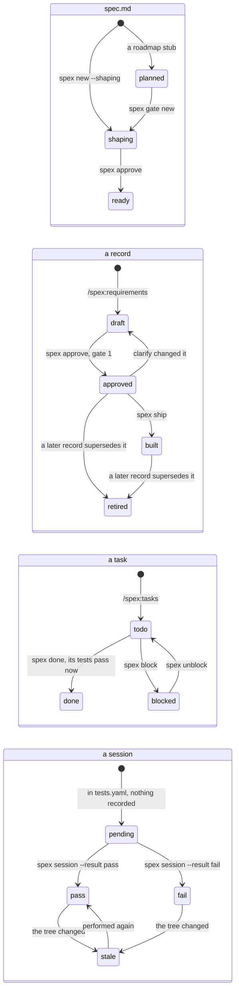
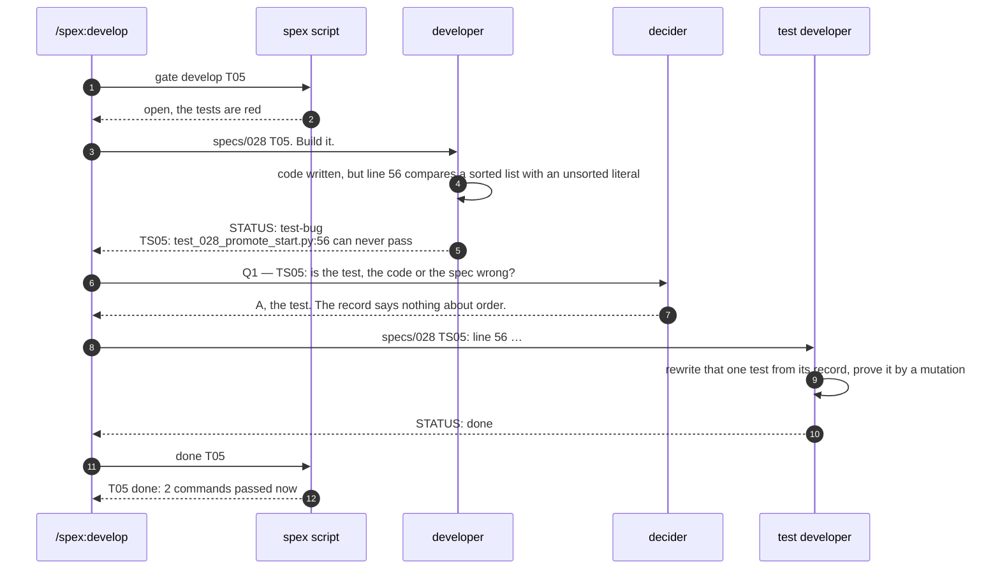

# spex

Spec-driven development in small, checkable files. A raw idea is shaped into a
spec in words, the spec becomes EARS requirement records, the records become
tasks sized for one agent run, a test analyst writes the proof plan for every
claim, and a script — not the model — decides whether each step is done. The
one who writes a claim never writes its proof.

> **Proposed: spex 3.0, four commands.** [`README.html`](README.html) is the
> design of the next version, not built yet: `new` splits an idea into specs
> and keeps every detail of it, `plan` turns one note into the full spec, the
> requirements, the tasks and the test plan, `implement` writes the tests red,
> builds and proves the spec, and `review` reads the diff and closes the spec.
> There is no `approve`: the next command is the approval. The page lists every
> case that can happen, each with its way out. Everything below this note
> describes spex 2.2, which is what the code does today. This file is rewritten
> when 3.0 is built.
>
> **Status:** spex 2.2.0 · 2026-11-09 · data format 2. It replaces GitHub
> spec-kit in Dex and in any repo.
>
> **v2.2** makes a roadmap leave no gap. Round 0 of `/spex:new` cuts the
> steps from the design's own sections (`spex outline`), and one file,
> `specs/<name>.roadmap.md`, gives every section a row: the steps that build
> it, or built, not planned, outside or context, with the reason. `spex roadmap
> <name> --coverage` fails on a section with no row. Each stub carries every
> name its sections fix, tagged `[new]`, `[built: …]` or `[changes: …]`, and
> its Uses and Introduces lines, so `spex check` finds a missing dependency
> (`USES-DEPENDS`). A `roadmap-reviewer` subagent reads every 10 stubs
> against the design before the person sees them, and every Open question
> ends with a pick. A re-cut keeps, changes, adds and drops steps, and `spex
> drop` keeps a dropped step's work. A feature can write more than one git
> repo (`repos` in the config, `repo:` on a task or a driver). See [What
> changed in v2.2](#what-changed-in-v22).
>
> **v2.1** makes review end. Every finding of a round comes at once, worst
> first, each with a severity (P1 to nit), the finder's fix plan and a pick;
> the person answers in one word (`ok`, or `2=defer`), and `spex review accept`
> turns the fix picks into fix tasks that need no second approval. `/spex:fix`
> builds them in one run (tests, code, verify), and a later round only checks
> those fixes. Deferring ends the rounds, so ship always has a way in. See
> [What changed in v2.1](#what-changed-in-v21).
>
> **v2.0** puts a wall through the process: the analyst writes the claim (a
> record with its scenarios, a task with its `done_when`), a `test-analyst`
> subagent writes its proof in a new file, `tests.yaml`, `test-developer`
> subagents write the scripts red before any code, `developer` subagents build,
> `tester` subagents perform the sessions no script can run (a browser through
> the bundled Playwright MCP, an API), and the `decider` judges every failing
> test as test, code or spec. Seven phases: analyze, plan, test-develop,
> develop, verify, review, ship. A new `verify` stage proves the whole feature
> at the tree that ships; `ship` merges through `ship.cmd` with no click. No
> task and no test may name a person as an actor (`TASK-PERSON`,
> `TEST-PERSON`); a real system a test writes needs the one-time yes in
> `live[]`; a token or a running system is a `needs[]` the gate checks; a test
> that skips is neither red nor green. `implement` is now `develop`, `archive`
> is folded into `ship`, `quick` and `sync` are gone. `spex update` migrates a
> repo from format 1. See [What changed in v2.0](#what-changed-in-v20).
>
> **Before that:** v0.9 made a wrong test the process's to fix; v0.8 added auto
> mode and the decider; v0.7 made `/spex:new` the only way in and added
> roadmaps; v0.6 added the person's third reading, the implement and review
> subagents and the NEXT block; v0.5 made shaping a real planning phase; v0.4
> added `spec.md`; v0.3 made the gates run the checks; v0.2 closed the v0.1
> review. Each has its section at the end of this file.
>
> **Sources studied:** spec-kit 1.3.1, BMAD Method (HEAD `022be931`), Superpowers
> 7.0.2, OpenSpec 1.16.0, and nex's own EARS format (`nex/platform/schemas/`,
> `nex/platform/nex/runner/spec_check.py`, ADR-001, ADR-018, ADR-020, ADR-044).

```text
/spex:init                       # once per repo: writes .spex/config.yaml from what the repo already has
/spex:new <raw idea or design>   # the shaping phase: sizes it, then every open question on one screen per round → specs/NNN-slug/spec.md: the spec in words.
                                 # A big idea becomes a roadmap: specs/<name>.roadmap.md, where every design section has a step
                                 # or a reason, and one stub folder per step, the first shaped now
                                 # (you said done: /spex:new runs spex approve, and spec.md goes from status: shaping to ready)
/spex:requirements specs/NNN-slug  # spec.md → requirements.yaml (the claim), then a test analyst → tests.yaml (its proof)
/spex:clarify                    # only when a question opens later: requirements answers its own
/spex:research                   # only when an unknown opens later: requirements researches its own
/spex:approve specs/NNN-slug     # gate 1: you read the records and their proof plan; draft → approved at once
/spex:tasks                      # requirements → tasks.yaml (approach, design, tasks), then a test analyst adds a test per task
/spex:approve specs/NNN-slug     # you read tasks.yaml and the task tests; approved as read
/spex:develop-tests specs/NNN-slug  # test developers write every script test, batch after batch; each must be red
/spex:develop specs/NNN-slug T01 # one task in this context, inside its paths
/spex:develop specs/NNN-slug     # or every ready task through developer subagents, a wave at a time; spex done closes each
/spex:run-tests specs/NNN-slug   # the whole feature at this tree: every script, every session a tester performs, the decider on each failure
/spex:review                     # the diff, read only, for what no test sees: every finding at once, with a severity and a fix plan
/spex:review specs/NNN-slug ok   # your answer: ok takes every pick, or 2=defer 3=fix; fix picks become fix tasks
/spex:fix specs/NNN-slug         # the accepted fixes: their tests red, the code, verify; then /spex:review only checks them
/spex:ship specs/NNN-slug        # approved → built, commit, ship.cmd merges; a roadmap step also routes its lessons
spex next specs/NNN-slug         # lost? the stage, and the one command that moves it
spex roadmap <name>              # the steps of one idea, in order, with where each stands
spex roadmap <name> --init --source <design>  # writes specs/<name>.roadmap.md: one empty coverage row per design section
spex roadmap <name> --coverage   # every design section has a row: steps, built, not planned, outside or context
spex outline <design file>       # the design's sections, with the anchor a source or a row names
spex drop specs/NNN-slug --reason "…"  # a step a re-cut removes: folder and work to .spex/archive/
/spex:new specs/NNN-next-step    # the next planned step, once every step it depends on is built
```

`/spex:*` are skills. `spex` is the bundled script (`scripts/spex.mjs`), which the
skills and Dex both call. In Claude Code the path is
`node ${CLAUDE_PLUGIN_ROOT}/scripts/spex.mjs`.

**Install** (Claude Code 2.1.275 or later, one step):

```text
/plugin install spex --marketplace lukaskellerstein/claude-my-marketplace
```

The plugin also starts a Playwright MCP server (`@playwright/mcp`, headless)
for the `tester` subagent; `npx` fetches it on first use, and its screenshots
land in `.spex/artifacts/`. For `spex` on your `PATH` as well, run `npm link`
in `plugins/spex/`. Dex does not need that: it runs the script by its path
(017, D-017-2).

## Why spex

spec-kit gives good results, but its cost grows with every fresh agent:

- **Big prompts.** Its nine core commands are 128 KB of prompt text. About 4 KB
  of each is extension-hook boilerplate (21 to 50 percent of a prompt), paid on
  every run even when no extension exists. `checklist` alone is 22 KB.
- **Expansion.** In Dex, the 24 KB input document of feature 015 became a
  248 KB spec folder. Across features 007–015 the folder is 4 to 11 times its
  input.
- **Read everything, every run.** `implement` reads `tasks.md` and `plan.md`,
  and `data-model.md`, `contracts/`, `research.md`, `constitution.md` and
  `quickstart.md` when they exist. In Dex they all exist. For Dex 015 that is
  186 KB (about 47k tokens) before any code is read. Dex starts a fresh agent
  per phase, and 015 has 12 phases. The same context is then sent again on
  every turn of every run.
- **Most of it is noise for the phase that runs.** Measured on Dex 015: each
  implement phase points at 5 to 41 KB of those 186 KB (its own tasks, the
  research sections, contracts, data-model sections and decisions it names).
  The mean is 22 KB. The tasks file already names what a phase needs — 25
  research pointers, 15 contract pointers, 8 decision pointers — but prose has
  no ids to slice by, so spec-kit loads the folder.
- **Prose that only a model can check.** `FR-006` sentences, acceptance
  scenarios hung off user stories instead of requirement ids, tasks that point
  at stories, and `analyze` matching tasks to requirements by id first and by
  keyword second. Gates live in prompt text. The model ticks its own `[X]`.
- **The same hand writes the claim and its proof.** The agent that wrote a
  requirement writes the test that checks it, and the agent that wrote the
  code decides when it passes. A test bent to the code, or a task closed on a
  skipped test, looks green.

spec-kit's `presets/lean` cuts its five core prompts from 61.5 KB to 3.7 KB. That
fixes the prompt size, but not the prose specs, the model-graded gates, the
read-everything `implement`, or the per-agent `/speckit-*` syntax. spex keeps
what spec-kit does well — research, contracts, clarify, cross-checks — and moves
every check that a program can do into a program.

The saving has two mechanisms. The base context of a fresh agent drops from
about 47k tokens to about 5k, and that base is paid on every turn. And three
model runs — `analyze`, `checklist`, the constitution stage — become one script.
What can eat the saving: an uncapped `context` list, check-fix loops, and the
count of fresh agents, because every fresh agent pays its harness's own system
prompt. A feature with N tasks, S script tests and M sessions costs one
`requirements` run and one test analyst, one `tasks` run and one test analyst,
⌈S/K⌉ test developers over one `tests` run (K script tests per batch, capped by
`limits.tests_scenarios`), N `develop` runs, one `verify` run with M testers
and one decider per failing round, one `review` and one `ship`. The `new`
conversation before them is a person's time, not a fresh agent in a loop. All
of it has a limit in this design, and the cost test measures all of it.

## Design rules

These rules are what keep spex cheap and honest. Each one names the failure it
prevents.

1. **A run reads only its inputs, by default.** Every skill lists what it
   reads. `develop` reads `spex show <task>` (the task, its tests from the proof
   plan, its requirement records, the boundaries, the decisions and the design
   slice for its paths) and the files in the task's `context`. It may pull more
   by id — `spex show REQ-007-003`, `spex show --design`, `spex show
   --decisions` — and it lists every pull in its run report, so the cost test
   shows which pulls are frequent and `tasks` learns to include them.
   *(spec-kit and OpenSpec `apply` read every artifact; BMAD's retired
   create-story said "when in doubt, LOAD IT".)*
2. **Records, not prose.** Anything a program checks is a YAML record with an
   id. *(OpenSpec's Markdown route needs 1,600 lines of parsers plus 3,100 of
   validation and merge, and still loses to new heading shapes; Superpowers
   fixed task-heading parsing again in 7.0.2.)*
3. **Rules live in code.** EARS shapes, banned words, coverage, file overlap,
   pointers, size limits, a person named as an actor: all checked by `spex
   check`, not described in prompt prose. Every finding carries a `fix` text,
   and that text is the only place the rule is explained. A skill names the
   rule; it does not repeat it. *("LLMs miscount IDs and miss literal
   placeholders; a grep does not." — BMAD `lint_spine.py`.)*
4. **Gates run the check.** A stage starts only when `spex gate <stage>` exits
   0, and a task is done only when `spex done` exits 0. Both run the check at
   the moment they decide: `gate develop` runs the task's own tests and needs
   them to fail, `done` runs them again with `fast_checks` and needs them to
   pass, `verify` runs every test of the feature at the tree that ships.
   Neither reads a file an agent could have written. `.spex/evidence/` holds
   records of runs, never the proof. No skill grades its own work.
5. **Small skills, no boilerplate.** Each `SKILL.md` is at most 6,000 bytes;
   the mean is about 4,400 now. Text a skill reads only in one case has its
   own file and cap: `reply.md` at most 4,500 bytes, `skills/new/roadmap.md`
   (round 0 of a roadmap) at most 6,500, each agent file at most 3,300. A test
   in this plugin enforces every cap. No
   hook tables, no personas, no routing tables in a skill: Dex or the person
   owns the order. *(Superpowers caps at 20,000 bytes because Claude Code
   truncates there; 6,000 is spex's own choice, so a skill re-attached after
   compaction — the first 5,000 tokens — is never cut.)*
6. **Nothing is always on.** Every skill has `disable-model-invocation: true`.
   Claude Code then keeps the description out of context until the skill is
   invoked. spex adds no bootstrap hook and no always-loaded text. A skill
   costs nothing until it is called. *(Superpowers' session-start bootstrap is
   3.6 KB, paid by every session.)*
7. **Decisions, not code, in the plan.** A task carries exact paths,
   signatures and named values. It does not carry function bodies, and it does
   not carry its own proof: that is a test record in `tests.yaml`.
   *(Superpowers measured, on one report, plans that record decisions at about
   a third of the tokens of plans that carry code, with the same blind-judged
   quality.)*
8. **Closed questions with a default.** Every question lists options and marks
   one as recommended. With nobody to ask, the recommended answer is taken and
   recorded as `by: default`, so a person can review it later. `spex ship`
   prints every `by: default` and `by: agent` answer, so the person reads them
   once more at the end.
9. **Portable text.** A skill names actions ("ask the user", "track your
   steps"), never one agent's tool names. The same `SKILL.md` then works in
   Claude Code, Codex and OpenCode. *(Superpowers: "Skills name actions, not
   tools.")*
10. **This README is for people.** No skill tells the agent to read it. If one
    did, every run would pay for the whole process again.
11. **The wall: the one who writes a claim never writes its proof.** The
    analyst writes the records and the tasks and never opens `tests.yaml`. The
    test analyst writes `tests.yaml` from the claims and never reads the source.
    The test developer writes the test code from a test record and never reads
    the source or edits `tests.yaml`. The developer writes code and never edits
    a test. The tester performs a session and changes nothing. The decider
    judges and fixes nothing. A test bent to the code, a test written from the
    code, and a claim proved by its own author are the three ways a green run
    lies, and each one needs two of those roles in one hand. *(nex 028: the
    agent that wrote the test also decided it could skip.)*
12. **No manual step.** A task's `instructions` and `done_when`, and a test's
    `steps` and `expect`, name no person as an actor: not "ask Lukas", not "a
    go-ahead", not "by hand", not a name from `people[]` (`TASK-PERSON`,
    `TEST-PERSON`). A merge is `ship.cmd`; a press is a browser step in a
    session a tester performs; a credential or a running system is a `needs[]`
    entry the gate checks and names when it is missing; a real system a test
    writes is in `live[]`, the one-time yes a person gives in the config. The
    person reads at three gates and gives a `needs`. Nothing else waits for a
    hand. *(nex 028, T10: "Ask Lukas for the go-ahead" in the instructions, and
    a live test that skipped without a token and counted as green.)*

## The process

> **The process in pictures:** [`README.html`](README.html) in this folder
> holds two animated films. *One spec* travels eleven stops: the four actors
> act, files appear in the folder and statuses flip; a verify failure becomes
> a fix task, and a review round is answered in one word and built by
> `/spex:fix`. *A big design* goes through round 0 into a roadmap: the
> design's sections, the coverage table where each gets a row, the step
> folders with their `depends_on` arrows, a missing dependency `spex check`
> finds, the reviewer, the re-plan at ship, `spex gate new` opening the next
> step, and a re-cut with `spex drop`. Click a stop to see what must be on
> disk there and what you type. `README.html#r1` opens the second film. GitHub does not
> render HTML, so open the file in a browser.

Four kinds of actors move a feature, and the color says which one: **yellow**
is you (a reading and one command), **blue** is a skill you type, **grey** is
the script deciding on its own run of the checks, **green** is a subagent a
skill starts. Dashed boxes are files on disk. Solid arrows are the main path;
dotted arrows are what a skill starts or the way back.

```mermaid
flowchart LR
  classDef person fill:#fde68a,stroke:#b45309,color:#111
  classDef skill fill:#dbeafe,stroke:#1d4ed8,color:#111
  classDef script fill:#e5e7eb,stroke:#374151,color:#111
  classDef agent fill:#dcfce7,stroke:#15803d,color:#111
  classDef file fill:#ffffff,stroke:#6b7280,color:#111,stroke-dasharray: 4 3

  idea(["raw idea, document or design"]):::person --> new["/spex:new<br/>rounds until you say done"]:::skill
  new -. "a big idea: one stub per step" .-> stubs[["planned steps<br/>status: planned, depends_on"]]:::file
  new -. "a big idea" .-> rmap[["specs/name.roadmap.md<br/>a row per design section"]]:::file
  new -. "every 10 stubs" .-> rmr[/"roadmap reviewer ×n"/]:::agent
  stubs -. "its turn: spex gate new" .-> new
  new -. "facts" .-> res1[/"researcher ×n"/]:::agent
  new --> spec[["spec.md<br/>status: ready"]]:::file
  spec --> A0{{"you read the spec<br/>/spex:approve"}}:::person
  A0 --> req["/spex:requirements<br/>records, clarify, research"]:::skill
  req -. "questions, auto mode" .-> dec[/"decider"/]:::agent
  req -. "unknowns" .-> res2[/"researcher ×n"/]:::agent
  req -. "a test per scenario" .-> ta1[/"test analyst"/]:::agent
  ta1 --> plan[["tests.yaml<br/>the proof plan"]]:::file
  req --> G1{{"gate 1: you read the records<br/>and their tests · /spex:approve"}}:::person
  G1 --> tasks["/spex:tasks<br/>approach, design, one task per run"]:::skill
  tasks -. "a test per task" .-> ta2[/"test analyst"/]:::agent
  ta2 --> plan
  tasks --> A2{{"you read tasks.yaml<br/>/spex:approve"}}:::person
  A2 --> tests["/spex:develop-tests<br/>every batch, red first"]:::skill
  tests -. "one per group" .-> td[/"test developer ×n"/]:::agent
  tests --> dev["/spex:develop<br/>one wave at a time"]:::skill
  dev -. "one per task" .-> devs[/"developer ×n"/]:::agent
  devs -. "test-bug" .-> fix[/"decider, then test developer"/]:::agent
  dev --> done{{"spex done<br/>runs the task's tests itself"}}:::script
  done -. "next task" .-> dev
  done -- "all done" --> ver["/spex:run-tests<br/>every script, every session"]:::skill
  ver -. "one per session" .-> tst[/"tester ×n, in a browser"/]:::agent
  ver -. "each failure: test, code or spec?" .-> dec2[/"decider"/]:::agent
  dec2 -. "fix task" .-> dev
  ver --> vok{{"spex verify<br/>green at this tree"}}:::script
  vok --> rev["/spex:review<br/>what no test sees"]:::skill
  rev -. "more than 3 tasks" .-> rvw[/"reviewer ×n"/]:::agent
  rev -. "spec gap" .-> req
  rev -- "clean" --> ship["/spex:ship<br/>built, commit, ship.cmd merges"]:::skill
  rev -- "findings, worst first" --> ans{{"you answer in one word<br/>ok · 2=defer 3=fix"}}:::person
  ans --> acc{{"spex review accept<br/>fix picks → fix tasks"}}:::script
  acc -- "fix picks" --> fixs["/spex:fix<br/>tests red, code, verify"]:::skill
  fixs -. "the next round checks only the fixes" .-> rev
  acc -- "no fix pick: a clean report" --> ship
  ship -. "a roadmap step: lessons routed into the stubs" .-> stubs
```



Every arrow into a blue box goes through `spex gate <stage>` first, and every
blue box ends with `spex next`, which prints the one command that moves the
feature. So the picture is also the order you type things: a skill, a reading,
a skill. Nothing in it needs the chat to remember anything.

### The seven phases and the wall

| Phase | Writes the claim | Writes the proof | The script decides |
|:--|:--|:--|:--|
| **analyze** | `/spex:requirements`: records with scenarios | `test-analyst`: one test per scenario in `tests.yaml` | gate 1 (`spex approve`): no question open, `check` clean, every scenario has a test |
| **plan** | `/spex:tasks`: tasks with `done_when` | `test-analyst`: one test per task | `spex approve` on `tasks.yaml` and the task tests, as read |
| **test-develop** | — | `test-developer`: the script files, from the records alone | `spex run --test TS01 --expect fail`: red before the code |
| **develop** | `developer`: the code | — | `gate develop`: own tests exist, red, needs met · `spex done`: own tests green now |
| **verify** | — | `tester`: a session performed and recorded | `spex verify`: every script, every session, at this tree; the decider on each failure |
| **review** | `/spex:review`: findings with a severity, a fix plan and a pick; the person's one-word answer | `test-analyst` (through `/spex:fix`): a test of the fix task, from the finder's scenario | `gate review`: verify green · `spex review accept`: fix picks → fix tasks · `gate ship`: the report says done |
| **ship** | — | — | `spex ship`: built, retired, commit, `ship.cmd` merges |

### Who does what

<table>
  <thead>
    <tr>
      <th rowspan="2" align="left">Stage</th>
      <th colspan="4" align="center">Who does it</th>
      <th rowspan="2" align="left">Leaves behind</th>
    </tr>
    <tr>
      <th align="left">You</th>
      <th align="left">Skill</th>
      <th align="left">Script</th>
      <th align="left">Agents</th>
    </tr>
  </thead>
  <tbody>
    <tr>
      <td><b>shape</b></td>
      <td>answer the open questions,<br>round by round, say "done"</td>
      <td><code>/spex:new</code></td>
      <td><code>new --shaping</code>, <code>gate new</code>,<br><code>approve</code> sets <code>ready</code>;<br>for a roadmap <code>outline</code>, <code>roadmap --init</code>,<br><code>roadmap --coverage</code>, <code>new --planned</code>, <code>drop</code></td>
      <td>researcher per fact,<br>decider in auto mode,<br>roadmap reviewer per 10 stubs</td>
      <td><code>spec.md</code>, or <code>specs/&lt;name&gt;.roadmap.md</code> and one stub per roadmap step</td>
    </tr>
    <tr>
      <td><b>analyze</b></td>
      <td>read the records, the answers and the proof plan,<br><code>/spex:approve</code> (gate 1)</td>
      <td><code>/spex:requirements</code><br>(clarify and research inside it)</td>
      <td><code>gate requirements</code>, <code>check</code>,<br><code>approve</code> flips <code>draft → approved</code> and stamps <code>tests.yaml</code></td>
      <td>decider per step,<br>researcher per unknown,<br>test analyst for the scenarios</td>
      <td><code>requirements.yaml</code>, <code>research.md</code>, <code>tests.yaml</code></td>
    </tr>
    <tr>
      <td><b>plan</b></td>
      <td>read approach, design, tasks and the task tests,<br><code>/spex:approve</code></td>
      <td><code>/spex:tasks</code></td>
      <td><code>gate tasks</code>, <code>check</code> (coverage is an error),<br><code>approve</code> stores a hash of what you read</td>
      <td>test analyst for the tasks</td>
      <td><code>tasks.yaml</code>, <code>contracts/</code>, task tests in <code>tests.yaml</code></td>
    </tr>
    <tr>
      <td><b>test-develop</b></td>
      <td>nothing (a reading only with <code>approvals: [tasks, tests]</code>)</td>
      <td><code>/spex:develop-tests</code>, batch after batch</td>
      <td><code>gate tests</code>, <code>run --test --expect fail</code>:<br>every script is red before its code</td>
      <td>test developer per group,<br>test analyst for a record that cannot be scripted</td>
      <td>one file per script test under its driver's folder</td>
    </tr>
    <tr>
      <td><b>develop</b></td>
      <td>nothing, unless a task is blocked twice or a <code>needs</code> is missing</td>
      <td><code>/spex:develop</code>, a wave at a time</td>
      <td><code>gate develop</code> (tests exist, needs met, red check),<br><code>done</code> runs the task's tests itself,<br><code>block</code>, <code>unblock</code></td>
      <td>developer per task,<br>decider and test developer for a wrong test</td>
      <td>the code, <code>status: done</code>, evidence</td>
    </tr>
    <tr>
      <td><b>verify</b></td>
      <td>a <code>needs</code> the gate names (a token, a running system)</td>
      <td><code>/spex:run-tests</code>, round after round</td>
      <td><code>gate verify</code>, <code>verify</code> runs every script and reads every session's evidence at this tree,<br><code>session</code> records what a tester saw</td>
      <td>tester per session,<br>decider per failing round,<br>test developer, test analyst or a fix task per verdict</td>
      <td><code>verify.json</code>, session evidence, fix tasks</td>
    </tr>
    <tr>
      <td><b>review</b></td>
      <td>answer the round in one word:<br><code>/spex:review &lt;dir&gt; ok</code>, or <code>2=defer 3=fix</code></td>
      <td><code>/spex:review</code></td>
      <td><code>gate review</code> (verify green at this tree), <code>show --review</code> writes the diff,<br><code>review accept</code> turns the picks into fix tasks, <code>deferred[]</code> and the report</td>
      <td>reviewer per task slice,<br>test developer for a wrong test,<br>decider for a spec gap</td>
      <td>a findings file, fix tasks, <code>deferred[]</code>, a report</td>
    </tr>
    <tr>
      <td><b>fix</b></td>
      <td>nothing: the answer to the review was the approval</td>
      <td><code>/spex:fix</code></td>
      <td>the same gates as <code>tests</code>, <code>develop</code> and <code>verify</code>; a task with <code>review</code> is out of the approval hashes</td>
      <td>test analyst per fix task,<br>test developer, developer, tester, decider</td>
      <td>a red test per fix, the code, a green verify; the next review round checks only these</td>
    </tr>
    <tr>
      <td><b>ship</b></td>
      <td>read the answers nobody gave</td>
      <td><code>/spex:ship</code></td>
      <td><code>gate ship</code>, <code>ship</code> flips <code>approved → built</code>, retires superseded records, commits, runs <code>ship.cmd</code></td>
      <td>decider for the re-plan of a roadmap</td>
      <td>built records, a merged branch, lessons routed into the stubs</td>
    </tr>
  </tbody>
</table>

### What a status can do

Four things carry a status, and only the script writes one past its first
value. The arrows are the only moves there are.



### When a test is wrong

The one loop a person never sees. The developer may not touch a test, the test
developer may not read the code, and the decider sits between them with three
verdicts: the test, the code, or the spec.



### Verify

`spex done` proved each task by its own tests. `spex verify` proves the
feature: `fast_checks`, every script test in one run per driver, every shell
test, and every session's evidence, at the tree that ships. A session is a
procedure no script can run — a visual check in a browser, a real device, a
third-party UI with no API — so a `tester` subagent performs it with the
bundled Playwright MCP or an API, notes every value it sees, and records it
with `spex session`. The record carries the tree; a code change after it makes
the session `stale`, and another tester performs it again.

```mermaid
sequenceDiagram
  autonumber
  participant O as /spex:run-tests
  participant S as spex script
  participant T as tester
  participant D as decider
  participant X as test developer
  O->>S: verify specs/028
  S-->>O: round 1: 6 scripts green, TS07 red, TS09 session pending
  O->>T: specs/028 TS09. Perform it and record it.
  T->>T: opens the page, clicks, screenshots .spex/artifacts/TS09-3.png
  T->>S: session TS09 --result pass --observed "…" --artifact …
  O->>S: show --verify
  S-->>O: TS07: its claim, its file, the task behind it, the tail
  O->>D: Q1 — TS07: test, code or spec?
  D-->>O: B, the code: the test asserts what the record says
  O->>O: fix task T11 appended, TS07 now covers T11; develop T11; spex done T11
  O->>S: verify specs/028
  S-->>O: round 2: every script green, TS09 pass at this tree
```

Each failure gets one verdict and one owner: the test (a `test-developer`
rewrites it; a wrong plan record goes to the `test-analyst` first), the code (a
`kind: fix` task is appended and covered by the test that found it, then
developed), or the spec (a question is appended and settled the way `clarify`
does; the record goes back to `draft` and a person reads it at gate 1). Then
the next round. Past `verify_rounds` (3 by default) the skill stops and reports
`blocked`: the loop did not converge, and a person reads why.

### Gates

| Gate | Who | Passes when |
|:--|:--|:--|
| `spex gate new` on a planned step | script | every folder in its `depends_on` is built (shipped); it flips `planned` → `shaping`. A shaping spec passes as a resume |
| `spex approve` on a folder with only `spec.md` | a person | they said done; Why, What, Not this and Success have words. Open questions may stay: they go on to `requirements`. A document with no status line (brought in by hand) gets `ready` the same way; a planned stub is refused |
| `spex gate requirements` | script | the argument is a folder under `specs/` and its `spec.md` says `status: ready`. A document path, a pasted idea, a shaping spec or a stub is refused: `/spex:new` is the only way in. On a rerun it names the scenarios without a test |
| gate 1: `spex approve` | a person (or Dex policy) | `check` is clean and no question is open; `spex next` sends the skill back to the test analyst first while a scenario has no test. The approval also stamps `tests.yaml` |
| `spex gate tasks` | script | `check` is clean, every record is `approved`, every unknown has a decision. On a rerun it names the records no task covers, or the tasks without a test |
| `spex approve` on `tasks.yaml` | a person, when `approvals` lists `tasks` (the default) | they read the approach, the design, the tasks and the task tests; the hash in `approvals.tasks` is of that text, and `tests.yaml` is stamped again |
| `spex gate tests [TS…]` | script | `tasks.yaml` is clean and approved as it is now, every record a test of the batch covers is `approved`; the batch is the named tests or every script test without a file, up to `limits.tests_scenarios` |
| `spex approve` on `tests.yaml` | a person, when `approvals` lists `tests` (off by default) | they read the proof plan as it is now; the hash in `tests.yaml` `approvals.tests` |
| `spex gate develop <task>` | script | every `depends_on` task is `done`, the task has a test in `tests.yaml` and every named script has its file, `tasks.yaml` (and `tests.yaml` when configured) are approved as they are now, every `needs` of its script tests is met, and the gate's own run of its file tests fails (red first). A task with only shell tests or a session has nothing to be red: `RUN-NO-RED` says so and the gate opens |
| `spex done <task>` | script | its own run of `fast_checks`, the task's file tests and shell tests passes, at that moment; a skip is a refusal |
| `spex gate verify` | script | every task is `done`, every `needs` of every test is met |
| `spex gate review` | script | every task is `done` and `spex verify` is green at this tree: every script passed and every session is a `pass` recorded at this tree |
| `spex gate ship` | script | no question open, every task done, verify green at this tree, the review report says `done` |
| `spex ship` | script | the close (built, retired), then `ship.commit` and `ship.cmd` on a feature branch; `--merged` after a merge a person made |

A person's approvals run through `/spex:approve`: it runs `spex approve` at
once, because typing the command is the approval, and asks nothing. Then it
says what it approved, in a short digest with the file path (the draft
records' count, every answer no person gave, and the proof plan test by test;
or the approach, the task list and the task tests), so the person can read it
now. A refusal (an open question, a check error) comes back with its `fix`
text. The `spex` command stays for Dex and for scripts. Nothing in the plugin
needs an install step, and `${CLAUDE_PLUGIN_ROOT}` exists only inside a skill,
so every command a person types by hand in the flow is a skill.

A big idea does not become one big spec. `/spex:new` sizes it in round 0: more
than one step, and it proposes a **roadmap**, which the person confirms, cuts
or reorders. The steps start from the design's own sections (`spex outline`)
and its own order, so a second session cuts the same list; each change to that
order is written down with its reason. One file, `specs/<name>.roadmap.md`,
holds the whole: the idea, the order, what the roadmap needs from outside, the
round-0 decisions, and a coverage table where every design section has a row
(the steps that build it, or built, not planned, outside, context, with the
reason); `spex roadmap <name> --coverage` names every section without one,
and one `roadmap-reviewer` per 10 stubs reads them against the design before
the person sees the list again.
Each step is a folder with a stub (`status: planned`, `roadmap`, `step`,
`depends_on`, `source`, a first line that says when it is shaped, Why, What and
Not this, From the design: every name and value its sections fix, each tagged
`[new]`, `[built: …]` or `[changes: …]`, Uses and Introduces, and the design's
open items as Open questions), and only the first step is shaped in full.
What the code says is written when a step's turn comes, because the steps
before it change the code; `spex gate new` adds those sections then. See
[Roadmaps](#roadmaps-a-big-idea-one-step-at-a-time).

Three readings per feature are a person's: the spec they shaped, the records
with their proof plan, and the design block in `tasks.yaml` with the task
tests. The script proves the rest: coverage, red first, `done`, `verify`, the
review gate, the merge. A fourth reading, `tests.yaml` on its own after it
changed, is a switch (`approvals: [tasks, tests]`) for a repo where a lenient
test is the bigger risk. Every approval past gate 1 is a hash of what the
person read, so a review fix task appended to `tasks.yaml`, or an edited test
record, sends that stage back to a person. Two more things are a person's and
nothing else is: a `needs` the gate names (a token in the environment, a
cluster that must be up), and the `live[]` list in the config, the one-time
yes for every real system a test may write. *(BMAD `bmad-build` halts on the
plan with "Approve and continue" or "Approve and stop"; spec-kit `implement`
stops on an unchecked checklist.)*

**What now.** `spex next <dir>` reads the folder and prints the stage, the one
command that moves it, and whether the next step needs anything from the chat.
Every skill prints that block last, copied as the script printed it and
outside the skill's line cap, never rewritten into a sentence, so the two
commands to run are always there in the same shape:

```text
────────────────────────────────────────
NEXT   /clear
       /spex:requirements specs/012-foo
       it reads only specs/012-foo/spec.md, nothing from this chat.
       It asks you its questions. Or let an agent answer them, and you read at the gates
       /spex:requirements specs/012-foo auto
────────────────────────────────────────
```

The commands are run top to bottom as printed: `/clear` first, then the
skill. Clearing is safe at every boundary, because every skill reads its
inputs from files and `spex show` (design rule 1). Two exceptions keep the
chat. Inside `/spex:new` the file is the memory, but the last rounds' nuance
is in the chat, so after a round that asked, the block says `NEXT   your
answer, in the shaping chat`, with `/spex:new <dir>` only as the way to
resume from another chat. A shaping spec with nothing asked yet (reply 2 of
round 0) gets `/clear` and `/spex:new <dir>`: that round reads its files. A review
round that waits for the person's answer says "Stay in this chat". A skill
that can ask (`/spex:new`, `/spex:clarify`, `/spex:requirements`,
`/spex:review`) is printed twice while auto is off: the plain command (you
answer) and the same command with `auto` (the decider answers), each alone on
its line to copy. With `auto: true` the block says `auto: on`: no skill asks
anything, and the gates are the only reads. The context saved is the whole previous stage.
*(BMAD: "Approve and stop ... so a fresh session can resume at
implementation".)*

The stages `spex next` prints, in the order it tests them:

| Stage | The command it names | When |
|:--|:--|:--|
| `invalid` | `/spex:fix <dir>` | a check error: every gate refuses until it is fixed, and `fix` has no gate |
| `empty` | `/spex:new` | the folder has no `spec.md` |
| `shaping` | your answer, in the shaping chat; `/spex:new <dir>` after `/clear` when nothing was asked (`--asked 0`, or no open question) | `spec.md` says `status: shaping` and something is still open |
| `approve-spec` | `/spex:approve <dir>` | a shaping spec with every section filled and nothing open (where auto mode ends), or a document with no status line |
| `planned` | `/spex:new <dir>`, or `(wait)` | a roadmap stub; `(wait)` names the dependencies that are not built |
| `spec-ready` | `/spex:requirements <dir>` | `spec.md` is ready and there are no records yet |
| `clarify`, `research` | `/spex:clarify <dir>`, `/spex:research <dir>` | a question with no answer, an unknown with no decision |
| `plan-tests` | `/spex:requirements`, `/spex:tasks` or `/spex:fix` | a scenario or a task has no test in `tests.yaml` |
| `approve-requirements` | `/spex:approve <dir>` | gate 1: a record is `draft` |
| `tasks` | `/spex:tasks <dir>` | every record is approved and there is no `tasks.yaml` |
| `review-accept` | `/spex:review <dir> ok` | a review round waits for the person's answer |
| `approve-tasks`, `approve-tests` | `/spex:approve <dir> [tests]` | the file changed since a person approved it |
| `tests` | `/spex:develop-tests <dir>`, or `/spex:fix <dir>` | a script test has no file |
| `develop` | `/spex:develop <dir> <task>`, or `/spex:fix <dir>` | a task is ready |
| `blocked` | `(a person)` | a blocked task: its reason file, or the yes/no question of a `--ask` and the command that is the yes |
| `verify` | `/spex:run-tests <dir>`, or `/spex:fix <dir>` | every task is done and verify is not green at this tree |
| `review` | `/spex:review <dir>` | verify is green and the review report is not `done` |
| `ship` | `/spex:ship <dir>` | the review is clean |
| `built` | `/spex:new <next step>`, or `(wait)` | the records are built; for a roadmap step, the next planned step whose dependencies are built |

`/spex:fix` stands in for `/spex:tasks`, `/spex:develop-tests`, `/spex:develop` and
`/spex:run-tests` while accepted review fixes are not built and verified yet:
the work that waits is theirs.

Clarify and research are steps of `requirements`, not commands a person runs:
the skill writes the records, then answers the questions (the decider in auto
mode, the person otherwise), researches the unknowns, and starts the test
analyst, all in the same run, so the next stop is gate 1, where the person
reads the records, the answers, the research decisions and the proof plan in
one digest. `/spex:clarify` and `/spex:research` stay as the way back in.
After gate 1 the loop can still come back to `clarify`: research finds a
requirement wrong, verify or review finds a spec gap. On the feature branch
that is an edit: `clarify` changes the record and sets it back to `draft`, and
gate 1 runs again. `tasks` and `tests` are then incremental — they add tasks
and tests for records that have none, and never rewrite a `done` task. A
record is frozen only once it is on `main` (see
[Living requirements](#living-requirements)).

## Running a skill again

Every skill reads its inputs from files and ends with `spex next`, so a second
run is meant to be a message, not a change. The table says what each one does
when you run it again, and who guarantees it: **script** means a refusal or a
text the script prints, **skill** means a line in the skill's own steps that a
model follows. One skill is not repeatable, because its job is to make a new
folder.

| Skill | Run again? | What happens | Guaranteed by | Watch out |
|:--|:--|:--|:--|:--|
| `/spex:init` | yes | the config exists: the skill runs `spex update` instead (the bare `spex init` refuses with `INIT-EXISTS`) | skill + script | `--force` scans again and loses hand edits |
| `/spex:update` | yes | adds nothing the second time; a migration runs once, because `format` moved | script | |
| `/spex:new <idea>` | **no** | every run makes a new folder, `specs/NNN+1`; for an idea with a roadmap already, round 0 is a re-cut: keep, change, add, drop | skill | to resume, give the folder: `/spex:new specs/NNN-slug`; a `ready` spec is refused (`GATE-DONE`) |
| `/spex:approve` | careful | approves the next stage that waits: the spec, the records, `tasks.yaml`, `tests.yaml`; nothing waiting: says so | script | typing it is an approval, not a check |
| `/spex:requirements` | yes | the gate says `records exist`: it adds only what the spec has and the records lack, and names the scenarios without a test for the test analyst; nothing missing: says so, changes nothing | skill | a new record is `draft`, so gate 1 runs again |
| `/spex:clarify` | careful | nothing open and no gap it can name: says so and stops; a gap becomes a question, answered by you or the decider | skill | a changed record goes back to `draft`: gate 1 again |
| `/spex:research` | yes | no unknown without a decision: says so and stops | skill | |
| `/spex:tasks` | yes | the gate says `nothing to add` when every record has a task and every task a test; a task without a test goes to the test analyst | script + skill | a task added later changes the hash: approve `tasks.yaml` again |
| `/spex:develop-tests` | yes | `nothing to write: every script test has its file`; the skill reports and stops | script + skill | |
| `/spex:develop <dir>` | yes | not at stage `develop`: prints the NEXT block and stops | script | |
| `/spex:develop <dir> <task>` | careful | `done`: refused (`GATE-DONE`); waiting on another task: refused (`GATE-DEPENDS`); `blocked`: unblocks and runs | script | on a blocked task the run is the act |
| `/spex:run-tests` | yes | a new round, a new `verify-<n>.json`; green and no session pending: nothing to dispatch | script | every run counts toward `verify_rounds` (3) |
| `/spex:review` | careful | all tasks done and verify green: a new round, a new diff file, a findings file; clean: `tasks.yaml` stays byte for byte; a round that waits for your answer: prints its list again and writes nothing | script | every run counts toward `review_rounds` (3); a round waits for your one-word answer, and later rounds only check the accepted fixes |
| `/spex:review <dir> ok` | careful | the answer to the round that waits; no round waits: refused (`REVIEW-NONE`) | script | the answer is the approval of the fix tasks it makes |
| `/spex:fix` | yes | goes on from the stage `spex next` names; no fix waits: prints the NEXT block and stops | script + skill | a failure verify turns into a fix task goes round again in the same run |
| `/spex:ship` | yes | the close is skipped once it happened (`closed already`); a failed merge is rerun from the merge; `--merged` closes after a merge a person made | script | the re-plan round of a roadmap step runs before the commit, once |

## Files

```text
specs/                             only what a person approves
├── 008-runner/
│   └── spec.md                    a planned step of a roadmap: status: planned, depends_on, source, Uses, Introduces
├── nex-target.roadmap.md          a roadmap as a whole: idea, order, outside, decisions, one coverage row per design section
└── 007-csv-export/
    ├── spec.md                    the spec in words, for people; /spex:new writes it (or `spec:` points elsewhere)
    ├── requirements.yaml          EARS records + scenarios: the claim; gate 1 approves this
    ├── tests.yaml                 the proof plan, by the test analyst: one test per scenario and per task
    ├── research.md                optional, for people; `unknowns[].ref` points into it
    ├── contracts/                 optional: OpenAPI, JSON Schema, CLI usage, IPC events
    └── tasks.yaml                 approach, design, one task record per agent run
tests/acceptance/                  the script tests, by the test developers; a driver's folder (tests/e2e) too
.spex/                             everything else spex owns in the repo
├── .gitignore                     written by spex init: ignores all of .spex/ but config.yaml
├── config.yaml                    written by /spex:init, edited by hand, committed
├── evidence/007/T01.json          one task's run (T01.red.json: the red check), keyed by the working tree
├── evidence/007/TS02.red.json     one test's red run, by the test developer
├── evidence/007/TS09.session.json what a tester observed, at which tree
├── evidence/007/verify.json       the latest whole-feature run; verify-1.json, verify-1.log … one per round
├── artifacts/TS09-3.png           a tester's screenshots and logs
├── runs/007/develop-T01.json      each run's status report; block-T03.json a block's reason
├── runs/007/start.json            the commit each other repo was at when its first task opened; ship.json, the repos merged
├── review/007-1.diff              the diff a reviewer reads
├── review/007-1.findings.yaml     the round's findings, worst first, each with a pick; spex review accept reads it
└── archive/012-old-step-<time>/   a step spex drop removed: its folder and its .spex/ work, with the reason
```

`specs/` is for people and reviewers. `.spex/` is spex's one folder: the config
is a person's file and travels with the repo; evidence, runs, review files,
artifacts and the archive are the script's and the testers' work and never
reach git (`.spex/.gitignore` ignores every file but itself and the config). No task
may write under `.spex/`, under `acceptance_dir` or under any driver's folder
(`protected`), so a developer cannot change the checks it is graded by.
Scripts, schemas and templates stay in the plugin, so there is one copy to
update, never one per repo (spec-kit's `.specify/scripts/` goes stale that way).

"Spec" means two things here, on purpose. `specs/007-csv-export/` is spec 007:
one folder with everything about one feature. `spec.md` inside it is the spec
in words. The records in `requirements.yaml` are the claim the gates read, and
`tests.yaml` is how each claim is proved.

There is no `plan.md`, `data-model.md`, `quickstart.md`, checklist folder or
constitution, and spec-kit's `spec.md` is a different file. Their jobs moved:

| spec-kit file | In spex |
|:--|:--|
| `spec.md` (the requirements, in prose) | `requirements.yaml`; spex's `spec.md` is the idea in words, written before the records |
| `plan.md` | `approach`, `boundaries` and `design` at the top of `tasks.yaml` |
| `data-model.md` | `design.entities[]`, or a JSON Schema in `contracts/` |
| `quickstart.md` | `tests.yaml` names the runnable checks; the test files are them |
| `checklists/` | `spex check` |
| `constitution.md` | the repo's `AGENTS.md` / `CLAUDE.md` and `.spex/config.yaml` |
| user stories | `goal`, and `spec.md` stays the narrative; every record points back with `source` |

### `spec.md`

The spec in words, shaped with `/spex:new` and read by `/spex:requirements`.
Markdown, for people. `spex new <slug>` writes the skeleton: nine sections,
each with a one-line hint in an HTML comment that the skill replaces. Each
section exists because a field of `requirements.yaml` is filled from it:

| Section | Feeds |
|:--|:--|
| Why | `goal` |
| What | the requirement records |
| Not this | `out_of_scope`, `unwanted-behavior` records |
| Who | `interfaces`, `applies_to` |
| Constraints | `scope`, the limits |
| Success | `measure` on the scenarios |
| Alternatives | `decisions`, with the why-not |
| Open questions | `questions[]` (a person decides), `unknowns[]` (research) |
| Decisions | kept as they are: an unknown with its decision, or a `rationale` |

`spex check` warns (`SPEC-SECTIONS`) while Why, What, Not this or Success has
no words under it; a hint alone does not count. A folder with only `spec.md` is
a feature being shaped: `check` lists it with `REQ-MISSING` as info, not as an
error. A document kept elsewhere (Dex keeps its own in `docs/my-specs/`) is
named by `spec:` in `requirements.yaml`; `SPEC-POINTER` fails when it is gone.

While `/spex:new` shapes the idea, the file starts with a front matter line
`status: shaping`. Each item under Open questions starts with its size:

| Mark | Size | Means |
|:--|:--|:--|
| 🟥 | big | the idea does not work without the answer |
| 🟧 | medium | the answer changes scope, cost or a decision |
| 🟨 | small | wording, a nice-to-have |

The dots of v2.0 (`●●●`, `●●○`, `●○○`) still count, so a spec shaped then
reads the same.

`spex check` reports `SPEC-SHAPING` (info) with the counts until the person
says done; then `spex approve <dir>` flips the status to `ready`. It refuses
while a required section is empty, and it lets open questions stay: they become
`questions[]` and `unknowns[]` in the next step. A document brought in with
`spex new --from` has no status line until a person runs `spex approve` on it:
that reads the four sections and writes `status: ready`. `spex gate
requirements` opens only on `ready`, so nothing reaches the records that a
person did not shape or read.

A step of a roadmap carries four more front matter keys, written once by
`spex new` and never flipped:

```yaml
---
status: planned                      # planned → shaping (spex gate new) → ready (spex approve)
roadmap: nex-platform                # the idea this step belongs to
step: 3                              # its place in the order
depends_on: [014-ticket-model, 015-runner]   # folders under specs/ it builds on
source: ["docs/nex-design.md#3.4"]   # the sections of the design it covers; the file must exist
---
```

While `planned`, Why, What, Not this, Uses and Introduces must have words
(`SPEC-SECTIONS`; "None." is an answer): the goal, the boundary to the steps
around it, and the names it takes and gives. The rest is written when its
turn comes. `SPEC-DEPENDS` and `SPEC-CYCLE` keep the order sound, `SPEC-SOURCE`
warns when the design file moved, and `SPEC-PLANNED` (info) says what the step
still waits for.

Uses and Introduces are lists of names, one per line:

```markdown
## Introduces

- `nex:rung-fix`: the label of a ticket built on a rung's branch

## Uses

- `deployed` ← 029-deploy-one-push
- `AutoMerge` ← built (spec 23)
```

A used name comes from a step this one depends on, directly or through
others (`USES-DEPENDS`), which lists it under Introduces (`USES-INTRODUCES`),
from what is built, or from outside (`← outside (who)`, for what the roadmap file's
Outside section lists); a line with no source is `USES-FROM`. Two steps that
introduce one name are a boundary to fix (`INTRODUCES-TWICE`), and a step that
introduces more than `limits.step_introduces` (10) names is two steps
(`SPEC-SIZE`). A planned step tags every From the design bullet (`SPEC-TAG`),
and names other steps by folder, never by a bare number a re-cut gives away
(`SPEC-STEPREF`).

### `requirements.yaml`

| Field | Meaning |
|:--|:--|
| `feature`, `slug`, `title` | `"007"`, `csv-export`, a short title |
| `spec` | the spec in words, only when it is not `spec.md` in this folder |
| `goal` | one or two sentences: what changes for whom |
| `out_of_scope` | what this feature does not do |
| `interfaces[]` | `id`, `kind` (`http-api`, `cli`, `ui`, `ipc`, `event`, `library`, `job`), optional `contract` path |
| `glossary` | term → meaning, for words the feature uses in a narrow sense |
| `questions[]` | for a person: `id`, `ask`, `why`, `options[]` (one `recommended`), then `answer` and `by` (`human`, `agent` or `default`); an agent's answer carries `evidence` (the design section, file and line, or finding it rests on) and `confidence` (`high` or `medium`) |
| `unknowns[]` | for research: `id`, `ask`, then a one-line `decision` that keeps its "because", and a `ref` into `research.md` |
| `requirements[]` | the records below |

Each requirement record:

| Field | Meaning |
|:--|:--|
| `id` | `REQ-<feature>-<NNN>`, never renumbered |
| `type` | `ubiquitous`, `event-driven`, `state-driven`, `optional-feature`, `unwanted-behavior`, `complex` |
| `text` | one EARS sentence with one `shall` and one duty |
| `scope` | the capability it belongs to (`export`, `auth`); the living index groups by it; `.spex/config.yaml` lists the known scopes |
| `applies_to` | interface ids |
| `acceptance[]` | `id`, `given`, `when`, `then` with real values; `measure` (`metric`, `operator`, `value`, `unit`, optional `percentile`) when the text has a number with a unit. A scenario says what is observed, never how it is tested: no file, no tool, no person |
| `priority` | `must`, `should`, `could` |
| `status` | `draft` → `approved` → `built`, or `retired` |
| `source` | where it came from: `spec#L12`, `Q1`, `U1`, `assumption`, `review`, `bug` — a reviewer sees which records nobody asked for |
| `relationships[]` | `depends-on`, `related-to`, `conflicts-with`, `supersedes` + `target` id |
| `rationale` | why, when the reason is not obvious, or the assumption made |

A record says nothing about how it is proved. That was the `verification`
field of format 1, which `spex update` removes: the proof is a test record in
`tests.yaml`, written by another hand.

```yaml
feature: "007"
slug: csv-export
title: Export open tasks as CSV
goal: Users move their open tasks into a spreadsheet without copying them by hand.
out_of_scope:
  - Import from CSV.
  - Export of finished tasks.
interfaces:
  - {id: cli, kind: cli, contract: specs/007-csv-export/contracts/cli.md}
questions:
  - id: Q1
    ask: Does the export include tasks from archived lists?
    why: It changes which rows the acceptance test expects.
    options:
      - {key: A, text: Active lists only, recommended: true}
      - {key: B, text: All lists}
    answer: A
    by: human
unknowns:
  - id: U1
    ask: Which library quotes RFC 4180 CSV in Node 20?
    decision: csv-stringify 6.x, because the repo already depends on it.
    ref: research.md#u1
requirements:
  - id: REQ-007-001
    type: event-driven
    text: When a user runs `todo export --csv`, the CLI shall write every open task of the active lists to stdout as RFC 4180 CSV.
    scope: export
    applies_to: [cli]
    acceptance:
      - id: AC-1
        given: active list "home" with open tasks "buy milk" and "fix tap, kitchen"
        when: the user runs `todo export --csv`
        then: 'stdout is `title,list`, `buy milk,home`, `"fix tap, kitchen",home` and the exit code is 0'
    priority: must
    status: approved
    source: spec#L4
  - id: REQ-007-002
    type: unwanted-behavior
    text: If the output file exists and `--force` is absent, then the CLI shall exit with code 3 without changing the file.
    scope: export
    applies_to: [cli]
    acceptance:
      - id: AC-1
        given: a file `out.csv` that contains "old"
        when: the user runs `todo export --csv -o out.csv`
        then: the exit code is 3 and `out.csv` still contains "old"
    priority: must
    status: approved
    source: Q1
```

### `tests.yaml`

The proof plan: how every claim is proved, written by the `test-analyst`
subagent and never by the analyst who wrote the claim. One test record per
scenario at least, and one per task; a test may cover several claims, and a
claim may have several tests. A `script` is code the spex script runs: a test
file under a driver, found by its name, or `driver: shell` steps run as
commands. A `session` is a procedure a `tester` subagent performs and records,
because no script can judge it. Sessions count at `spex verify` only and never
close a task, so every task has a script too.

| Field | Meaning |
|:--|:--|
| `feature` | `"007"`, the same as in `requirements.yaml` (`TEST-FEATURE`) |
| `approvals` | written by `spex approve`, never by a skill: `tests`, a hash of this file as a person read it, stamped at gate 1 and with `tasks.yaml`; checked by the gates only when `approvals` in the config lists `tests` |
| `tests[]` | the records below |

Each test record:

| Field | Meaning |
|:--|:--|
| `id` | `TS01`, `TS02`, … never renumbered |
| `covers` | what it proves: a scenario `REQ-007-001/AC-1`, a whole record `REQ-007-001`, or a task `T09`; every id must exist (`TEST-COVERS`) |
| `kind` | `script` or `session` |
| `driver` | script: a key of `drivers` in the config (`playwright`), `shell` (the steps are commands), or absent for the default (`acceptance_cmd`); session: `browser`, `api`, `cli` |
| `name` | script under a driver: the test's name in its file, exactly. It starts with the token of the first id in `covers`: `REQ_007_001_AC_1_…`, `REQ_007_001_…`, `TASK_007_09_…` (`TEST-NAME`). The script finds the test by this name, so there is no mapping to drift |
| `file` | script: the file that holds it, once written; the test analyst may name the intended file. `TEST-FILE` is an info while the file is missing and an error when the file exists without the name |
| `steps` | what runs, with which values; for a session, what the tester does, step by step |
| `expect` | what is observed, with its exact value |
| `needs` | an env var (`GITLAB_TOKEN`) or a command (`test -f .env`, `kubectl get nodes`) the test needs met; `gate develop` and `gate verify` check them and name the one that is missing (`GATE-NEEDS`). A credential is a need, never a step |
| `touches` | the real systems the test writes (`github:acme/playground`); each must be in `live[]` of the config, the one-time yes (`TEST-TOUCHES`) |
| `why` | session only: why a script cannot judge this (`TEST-SESSION-WHY`) |

No `steps`, `expect` or `why` line names a person as an actor
(`TEST-PERSON`): a merge is an API call, a press is a browser step, a
credential is a `needs`. A test that needs a live system fails without it; a
test that skips is neither red nor green (`RUN-SKIPPED`), and `spex done`
refuses it.

```yaml
feature: "007"
tests:
  - id: TS01
    covers: [REQ-007-001/AC-1]
    kind: script
    name: REQ_007_001_AC_1_writes_open_tasks_as_csv
    file: tests/acceptance/export.test.mjs
    steps:
      - create the list "home" with the open tasks "buy milk" and "fix tap, kitchen"
      - run `todo export --csv`
    expect:
      - 'stdout is exactly `title,list`, `buy milk,home`, `"fix tap, kitchen",home`'
      - the exit code is 0
  - id: TS02
    covers: [REQ-007-002/AC-1]
    kind: script
    name: REQ_007_002_AC_1_refuses_overwrite
    file: tests/acceptance/export.test.mjs
    steps:
      - write "old" to `out.csv`
      - run `todo export --csv -o out.csv`
    expect:
      - the exit code is 3
      - '`out.csv` still contains "old"'
  - id: TS03
    covers: [T03]
    kind: script
    driver: shell
    steps:
      - test -f src/cli/commands/export.ts
      - npm run typecheck
    expect:
      - every command exits 0
  - id: TS04
    covers: [REQ-007-001]
    kind: session
    driver: cli
    why: whether the sheet opens with two rows in a spreadsheet app is a visual judgment no script here can make
    steps:
      - run `todo export --csv -o out.csv`
      - open out.csv in the spreadsheet app
    expect:
      - two rows under the header, the second quoted as `"fix tap, kitchen"`
```

`spex coverage` prints which test proves each claim and which script has no
file yet. `TEST-COVER` (a gap, exit 5) names a scenario or a task with no test
at all; `spex next` then sends the feature back to the test analyst before gate
1 (a scenario) or before `tasks.yaml` is approved (a task).

### `tasks.yaml`

A spex task is **one agent run**: about the size of a spec-kit *phase*, not a
spec-kit task. Inside the run the agent keeps its own step list.

| Field | Meaning |
|:--|:--|
| `feature` | `"007"` |
| `approach` | at most `limits.approach_bytes`: the shape of the solution |
| `boundaries` | `always[]` and `never[]`: rules every task obeys |
| `design` | `modules[]` (`id` M1, `path`, `role`), `entities[]` (`id` E1, `name`, `fields[]` or `schema` path), `decisions[]` (`id` D1, `text`, `why`) — the part of `plan.md` and `data-model.md` that tasks need |
| `deferred[]` | review findings the decider chose to leave for later |
| `approvals` | written by `spex approve`, never by a skill: `tasks`, a hash of this file as a person read it (statuses and `deferred` left out). A gate recomputes it, so a changed file goes back to a person |
| `tasks[]` | the records below |

Each task record:

| Field | Meaning |
|:--|:--|
| `id`, `title` | `T01`, one line |
| `kind` | `setup`, `foundational`, `story`, `polish`, `fix` |
| `requirements` | the ids this task makes true; a setup task may have none, its own test proves it |
| `depends_on`, `parallel_group` | order; tasks in one group must have disjoint `paths`, and never read a sibling's `paths` |
| `repo` | the repo it writes, a key of `repos` in the config; absent: this repo. Its `paths` and `context` are inside it |
| `paths` | the files it may write — the write allowlist; never a `protected` path and never a test folder |
| `context` | the files it reads, as `path` or `path:from-to`; the total is capped by `limits.context_kb` |
| `design` | ids of design entities and decisions this task needs; modules are matched by path on their own |
| `interfaces` | `consumes[]` and `produces[]`: exact signatures shared with other tasks; every `consumes` must be a `produces` of a task it depends on |
| `instructions` | at most `limits.instructions_bytes`: decisions, quoted constraints, one name per value. Every file or id it names must be in `context`, `paths`, `design` or `requirements`. No person is an actor in it (`TASK-PERSON`) |
| `done_when` | one observable sentence a script can check; the test analyst turns it into a test record. No person in it either |
| `source` | on `fix` tasks: the finding it answers |
| `status` | `todo`, `done`, `blocked` — written only by `spex done`, `spex block` and `spex unblock` |

A task carries no `verify` commands and the file carries no `quick` block any
more: a task's proof is its test records in `tests.yaml` (`spex show <task>`
prints them under `## tests` and the composed commands under `## verify`), and
the small-change path is gone. `spex update` moves the old `verify` commands
into shell tests.

```yaml
feature: "007"
approach: |
  Add an `export` subcommand next to `list` in src/cli/commands/. Read tasks
  through TaskStore.openTasks() and format them with csv-stringify (U1). Write
  to stdout, or to -o after an existence check that runs before any write.
boundaries:
  always:
    - Read tasks through TaskStore; never open the database file directly.
  never:
    - Change the TaskStore API.
design:
  modules:
    - id: M1
      path: src/cli/commands/export.ts
      role: the export subcommand and its CSV formatting
  decisions:
    - id: D1
      text: Rows follow list order, then task order.
      why: The spec shows the spreadsheet grouped by list.
tasks:
  - id: T01
    title: "`todo export --csv` writes open tasks to stdout"
    kind: story
    requirements: [REQ-007-001]
    paths: [src/cli/commands/export.ts, src/cli/index.ts, tests/unit/export.test.ts]
    context: [src/cli/commands/list.ts, "src/store/TaskStore.ts:40-90"]
    design: [D1]
    interfaces:
      produces: ["exportCsv(store: TaskStore, out: Writable): Promise<number>"]
    instructions: |
      The header row is exactly `title,list`. Row order is D1. Use
      csv-stringify defaults for quoting.
    done_when: The REQ-007-001 acceptance test passes.
    status: todo
  - id: T02
    title: "`-o` refuses to overwrite without `--force`"
    kind: story
    requirements: [REQ-007-002]
    depends_on: [T01]
    paths: [src/cli/commands/export.ts, src/cli/exit.ts, tests/unit/export.test.ts]
    context: [src/cli/commands/export.ts, src/cli/exit.ts]
    interfaces:
      consumes: ["exportCsv(store: TaskStore, out: Writable): Promise<number>"]
    instructions: |
      Add `OutputExists = 3` to ExitCode in src/cli/exit.ts. Check that the file
      exists before opening it for writing.
    done_when: The REQ-007-002 acceptance test passes.
    status: todo
```

### `research.md` and `contracts/`

`research.md` has one section per unknown: the question, the options, the
decision, why, and the sources. It is for people. `/spex:research` copies each
decision as one line, with its "because", into `unknowns[].decision`, so `tasks`
and `develop` read the decision without reading the research. The rejected
options stay out of the context on purpose: a model with the whole research
file in front of it can pick a rejected option. `develop` may follow
`unknowns[].ref` when it hits a surprise. *(spec-kit plan phase 0: Decision /
Rationale / Alternatives.)*

`contracts/` exists only when the feature has an interface that other code or
people call. `tasks` writes or updates the contract. The test analyst and the
test developers read it: a script test talks to an interface, never to
internals. `develop` reads it only when it is in the task's `context`.

### `.spex/config.yaml`

```yaml
format: 2                           # the shape of specs/ and .spex/, one integer; spex update changes it, nothing else does
acceptance_dir: tests/acceptance
acceptance_cmd: npm run test:acceptance -- -t "{ids}"   # the default driver. {ids} = REQ_007_001|REQ_007_002; {ids_k} = "A or B" for pytest
drivers: {playwright: {cmd: 'npx playwright test --grep "{ids}"', dir: tests/e2e}}   # more ways to run script tests; a test record picks one with driver:. shell is built in
repos: {}                           # other git repos a task may write (repo: in the task): dashboard: {path: ../forks/odh-dashboard}
fast_checks: [npm run typecheck, npm test]   # run by spex done and spex verify; must not run the test folders
source_dirs: [src]                  # the test analyst and the test developers never read these
protected: [specs/, .spex/, tests/acceptance/, .github/]   # no task may write these; every driver's folder is protected too
scopes: [export, auth]              # known capabilities; a new scope is a warning
banned_words: []                    # added to the built-in list
live: []                            # real systems a test may write (github:org/repo, gitlab:group/project, cluster:laptop): the one-time yes
people: [Lukas]                     # names that never appear as an actor in a task or a test step
limits:
  task_files: 12
  instructions_bytes: 1500
  approach_bytes: 1200
  context_kb: 24
  diff_kb: 120
  file_kb: 40
  tests_scenarios: 12               # script tests per batch; /spex:develop-tests takes batch after batch in one run
  verify_minutes: 20                # the timeout of one command run by spex run, done, verify or ship
  step_introduces: 10               # names one roadmap step may introduce; more is two steps (SPEC-SIZE)
review_rounds: 3
verify_rounds: 3                    # whole-feature verify rounds before a person reads it
approvals: [tasks]                  # stages past gate 1 a person approves with `spex approve`: tasks, tests. The spec and the records always need one
auto: false                         # true: nobody is asked; the decider agent answers every question with evidence, and you read the answers at the gates
ship: {commit: true, cmd: "gh pr create --fill && gh pr merge --squash --delete-branch"}   # commit: commit the tree first; cmd: push, open the request, merge it. Empty cmd: a person merges, then spex ship --merged
```

| Key | Default | Meaning |
|:--|:--|:--|
| `format` | `2` | the version of the data, not of the plugin; a missing line means 1 |
| `acceptance_dir` | `tests/acceptance` | where the default driver's tests live; the test developers write there |
| `acceptance_cmd` | empty | the default driver: one command that runs only the tests whose names match `{ids}` (joined by `\|`) or `{ids_k}` (joined by ` or `) |
| `drivers` | `{}` | more drivers by name, each `{cmd, dir, repo}` with the same placeholders; `repo` runs the command in another repo of `repos`, and `dir` is inside it; `spex init` adds `playwright` when `@playwright/test` is a dependency. `shell` needs no entry: its steps are the commands |
| `repos` | `{}` | other git repos a task may write, by name: `{path, base, fast_checks, protected, ship}`. See **Other repos** below |
| `fast_checks` | `[]` | the repo's own checks (typecheck, lint, unit tests); `spex done` and `spex verify` run them first |
| `source_dirs` | `[src]` | what the test analyst and the test developers never read |
| `protected` | `[specs/, .spex/, tests/acceptance/, .github/]` | no task may write these; `acceptance_dir` and every driver's `dir` are protected as well |
| `scopes` | `[]` | known capabilities; `REQ-SCOPE` warns on a new one when the list is not empty |
| `banned_words` | `[]` | added to the built-in list `REQ-BANNED` checks |
| `live` | `[]` | the real systems a test may write; a test's `touches` must be in here (`TEST-TOUCHES`). The one-time yes, given in the config, never in a chat |
| `people` | `[]` | names that make a step a person's step when they appear in a task's `instructions` or `done_when` or a test's `steps`, `expect` or `why` (`TASK-PERSON`, `TEST-PERSON`) |
| `limits` | see above | byte and count caps; `verify_minutes` is the timeout per command; `step_introduces` is the most names one roadmap step brings |
| `review_rounds` | `3` | review rounds before a person reads it |
| `verify_rounds` | `3` | verify rounds before a person reads it (`VERIFY-ROUNDS`) |
| `approvals` | `[tasks]` | the stages past gate 1 a person approves; `tests` adds a reading of `tests.yaml` whenever it changed after the last stamp |
| `auto` | `false` | nobody is asked; the decider answers with evidence; the NEXT block says `auto: on`. Off, it prints a skill that asks twice: plain, and with `auto` |
| `ship` | `{commit: false, cmd: ""}` | `commit: true` commits the tree before the merge (`"<feature>: <title>"`, the work dirs under `.spex/` left out); `cmd` pushes, opens the request and merges it; empty: a person merges and runs `spex ship --merged` |

**Other repos.** A feature can change code in more than one git repo: an API
here and its UI in a fork next to it. The specs, the records and `.spex/` stay
in this repo (the home repo). The other repos get a name in `repos`:

```yaml
repos:
  dashboard: {path: ../forks/odh-dashboard, fast_checks: ['npm run type-check'], ship: {commit: true, cmd: ''}}
drivers:
  dashboard-jest: {repo: dashboard, cmd: 'npx jest -t "{ids}"', dir: frontend/src/__tests__/flywheel}
```

- A task with `repo: dashboard` writes in that repo: its `paths` and
  `context` are inside it. One task writes one repo; a change in two repos is
  two tasks with `depends_on`.
- A driver with `repo:` runs its command there (`cd ../forks/odh-dashboard &&
  …`), and its `dir` is protected there. The repo's `protected` and
  `fast_checks` work as the home repo's do, in that repo.
- `path` is from the home root, or absolute (`/…` or `~/…`). Write it
  absolute when you work in git worktrees: a worktree's root is another
  folder, so `../forks` from there points at nothing.
- Every path spex prints is from the home root
  (`../forks/odh-dashboard/frontend/…`), or absolute when `path` is, so an
  agent that starts here can open it. The review diff has one part per repo,
  its file names from the home root (`b/../forks/…`, `b//Users/…`).
- The evidence's tree covers each repo the feature names, so a change in any
  of them makes a green run stale.
- A repo's review diff starts at `base` when it is set, else at the commit the
  repo was at when its first task opened (`.spex/runs/<feature>/start.json`).
  A long-lived integration branch then shows only this feature's work.
- `spex ship` commits and merges each other repo first, with its own `ship`
  (`commit` defaults to this repo's; an empty `cmd` means a person merges it),
  and this repo last. A rerun skips the repos merged already
  (`.spex/runs/<feature>/ship.json`).
- Claude Code writes only inside its working folders. Add each repo with
  `/add-dir` or `additionalDirectories`, or every write there asks first.

`spex init` fills this from what the repo already has — `package.json`
scripts, `pyproject.toml`, `go.mod`, the test folders, `@playwright/test` in
the dependencies. It never asks what a scan can answer, and it writes no
project documentation. *(BMAD retired its documentation generator as "large,
unverified, stale on arrival".)*

**`format`** is the version of the data, not of the plugin. `spec.md`,
`requirements.yaml`, `tests.yaml`, `tasks.yaml` and this file are one contract
(`spec:` points from the records to the document, `covers` points from a test
to a claim, `approvals` hashes what a person read, `source: spec#L12` crosses
files), so one integer covers them, and one migration per repo. It goes up
when a key changes meaning, moves or goes away; never for a new optional key.
The script carries the one format it reads: `spex --version` prints
`spex 2.2.0 (format 2)`, and `spex check --json` carries `format: {repo,
script}` for Dex's prerequisites check. A repo on a newer format fails `check`
with `CONFIG-FORMAT` (update the plugin: an older script would read changed
keys wrong). A repo on an older format is told to run `spex update`. *(Git's
`core.repositoryformatversion`, Cargo's `version` in `Cargo.lock`, Terraform's
`version` in the state file: an integer the tool refuses to read when it is
too new.)*

**After a plugin update, run `spex update`, never `spex init --force`.**
`init --force` is a new scan: it rewrites the file and loses every value you
edited by hand. `update` keeps your values and your comments. It adds a key
the new plugin introduced, with its default and its comment, including a new
`limits` entry; it runs the format migrations in order when `format` is
behind; and it sets `format`. With nothing to do it says so. It refuses a
repo whose format is newer than the script. The migration from format 1 to 2
is the first one: it removes `verification` from every record and `verify`,
`quick` and `approvals.tests` from every `tasks.yaml`, and writes a
`tests.yaml` per folder from what is there — one script test per scenario,
with its name and file found in `acceptance_dir` when the test exists, and one
shell test per task that had `verify` commands. That file is a start, not a
plan: `/spex:update` starts a test analyst per folder to complete it. On this
machine the marketplace is a folder, so the plugin loads in place and
`/reload-plugins` picks up the new files; from a Git-hosted marketplace it is
`claude plugin update spex@claude-my-marketplace`, then `/reload-plugins`.

### Evidence

Every run writes a record under `.spex/evidence/<feature>/`, keyed by the tree
id (`HEAD` plus a hash of `git diff HEAD` and of every untracked, unignored
file). A gate or `done` never reads a record as proof; it runs the check again
at the moment it decides. The records are for people and for the decider.

| File | Written by | Holds |
|:--|:--|:--|
| `T01.json`, `T01.red.json` | `spex run <task>`, `spex done`, `gate develop` | the composed commands of one task, their exit codes and tails, the test ids, `ids_seen`, `expect` |
| `TS02.json`, `TS02.red.json` | `spex run --test TS02 [--expect fail]` | one script test's run, the test developer's red proof |
| `TS09.session.json` | `spex session` | a tester's claim: `result`, `observed`, `artifacts[]`, the tree, the time |
| `verify.json` | `spex verify` | the latest whole-feature run: `ok`, `round`, `tree`, `fast_checks`, one line per script (`ok`, `cmd`, `exit`, `tail`), one per session (`status`: `pass`, `fail`, `pending`, `stale`) |
| `verify-<n>.json`, `verify-<n>.log` | `spex verify` | round n, kept; the count of these is the round number |
| `../artifacts/TS09-3.png` | a tester | screenshots and logs a session names with `--artifact` |
| `../runs/<feature>/<stage>[-<task>].json` | `spex report` | each run's `status`, `summary`, `concerns[]`, `questions[]`, `files_changed[]`, `pulled[]`; `block-<task>.json` holds a block's reason and `ask` |
| `../review/<feature>-<n>[-<task>].diff` | `spex show --review` | the diff a reviewer reads |
| `../review/<feature>-<n>.findings.yaml` | `/spex:review` | the round's findings: `id`, `severity`, `title`, `file`, `line`, `when`, `effect`, `fix`, `done_when`, `requirements`, `paths`, `pick`; `spex review accept` reads it |
| `../runs/<feature>/start.json`, `ship.json` | `gate develop`, `spex ship` | per other repo: the commit its review diff starts at; the repos merged already |
| `../archive/<folder>-<time>/` | `spex drop` | a dropped step's folder and its runs, evidence and review files, with the reason |

`spex verify` is green for a tree when every script passed and every session
is a `pass` recorded at that tree. `gate review`, `gate ship` and `spex next`
read exactly that (`verifyIsCurrent`), so a code change after the run sends
the feature back to `verify`.

### Ids and test names

`REQ-007-002`, `REQ-007-002/AC-1`, `T02`, `TS03`, `Q1`, `U1`, `M1`, `E1`, `D1`.
A script test carries the token of the first claim it covers in its name —
`REQ_007_002_AC_1_refuses_overwrite` for a scenario, `REQ_007_002_…` for a
whole record, `TASK_007_03_…` for a task — so `spex coverage` finds the test
for each record of `tests.yaml` with a search, and no mapping file exists to
drift. `{ids}` in a driver command is those names joined by `|`.

## Skills

Every skill ends with one reply, in the one frame that
[`reply.md`](reply.md) gives them all; each skill reads it before it replies
and keeps only what goes in. The skill sets its own line cap (most say 15
lines, `approve` and `update` 12); the NEXT block does not count toward it.
The frame, in reading order:

1. A banner between two heavy `━` rules: in bold the verdict (`✅` and the
   skill's word, or `⏸ WAITING FOR YOU`, `⛔ NOT STARTED`, `⛔ STOPPED`, `❓
   QUESTIONS`) and what it is about; on the line under it the phase icon and
   name, the folder, the numbers a command printed, and the replies left
   when the skill knows them (`reply 1 of 2`). A skill that names its own
   line 1 uses it: `new` prints `🔍 SIZING` or `💎 SHAPING`.
2. `What:`, one to three lines of what is true now, never the steps taken.
3. Questions, one block each between two `─` rules: a numbered heading with
   the size (🟥 BIG, 🟧 MEDIUM, 🟨 SMALL) and one closed question, **Context**,
   the options A, B, C, and **👉 Pick**. A question with one option is listed
   under "I do this unless you say no" instead. Under the last rule, the
   skill's answer line, so one word answers.
4. `You:`, the one step that is the person's, never hidden in a paragraph.
5. `Notes:`, one line, only with concerns: how many, and the first.
6. The NEXT block, as `spex next` printed it. `init` and `update` have no
   folder, so they print none.

The verdict words: approve `APPROVED`, clarify `CLARIFIED`, develop
`IMPLEMENTED`, fix `FIXED`, init `SET UP`, new `SHAPED` (`ROADMAP WRITTEN`
after round 0), requirements `RECORDS WRITTEN`, research `DECIDED`, review
`REVIEWED`, ship `SHIPPED`, tasks `PLANNED`, tests `TESTS WRITTEN`, update
`UPDATED`, verify `VERIFIED`.

A pick is what "ok" takes, and the person says ok nearly every time. So it is
the option with the best result for the person's goal, and its reason names
that result: never "the rule says" alone, and never a work-around for a
missing spex feature (the reply names the gap). What the person did or
decided already (deleted folders, a branch, a decision in their design) is
their answer, and a pick never drops it.

The agents' words (`blocked`, `test-bug`, `concerns`, `refused`) and `STATUS:`
codes never reach the banner.
The status goes to `.spex/runs/<feature>/<stage>[-<task>].json` as
`{status, summary, concerns[], questions[], files_changed[], pulled[]}`, with
`done | concerns | blocked | needs-context | too-big`. Dex reads the file, not
the prose. *(Superpowers' four statuses plus `too-big` from nex; BMAD's status
in plan frontmatter.)*

| Skill | Reads | Writes | Starts | Bytes now |
|:--|:--|:--|:--|:--|
| `init` | the `spex init` scan | `.spex/config.yaml`, `.spex/.gitignore` | — | 4,433 |
| `update` | `spex update`, then `spex check` | `.spex/config.yaml`: the keys a newer plugin needs, the format line, the migrations; every value of yours kept | a test analyst per migrated folder | 2,705 |
| `new` | the user's raw text or design, `README.md`/`CLAUDE.md`, `spex index`, the first line of other specs, what the `researcher` and `roadmap-reviewer` subagents return; for a planned step also `spex gate new`, its `source` sections, `spex show --inherited` and the questions routed into it | `spec.md`, round by round; for a roadmap `specs/<name>.roadmap.md` and one stub per step (round 0 is in `skills/new/roadmap.md`, which the skill reads only for a roadmap) | researcher per fact, decider in auto mode, roadmap reviewer per 10 stubs | 6,000 |
| `approve` | `spex approve <dir> [stage] --json`, then the file it approved, cut to a digest | runs `spex approve` at once: typing the skill is the person's yes | — | 2,745 |
| `requirements` | `spex gate requirements`, `spec.md`, `spex show --inherited`, `spex index --scope` | `requirements.yaml`, then the clarify and research steps and the proof plan | decider, researcher per unknown, one test analyst | 5,947 |
| `clarify` | `spex check --json` (its `REQ-QUESTION-OPEN` findings), `requirements.yaml`, the `spec:` document, `spex show --inherited` | answers, edited records back to `draft` | researcher, decider in auto mode | 3,754 |
| `research` | `unknowns[]`, targeted code and web | `research.md`, `unknowns[].decision` | researcher per unknown | 2,283 |
| `tasks` | `requirements.yaml`, `spex show --inherited`, the config (`limits`, `live`, `people`, `repos`), targeted code | `tasks.yaml`, `contracts/` | one test analyst | 5,526 |
| `tests` | `spex gate tests`, `spex show --tests` (one batch), `spex coverage` | nothing itself | test developer per group, test analyst for a record that cannot be scripted, decider for a call the steps do not cover | 4,862 |
| `develop` | `spex show <task>`, the task's `context`, its tests | code inside `paths` | developer per task, decider and test developer for a wrong test, test analyst for a wrong plan record | 5,885 |
| `verify` | `spex verify`, `spex show --verify`, the develop skill for a fix task | fix tasks, the `covers` of the test that found them, a question for a spec gap | tester per session, decider per failing round, test developer or test analyst per verdict | 4,378 |
| `review` | `spex show --review`, the diff file | the findings file; on the person's answer `spex review accept` writes the fix tasks, `deferred[]` and the report | reviewer per task slice, test developer, decider for a spec gap | 5,169 |
| `fix` | `spex next`, then the steps of `tests`, `develop` and `verify` | nothing itself: the fix tasks' tests, code and verify rounds, through the agents | test analyst per fix task, test developer, developer, tester, decider | 2,823 |
| `ship` | `spex gate ship`; for a roadmap step `spex show --lessons`, `spex roadmap <name>`, the stubs that depend on it | runs `spex ship`; routes each lesson into the stub it changes; re-plans the remaining stubs | decider for the re-plan | 4,938 |

### `init`

Runs `spex init`, shows the person what the scan found, and fixes the guesses
the scan got wrong. The scan reads `package.json`, `pyproject.toml`, `go.mod`,
`Cargo.toml` and the test folders; it names a `playwright` driver when
`@playwright/test` is a dependency (its folder, `tests/e2e`, `test/e2e` or
`e2e`, is then not the acceptance folder). The skill proves `acceptance_cmd`
before anyone relies on it: one throwaway test, `REQ_000_000_AC_0_probe`, that
fails on purpose; the runner must list it and report it as failed. A command
that silently runs zero tests makes every red run `RUN-NO-TESTS`. Then the
keys a scan cannot fill: `live` stays empty and the reply names the real
systems the repo talks to, so the person adds the ones they allow; `people`
gets the user's first name, from the git author of the last commits; `ship`
gets `commit: true` and the command for the repo's forge (`gh pr create
--fill && gh pr merge --squash --delete-branch` on GitHub, `glab mr create
--fill --yes && glab mr merge --yes` on GitLab), or an empty `cmd` when the
person merges by hand, and `/spex:ship --merged` then closes the feature. With
no runner found it asks one question, with a pick. It ends with `spex check`,
which must print `0 error(s)` on a repo with no specs yet. With a config
already there it runs `spex update` instead; `--force` is a new scan and loses
hand edits.

### `update`

Runs `spex update` after a plugin update and reports the lines it added, then
`spex check`. A new default that does not fit the repo (`approvals: [tasks]`
in a loop with nobody to approve, `live: []` when a test must write a real
system, `ship.cmd` empty) is named for the person to decide. After the format
1 → 2 migration the written `tests.yaml` files are a start, not a plan: for
every folder whose records are not all built or retired, the skill starts one
`test-analyst` to complete it (a name per script, a session where no script
can judge, a test for every task), then `spex check` again.

### `new`

Creates a new spec by shaping a raw idea in rounds. This is the shaping phase:
round 0 sizes the idea, every round after asks. It takes as long as the idea
needs, and the person ends it, never the skill. Every reply starts with a
banner that names the phase (`SIZING …` or `SHAPING specs/NNN-slug · step n of
m · round r · open: …`) and ends with the line that says how to answer, so a
question is never mistaken for the plan or for other work.
*(Shape Up: "set boundaries, rough out the elements, address risks and rabbit
holes, write the pitch"; shaped work is "rough, solved, bounded". Superpowers
`brainstorming`: one question at a time, real alternatives. OpenSpec
`/opsx:explore`: "a thinking partner". BMAD `product-brief`: the section idea.)*

- Input: typed or pasted thoughts, a file, or a design document. Nothing is too
  raw. A big design stays where it is; the skill reads its outline and the
  sections it needs and never copies it in. Or a folder: `spex gate new <dir>`
  resumes a `shaping` spec from the file, and opens a `planned` step once every
  folder in its `depends_on` is built (it refuses until then).
- Reads the repo's `README.md` or `CLAUDE.md`, `spex index` for the
  capabilities the idea touches, and the first line of every other `spec.md`.
  Overlap with a live record or a sibling idea is the first thing it says.
- Round 0: restate in three sentences, confirm, then **size**. One step has
  one Success you can show, touches one or two scopes, fits `limits` and ships
  alone. More than that is a roadmap: the skill proposes the steps as a list
  (number, slug, goal in one line, `depends_on`, the design sections covered),
  thin path through the whole product first, depth after, every design section
  in a step or named as not planned with the reason. The person confirms, cuts,
  merges or reorders. Then `spex new <slug> --shaping` for one step, or one
  `spex new` per step for a roadmap (the first `--shaping`, the rest
  `--planned`, each with `--roadmap`, `--step`, `--depends-on`, `--source`),
  Why, What and Not this into each stub in three lines, From the design (3 to
  6 bullets of what its source sections say, each with its `#section`), and
  Why and What into the first step's file. From then on every answer lands in `spec.md` in the
  round it arrives. The file is the memory, so a compacted or a new session
  loses nothing.
- A planned step, when its turn comes, reads in this order: the stub, the
  sections its `source` names, `spex show --inherited` (the goals, interfaces,
  decisions and signatures of the steps it builds on, to use as they are),
  `spex index --scope`, and its Open questions, where the ship of an earlier
  step routed what it learned. Those questions come first in the rounds.
- Round 1 drafts first. Before it asks anything, it fills every section of
  `spec.md` from the design, the code and the steps it builds on, and draws
  the step under What as one Mermaid diagram: what starts it, what runs, what
  it leaves. A question is only what the draft cannot settle, and it names the
  line it changes. So the person reads a whole spec, and the holes in it, not
  a list of holes in an empty file (nex 029: five decisions after round 1, and
  Who, Constraints, Success and Alternatives still empty).
- Every later round is one reply with every open question known so far on one
  screen, and nothing else in it: under the banner `💎 SHAPING · <spec>` and
  `spec 2 of 29 in roadmap <name> · question round 1`, numbered, big first,
  each a question block of `reply.md` (the size, the question, **Context**, the
  options, **👉 Pick**), and the pick is what the person takes with "ok".
  The questions are not known in advance: an answer opens new holes, and those
  join the next round, marked `new`. At most 5 are asked per round; the rest
  stand under them, title and size only. A side job the person asked for in
  the same chat gets its own reply, and the round is the next one.
- Every hole is sized: 🟥 the idea does not work without the answer, 🟧 the
  answer changes scope, cost or a decision, 🟨 wording or a nice-to-have.
  Big first; when only small ones are left, the skill says so.
- Every reply ends with the answer line, so the person always knows what a
  word does. The NEXT block is that line: one row per word, what to type
  left of a bar, what it does right of it. `--asked <n>` (the question
  blocks of the reply) picks the rows: none asked, no `ok` and no letters;
  one, `ok` and `B`; more, `ok` and `1=B, 3=A`, with the separator (a comma
  or a new line) and "a question you leave out keeps my pick" spelled out.
  `done │ 🏁 approve the spec` only where a spec exists. Reply 1 of round 0
  has no folder yet: `spex next --sizing roadmap|step --asked <n>`; reply 2
  is `spex next <first folder> --asked 0`. It sits in the NEXT block as `NEXT   your answer, in the
  shaping chat`: the answer is the next step, not `/spex:new`, which only
  resumes the shaping from another chat. A "done" while a question of the last round has no
  answer is explained once and asked once, with no question block: the NEXT
  block of `spex next <dir> --ending` has two rows, `ok │ take my picks for
  the 2 open questions, then approve the spec` and `done │ 🏁 approve the
  spec now, the 2 open questions stay open and go on to requirements`.
- Research before a verdict, never from memory: one line says
  `Research: 3 questions → 3 agents`, then one `researcher` subagent per
  question, all at once. Each returns the answer, the links it opened and a
  confidence. The links go into Alternatives and Decisions.
- The end: the person says done. A big hole still open is named once; if the
  answer is still done, it stays under Open questions and becomes a question or
  an unknown in `requirements`. Then `spex approve <dir>` sets `status: ready`,
  and the reply ends with `/spex:requirements <dir>`.
- **Auto mode** (the word "auto" among the arguments, or `.spex/config.yaml`
  has `auto: true`): nobody is asked. Round 0 goes into the reply and the
  skill goes on; the person can stop it. The skill lists every open question
  with its options and its recommendation; starts one `researcher` per
  question that needs outside facts, in parallel; then starts one `decider`
  for the whole step, with every question, the design sections the stub names,
  the stub, `spex show --inherited`, the code a question points at and the
  findings. The decider returns, per question, the answer, the evidence, a
  confidence and what it still needs. Every verdict goes under Decisions with
  its evidence, its confidence and the mark `(by agent)`; a `low` is a verdict
  too, with what would raise it. A `needs` the skill can meet (a file, a
  section), and a new question the verdicts or the facts raise, go back to
  the same agent with its context intact. Access control, interfaces and
  mechanisms are the decider's to decide, and the skill never tells it that a
  question is the person's. When nothing is open the skill finishes the file
  without waiting for "done" and leaves `status: shaping`; `spex next` then
  says `approve-spec`, and `/spex:approve` shows every agent decision with its
  evidence and confidence before it sets `ready`. That reading is the one
  place the person is, and the place to catch a wrong verdict. See
  [Agents](#agents) for why the decider runs on the session's model and the
  researcher does not.

### `approve`

A person's approval, as a skill. It runs `spex approve <dir> [stage]` at once,
because typing the command is the approval, and asks nothing. Then it says
what it approved, cut to a digest with the file path: the spec (its Why, the
decisions marked `(by agent)`, the open questions carried over); the records
(the count, every answer `by: agent` or `by: default`, and `tests.yaml` test by
test, each session with its `why`, every `needs` and `touches`); the tasks
(the approach, `T01 kind — title` per task, the `deferred` list, the task tests
added to `tests.yaml`); or `tests.yaml` alone, for what changed since the last
stamp. A refusal comes back with its `fix` text. No other skill runs
`spex approve`: it is the person's hand.

### `requirements`

Turns `spec.md` into `requirements.yaml` with every record at `status: draft`,
then has the proof plan written. The argument is a spec folder under `specs/`
and nothing else: `spex gate requirements <dir>` opens only when its `spec.md`
says `status: ready`, which `/spex:new` sets when the person says done (or
`spex approve` on a document a person brought in and read). A document path, a
pasted idea, a shaping spec or a planned stub is refused with the command to
run instead. So every record comes from a spec that was shaped or read first,
and the sizing in `/spex:new` cannot be skipped.

- The skill is the analyst: it writes the claim and never opens `tests.yaml`.
- Reads `spex show --inherited` when the spec names `depends_on`: the goals,
  interfaces, decisions and signatures of the steps this one builds on. A
  record never contradicts them; a record that builds on one of theirs says so
  with `depends-on`, so `REQ-DEP-SUPERSEDED` warns when that target is
  replaced later.
- One EARS sentence per record, about an interface, never about internals.
  "The CLI shall exit with code 3" is right. "ExportService shall call the
  validator" is wrong.
- Every record has at least one scenario with real values: a list name, a count,
  an exit code. A scenario says what is observed, never how it is tested: no
  file, no tool, no person.
- Every record has a `source`. Where the spec is silent: make the smallest
  sensible assumption, write `source: assumption` and the reason in
  `rationale`. If the assumption changes money, law, data retention or
  security, add a question instead.
- A spec that already carries decisions (its Decisions and Alternatives
  sections; Dex's documents do too, as `D-015-n`) keeps them: they become
  `unknowns[]` with a `decision` already filled, or `rationale` on the records
  they shaped. Nothing is asked twice. "Not this" becomes `out_of_scope` and
  `unwanted-behavior` records; "Success" gives the numbers for `measure`.
- Technical questions that a person need not answer go to `unknowns`, not
  `questions`.
- Reads related live requirements through `spex index --scope <scope>` — a few
  records, not other feature folders. A contradiction becomes a `conflicts-with`
  relationship plus a question, so the answer says which feature wins.
- Runs `spex check` and fixes every error before it stops. At most three
  rounds; then it stops and lists the findings left.
- Then, in the same run, its clarify step and its research step: it reads
  `skills/clarify/SKILL.md` and answers every open question (the decider in
  auto mode, the person otherwise), then reads `skills/research/SKILL.md` and
  decides every unknown with one `researcher` each. A question that research
  adds goes back to the clarify step.
- Then the proof plan: it says `Plan the tests → 1 analyst` and starts one
  `test-analyst` with the folder. The agent reads `spex show --plan` (every
  scenario without a test, the interfaces, the drivers, `live`, `people`, the
  rules) and writes `tests.yaml`. On its return the skill runs `spex check`: a
  `TEST-*` error or a `TEST-COVER` gap goes back to a fresh analyst with the
  findings, once. A `blocked` return names a scenario no test can observe (no
  value, no interface): the skill fixes the scenario and starts the analyst
  again. The person never types those steps after this skill; the next stop
  is `/spex:approve`, where they read the records and their proof together.

### `clarify`

Resolves `questions[]`. `requirements` runs it as its own step at the end of
its run, by reading this skill's file; a person types `/spex:clarify` only for
a question that opens later. *(spec-kit clarify; Superpowers brainstorming.)*

- At most 5 questions per run, picked by impact × uncertainty, asked one at a
  time.
- Each question has 2 to 5 options, one marked recommended, and one line on why
  it matters.
- If the spec does not say *why* the feature exists, that is the first
  question.
- Asks only when the answer changes what gets built. Otherwise it states its
  call as an assumption in `rationale`.
- In auto mode (the word "auto" or `--auto` among the arguments, or
  `auto: true` in the config) nobody is asked: one `researcher` per question
  that needs outside facts, then one `decider` for the file with every open
  question, the `spec:` document, `spex show --inherited` and the code a
  question points at, the questions the skill added this run included. Every
  verdict is written as `by: agent` with its `evidence` and `confidence`; what
  the decider still needs, the skill gives it and asks again. `ship`,
  `show --lessons` and `/spex:approve` print every `agent` answer with its
  confidence, because no person gave it. `by: default` stays in the schema for
  a recommended option taken without a decider.
- An answer that changes an `approved` record edits the record and sets it back
  to `draft`, and so does every approved record a new question touches. Gate
  1 runs again. A record that is already on `main` is not
  edited: a new record with `supersedes` takes its place.
- Scan list for gaps: scope, users and roles, data and its lifetime, interfaces,
  errors and rare cases, numbers (latency, size, limits), security and privacy,
  dependencies, out of scope, terms.

### `research`

Runs only when `unknowns[]` has entries without a decision, as a step of
`requirements` (which reads this skill's file at the end of its run) or by
hand for an unknown that opens later. It says
`Research: 3 unknowns → 3 agents` and starts one `researcher` subagent per
unknown, all at once; each returns the answer, the sources it opened and a
confidence. One section per unknown in `research.md`; one line per decision,
with its "because", back into `requirements.yaml`. It changes no requirement.
If research shows a requirement is wrong, it adds a question.

### `tasks`

Turns approved requirements into `tasks.yaml`, then has a test planned for
every task. *(nex plan; BMAD story specs; Superpowers writing-plans; spec-kit
plan and tasks.)*

- The skill is the analyst: it writes the claim (`done_when`) and never opens
  `tests.yaml`.
- Starts with `spex gate tasks`. Open with `nothing to add`: every record has
  a task; with `… have no test`: only the test analyst step runs.
- Reads `spex show --inherited` when `spec.md` names `depends_on`: the
  decisions, entities and produced signatures of the steps this one builds on.
  Tasks `consume` those signatures as they are, and never read the other
  folders. Reads `.spex/config.yaml` for `limits`, `live` and `people`.
- Writes `approach`, `boundaries` and `design` first. Every module a task will
  create gets an `M` entry, every shared data shape an `E` entry, every
  decision that more than one task relies on a `D` entry.
- A task fits one agent run within `limits`. Split, never shrink: when a task
  does not fit, make two tasks, and never drop scope.
- Order: setup, foundational (schema, models, contracts), stories, polish. A
  setup task may name no requirement; its own test proves it.
- Names every value a scenario needs and the code lacks, once, in
  `instructions` (`GIFT-2EUR = 200 cents`), so the test developer and the
  developer use the same name.
- Signatures and assertions, not function bodies. A signature a later task
  needs goes in `produces`; the later task lists it in `consumes`.
- `done_when` is one observable sentence a script can check. No person is an
  actor anywhere in a task: not "ask Lukas", not "a go-ahead", not "by hand",
  not "Lukas merges the request". A merge is `ship.cmd`, a press is a browser step
  in a session test, a token is a `needs` of a test; `TASK-PERSON` refuses the
  file otherwise.
- Incremental on a second run: adds tasks for records without one, never
  rewrites a `done` task.
- Runs `spex check` until it is clean; a `TASK-COVERAGE` gap counts as an
  error.
- Then the task tests: it says `Plan the task tests → 1 test analyst` and starts
  one `test-analyst`, which reads `spex show --plan` (every task without a
  test, its `done_when`, `paths` and `instructions`) and appends to
  `tests.yaml`: a script, a shell test, or a session with a `why`, and a
  script next to every session, because a session never closes a task. A
  `TEST-*` error or a `TEST-COVER` gap goes back to a fresh analyst once; a
  `blocked` return names a `done_when` no test can check, and the skill
  rewrites that sentence. The next stop is `/spex:approve`, where the person
  reads the plan and the task tests together.

### `tests`

Writes the test code the proof plan asks for, through `test-developer`
subagents, before any code exists. *(nex test-author; Dex 016; Superpowers
TDD.)*

- One run covers every script test without a file, one batch at a time: a
  batch is the script tests in plan order that have no file yet, up to
  `limits.tests_scenarios` (12 by default). `spex gate tests` with no ids
  picks it; with ids it takes those first. After each batch the
  skill asks `spex next`; while the stage is still `tests` it takes the next
  batch, so the person runs `/spex:develop-tests` once per feature and the NEXT block
  never names it again. Session tests have no file: a tester performs them at
  `verify`. Shell tests have no file: their steps run.
- The skill writes nothing itself and never opens `tests.yaml`: its context
  holds the batch and the results. It groups the batch by the file each test
  names (the rest by driver, two or three per developer), says
  `Write: TS01 TS02 → 1 developer, TS03 → 1 developer`, and starts one
  `test-developer` per group, all at once, each with one line: the folder and
  the test ids. The developer reads its brief with `spex show --tests TS01
  TS02`: each record, the claim it proves, the names and values from the plan,
  the contracts, the glossary, the existing test files. It never reads
  `source_dirs`.
- A test developer writes each test under its driver's folder, in the repo's
  framework, with the record's `name` exactly, maps the steps to the arrange
  and act and `expect` to the assertions, with the record's values and the
  plan's names and not one thing more. Before the red run it works every
  expected literal out by hand: the exact order, type and spacing the
  interface gives. A literal the code cannot produce in that form is a bug
  now, not at develop time. *(nex 028, T05: `sorted(...) == [(GH, …), (GL,
  …)]`, where `GL` sorts first.)* It retires a test the show output lists
  under "tests to retire" (its record is superseded).
- It proves each test with `spex run <dir> --test TS01 --expect fail`:
  `red as expected` is done; `RUN-GREEN` means the code is there already, so
  it changes one expected value, sees the run fail and name the test, puts
  the value back and sees it pass (`proof: mutation`); `RUN-NO-TESTS` means
  the runner never collected it; `RUN-SKIPPED` means it skips, which is
  nothing. A test it cannot make fail is not a test: `blocked`.
- When the developers return, the skill runs `spex check`, `spex coverage`
  (every test of the batch must have its file) and one red run per test
  itself. A `blocked` developer names a step no script can do or a value no
  interface gives: that is the plan's fault, so the skill starts one
  `test-analyst` with `<dir> TS03: <why>` to rewrite that one record (a
  session, a `needs`, another value), then a developer for it again, once.
- `spex gate develop` runs the same red check again by itself when the task
  starts, so a test that turned green in between is caught. A call these
  rules do not cover goes to the decider, never to the person.

### `develop`

Makes one task's tests pass, or orchestrates every ready task.

- Starts with `spex gate develop <task>`: the task's tests exist in
  `tests.yaml` and in their files, its `needs` are met, `tasks.yaml` is
  approved as it is, and the gate's own run of the tests fails. Then it reads
  `spex show <task>` (about 1–3 KB: the task, its tests under `## tests`, the
  composed commands under `## verify`, its records, the boundaries, the
  decisions, the design slice) and the files in `context`. Nothing else from
  `specs/` by default. When it needs more, it pulls by id and lists the pull
  in `pulled[]`.
- Writes only inside `paths`. Never edits `protected` paths, a test folder or
  `tests.yaml`. A test that asserts other than its claim stops it with
  `STATUS: test-bug` and the exact assertion against the claim.
- **A wrong test is the process's to fix**, because the process wrote it. The
  skill settles the claim without the person: one `decider` says whether the
  test, the code or the spec is wrong (the claim decides: a test that asserts
  other or more than its claim is wrong). A wrong test goes to one
  `test-developer`, which rewrites that one test from its plan record, never
  reads the source, and proves it: red when the code is not there, or a
  mutation when it is; a wrong plan record goes to the `test-analyst` first.
  Then `spex done` closes the task, or a fresh developer finishes the code. A
  right test sends a fresh developer back with the verdict in its brief. A
  wrong claim is a spec gap, routed the way review routes one, and the task
  waits blocked until the record is approved again. One round per task; a
  second claim is a `spex block` with both verdicts, for a person, and
  `/spex:develop <dir> <task>` on the blocked task is the way back: it runs
  `spex unblock` first. The developer never touches the test, so no test is
  bent to the code, and the test developer never reads the code, so no test
  is written from it. *(nex 028, T05: the test compared a sorted list with an
  unsorted literal, so it could never pass; the implementer was right to stop
  and wrong to be the end of the line.)*
- **A file outside `paths` is the process's to settle**, because the process
  wrote `tasks.yaml`. The developer does the rest and returns `STATUS: paths`
  with the files on `needs:`. One `decider` says whether the file is this
  task's work (its records and `done_when` decide). Yes: `spex paths <dir>
  <task> --add <file> --reason "…"` widens the task under the check rules and
  keeps why in `.spex/runs/<feature>/paths-<task>.json`; the task runs again.
  No, or a refused path: `spex block`, never an edit handed to the person. One
  round per task. The route lives in `skills/develop/paths.md`, read only when
  it happens. A plan the person approved stays approved: `spex paths` stamps
  the new hash, and `/spex:review` lists every widening with the decider's why.
  A plan not approved before the change still ends the run with
  `/spex:approve`. An old block whose question is a file or a test goes the
  same way when `/spex:develop <dir>` meets it; only a write with no undo
  waits for a person's yes. *(dex 017: T07 and T32 each needed one
  file outside their paths; the reply asked the person and promised "on ok, I
  run `/spex:clarify`", a user-only skill that writes `requirements.yaml`, not
  `tasks.yaml`.)*
- No production code without a failing test first. The task's tests are the
  outer loop; its own unit tests are the inner loop.
- `spex run <task>` is its loop. Then `spex done <task>`, which runs the
  task's tests and `fast_checks` again by itself and flips the status only on
  a pass at that moment. Nothing the agent wrote under `.spex/` counts.
- `too-big` when the task cannot fit in `paths` and `limits`: it says how to
  split and stops. It never does half. A write to a real system that no test's
  `touches` covers (money, no undo) is a `spex block --ask`, the one yes/no
  question left for a person, and the NEXT block prints it with the command
  that is the yes.
- **Given only the folder, it orchestrates.** `spex next --all` lists the ready
  tasks by wave: a `parallel_group` is one wave, because `TASK-PARALLEL` proved
  its tasks write different files. One `developer` subagent per task in the
  wave, all at once, each with a one-line brief: the folder and the task id. The
  subagent reads its own spec with `spex show`, so nothing is pasted into the
  orchestrator. When they return, the orchestrator runs `spex done` itself; a
  fail is a `block`, whatever the report said. A task the gate refused with
  `RUN-GREEN` goes to the decider: when the code already does what the claims
  say, `spex done` closes it, else it is a wrong test and takes the path above.
  Then the next wave, until no task is ready. The orchestrator's context holds
  the task list and ten-line results, never the code. *(Superpowers
  `subagent-driven-development`: a fresh implementer per task, and "everything
  a subagent prints back stays resident in your context".)*

### `verify`

Proves the feature as a whole, round after round, with no question to the
user. `spex done` proved each task by its own tests; this stage runs every
script at once, has every session performed, and judges each failure.

- Starts with `spex gate verify`: every task done, every `needs` of every
  test met. A `GATE-NEEDS` is the one thing a person gives (a token, a running
  system), and the skill names it as the NEXT block does.
- `spex verify <dir>`: round n of `verify_rounds`. It runs `fast_checks`, one
  command per driver for the scripts (then one run per test when a group
  fails, so each test has its own verdict), every shell test's steps, and
  reads each session's evidence; a session recorded at another tree is
  `stale`, one never recorded is `pending`.
- Sessions pending or stale: the skill says `Perform: TS07 TS08 → 2 testers`
  and starts one `tester` per session, all at once, each with one line. A
  tester reads `spex show --session TS07` (the driver, the `why`, the claim,
  the steps, the expected values, `needs`, `touches`), performs the steps with
  the Playwright MCP tools (`browser_navigate`, `browser_snapshot`,
  `browser_click`, `browser_type`, `browser_take_screenshot`) or `curl`, `gh`,
  `glab`, saves a screenshot or a response under `.spex/artifacts/` at each
  `expect`, and records one call: `spex session <dir> TS07 --result pass|fail
  --observed "<every value seen, next to the value expected>" --artifact
  <path>…`. A step it cannot do is a `fail` with the step and what it saw. It
  changes nothing. Then `spex verify` again.
- Failures (a script red, a session `fail`): `spex show --verify` prints each
  with its claim, its file, the task behind it and the tail. One `decider` for
  all of them, one question each: test, code or spec? The routes: the test (a
  `test-developer` with the id and what is wrong; a `blocked` return means the
  plan record is wrong, so a `test-analyst` rewrites it first; a session with a
  wrong plan goes to the analyst at once); the code (a `kind: fix` task is
  appended to `tasks.yaml` with the tail as `source`, its id is appended to
  that test's `covers` so the proof names the fix too, and the skill does the
  develop orchestration for it, or prints the NEXT block when `approvals`
  wants a person to read the new task first); the spec (a question is appended
  and settled the way `clarify` does in auto mode; the record goes back to
  `draft`, a person reads it at gate 1, and the test analyst re-plans its
  tests). Then the next round.
- Past `verify_rounds` the skill stops with `STATUS: blocked` and one concern
  per failure with its verdicts. A person reads it.
- Green and no session pending: `spex report` and the NEXT block, which names
  `/spex:review`.

### `review`

Checks the whole feature after verify is green: the diff, read only, for what
no test sees. One reviewer, two verdicts. *(Superpowers' merged reviewer;
BMAD's routed triage; spec-kit converge.)* With more than three tasks, the spec
verdict runs in parallel: one `reviewer` subagent per task slice, each
returning its verdict, unrequested changes and blocking findings with file and
line. The main agent opens the diff at every blocking finding before it routes
it, and keeps the quality verdict, because duplication and coherence live
between the slices.

1. **Spec verdict** per requirement: a requirement whose tests are green is
   `met` by the evidence; the diff is read for `cannot-verify` (no test can
   see it) and `contradicts` (the code does other or more than the record);
   `partial` and `missing` stay for a case the record names and no test
   covers. Plus `unrequested` for changes no requirement asked for.
2. **Quality verdict:** blocking findings only — a bug, a security hole, data
   loss, a broken boundary, a signature that differs from `produces`.

- Starts with `spex gate review`: every task done and `spex verify` green at
  this tree.
- Reads `spex show --review` and the diff file `.spex/review/<feature>-<n>.diff`.
  The show output carries the evidence line: which verify round proved the
  tests. When the diff is over `limits.diff_kb`, `spex show --review --task
  T03` slices it by one task's `paths`, and the review runs per task.
- It does not explore the codebase and does not rerun the tests: the script
  proved them, and the evidence is in `.spex/evidence/`.
- The developer's report is a claim, not evidence. When the diff cannot show
  something, the verdict is `cannot-verify`, not `met`.
- Every finding of the round comes at once, worst first, in
  `.spex/review/<feature>-<round>.findings.yaml`, each with a severity, the
  failure scenario (`when`, `effect`), the finder's fix plan (`fix`, what and
  where, never code), the claim (`done_when`) and a pick:

  | Severity | Means | Pick |
  |:--|:--|:--|
  | `P1` | likely in normal use, or data loss, security, a broken boundary | fix |
  | `P2` | a wrong result in a rare but real case | fix in one task's paths, else defer |
  | `P3` | rare and harmless, or only looks wrong | defer |
  | `nit` | style, names, taste | skip |

  The person answers in one word: `ok` takes every pick, `2=defer 3=fix`
  changes some. `spex review accept` is that answer: each `fix` becomes a
  `kind: fix` task (finding → `source`, fix plan → `instructions`, with
  `severity` and `review: <feature>-<round>/F<n>`), each `defer` goes to
  `deferred[]` with its severity, each `skip` is only noted. The finder plans
  the fix because the finder knows the bug; a test analyst plans its proof
  from the scenario, a test developer writes it red, a developer builds it,
  so nobody grades their own work. A task with `review` is out of the
  `tasks.yaml` and `tests.yaml` approval hashes: the answer was the approval.
  `TASK-REVIEW` refuses a `review` field no accept wrote. In auto mode the
  skill takes the picks itself (`--by agent`).
- `/spex:fix` builds the accepted fixes in one run, and the round after only
  checks them (`## check` in `spex show --review`): `fixed` or `not-fixed`
  per finding, and a new finding there counts only at P1. On the last round,
  and past `review_rounds`, only a P1 is picked `fix`; an answer with no fix
  pick writes the clean report ship needs, so a person can always end the
  rounds by deferring. `spex ship` lists every deferred item with its
  severity.
- Two kinds are the process's own work, not findings. A `spec-gap` adds a question to `requirements.yaml` and settles it in
  the same run the way `/spex:clarify` does in auto mode, with the decider. A
  `test-bug` (a green test that asserts other than its claim, and code written
  to it) goes to one `test-developer`, which rewrites that one test from its
  record and proves it; `spex run --test` after that: red means the code met
  the wrong test, so it becomes a finding of the round, with a fix pick;
  green means the claim is met already. The review asks the person one thing,
  the answer to the round, and never edits a test or `tasks.yaml` itself.
- The answer is an argument: `/spex:review <dir> ok` (or `2=defer`, `F3=fix`,
  `all=defer`) runs `spex review accept` and stops. With no argument while a
  round waits, the skill prints the list again from the findings file.
- Append only. If nothing is found, the findings file says `findings: []`,
  the accept writes the clean report, and `tasks.yaml` stays byte for byte
  the same.

### `fix`

Builds the review fixes a person accepted, in one run, with no second
approval and no question. The answer to the review was the yes.

- Loops on `spex next <dir>` and does the one stage it names, until the NEXT
  command is no longer `/spex:fix`.
- `invalid`: a file breaks a `spex check` rule, so every gate refuses. It
  fixes each error by its `fix` text in `spec.md`, `requirements.yaml`,
  `tasks.yaml` or `.spex/config.yaml`. The wall holds: an error in
  `tests.yaml` goes to one `test-analyst`, one in a test file to one
  `test-developer`. An approved record that changes goes back to `draft`. At
  most three rounds of `spex check`, then `⛔ STOPPED` with the errors left.
  *(A NEXT block said `spex check <dir>`, a CLI the person does not have on
  the PATH: every command in a NEXT block is a skill now.)*
- `plan-tests`: one `test-analyst` per fix task without a test, all at once,
  each with `<dir> <task>: <its source>`. The test is the finder's scenario,
  and it names the fix task, because only such a test proves a review fix.
- `tests`: the steps of `/spex:develop-tests`. Each new test must be red: it fails
  before the fix.
- `develop`: the orchestration of `/spex:develop`, every wave, with its path
  for a wrong test.
- `verify`: the steps of `/spex:run-tests`. A failure that becomes another fix
  task goes back to the first step in the same run.
- Any other stage (`blocked`, or an approval because something else changed):
  it prints the NEXT block and stops. A call the steps do not cover goes to
  one `decider`.
- The next `/spex:review` round reads only these fix tasks (`## check`), one
  reviewer each.

### `ship`

Ships the feature with no click, and for a step of a roadmap routes what it
learned first.

- Starts with `spex gate ship`: every task done, verify green at this tree, a
  clean review report, no question open.
- A roadmap step does the re-plan round first, so the commit carries it:
  `spex show --lessons` gathers what the step recorded (the concerns and
  questions of every run report, the answers given by default or by the
  decider, the deferred findings, the blocks, the decisions, the superseded
  records); `spex roadmap <name>` and `specs/<name>.roadmap.md` list the
  remaining stubs and what each covers; the skill routes every item and says
  where it went: a planned step it changes gets one sized line under its Open
  questions with the source last (`← 015 review`); live behavior it changes is
  noted as a `supersedes` record for the step that will build it; a name this
  step introduced that came out different, or not at all, fixes the Uses
  lines of the stubs that name it and this step's Introduces; how to work in
  the repo goes to the repo's own docs, not into a spec; the rest is dropped.
  Then it proposes changes to the remaining steps with a reason each (split,
  merge, reorder, drop, add, a new `depends_on`), the decider settles each one
  with its evidence, and the skill edits the stubs, marking each change `(by
  agent)` in the stub's Decisions. A new step is `spex new --planned`, a
  dropped one `spex drop`, and their coverage rows move with them. Then `spex
  check` on every stub it touched and `spex roadmap <name> --coverage`. A step
  that has started is never rewritten. "No change" is a fine verdict.
- `spex ship <dir>`: the close (`approved` → `built`, the records this feature
  supersedes → `retired` in their own files, the answers nobody gave printed),
  then the commit when `ship.commit` is true (`"<feature>: <title>"`, the
  work dirs under `.spex/` taken back out of the index), then `ship.cmd`:
  push, open the request, merge it. It is safe to rerun: a close that happened
  is skipped, and a failed `ship.cmd` is rerun from the merge. With **Other
  repos**, each one the feature names is committed and merged first, with its
  own `ship`, and this repo last; a rerun skips the repos merged already, and
  `SHIP-CMD` names each repo a person merges.
- `SHIP-CMD` (no `ship.cmd`): the close is done and a person merges; the skill
  says so, and `/spex:ship <dir> --merged` finishes after the merge.
  `SHIP-BRANCH` (on `main`): nothing to merge; `--merged`. `SHIP-FAILED`: the
  tail names the cause (a failing check on the request, a conflict), which is
  a thing to fix, not a question; a missing credential is a `needs` the skill
  names and stops on.
- The answers given `by: default` and `by: agent` come back in the output,
  each with its evidence: a person reads them now, because none gave them.
  With `ship.commit: false` the skill says which files changed, so the user
  can commit.

## The script: `spex`

`scripts/spex.mjs` is one bundled file. Node 20 or newer is its only runtime
need. The source is TypeScript under `src/`, bundled with esbuild together with
its YAML parser (`yaml`, core schema, so `no` and dates stay strings) and its
JSON Schema validator (`ajv`), so the plugin works with no install step.

| Command | Does |
|:--|:--|
| `spex init [--force]` | scans the repo, writes `.spex/config.yaml` and `.spex/.gitignore` (all of `.spex/` but the config is ignored); a `playwright` driver when `@playwright/test` is a dependency; refuses when the config exists unless `--force`, which is a new scan |
| `spex update` | after a plugin update: adds the keys a newer plugin introduced with their defaults and comments, runs the format migrations when `format` is behind (1 → 2 writes `tests.yaml` per folder), sets `format`; keeps every value and comment of yours; refuses a newer format |
| `spex new <slug> [--from <file>] [--shaping] [--number <n>]` | creates `specs/<next NNN>-<slug>/spec.md` from the template, or as a copy of `<file>`, with `status: shaping` when asked; the next number also counts branch names. `--number` sets it when the repo numbers its specs elsewhere too (`docs/my-specs/28` → `029`), never below the next one |
| `spex new <slug> --planned --roadmap <name> --step <n> [--depends-on <dir,dir>] [--source <file#section>]…` | one stub of a roadmap: `status: planned` and the roadmap keys in the front matter; `--depends-on` names only folders that exist, so steps are made in order. The same roadmap flags go with `--shaping` for the first step |
| `spex check [dir…] [--base <ref>] [--no-branches]` | every rule below; `--base` adds the frozen-text check against a git ref; `--no-branches` skips the other branches' records |
| `spex approve <dir> [tasks\|tests]` | the first stage that waits for a person: `spec.md` `shaping` → `ready` (a document with no status line gets `ready` the same way; a planned stub is refused); records `draft` → `approved` (refuses while `check` fails or a question is open) and `tests.yaml` stamped; `tasks.yaml` as read, `tests.yaml` stamped again; `tests.yaml` alone. The last two only when `approvals` in the config lists them |
| `spex gate <stage> <dir> [id…]` | the stage preconditions from the gate table, for `new`, `requirements`, `tasks`, `tests [TS…]`, `develop <task>`, `verify`, `review`, `ship`; `develop` runs the red check itself |
| `spex roadmap [name]` | the steps that name the roadmap, in `step` order, each with its stage and what it waits for, plus the next planned step whose dependencies are built; without a name, every roadmap on disk. The order is computed from the folders' front matter; `ROADMAP-FILE` warns when `specs/<name>.roadmap.md` is missing |
| `spex roadmap <name> --init --source <file or folder>… [--force]` | writes `specs/<name>.roadmap.md`: front matter (`roadmap`, `design`), Idea, Order, Coverage (`Section \| Where \| Why`, one empty row per section of the design's top two levels), Outside, Decisions and Names left out; a folder is every Markdown and HTML file in it (`DESIGN-FORMAT` names a file of another format and its convert command). Refuses when the file exists, unless `--force`, which loses the rows |
| `spex roadmap <name> --coverage` | every design section has a row (`ROADMAP-UNCOVERED`), every row says where (step folders, or `built`, `not planned`, `outside`, `context`) and why, every step it names exists, every step covers a section and its `source` cites it, and the names a covered section fixes are in a stub or under `## Names left out` (`ROADMAP-NAMES`). The rules are under **Roadmaps** below |
| `spex outline <file>…` | a Markdown or HTML design's sections, indented by level, each with the `#anchor` a `source` or a coverage row names; another format is refused with the command that converts it (`DESIGN-FORMAT`) |
| `spex drop <dir> --reason "…"` | a step a re-cut removes: the folder and its `.spex/` runs, evidence and review files move to `.spex/archive/<folder>-<time>/`, with the reason. Refuses a step with approved or built records (`DROP-LIVE`); warns when another step still names it in `depends_on` (`DROP-DEPENDED`) or a coverage row still gives it sections (`DROP-ROWS`) |
| `spex show <dir> <task>` | the whole spec input of one develop run: the task, its tests, the composed verify commands, its records, the boundaries, the decisions, the design slice |
| `spex show <dir> --plan` | the input of the test analyst: every claim without a test (scenarios with their given/when/then, tasks with their `done_when`, `paths` and `instructions`), the drivers, `live`, `people`, the interfaces, the ids to continue from, the rules of the plan |
| `spex show <dir> --tests [TS…]` | the input of one test-develop run: the named tests, or the next batch of script tests without a file (up to `limits.tests_scenarios`), each with its claim, the names and values from the plan, the contracts, the existing test files and the tests to retire |
| `spex show <dir> --session <TS>` | the brief of one tester: the session to perform, the claim it proves, the steps and expected values, and the `spex session` call that records it |
| `spex show <dir> --verify` | after `spex verify`: each failure with its claim, its file, the task behind it and the tail, for the decider; the sessions with their status |
| `spex show <dir> --review [--task T] [--base <ref>]` | the evidence line, the requirements, the tasks, the boundaries and the diff file path; writes the diff; `REVIEW-DIFF-BIG` above `limits.diff_kb` |
| `spex show <dir> REQ-id` / `--design` / `--decisions` | the pulls; a record comes with the tests that prove it |
| `spex show <dir> --inherited` | what the folders in `depends_on` settled: goal, interfaces, decisions, entities and every signature their tasks produce. The step that builds on them reads this, never their folders |
| `spex show <dir> --lessons` | what a finished step recorded for the steps after it: the concerns and questions of its run reports, the answers given by default, `deferred[]`, the block reasons, the decisions, the records it supersedes. `/spex:ship` routes each item |
| `spex next <dir> [--all] [--asked <n>] [--ending]` | what now: the stage, the one command that moves it, whether the chat can be cleared first, and whether auto mode is on, as the NEXT block every skill prints last; `(wait)` when another step must finish first, `(a person)` when only a person can move it (a blocked task: the reason file, the fix, then `/spex:develop <dir> <task>`, which unblocks first; a block with `--ask`: the question and the command that is the yes); `--all` lists every ready task by wave, for the orchestrating `develop`; `--asked <n>`: the question blocks a shaping reply asked, so only the rows that work print (0: the next round's command); `--ending`: "done" came while questions are open, so the block is `ok` and `done` and what each does to them |
| `spex next --sizing roadmap\|step --asked <n>` | the NEXT block of reply 1 of round 0 of `/spex:new`, in the same frame: it has no folder yet (`roadmap` or one `step`). Rows for the n questions it asked: `ok`, then `B` or `1=B, 3=A`; no `done`, no spec exists yet. Reply 2 is `spex next <first folder> --asked 0` |
| `spex run <dir> <task> [--expect fail]` | the developer's loop: composes the task's tests from `tests.yaml` (`fast_checks`, one command per driver, the shell steps; `--expect fail` runs the drivers only) and runs them, writes the record under `.spex/evidence/` |
| `spex run <dir> --test <TS> [--expect fail]` | one script test, for the test developer's red run; a session is refused |
| `spex run <dir> --all` | the same as `spex verify` |
| `spex verify <dir>` | the whole feature now: `fast_checks`, every script (one run per driver, then one per test when a group fails), every shell test, every session's evidence at this tree; round n of `verify_rounds`; writes `verify.json`, `verify-<n>.json` and `.log`; exit 7 when anything is red or a session is not a `pass` at this tree |
| `spex session <dir> <TS> --result pass\|fail --observed "…" [--artifact <path>]…` | records what a tester observed in one session, at this tree; refuses an empty observation, a missing artifact file, or a script test |
| `spex done <dir> <task>` | runs the task's tests and `fast_checks` itself and writes `status: done` only on a pass now; a skip is a refusal |
| `spex block <dir> <task> --reason "…" [--ask "…"]` / `spex unblock <dir> <task>` | `block` writes `blocked` and the reason to `.spex/runs/<feature>/block-<task>.json`, with `--ask` the one yes/no question a person answers; `unblock` writes `todo` again once a person fixed the cause, and keeps the reason file for `show --lessons`; `/spex:develop <dir> <task>` on a blocked task runs it first, so a person types the skill, never the script |
| `spex paths <dir> <task> --add <path>… --reason "…"` | a `decider` said the task must write a file outside its `paths`: adds it, then runs the check rules and puts the file back on any new error (`TASK-PROTECTED`, `TASK-PARALLEL`, `TASK-LIMITS`); writes why to `.spex/runs/<feature>/paths-<task>.json`, one entry per change, and `spex show --review` lists them. One `--add` takes every path up to the next flag (so do `--file` and `--pulled`); a path after the task id is a usage error, never dropped. A `tasks` approval that matched before the change is stamped again (`approval_kept`); one that did not stays due (`approval_due`). Refuses a done task (`PATHS-DONE`), no `--reason` (`PATHS-REASON`), nothing new (`PATHS-NONE`) |
| `spex coverage <dir>` | which test proves each claim (`## claims`), and which script has no file yet (`## files`); the sessions; exit 5 on a gap |
| `spex index [--scope s] [--branches] [--all]` | the live requirements across `specs/`: `approved` and `built`, not `retired`; `--branches` adds the `NNN-*` branches, `--all` every status |
| `spex ship <dir> [--merged]` | the end: `approved` → `built`, records named by `supersedes` → `retired`, the `by: default` and `by: agent` answers printed; then, on a feature branch, the commit (`ship.commit`) and `ship.cmd`; `--merged` after a merge a person made. Refuses with a task left, a question open, verify not green at this tree, or no clean review. Safe to rerun |
| `spex review accept <dir> [ok \| F2=defer \| 3=fix \| all=skip]… [--by agent]` | a person's answer to the newest review round, as a command: `ok` takes every pick, a number or `F<n>` changes one. Each `fix` becomes a `kind: fix` task with `review: <feature>-<round>/F<n>` (no second approval), each `defer` goes to `deferred[]`, each `skip` is noted in the findings file. Writes the review report: `done` when nothing is left to fix, so ship has a way in. `--by agent` in auto mode. Refuses with no round waiting (`REVIEW-NONE`), a fix pick without `done_when` or `paths` (`REVIEW-FIX`), a pick for a finding the round lacks (`REVIEW-UNKNOWN`) |
| `spex report <dir> <stage> [task] --status s --summary "…" [--concern c]* [--question q]* [--file f]* [--pulled p]*` | writes `.spex/runs/<feature>/<stage>[-<task>].json`; the status is one of `done`, `concerns`, `blocked`, `needs-context`, `too-big` |
| `spex --version` | `spex 2.2.0 (format 2)` |

Every command takes `--json` and then prints one document:
`{ok, command, findings: [{severity, code, message, fix, path, id}], ...}`.
Exit codes: `0` ok, `2` usage, `4` invalid spec, `5` coverage gap, `6` gate
refused, `7` verify failed. *(OpenSpec's agent contract; nex's exit codes.)*

**Records, not proof.** Every run writes `.spex/evidence/<feature>/<name>.json`
(and `.log` for a verify round): the commands, their exit codes and tails, and
the tree id (`HEAD` plus a hash of `git diff HEAD` and of every untracked,
unignored file). A gate or `done` never reads a record; it runs the check again
at the moment it decides. So an agent that writes or edits a record forges
nothing, and Dex needs no second run of its own: `spex done` is the second
run. The one record that is a claim and not a run is a session's: a tester's
observation with its artifacts, which `spex verify` counts only at the tree it
was recorded on.

### Rules

Each rule has a code. `error` blocks a gate; `warning` does not; `gap` is a
coverage hole (exit 5); `info` is a fact. The config:

| Code | Severity | Rule |
|:--|:--|:--|
| `CONFIG-YAML` | error | `.spex/config.yaml` parses |
| `CONFIG-SCHEMA` | error | its keys are the ones above |
| `CONFIG-FORMAT` | error | `format` is the one this script reads; newer: update the plugin, older: `spex update` |
| `CONFIG-MISSING` | error | `spex update` found no config: `spex init` writes the first one |
| `CONFIG-REPO` | error | a driver's `repo` is a key of `repos` |
| `CONFIG-ACCEPTANCE` | error | a test under the default driver has no command: `acceptance_cmd` is not set |

The spec in words:

| Code | Severity | Rule |
|:--|:--|:--|
| `SPEC-POINTER` | error | `spec:` names a file that exists |
| `SPEC-SECTIONS` | warning | `spec.md` has words under Why, What, Not this and Success; a template hint does not count |
| `SPEC-SHAPING` | info | `spec.md` still says `status: shaping`; the message counts the open questions by size |
| `SPEC-OPEN-PICK` | warning | a planned or shaping step has an Open question with no `Pick:` and no `Settles:`, so "ok" takes nothing for it |
| `SPEC-PLANNED` | info | `spec.md` says `status: planned`; the message names the dependencies that are not built yet |
| `SPEC-DEPENDS` | error | every `depends_on` entry is a folder under `specs/`, and not this one |
| `SPEC-CYCLE` | error | `depends_on` across folders forms no cycle |
| `SPEC-SOURCE` | warning | every `source` file exists (the `#section` part is for people) |
| `REQ-MISSING` | info | a folder with `spec.md` and no `requirements.yaml` yet |
| `SPEC-MISSING` | error | a folder with none of `spec.md`, `requirements.yaml`, `tasks.yaml`; or a command that needs a file the folder lacks |

Requirements:

| Code | Severity | Rule |
|:--|:--|:--|
| `REQ-YAML` | error | the file parses and is a mapping |
| `REQ-SCHEMA` | error | the file matches the schema: fields, enums, id formats. A `verification` field names the format 1 → 2 migration |
| `REQ-ID` | error | ids are unique and well formed |
| `REQ-EARS` | error | `text` matches its EARS shape and contains ` shall ` |
| `REQ-UBIQ-COND` | error | a `ubiquitous` sentence has no `if`, `when`, `whenever`, `while`, `unless` |
| `REQ-ONE-SHALL` | warning | exactly one `shall` (v1 warns; the cost test measures false positives before it errs) |
| `REQ-ONE-DUTY` | warning | the clause after `shall` has no top-level `and`, `or`, `except` outside quotes and backticks |
| `REQ-BANNED` | error | no banned words: fast, quick, robust, user-friendly, intuitive, appropriate, adequate, easy, gracefully, as needed, etc, plus `banned_words` |
| `REQ-MEASURE` | error | a number with a unit in `text` needs a `measure` on one scenario |
| `REQ-SCENARIO` | error | every record has a scenario; `given`, `when`, `then` are not empty, and `then` has at least 12 characters |
| `REQ-PLACEHOLDER` | error | no `TODO`, `TBD`, `TKTK`, `???`, `NEEDS CLARIFICATION`, `<…>` |
| `REQ-REL-TARGET` | error | relationship targets exist (other features through the index, on disk or on a branch) |
| `REQ-INTERFACE` | error | `applies_to` names declared interfaces; contract files exist |
| `REQ-SCOPE` | warning | `scope` is in `config.yaml` `scopes[]` when that list is not empty |
| `REQ-FROZEN` | error | with `--base`: a record that exists at the ref as `approved` or `built` has the same `text` and `acceptance` |
| `REQ-SUPERSEDE-DUP` | error | two features do not both supersede the same record |
| `REQ-DEP-SUPERSEDED` | warning | a `depends-on` target is superseded by another feature, on disk or on a branch: the behavior this record builds on is being replaced |
| `REQ-QUESTION-OPEN` | info | a question has no answer (blocks `approve`) |
| `REQ-AGENT-EVIDENCE` | warning | a question answered `by: agent` has no `evidence`: a verdict without the section, file and line, or finding it rests on is a guess |
| `FILE-SIZE` | warning | `requirements.yaml`, `tasks.yaml` or `tests.yaml` above `limits.file_kb`: a spec that big is two features |

Tasks:

| Code | Severity | Rule |
|:--|:--|:--|
| `TASK-SCHEMA` | error | the file matches the schema; ids are unique. A `verify` or `quick` key names the format 1 → 2 migration |
| `TASK-DEP` | error | `depends_on` targets exist and form no cycle |
| `TASK-REQ` | error | every requirement a task names exists |
| `TASK-COVERAGE` | gap | every requirement that is not `retired` is covered by a task (exit 5) |
| `TASK-PROTECTED` | error | no `paths` entry is under `protected`, `acceptance_dir` or a driver's `dir` |
| `TASK-PARALLEL` | error | tasks in one `parallel_group` have disjoint `paths`, globs included, and no `context` inside a sibling's `paths` |
| `TASK-REPO` | error | a task's `repo` is a key of `repos` |
| `REPO-UNKNOWN` | error | a repo a command or a driver names is a key of `repos` (in `tasks.yaml` it is `TASK-REPO`) |
| `REPO-MISSING` | warning | a repo a task names exists at its `path` and is a git repo; an error at the develop, verify, review and ship gates, at `done` and at `show --review` |
| `TASK-CONTEXT` | error | every `context` file exists, or is in the `paths` of a task this one depends on; a line range is inside the file; the total is under `limits.context_kb` |
| `TASK-DONE-WHEN` | error | `done_when` is not empty |
| `TASK-PERSON` | error | `instructions` and `done_when` name no person as an actor: "by hand", "manually", "go-ahead", "sign-off", "a person's yes", "ask the user", "waits for someone", or a name from `people[]` |
| `TASK-LIMITS` | error | `paths`, `instructions` and `approach` stay inside `limits` |
| `TASK-POINTER` | warning | every file or id that `instructions` names is in `context`, `paths`, `design`, `requirements`, or is a known record id |
| `TASK-CONSUMES` | warning | every `consumes` signature is a `produces` of a task it depends on |
| `TASK-DESIGN` | error | `design` ids exist in the `design` block |

The proof plan:

| Code | Severity | Rule |
|:--|:--|:--|
| `TEST-MISSING` | info | a folder with records and no `tests.yaml` yet: no proof plan |
| `TEST-YAML`, `TEST-SCHEMA` | error | the file parses and matches the schema: `TS` ids, `covers` shapes, a name of 8+ characters, `steps` and `expect` not empty |
| `TEST-REQ` | error | `tests.yaml` has a `requirements.yaml` next to it |
| `TEST-FEATURE` | error | its `feature` is the records' `feature` |
| `TEST-ID` | error | ids are unique |
| `TEST-COVERS` | error | every id in `covers` exists: a scenario or a record in `requirements.yaml`, a task in `tasks.yaml` |
| `TEST-RETIRED` | warning | a test covers a retired record |
| `TEST-DRIVER` | error | `driver` is `shell` or a key of `drivers` in the config |
| `TEST-NAME` | error | a script under a driver has a `name`, it starts with the token of the first id in `covers`, and no two tests share one |
| `TEST-FILE` | info / error | `file` does not exist yet (info: the test developer writes it); it exists without a test of that name (error) |
| `TEST-SESSION-WHY` | error | a session says `why` a script cannot judge it |
| `TEST-TOUCHES` | error | every system in `touches` is in `live[]` of the config |
| `TEST-PERSON` | error | no line of `steps`, `expect` or `why` names a person as an actor (the same patterns as `TASK-PERSON`) |
| `TEST-COVER` | gap | every scenario of a live record and every task has at least one test (exit 5); a task is covered by a test of its id, of its records or of their scenarios |
| `TEST-STALE` | warning | no test file under any driver's folder still carries the id of a record this feature supersedes |

Roadmaps. `spex check` runs the stub rules on every step that names a
roadmap; `spex roadmap <name> --coverage` runs the file rules; `spex outline`
and `spex drop` run their own:

| Code | Severity | Rule |
|:--|:--|:--|
| `SPEC-TAG` | warning | every bullet under From the design ends with `[new]`, `[built: …]` or `[changes: …]` |
| `SPEC-STEPREF` | warning | another step is named by its folder, never by a bare number a re-cut gives away; a named folder exists |
| `SPEC-SIZE` | warning | a step introduces at most `limits.step_introduces` (10) names; more is two steps |
| `USES-FROM` | error | every Uses line ends with `← <step folder>`, `← built (where)` or `← outside (who)`, and the folder exists |
| `USES-DEPENDS` | error | a name used from a step comes from a step this one depends on, directly or through others |
| `USES-INTRODUCES` | error | the step a name is used from lists it under Introduces |
| `USES-MISSING` | warning | What, From the design or Success names a name another step introduces, with no Uses line for it |
| `INTRODUCES-TWICE` | warning | two steps introduce one name: one brings it, the other uses or changes it |
| `ROADMAP-FILE` | error / warning | `specs/<name>.roadmap.md` exists and its front matter parses (`--init` on an existing file is refused); a warning when `spex roadmap` finds no file, or the file names no `design:` |
| `ROADMAP-DESIGN` | error | every file in `design:` exists and is Markdown or HTML |
| `ROADMAP-ROW` | error | a row names a file of `design:` and a section that file has, and its Where is not empty: step folders, or `built`, `not planned`, `outside`, `context` |
| `ROADMAP-WHY` | error | a row that is `built`, `not planned`, `outside` or `context` says why |
| `ROADMAP-STEP` | error | every step folder a row names is a step of this roadmap |
| `ROADMAP-UNCOVERED` | error | every design section has a row; a row covers the sections under it |
| `ROADMAP-IDLE` | warning | every step covers at least one design section |
| `ROADMAP-SOURCE` | warning | a step's `source` names a section its design has, and cites every section its rows give it |
| `ROADMAP-NAMES` | warning | every name in `code` (and every key of a YAML, JSON or TOML block) in a covered section is in a stub, or under `## Names left out` with why |
| `ROADMAP-PROSE` | warning | the covered sections mark at least 2 names each; else the names check sees little, and the round-0 review is the reading |
| `DESIGN-FORMAT` | error / warning | `spex outline` and `--init` read Markdown and HTML only; the fix names the convert command (pandoc, markitdown). A warning for such a file in a design folder |
| `DESIGN-HEADINGS` | warning | a design over 8 KB has a heading per 8 KB at least, so a step and a row can name its parts |
| `DROP-LIVE` | error | `spex drop` on a step with approved or built records: a new spec supersedes them instead |
| `DROP-DEPENDED`, `DROP-ROWS` | warning | after a drop, another step still names it in `depends_on`, or a coverage row still gives it sections |

Runs, gates and commands:

| Code | Severity | Rule |
|:--|:--|:--|
| `RUN-FAILED` | error | a composed command exited non-zero on a `pass` run |
| `RUN-GREEN` | error | the tests pass on an `--expect fail` run: a test that passes before the code exists asserts nothing new |
| `RUN-NO-TESTS` | error | the run failed but never mentioned the test names, or a task has no test: the tests crashed or were not collected |
| `RUN-SKIPPED` | error | a test of the task skips: neither red nor green; a test that needs a live system must fail without it, or declare it in `needs[]` |
| `RUN-NO-RED` | info | a task has no test under a driver (only shell tests or a session), so nothing can be red; the develop gate opens with this on record |
| `COVERAGE` | gap | `spex coverage`: a claim with no test, or a script with no file |
| `VERIFY-ROUNDS` | warning | a verify round past `verify_rounds`: the loop did not converge |
| `VERIFY-MISSING` | error | `show --verify` without a `spex verify` run |
| `REVIEW-DIFF-BIG`, `REVIEW-ROUNDS` | error, warning | the diff is above `limits.diff_kb` (review per task); a review round past `review_rounds` (only a P1 is a fix) |
| `REVIEW-NONE`, `REVIEW-FIX`, `REVIEW-UNKNOWN`, `REVIEW-YAML`, `REVIEW-SCHEMA` | error | `spex review accept` with no round waiting; a fix pick without `done_when` or `paths`; a pick for a finding the round does not have; a findings file that does not parse, or is off its schema |
| `TASK-REVIEW` | error, warning | a task's `review` field names no finding accepted as `fix` (warning when the findings file is gone, as on a fresh clone) |
| `GATE-SPEC` | error | `gate requirements` on something that is not a ready spec folder; `gate new` on a document without a status line |
| `GATE-DONE` | error | `gate new` on a spec that is ready or has records; `gate develop` on a done task |
| `GATE-BUILT` | error | `gate new` on a planned step whose dependency is not built |
| `GATE-QUESTION`, `GATE-UNKNOWN` | error | a question without an answer, an unknown without a decision (`gate tasks`, `gate ship`) |
| `GATE-APPROVED` | error | a record is still `draft` (`gate tasks`; `gate tests` for a record of the batch) |
| `GATE-TASKS-APPROVED`, `GATE-TESTS-APPROVED` | error | `tasks.yaml` or `tests.yaml` changed since a person approved it, or was never approved |
| `GATE-DEPENDS` | error | `gate develop`: a `depends_on` task is not done |
| `GATE-COVERAGE` | error | `gate develop`: the task has no test in `tests.yaml`, or a named script is not in its file |
| `GATE-NEEDS` | error | a `needs` entry is not met: the env var is not set, or the command exited non-zero. The fix names the one thing a person gives |
| `GATE-RED` | error | `gate develop`: the gate's own run of the task's tests did not fail (`RUN-GREEN`, `RUN-SKIPPED` or `RUN-NO-TESTS` says why) |
| `GATE-TASKS` | error | `gate verify`, `gate review`, `gate ship`: a task is not done; a blocked one names its reason file and the way back |
| `GATE-VERIFY` | error | `gate review`, `gate ship`: the whole-feature run is missing, red, or from another tree |
| `GATE-REVIEW` | error | `gate ship`: no review report at status `done` |
| `APPROVE-SPEC`, `APPROVE-QUESTION`, `APPROVE-STAGE` | error | `approve` on a planned stub or an empty required section; with a question open; for a stage not in `approvals` |
| `DONE-FAILED` | error | `spex done`: a command failed now, so the status stays |
| `UNBLOCK-STATUS` | error | `unblock` on a task that is not blocked |
| `SHIP-QUESTION`, `SHIP-TASKS`, `SHIP-VERIFY`, `SHIP-REVIEW` | error | `ship` refused: a question open, a task left or no `tasks.yaml`, verify not green at this tree, no clean review |
| `SHIP-BRANCH` | error | `ship` on `main` or `master` without `--merged`, in this repo or in another repo of the feature (on its `base`): nothing to merge |
| `SHIP-COMMIT`, `SHIP-CMD`, `SHIP-FAILED` | error | the commit failed; `ship.cmd` is empty (a person merges, then `--merged`); `ship.cmd` exited non-zero (fix the cause, rerun: the close and the commit are kept) |
| `GIT-REQUIRED`, `GIT-BASE` | error | a command that needs a git repository for the tree id; `show --review` with no `main`, `master` or `--base` |
| `INIT-EXISTS` | error | `init` with a config already there (use `update`, or `--force`) |
| `INDEX-BRANCH` | info | a `NNN-*` branch's records did not parse; skipped |
| `TASK-UNKNOWN`, `TEST-UNKNOWN`, `REQ-UNKNOWN` | error | an id that is not in the file (exit 2) |
| `USAGE` | error | a flag or an argument the command does not take (exit 2) |

What only a model can judge stays with a model: whether two requirements
conflict in meaning, which rare cases are missing, whether a session's
observation matches its `expect`, and whether the design fits the repo.
`clarify`, the tester, the decider and `review` carry those.
## Living requirements

OpenSpec keeps the current truth in one spec per capability and merges each
change's deltas into it at archive. Its merge code now refuses to drop a
scenario, but its own `/opsx:sync` and `/opsx:archive` skills have the model
edit the specs and `mv` the folder instead of calling it, and two parallel edits
of one requirement end with the last archive winning.

spex avoids the merge altogether:

- **A record is frozen once it is on `main`.** On the feature branch, `clarify`
  edits it and sets it back to `draft`. After the merge, a new behavior is a
  new record with `supersedes`. `spex check --base main` enforces exactly that
  line. *(nex edits approved records in place in a spec PR, ADR-018 and
  ADR-012; spex does the same before the merge.)*
- **Feature folders stay where they are.** They are the history, with their
  provenance.
- **The current truth is computed.** `spex index --scope export` prints the live
  records for one capability. `requirements` reads that, a few records, instead of
  other folders.
- **Conflicts are found before the merge.** Two open features that supersede the
  same record fail `spex check`. `spex index` looks at local and remote
  branches named `NNN-*`, so an open feature on another branch counts.
- **A superseded record keeps its test until the superseding feature retires
  it.** `spex show --tests` lists the tests to retire; `TEST-STALE` warns while
  one is left.

## Roadmaps: a big idea, one step at a time

A design document for a whole product is not one spec. Dex 020 measures the
nex design at about 125k tokens, 93 diagrams and 161 headings: no agent reads
that next to the code, and a spec that covers all of it is wrong before its
second step is built. Two things go wrong when every step is written out in
full up front: the later specs describe code that does not exist yet, and step
5 changes something that steps 6 to 20 already assumed, so fifteen files are
stale and nobody owns the re-sync. spex avoids both by construction.

- **Two layers, bound at two times.** What the design says for a step does not
  change when the code does, so round 0 writes all of it into the stub at
  once: every name, key, value, file, command, label, check, signal and record
  path of its sections, each tagged `[new]`, `[built: …]` or `[changes: …]`,
  the names it uses and introduces, and the design's open items as Open
  questions. What the code says (Constraints, research, the decisions that
  rest on them) is written when the step's turn comes, from `main` as it is
  then, because the steps before it change the code. A stub has seven
  headings; the other five come with `spex gate new`, since headings with only
  hints under them read as a run that failed. The person confirms the list
  once, in the chat; each step still gets its own `spex approve`, gate 1 and
  the rest, as any feature. *(Dex 020, D-020-3 and D-020-7: a roadmap of steps,
  briefs per step at the time it starts. Measured on nex 029 to 057 and on a
  second project: stubs of 3 to 6 bullets left design sections in no step,
  and dependencies a reader had to guess.)*
- **The order is computed; the coverage is a file.** `spex roadmap <name>`
  reads the folders: the order and the dependencies live in each stub's front
  matter, and `SPEC-DEPENDS` and `SPEC-CYCLE` keep them sound. What the
  folders cannot say lives in `specs/<name>.roadmap.md`: the idea, why the
  order is this one, what the roadmap needs from outside, the round-0
  decisions, and one coverage row per design section. The file names steps
  only in its rows, and `spex roadmap <name> --coverage` fails on a row that
  names a step that is gone, on a step no row names, and on a section with no
  row, so it cannot drift silently.
- **The same design gives the same list.** Round 0 starts from `spex outline`,
  the design's own sections, and from the design's own list of work and order
  when it has one; each merge, split and change of order is a line with its
  reason. Two sessions on one design cut 16 and 14 steps, with different
  dependencies, when the list came from a free reading. A re-cut starts from
  the roadmap that exists: keep, change, add, drop, and `spex drop` keeps a
  dropped step's work in `.spex/archive/`.
- **A missing dependency is found by a program.** Each stub lists the names it
  uses, each with the step it comes from, and the names it introduces.
  `USES-DEPENDS` fails when that step is not among its dependencies, so the
  step cannot be shaped before the name exists.
- **A step opens only when its dependencies are built.** `spex gate new`
  refuses a planned step while a folder in its `depends_on` is not shipped
  (its records `built`), and flips it to `shaping` when every one is. The
  order is a gate, not a convention. `spex next` on a built step names the
  next planned step whose dependencies are built.
- **What a step needs from the steps before it is read, not remembered.**
  `spex show --inherited` prints the goals, interfaces, decisions, entities and
  produced signatures of the `depends_on` folders. `requirements` and `tasks`
  read that; they never open the other folders. A record that builds on an
  earlier record says so with `depends-on`, and `REQ-DEP-SUPERSEDED` warns when
  that target is being replaced, on disk or on a branch.
- **Lessons are routed, not collected.** A handover file that every step reads
  grows without bound, is addressed to nobody, is pruned by nobody, and turns
  unreviewed model text into an instruction for every later run. *(Dex 018 cites
  a 2026 study with about 50% success for an instruction planted in agent
  memory.)* Instead, `spex show --lessons` gathers what a finished step
  recorded in structured places it already has (the run reports' concerns and
  questions, `by: default` answers, `deferred[]`, block reasons, decisions,
  `supersedes`), and `/spex:ship` routes each item: a lesson that changes a
  planned step becomes one sized line under that stub's Open questions with its
  source (`← 015 review`), so the step finds it first when its turn comes; a
  lesson that changes live behavior is a `supersedes` record for the step that
  builds it; a lesson about how to work in the repo goes to the repo's docs,
  which Dex 018 owns, not to a spec. *(BMAD's retrospective routes action items
  with an owner; Dex 018, D-018-5 and D-018-7: lessons are proposed edits a
  person approves, and the handoff goes through reviewed text.)*
- **Re-plan at every ship, while it is fresh.** The ship of a roadmap step
  starts with the remaining stubs: split, merge, reorder, drop, add, or a new
  `depends_on`, each with a reason, settled by the decider, so the commit
  carries the re-plan. A started step is never rewritten. "No change" costs
  one read of N ten-line stubs. *(Dex 020, D-020-6: a re-plan after every
  merged step, "no change" passing without the person.)*

What the script does not check: that a row's reason is a good one, or that a
stub's bullets hold everything its sections say. Those are a person's reading
of the roadmap file and the stubs, once, in round 0.

## Agents

- **Claude Code (v1):** `.claude-plugin/plugin.json`. Install it from this
  marketplace at project scope. The skills appear as `/spex:<name>`. The
  manifest also declares the Playwright MCP server the tester uses.
- **Codex (later):** `.codex-plugin/plugin.json` with `"skills": "./skills/"`.
  Codex picks skills by their descriptions, so it needs no hook.
- **OpenCode (later):** it loads no Claude plugin, but it reads `SKILL.md` from
  `.agents/skills/` and `.claude/skills/`. A link script places the skills
  there and puts a `spex` wrapper on `PATH`.

The later two come with Dex's any-agent spec. The skill text is portable from the
start (rule 9), so adding them is delivery work, not a rewrite.

**Subagents.** The plugin ships eight, each with a one-line brief in and a
fixed shape out, so the main context never holds what they read. A skill says
`Research: 3 questions → 3 agents`, `Plan the tests → 1 analyst`,
`Plan the task tests → 1 test analyst`, `Plan: T14 T15 → 2 analysts`,
`Write: TS01 TS02 → 1 developer`, `Develop: T03 + T04 → 2 agents`,
`Perform: TS07 TS08 → 2 testers`, `Fix test: TS05 → 1 test developer` or
`Review: 6 tasks → 6 agents` before it starts them, so the person sees what
is happening and how much. The wall (rule 11) is drawn between them: four of
the eight write, and no two of those four may hold the same claim and its
proof.

| Agent | Started by | Brief | Returns | Never | Model | Color |
|:--|:--|:--|:--|:--|:--|:--|
| `researcher` | `new`, `research`, `clarify`: one per question | the question and what it decides | at most 20 lines: answer, the links it opened, confidence, what it did not find | writes anything (`Edit`, `Write`, `NotebookEdit`), starts agents | `sonnet` | cyan |
| `decider` | `new`, `clarify`, `ship` in auto mode: one per step; `develop`: one per wrong test; `verify`: one per failing round, for all its failures; `review`, `tests`, `fix`: one for a call the steps do not cover | every open question with its options, the design sections, the stub, the inherited decisions, the code a question points at, the researchers' findings; or `TS05: test, code or spec?` | at most 8 lines per question: answer, evidence, confidence, needs | writes anything, fixes anything, starts agents | `inherit` | purple |
| `test-analyst` | `requirements` after the records, `tasks` after the tasks, `update` per migrated folder, `tests`, `develop` and `verify` for a wrong plan record | `<dir>. Plan a test for every scenario spex show --plan lists.` or `<dir> TS03: <why>` | at most 10 lines: `STATUS: done \| blocked`, tests by kind, sessions with `why`, `needs`, `touches`, blocked, concerns | reads `source_dirs`, edits any file but `tests.yaml`, writes a test file, starts agents | `inherit` | pink |
| `test-developer` | `tests`: one per group of the batch; `develop`, `verify`, `review`: one per wrong test | `<dir> TS01 TS02` or `<dir> TS05: <the claim>` | at most 10 lines: `STATUS: done \| blocked`, each test with its file, line and proof (red, or a mutation), the old assertion it replaced, blocked, concerns | reads `source_dirs`, opens `tests.yaml`, runs `spex done`, writes outside the test folders, starts agents | `inherit` | yellow |
| `developer` | `develop` with only the folder: one per task in a wave | `<dir> <task>. Build it; the orchestrator runs spex done.` | at most 11 lines: `STATUS: done \| test-bug \| blocked \| too-big`, the run result, files, pulls, concerns, an `ask` | edits a test or `tests.yaml`, writes outside `paths` (or outside its `repo:`), runs `spex done`, commits, flips a status, starts agents; it stops after ten runs | `inherit` | green |
| `tester` | `verify`: one per session that is pending or stale | `<dir> TS07. Perform it and record it.` | at most 8 lines: `STATUS: pass \| fail`, the session and its claims, every value seen next to the value expected, artifacts, the step it failed at | writes anything (`Edit`, `Write`, `NotebookEdit`), fixes anything, records a `pass` for a step it did not see, starts agents | `inherit` | blue |
| `reviewer` | `review` with more than three tasks: one per task slice; in later rounds one per accepted fix, to check it | `<dir> <task>. Review its slice.` or `<dir> <task>. Check the fix of <ref>.` | at most 25 lines: spec verdict (or `fixed` / `not-fixed` for a check), unrequested changes, findings with a severity, file and line, `when`, `effect`, `fix` and `done_when`, a finding for a person | writes anything, reruns the tests, starts agents | `inherit` | orange |
| `roadmap-reviewer` | `new` at the end of round 0 of a roadmap: one per 10 stubs, in parallel | the roadmap, its file, the design files, the step folders | at most 60 lines: per step with a finding, what its design sections fix that the stub lacks (quoted, with the anchor), a `[new]` name the code has, a Success no step builds, a design open item that is no Open question; the one with the first step also reads every row that names no step: a `built` row a status line contradicts, a `not planned` row with no person's answer; and the folders it found clean | writes anything, judges the order, the cut or the size, starts agents | `inherit` | red |

The manifest names no `agents` field: Claude Code scans `agents/` itself. With
the documented array form (`"agents": ["./agents/researcher.md", …]`),
`claude plugin details spex` reported `Agents (0)` on Claude Code 2.1.319,
and a probe plugin showed the same: the array form counts nothing, the folder
scan counts every file. So the plugin relies on the scan, and a test fails if
the field comes back.

No agent has a `tools:` allowlist. An agent without one inherits every tool
the session has, so a code intelligence plugin's `LSP` tool (definitions,
references, call hierarchies by symbol, diagnostics after each edit), the
session's MCP servers and other plugins' tools reach the subagent. The tester
needs exactly that: the plugin's own Playwright MCP server (`browser_navigate`,
`browser_snapshot`, `browser_click`, `browser_type`,
`browser_take_screenshot`) reaches it only because nothing shuts it out.
`disallowedTools` names the few things an agent must never do: the
researcher, the decider, the tester, the reviewer and the roadmap reviewer
change nothing (no `Edit`, `Write` or `NotebookEdit`), and no agent starts
agents of its own, so the orchestrator sees all the work. The rest of the wall
is prose, not a tool list, because no tool list can say it: the test analyst
and the test developer never read a source folder, the test developer never
opens `tests.yaml`, the developer never edits a test, the tester never reads
a source folder and never records what it did not see. Each rule shuts one
way for a green run to lie. Seven of the eight run on the session's model
(`inherit`): a verdict on a design question, a proof plan written from a
claim, a test written from a record, a task written in prose, a session
judged in a browser, a review of it and a review of the stubs against the
design need the model you chose, not a cheaper one. The researcher reads and summarizes
with sources, where `sonnet` is enough and three or five run at once; it
brings facts to the decider and never decides. The decider is one agent per
step, not one per question, so its verdicts agree with each other, and it
runs in its own context so the design sections and the code it reads never
land in the chat. *(Claude Code docs, subagents: "Inherits every tool
available to subagents if omitted"; Superpowers: the capable model is the
floor for reviewers and for implementers working from prose.)*

Dex does not use the orchestrating `develop`: it runs one fresh `claude -p`
per task and calls `spex done` itself. The subagents are for interactive use.

## Use from Dex

Dex owns the order and the branches; spex owns the files, the checks and the
stage instructions.

| Dex stage | spex |
|:--|:--|
| new queue entry | Dex runs `spex new <slug> --from <document>` (the brief is copied in as `spec.md`) and, since its policy stands in for the person, `spex approve <dir>`, which checks the four sections and sets `status: ready`. A roadmap entry (020) is `spex new --planned …` per step, and `spex roadmap --json` replaces `roadmap.json` |
| `requirements` | `/spex:requirements <specDir>`; `spex gate requirements` refuses anything but a folder under `specs/` whose `spec.md` is ready; the run ends with the test analyst's `tests.yaml` |
| `clarify` | a step of `/spex:requirements`; `/spex:clarify` in auto mode only when a question opens later |
| `research` | a step of `/spex:requirements`; `/spex:research` only when an unknown opens later |
| `tasks` | `/spex:tasks`; the run ends with a task test per task in `tests.yaml` |
| `tests` (Dex 016) | `/spex:develop-tests`, which takes every batch `spex show --tests` picks until no script test lacks a file |
| `implement` | `/spex:develop <dir> <task>`, one run per task; then Dex runs `spex done <task>` itself, one command that runs the checks and flips the status |
| `verify` | `/spex:run-tests`: `spex verify` rounds, the testers for the sessions, the decider per failure; then `/spex:review`; fix tasks loop back to `implement` |
| done | `/spex:ship`, or `spex ship <dir> --merged` after a merge Dex made itself |

- Dex calls `spex gate` and `spex done` itself, in its own process. Both run
  the checks at that moment, so no agent can skip them, no agent-written file
  is trusted, and Dex needs no run of its own on top. The `--json` output is
  Dex's evidence.
- Dex reads `.spex/runs/*.json` for status, concerns, questions and pulls.
- The Dex `constitution` stage goes away.
- The adoption work — prompts, the prerequisites check, `parser.ts` and the task
  board reading `tasks.yaml` — is Dex spec 017.

## Where each idea comes from

| Idea | From |
|:--|:--|
| EARS records with scenarios, the checker rules, test-author and implementer as separate runs, write allowlists, named values, exit codes | nex (ADR-001, ADR-018, `spec_check.py`, `plan.md`, `test-author.md`) |
| Question budget, recommended option, defaults when nobody can answer, research as Decision / Rationale / Alternatives, contracts only for real interfaces, append-only convergence | spec-kit (`clarify`, `checklist`, `plan`, `converge`) |
| Status read from a file, compiled per-task context (`compile-epic-context`, since retired), routed review triage, scripts for mechanics and models for judgment | BMAD (`bmad-build`, docs/build, `lint_spine.py`) |
| One task per fresh agent with files handed over, one reviewer with two verdicts, "treat the report as unverified claims", decisions not code in plans, a scripted done gate (`executing-plans/scripts/task-done`), a skill size cap, portable skill text | Superpowers (`subagent-driven-development`, `writing-plans`, `executing-plans`, `test-skill-size.sh`, porting guide) |
| Living truth per capability, validation before archive, a JSON agent contract | OpenSpec (`specs-apply.ts`, `validator.ts`, `docs/agent-contract.md`) |
| The planning phase that takes as long as it needs: "set boundaries, rough out the elements, address risks and rabbit holes, write the pitch"; shaped work is "rough, solved, bounded"; the pitch's Problem, Appetite, Solution, Rabbit holes and No-gos are `spec.md`'s Why, Constraints, What, Open questions and Not this; the thin path through the whole product before depth | Shape Up (Basecamp: "Principles of Shaping", "Write the Pitch") |
| A big design sized into a roadmap of steps with `depends_on`, each step one folder and one branch, briefs written per step when it starts, a re-plan after every merged step that never rewrites a started step; lessons as proposed edits a person approves, the handoff through reviewed text, the project docs as the only lasting memory; retrospective action items routed with an owner | Dex 020 (`design-roadmap`, D-020-3, 6, 7), Dex 018 (`living-docs`, D-018-5, 7, 8), BMAD `bmad-retrospective` |
| The wall between a claim and its proof, test-first with a separate test author, a decider between the developer and the test, a session performed by an agent in a browser, no manual step in a task | nex 028 (T05, T10), the v2.0 brainstorm in this repo |

## Left out

| Left out | Why |
|:--|:--|
| Constitution | `AGENTS.md`, `CLAUDE.md` and `.spex/config.yaml` already cover it; one more always-read file costs every run |
| Personas (BMAD) | Dex owns the stages; BMAD's activation boilerplate is about 5 KB per skill |
| Session-start bootstrap (Superpowers) | paid by every session; spex skills cost nothing until called |
| Extension hooks in prompts (spec-kit) | about 4 KB per command; mandatory hooks run only if the model obeys |
| Markdown as the machine format (OpenSpec) | thousands of lines of parsing that still break |
| Model-run merge of living specs (OpenSpec skills) | computed index and frozen-on-main records instead |
| `taskstoissues`, git skills | Dex and the person own branches and trackers |
| Generated project docs (BMAD `document-project`) | stale on arrival; `spex index` and the code are the truth |
| User stories as a file section | `spec.md` is the narrative; records point back with `source` |
| The quick path (v0.2 to v1.x) | a small change that skips the proof plan is the hole v2.0 closes; a small feature is a small spec with one test |
| `sync` (v1.x) | it edited approved records from the code; a change to behavior is `clarify` on the branch or a `supersedes` record after the merge |

## Build plan for v1

The plan v1 was built from, kept as history: the skill names are the v1
names (`spec` is now `new`, `implement` is `develop`; `quick`, `sync` and
`archive` are gone).

1. **`spex.mjs`, the schemas, and the rule tests.** Port the nex rules, then add
   the rest. Fixtures: the example above as a valid spec, nex `FEAT-142`
   converted to this format, and one broken copy per rule, each failing with its
   own finding code.
2. **The core skills:** `spec`, `requirements`, `clarify`, `tasks`, `implement`. Then `tests`,
   `review`, `quick`, `research`, `sync`, `init`, `archive`.
3. **The size test:** every `SKILL.md` at most 6,000 bytes.
4. **The cost test.** On a scratch clone of `dex-ecommerce`, run one feature's
   document through spec-kit and through spex. Compare input tokens with cache reads
   counted, the number of fresh agents, turns per run, `spex check` rounds,
   pulls per implement run, and the acceptance result. Convert Dex 015 (49
   records) as a second fixture: FEAT-142 has 8 records, and the big case is
   the one that matters.
5. **Register** the plugin in `.claude-plugin/marketplace.json` and the
   marketplace README, and bump the version.

Definition of done:

- [x] `spex check` passes the valid fixtures and fails each broken copy with the
  expected finding code.
- [x] `spex done` refuses without passing evidence for the current tree.
- [x] Every `SKILL.md` is at most 6,000 bytes.
- [ ] The cost test shows spex below spec-kit at the same acceptance result, and
  the numbers are written down.
- [ ] One feature runs end to end on Claude Code, with no skill reading this
  README.

## What changed in v0.2

| Hole in v0.1 | v0.2 |
|:--|:--|
| "A record never changes after approval" broke the clarify, research and review loops | frozen only on `main`; on the branch, edits set the record back to `draft` |
| evidence keyed by `HEAD`, which never moves while implement works | keyed by `HEAD` plus a hash of the working tree |
| `context`, the review diff and the `tests` run had no cap | `limits.context_kb`, `limits.diff_kb`, `tests` per batch (`limits.tests_scenarios`, v0.3) |
| `skip_spec` let the living index drift | the quick path writes one record |
| no home for the design and the data model | `design` block in `tasks.yaml`, sliced by `spex show` |
| a record superseded by an open feature still needed a passing test | `show --tests` lists the tests to retire; `TEST-STALE` warns |
| a wrong acceptance test had no fix path | review `test-bug` → `/spex:tests --fix` |
| records had no provenance | `source` on every record |
| `verify` repeated `config.yaml` | the script composes it; `verify` is extras only |
| `scope` was free text | `scopes[]` in `config.yaml`, `REQ-SCOPE` warns |
| line limits, easy to game | byte limits |
| one-shall and one-duty as errors with no measurement | warnings in v1 |
| `--expect fail` could not tell a crash from a failure | the run must mention the test ids |
| `NNN` collided across branches | `spex new` counts branch names |
| rule 1 forbade reading more | pulls by id, listed in `pulled[]` |
| no check that `instructions` pointers are loadable | `TASK-POINTER`, `TASK-CONSUMES` |
| wrong attributions (Superpowers' gate, BMAD's retired scripts, OpenSpec's line count, an outside token test with no source) | corrected; the outside test is gone, the Dex per-phase measurement replaces it |

## What changed in v0.3

The Dex 017 brief (`dex/docs/my-specs/017-dex-runs-on-spex`) took two of its
defaults from gaps in v0.2. Both are closed here, so the brief can drop them.

| Hole in v0.2 | v0.3 |
|:--|:--|
| `gate implement` and `done` read evidence files, which an agent with a shell can write; Dex had to run `spex run` and `spex done` a second time (017 default 6) | a gate or `done` runs the check itself at the moment it decides; records are logs, never proof; `spex done` is Dex's second run |
| the red-first gate needed a `tests` *run* per task, so N tasks cost 2N fresh agents (017 default 1: "20 instead of 11") | the gate needs red *tests*, which it checks itself; `tests` covers a batch of tasks up to `limits.tests_scenarios`, so N tasks cost N + ⌈N/K⌉ agents |
| no whole-feature run for the verify stage | `spex run <dir> --all` |
| no `spex` on `PATH` | a `bin` entry: `npm link` in the plugin folder, or `npm i -g` |
| the config sat in `specs/` beside the spec folders, while the script's records sat in a gitignored `.spex/` | `.spex/` is spex's one folder: `config.yaml` is committed, `.spex/.gitignore` ignores the rest, `.spex/` is `protected` from tasks; `specs/` holds only what a person approves |

## What changed in v0.4

Real use (the first `/spex:init` in Dex, the Dex 017 phase 0) and one request:
a step before the records, where a raw idea is talked into shape.

| Hole in v0.3 | v0.4 |
|:--|:--|
| nothing before `specify`: the person wrote the input document alone, as with spec-kit | `/spex:spec`: restates the idea, asks closed questions, says where it is weak, lays out alternatives with a pick, and writes `spec.md` with nine sections, each feeding a field of `requirements.yaml`; `SPEC-SECTIONS` warns while a required section is empty |
| the input document was called a brief and lived wherever | `specs/NNN-slug/spec.md`, written by `spex new` from the template or copied in with `--from`; `spec:` in `requirements.yaml` only for a document kept elsewhere (`SPEC-POINTER` checks it); a folder with only `spec.md` is a feature being shaped, not an error |
| `spec` and `specify` would have meant two different files | skills are named for what they leave behind: `requirements` (was `specify`), `tasks` (was `plan`), `spex gate tasks` |
| the skill picked its own number, so Dex's folder and the skill's folder could disagree (017 phase 0) | `/spex:requirements <document> --dir <specDir>` writes into the folder that exists |
| the init scan trusted the dependency list and the `test` script; in Dex it picked vitest, whose `include` stops at `src/renderer` | the scan reads every script, prefers the runner whose config reaches `acceptance_dir`, and the init skill proves the command with a throwaway test |

## What changed in v0.5

A second look at the step before the records: six questions and one write at
the end was a form, not a planning phase.

| Hole in v0.4 | v0.5 |
|:--|:--|
| the skill asked at most six questions, then wrote; the person could not tell when the phase was over, or how big the holes still were | `/spex:new` runs in rounds until the person says done; every hole carries a size (`●●●` `●●○` `●○○`); every reply ends with a state line that counts them |
| the file was written only at the end, so a long session that got compacted lost the early rounds | `spex new --shaping` writes the file in round 0 and every answer lands in it in the round it arrives; `/spex:new <dir>` resumes from a file that says `status: shaping` |
| nothing said that the shaping was done | `status: shaping` in the front matter; `spex approve <dir>` on a folder with only `spec.md` flips it to `ready`, and refuses while a required section is empty; `SPEC-SHAPING` (info) counts the open holes until then |
| the skill judged the idea from what the model remembers | research before any verdict: one `researcher` subagent per question, all at once, each returning the answer, the links it opened and a confidence; the links go into Alternatives and Decisions |
| `clarify` and `research` read like fixed steps after `requirements` | `requirements` picks the next command from the data: `clarify` only while a question has no answer, `research` only while an unknown has no decision; a shaped spec leaves both empty and goes straight to `spex approve` and `tasks` |
| the skill was called `spec`, which already named the folder and the file | `new`: it creates a new spec, and `spex new` is the script command it calls |

## What changed in v0.6

One question after v0.5: if a person approves the spec and the records, why not
the tasks and the tests they never read? And two wishes: subagents for the
implementation and the review, and a clear sign when the chat can go.

| Hole in v0.5 | v0.6 |
|:--|:--|
| the design block in `tasks.yaml` was first seen at review, with code on it | `spex approve` on `tasks.yaml`, by default: the person reads the approach, the design and the tasks; `approvals.tasks` is a hash of that text, so `spex gate tests` and `spex gate implement` refuse when a fix task or a sync changed the file since |
| a lenient acceptance test made `spex done` pass on wrong behavior, and only review read the test diff | `approvals: [tasks, tests]` in the config adds the person's reading of the acceptance files, one hash per file, checked by `spex gate implement` for the task's files |
| `spex approve` meant two things, and a third was coming | one verb, four stages in order: the spec, the records, `tasks.yaml`, the tests; `spex approve <dir>` takes the first that waits, `spex approve <dir> tests` names one |
| `/spex:implement` was one task per run, typed by hand ten times for ten tasks | given only the folder it orchestrates: `spex next --all` gives the waves, one `implementer` subagent per task in a wave, the orchestrator runs `spex done` itself, and its context holds results of ten lines, never code |
| one reviewer read the whole diff, record by record | more than three tasks: one `reviewer` subagent per task slice for the spec verdict; the main agent checks every blocking finding in the diff and keeps the quality verdict |
| `spex next` knew only the next task; the person did not know when a new context was safe | `spex next` answers "what now" for the whole lifecycle and prints the NEXT block; every skill ends with it; `/clear first` when the next step reads only files, `Stay in this chat` while shaping |
| the subagents listed their tools, which shut out `LSP` and every MCP server | no `tools:` line: each inherits the session's tools; `disallowedTools` names what it must never do; each has a color (cyan, green, orange) and a model (`sonnet` for research, `inherit` for code) |
| the files' shape changed three times this week and nothing said so to a repo on the old shape | `format: 1` in `.spex/config.yaml`, one integer for the whole file set; `CONFIG-FORMAT` refuses a newer repo and asks an older one to run `spex update`; `spex --version` and `spex check --json` name the format |
| after a plugin update the only way to get a new config key was `init --force`, which throws the hand edits away | `spex update`: adds the new keys with defaults and comments, keeps every value and comment, runs the format migrations, sets `format` |

## What changed in v0.7

Two wishes after v0.6: `/spex:new` as the only way in, so no record is written
from a document nobody shaped or read; and a big design sized into many specs
without fifteen detailed files going stale while the first five are built.

| Hole in v0.6 | v0.7 |
|:--|:--|
| `/spex:requirements` took a document path or pasted words, so the planning phase could be skipped | `spex gate requirements` opens only on a folder under `specs/` whose `spec.md` says `status: ready`; the skill's document and words forms are gone; a document a person brings in gets `ready` through `spex approve`, which reads its four sections |
| one idea was always one spec, however big | round 0 of `/spex:new` sizes it; more than one step is a roadmap: one stub folder per step (`spex new --planned --roadmap --step --depends-on --source`), the first step shaped now, the rest when their turn comes |
| nothing said in which order the steps go, or stopped step 6 from starting on an unbuilt step 5 | `depends_on` in the stub's front matter; `spex gate new` flips `planned` → `shaping` only when every dependency is archived; `SPEC-DEPENDS`, `SPEC-CYCLE`, `SPEC-PLANNED`; `spex next` on a built step names the next planned one |
| a roadmap file would drift from the folders | `spex roadmap <name>` is computed from the front matter; there is no file |
| the next step guessed the names and decisions of the steps before it | `spex show --inherited`: goals, interfaces, decisions, entities and produced signatures of the `depends_on` folders, read by `requirements` and `tasks`; `REQ-DEP-SUPERSEDED` warns when a `depends-on` target is being replaced |
| what a finished step learned reached the later steps only through a person's memory, or a handover file everyone reads whole | `spex show --lessons` gathers the step's concerns, questions, default answers, deferred findings, blocks, decisions and supersedes; `/spex:archive` routes each item into the stub it changes, as a sized Open question with its source, and re-plans the remaining stubs, never a started step |
| a document copied in with `--from` could not be shaped | `--from` with `--shaping` sets `status: shaping` on the copy, so a brief or a note goes through the same rounds as a pasted idea |
| after a plugin update, `spex update` was a node command with a long path | `/spex:update`: runs it, reports the lines added, runs `check`, names a new default the person has to decide on |
| `spex approve`, four times per feature, was the same long node command for a person without `npm link` | `/spex:approve`: shows what waits in a digest with the file path, asks one yes/no question, runs `spex approve` on yes; user-invoked only, so the model never approves on its own |

## What changed in v0.8

One observation after the first roadmap in nex: step 028 asked four questions,
one per round, and every one of them cited the design or the playground
repository in its own Context. The person answered "ok" four times. Nothing in
that exchange needed a person. The first idea, a `researcher` per question,
was wrong for the same reason the implementer is not on `sonnet`: the
researcher gathers facts, and a verdict on a design question needs the model
the person chose.

| Hole in v0.7 | v0.8 |
|:--|:--|
| every question went to the person, one per round, even when the design answered it | auto mode: a `decider` subagent on the session's model, one per step, reads the design sections, the stub, `spex show --inherited`, the code and the researchers' findings, and returns per question an answer, its evidence, a confidence and what it needs |
| a decision made for the person had no trace of where it came from | `by: agent` with `evidence` in `questions[]`, `(by agent)` with the source under Decisions; `REQ-AGENT-EVIDENCE` warns when the evidence is missing; `archive`, `show --lessons` and `/spex:approve` print every agent answer next to the default ones |
| the model's answer could not be checked before gate 1 | `/spex:approve` shows every agent decision with its evidence in the spec digest and the records digest, so the place to catch a wrong one is that reading |
| the questions the agent could not settle still came to the person | nothing does: a `low` is a verdict with what would raise it, and the person reads every verdict at `/spex:approve`, the gate that was theirs anyway |
| a `needs` from the agent meant a restart | the skill meets it (a file, a section) and asks the same agent again with its context intact; a new question the verdicts or the facts raise goes back the same way, never straight to the person |
| the first auto run in nex (step 028) still sent three questions to the person: which group presses the cut button, the rule for a multi-repo solution, how the cut writes on GitLab; the person: "I do not consider [they] need my attention" | no person-only list: auto means nobody is asked; access control, interfaces and mechanisms are the decider's, every verdict lands as `by: agent` with its `confidence` next to the evidence, and the skill never tells the decider that a question is the person's |
| the switch | `auto: true` in `.spex/config.yaml` (added by `spex init` and `spex update`), or the word "auto" to the skill, in any position; one word, nothing else to learn |
| the NEXT block put `/clear first:` in the prose under the command, so the two were not in the order to run them | `/clear` is the first line and the skill command the second; the block is run top to bottom as printed |
| skills asked the person mid-run: `tests` about a test that was green before its task, `review` before deferring a finding, `archive` whether the merge happened and about the re-plan | no skill asks mid-run but `new` in conversation mode and `quick` at gate 1; a call the steps do not cover goes to the decider and lands with `by: agent`; the merge is a git question; a green test has two named causes (the record is already met, closed by `spex done` after the decider agrees; a live-only scenario, tested red against a recorded run or a fake) |
| `/spex:tests` wrote one batch and its NEXT block said to run `/spex:tests` again, three times for ten tasks | it loops: after each batch it asks `spex next`, and while the stage is still `tests` it takes the next batch; the batch size is the size of one pass, and the person runs it once |
| `/spex:approve` showed a digest and asked "Approve …?", so the person approved twice: once by typing the command, once by answering | it runs `spex approve` at once and asks nothing; the digest of what it approved comes after, with the file path, for the person to read now |
| after `/spex:requirements` the person was told to run `/spex:clarify`, then `/spex:approve`, then `/spex:research`: three commands for work nobody chooses | `requirements` answers its questions and researches its unknowns in the same run, by reading the two skills' files (a skill cannot call a user-only skill, and a copy would break the byte cap); `spex next` puts research before gate 1, so the person reads records, answers and research in one digest; the two commands stay as the way back in |
| a shaped spec with nothing open still waited for the person to say done in a new chat | `spex next` on a `shaping` spec with every section filled and nothing open says `approve-spec`, so `/spex:approve` is the one stop; a person never starts the decider by hand, the skills are the only way in |
| `claude plugin details spex` reported `Agents (0)` although the manifest listed three agent files | the manifest's `agents` array is gone; Claude Code's default scan of `agents/` loads the four, and `details` now prints `Agents (4)` |

## What changed in v0.9

One observation from the first orchestrated implement in nex, step 028. The
implementer of T05 finished the code, ran the acceptance test and found an
assertion that could never pass: a sorted list compared with an unsorted
literal. It did the right thing by its rules, stopped and did not touch the
test. Then the process did the wrong thing: `spex block`, `NEXT (nothing)`,
and a person was expected to run `/spex:tests --fix` by hand, although no
person had written that test. Even after the fix there was no way to `done`
through the skills: the orchestrator dispatches only `todo` tasks, and the
single-task gate wants red tests, which a finished task with a fixed test
cannot give. The person asked the right question: the specs process wrote the
test, so the specs process must fix it.

| Hole in v0.8 | v0.9 |
|:--|:--|
| a wrong acceptance test ended the run: `blocked`, and a person had to run `/spex:tests --fix` | the implementer returns `STATUS: test-bug` with the exact assertion against the record; the skill asks one `decider` whether the test or the code is wrong (the scenario decides), and a wrong test goes to a new `tester` subagent, which rewrites that one test from the record and proves it; `spex done` then closes the task, or a fresh implementer finishes the code. A right test sends a fresh implementer back with the verdict. One round per task, then `spex block` with both verdicts |
| the implementer, the one agent that must never edit a test, was also the one who found it wrong, so the only honest move was to stop | the roles are split from both sides: the implementer never edits a test, the tester never reads the source. The decider between them means a test cannot be bent to the code, and a test cannot be written from it |
| `/spex:tests --fix` was the only fixer, and a user-only skill cannot be run by another skill | `--fix` stays as a person's way in; `implement` and `review` run the same fix through the `tester` agent, which a skill can start |
| a review `test-bug` finding also ended as a note for the person | the review starts the tester too; a red `spex run` after the fix is a `patch` with the finding as `source`, a green one means the record was met already |
| no path from `blocked` back: `next` and `gate review` said "unblock it", but no command did | `spex unblock <dir> <task>` writes `todo` again and keeps the reason file as a lesson. A person never types it: `/spex:implement <dir> <task>` on a blocked task runs it first, because naming the task is the sign that the person read the reason |
| `NEXT (nothing)` read as "finished" while it meant "only a person can move this" | the label is `(a person)`, next to `(wait)` for a step that waits on another; the why line names the reason file, the fix and the skill to run |
| the tests skill could not see a literal the code can never produce, because red first only proves that the test fails | before the red run it works every expected literal out from the scenario by hand (order, type, spacing); the T05 shape, a sorted left side against an unsorted literal, is named as the example |
| nobody could say what a second run of a skill does: `archive` would route the lessons into the stubs again, `tasks` and `requirements` had no line for "nothing to add" | the table [Running a skill again](#running-a-skill-again): each skill's second run, and who guarantees it. `spex archive` refuses a second run (`ARCHIVE-DONE`); `spex gate tasks` prints the records no task covers, or `nothing to add`; `requirements`, `clarify`, `tasks` and `sync` say when there is nothing to do and change nothing |
| the process was one flowchart of 20 boxes that mixed the person, the skills, the script and the agents | four pictures: the stage flow with one color per actor, a table of who does what at each stage, the state diagram of the three statuses, and the sequence of the wrong-test loop. All of it is Mermaid and HTML tables, the two things GitHub renders inside Markdown; inline SVG, `<style>` and `style=` are stripped there |

## What changed in v2.0

Two observations from nex step 028, after v0.9. Task T10 said "Ask Lukas for
the go-ahead" in its `instructions`, and nothing in spex refused it: the
orchestrator ran it, the developer stopped on that line, and the person who
had asked for a process with no manual step was asked. And the live test of
the same step skipped when its token was not set; the runner reported the
skip as not-a-failure, `spex done` counted the task green, and nothing had
been proved. Under both: the agent that wrote a claim also wrote its proof and
judged it. The analyst wrote the record and the `verification` line under it;
the implementer wrote the test and decided it could skip. A test bent to the
code, a test written from the code, and a claim proved by its own author all
look green. The person's rule, "if you write the requirement you do not write
how to test it; if you write the task you do not write how to test it", is
design rule 11, and the data format moved to 2 to carry it.

A third observation came from the first shaping run under v2.0, on
agent-flywheel-os the same day. Round 1 sat under a long report of a `.claude/`
cleanup the person had asked for in the same chat, and only the state line at
the very end said `shaping`. The rounds then asked one question each, and the
person could not tell whether a question was about the roadmap, the step, or
the plan, nor that "done" ends the phase: "done" came as the answer to round
3, and its question was carried over unanswered.

| Hole in v0.9 | v2.0 |
|:--|:--|
| `/spex:new` was called "the planning phase" in the docs and `shaping` in its state line, and the roadmap of round 0 looked like planning too | two words, never "planning": `SIZING` is round 0, `SHAPING specs/NNN-slug · step n of m · round r` is every round after; the banner is the first line of every reply, and a round is its own reply, never under a report of other work |
| one question per round, so the person saw the count of open questions in the state line but never the list | every round shows every open question known so far on one screen, numbered, big first, each with a pick; a hole an answer opened joins the next round as `new`; at most 5 asked per round, the rest named with their size |
| "done" ended the phase without a word about what it does; a `●●○` left open was carried over silently | the last line of every reply says what each word does (`answer by number · "ok" takes every pick · "done" approves the spec and ends shaping`); a "done" with an unanswered question is explained once and asked once |
| the proof of a record lived in its own `verification` field and the proof of a task in its own `verify` list, both written by the analyst who wrote the claim | `tests.yaml`, the proof plan, written by a `test-analyst` subagent from `spex show --plan` and never by the analyst: one test record per scenario and per task, `covers` pointing at the claim, `TEST-COVER` a gap until every claim has one. The analyst never opens the file; the test analyst never reads `source_dirs` |
| the test was written after the code could be seen, or by the one who wrote the code | a `test-develop` phase before `develop`: `test-developer` subagents write every script from its test record and the plan's names, never from the source, and prove each one red (`spex run --test TS01 --expect fail`) or by a mutation when the code is there; `gate develop` runs the red check again |
| a task could name a person as an actor, so "ask Lukas", "a go-ahead", "merge it by hand" ran as a step and stopped on the person | `TASK-PERSON` and `TEST-PERSON`: no `instructions`, `done_when`, `steps`, `expect` or `why` names a person as an actor, by pattern or by a name in `people[]`. A merge is `ship.cmd`, a press is a session step, a token is a `needs` |
| a test that skipped without a live system counted as green | a skip is neither red nor green: `RUN-SKIPPED` refuses `spex done`, and `spex verify` marks the test red. What a test needs is `needs[]` (an env var or a command), checked by `gate develop` and `gate verify` as `GATE-NEEDS`, which names the one thing a person gives. A real system a test writes is `touches[]`, each in `live[]` of the config: the one-time yes |
| a check only a browser or a person's eye can make had no place, so it was a manual step or nothing | `kind: session`: a procedure a `tester` subagent performs with the plugin's Playwright MCP server or an API, records with `spex session` (result, every value seen, artifacts), at the tree it saw; stale at another tree. Sessions count at `verify` and never close a task |
| `spex run --all` was the verify stage, with no loop behind it | `/spex:verify`: `spex verify` rounds (`verify.json`, `verify-<n>.json`), one tester per pending session, one `decider` per failing round with one question per failure (test, code or spec?), and one owner per verdict: a test developer, a `fix` task the test now covers, or a question. `gate review` and `gate ship` need verify green at this tree |
| `implementer` and `tester` were the names of the agent that writes code and the agent that fixes a test | `developer` writes code and never edits a test; `test-developer` writes tests and never reads the source; `tester` performs sessions and changes nothing; `test-analyst` plans and edits only `tests.yaml`; the `decider` judges and fixes nothing. Seven agents, four that write, no two of them holding a claim and its proof |
| `/spex:quick` skipped the records' proof for a small change; `/spex:sync` had the model edit approved records from the code; `/spex:archive` came after a merge a person made by hand | `quick` and `sync` are gone; `archive` is folded into `ship`: `spex ship` closes the records, commits (`ship.commit`), runs `ship.cmd` (push, open the request, merge it) on the feature branch, and `--merged` is the way after a merge a person made; `implement` is `develop` |
| `approvals.tests` hashed the acceptance files per task; a changed `tests.yaml` had no reading | `approvals.tests` lives in `tests.yaml`, stamped at gate 1 and with `tasks.yaml`, and read on its own only with `approvals: [tasks, tests]` |
| the migrations table had no entry, so the "older repo" branch of `CONFIG-FORMAT` could not run | format 1 → 2 is the first migration: `spex update` removes `verification` from every record, `verify`, `quick` and `approvals.tests` from every `tasks.yaml`, and writes a `tests.yaml` per folder (one script test per scenario, its name and file found in `acceptance_dir` when the test exists; one shell test per task that had `verify` commands); `/spex:update` then starts a test analyst per folder to complete it: a session where no script can judge, a test for every task, a name for every script. The new keys (`drivers`, `live`, `people`, `verify_rounds`, `ship`) arrive with their comments |
| the config had one way to run tests | `drivers`: named commands past the default (`playwright` when `@playwright/test` is a dependency), each with its folder, every folder protected; `shell` built in for steps that are commands |
| `spex go`, one command that runs the whole feature with no stop | deferred: every skill already ends with the NEXT block, the gates are the only stops, and auto mode removes every question; a runner over them is Dex's job (017) until a real repo shows a person typing the same seven commands |

## What changed in v2.1

One observation from nex step 028, after v2.0. Review round 1 found no
blocking finding, but two rare cases went to a decider, which said "patch".
Each fix task then went through the person's approval of `tasks.yaml`, the
test developers, develop, verify and a fresh review: about ten commands for
two small changes in one file. Round 3 read the new retry code with fresh
eyes and found a rare case in the fix itself, so a third fix task came. The
round after it would have been round 4, past `review_rounds`, and the skill
said "hand it to a person"; but `gate ship` needs a clean review report, and
no command let the person give one. The person said it plainly: a reviewer
always finds something, and the job is to fix the big things and skip the
small ones.

| Hole in v2.0 | v2.1 |
|:--|:--|
| every bug was blocking, however rare; a decider chose defer or patch and leaned to patch | a severity on every finding (`P1` likely or harmful, `P2` rare but real, `P3` rare and harmless, `nit` style) and a default pick for each |
| findings came one route at a time, inside the run, and the person saw only the result | every finding at once, worst first, with the finder's fix plan and a pick, in `.spex/review/<feature>-<round>.findings.yaml`; the person answers in one word, and `spex review accept` is the answer |
| a fix task the review wrote waited for a second `/spex:approve` of `tasks.yaml` | the accept is the approval: a task with `review` stays out of the approval hashes, and `TASK-REVIEW` refuses the field when no accept wrote it |
| a fix went through four commands (approve, tests, develop, verify) | `/spex:fix`: the test analyst plans the finder's scenario as a test of the task's own (a review fix is proved only by a test that names it), the test developers write it red, developers build, verify proves the feature |
| every round reviewed the whole diff again with fresh eyes, so new code always gave new rare cases | round 2 and later only checks the accepted fixes, and a new finding there counts only at P1; on the last round only a P1 is a fix |
| past `review_rounds` there was no way to ship | an answer with no fix pick writes the clean review report; `spex ship` lists every deferred item with its severity |

Three more from the same day, read in the person's own sessions: a develop
run in agent-flywheel-os 001, the roadmap of nex 028 to 056, and the shaping
of nex 029.

| Hole in v2.0 | v2.1 |
|:--|:--|
| every skill wrote its own reply; develop said `STATUS: blocked` for a task that was built and waited for one yes, the question sat in a paragraph, and NEXT pointed at the next task | one frame in `reply.md` that every skill reads: a bold verdict between heavy rules (`✅ IMPLEMENTED`, `⏸ WAITING FOR YOU`, `⛔ NOT STARTED`), `What:`, the question blocks, `You:`, NEXT. The agents' status words stay with the agents |
| the shaping banner said `step 2 of 29 · round 1`, which read as 29 questions; sizes were small dots; the questions ran together, and four of five had one option ("Pick: that") | `💎 SHAPING` and `spec 2 of 29 in roadmap nex-target · question round 1`, the total from `spex gate new`; 🟥 🟧 🟨; one block per question between `─` rules with **Context** and **👉 Pick**; one-option items under "I do this unless you say no" |
| a stub was Why, What and Not this, then five headings with only a hint; 28 of them looked like a run that failed, and none said what the design said | a stub has a first line that says when it is shaped, its three sections and From the design; `spex gate new` adds the other sections when it opens the step |
| shaping asked questions into a mostly empty file; after round 1 the person had seen no spec | round 1 drafts every section first, with one Mermaid diagram, and asks only what the draft cannot settle |

## What changed in v2.2

Two roadmaps, read in the person's own repos after v2.1: nex 028 to 057, cut
by `/spex:new` from `nex-design.html`, and agent-flywheel-os, whose UI lives
in forks next to it. Each nex stub had 3 to 6 bullets. Design sections fell
in no step, a reader had to guess the dependencies, and two sessions on one
design cut 16 and 14 steps. In the flywheel, the dashboard pages became
"outside", because a feature could write only one repo. The person's rule:
every spec has no gaps from round 0, and what is not settled is an open
question, not a hole.

| Hole in v2.1 | v2.2 |
|:--|:--|
| the step list came from a free reading of the design | round 0 (`skills/new/roadmap.md`) starts from `spex outline`, the design's own sections, and from its own list of work and order; each merge, split and change of order is a line with its reason |
| nothing said which design section went to which step | `spex roadmap <name> --init` writes `specs/<name>.roadmap.md`, one coverage row per section; `--coverage` fails on a section with no row (`ROADMAP-UNCOVERED`), a row with no reason (`ROADMAP-WHY`), a row that names a step that is gone (`ROADMAP-STEP`), and a step that covers nothing (`ROADMAP-IDLE`) |
| every section had a row, and still the nex stubs left out 222 names those sections fix: the cycle config keys, the run index's record paths, the deploy port's calls | `--coverage` warns (`ROADMAP-NAMES`) for each name in `code` in a section a step covers that no stub carries; the stub takes it, or `## Names left out` in the roadmap file says why (built, an example) |
| the names check saw only names in `code`: config files shown as blocks, a design in prose, a PDF or a Word file passed with nothing checked | the keys of YAML, JSON and TOML blocks count as names; a design whose step sections mark fewer than 2 names each gets `ROADMAP-PROSE`, so a clean check never reads as "all good"; `spex outline` refuses another format with the command that converts it (`DESIGN-FORMAT`: pandoc, markitdown) and warns when a long text has too few headings to name (`DESIGN-HEADINGS`) |
| a row that names no step was read by nobody: the second nex cut said the backlog was built, and ADR-027's status line says "not built: the groom agent" | a `built` row names what built it, and what a status line calls built in part is a step for the rest; what the design lists to build is not planned only by a question; the reviewer reads those rows against the status lines and the code |
| the agent that wrote the stubs was their only reader | round 0 ends with one `roadmap-reviewer` per 10 stubs: what each step's sections fix that the stub lacks, quoted with the anchor; a `[new]` name the code already has; a Success no step builds. The writer applies each finding or answers it under Decisions |
| the examples that skills and agents read came from nex (k3s, promote.py, 029 Deploy One Push) | neutral examples, and a test that keeps every project's names out of them |
| a stub held what the agent remembered of the design | From the design holds every name, key, value, file, command and signal its sections fix, each with its `#anchor` and a tag (`[new]`, `[built: spec 24]`, `[changes: spec 21]`, `SPEC-TAG`); another step is named by its folder, never by a number (`SPEC-STEPREF`) |
| a missing dependency showed up when a later step's shaping failed | Uses and Introduces in each stub: `USES-DEPENDS` fails when a name comes from a step outside `depends_on`, `USES-INTRODUCES` when that step does not introduce it, `USES-FROM` when the line names no source, `INTRODUCES-TWICE` warns when two steps bring one name; `← outside (who)` for what the Outside section lists |
| the design's picks and TBDs were lost, or written as facts | each one is an Open question of its step, with the design's pick as the recommendation |
| a re-cut deleted folders by hand | a re-cut starts from the list that exists: keep, change, add, drop. `spex drop <dir> --reason` moves a step and its work to `.spex/archive/`, refuses a step that has approved or built records (`DROP-LIVE`), and warns when another step still depends on it (`DROP-DEPENDED`) |
| one feature, one git repo: a UI in a fork was "outside" | `repos` in `.spex/config.yaml`, and `repo:` on a task or a driver. Paths print from the home root, or absolute for a repo at `/…` or `~/…` (a git worktree has another root). The evidence's tree covers every repo, so a change in any makes a green run stale. A repo's review diff starts at the commit of its first task. `spex ship` merges the other repos first and this one last, and a rerun skips what merged. See **Other repos** |
| `spex check specs/` failed with `SPEC-MISSING` | `specs/` means every folder, as no argument does |
| round 0 asked about the scope, and the person saw the step list only after the answers: how many steps, and what each covers, was a guess | the first reply holds the draft table, every pick taken, and each question says what its other options change in it (`B drops 031–034`); "ok" takes both, and the next reply writes the stubs. The banner says `round 0 · reply 1 of 2 · 31 steps in the draft` |
| a pick followed a rule or worked around spex: the flywheel's picked "restore the 13 folders you deleted" (HEAD wins), nex's "make the first folder by hand" (no way to set a number) | a pick is the best result for the person's goal, with that result as its reason, since they say ok nearly every time. What the person did is an answer: folders deleted in the working tree stay deleted. `spex new --number 29` starts the folders where the repo's other numbering is |
| the sizing banner was `🔍 SIZING` in one session and `❓ QUESTIONS` in the other | `new` names the phase in line 1 in place of `❓ QUESTIONS`, in every session |
| headless lab runs of round 0 in copies of both repos: the reviewers found 25 and 99 gaps, most of them a name that another step brings, used with no Uses line, or a failure path | `spex check` warns `USES-MISSING` when What, From the design or Success names a name that another step of the roadmap introduces and no Uses line says so; a stub's sources take the failure tables, and each failure with what follows it is a bullet |
| a lab pick dropped a decision from the person's own design as "not planned"; a Notes line hid a second way out; a reply still put `❓ QUESTIONS` in line 1, as `reply.md`'s verdict list said | a decision in the person's design is their answer, and a pick never drops it; a concern with another way out is a question with its pick; `reply.md` gives way to a skill's own line 1 |
| 63 of 79 Open questions in one lab roadmap had no pick | a stub's Open question that the design gives no pick gets the writer's best pick and its reason, or what settles it |
| lab round 2 still left 20 of 40 Open questions with no pick, and read a folder of three designs as its newest file only | `spex check` warns `SPEC-OPEN-PICK` for a planned or shaping step's Open question with no `Pick:` and no `Settles:`; a wait for a board or a review is an Outside line, not a question; `--init --source` takes a folder, and a design in it of another format gets its convert command |
| Dex 017, round 0 of a copied design: the person read the answer line as one sentence, said "ok", and expected the shaping to end; the next reply said "round 1 is next" while its NEXT block said `/spex:approve`, because the copy had nothing open; and the auto variant of a command was a sentence to remember, not a command | the answer line is two lines, `ok takes every pick, and shaping goes on · or answer by number` and `🏁 done approves the spec and ends shaping`, in the skill and in the NEXT block; an `approve-spec` block of a shaping spec adds what ok and done do in a shaping chat that is still open; with auto off, a skill that asks is printed twice, the plain command and then the same command with `auto`, each alone on its line |
| a `/spex:requirements` run asked one question mid-run and ended `Answer: A, B, or ok.`, with `reply 1 of 1` in the banner while research and the proof plan still came after, no NEXT block, and no word to let the decider answer | `clarify` step 4, which `requirements` runs too: the banner never says `1 of 1` while the run goes on, no NEXT block (the answer is the next step), and one answer line, `ok takes every pick · or answer by number · auto: an agent answers this and the rest`; `auto` sends every open question to the decider |
| the same run read the spec line `needs method: measure [changes: spec 01, which asks for a measure on a scenario]` as "the design contradicts itself", asked it as a question, and offered an option that retired the record: a decision of the approved spec, asked again | `requirements` step 5: a `[changes: …]` line is decided like Decisions and Alternatives; two rules in two places are no conflict; the work a decision brings (a schema value, a fixture) is a line under `I do this unless you say no` |
| a sizing reply (C1, 11 steps) ended with a prose `**NEXT:**` paragraph and two loose answer lines: round 0 has no folder, so `spex next` had nothing to print, and the words were buried in sentences | `spex next --sizing roadmap\|step --asked <n>` prints reply 1's block in the frame of every other NEXT; in sizing and shaping the block is the answer line, one row per word, and the skill prints no second one |
| C1 reply 2 (the roadmap written, no question in it) still offered `ok takes every pick` and `2=B`; the person could not tell what `2=B` meant, how to answer two questions, or if `🏁` was part of `done`, and the words ran into their text | `--asked <n>` prints only the rows that work: none asked, the next round's command (`/clear`, `/spex:new <dir>`, its `auto` twin) and no `ok`; else `ok`, then `B` or `1=B, 3=A` with the separator and "a question you leave out keeps my pick"; a `│` splits what to type from what it does; `done` is typed bare, the 🏁 sits in its text, and sizing offers no `done` |
| C1 001: the person said "done" before round 1; the reply asked an A/B question whose options were `ok` and `done`, then its own answer line, and no NEXT block | `SPEX next <dir> --ending` prints the two rows that end shaping (`ok` takes the picks and approves, `done` approves with the questions open), and the skill writes no question block for it |
| Dex 017, `/spex:develop`: T07 and T32 each needed one file outside their `paths`; the reply asked the person, said "on ok, I run `/spex:clarify`", and the call was refused, because every spex skill is user-only, and `clarify` writes `requirements.yaml`, not `tasks.yaml` | the developer returns `STATUS: paths` with `needs:`; a `decider` judges and `spex paths` widens the task under the check rules (`skills/develop/paths.md`); `reply.md`: no reply promises to start another skill, what ok takes happens in the chat that asked, and another skill's step is done by reading its `SKILL.md` |
| Dex 017, the next run: `spex paths … --add a b c` kept `a` and dropped `b` and `c` with no error; the reply asked the person to add them to `tasks.yaml` by hand and approve the plan again, after the person had said yes to those same files; T07 and T32 carried a `--ask` about files and a test, so each waited for its own typed `/spex:develop <dir> <task>` | one `--add` (and `--file`, `--pulled`) takes every value up to the next flag, and a stray path is a usage error; `paths.md`: a refusal is a block, never a hand edit; an approved plan stays approved and review lists each widening; `--ask` is for a write with no undo only, and the orchestrator sends an old block about a file or a test back through the decider |
| the person read `/spex:tests` as "the test stage" and `/spex:verify` as a check, not as "write the test code" and "run every test": the build half of the flow did not say its order | `/spex:tests` is `/spex:develop-tests` and `/spex:verify` is `/spex:run-tests`, so the names read in order: develop-tests, develop, run-tests, review. The CLI (`spex verify`, `spex gate tests\|verify`), the stage names in `spex next` and the files under `.spex/runs/` keep their names, so a repo set up before needs no `spex update` |
| a spec with a check error got `NEXT   spex check <dir>`: a CLI the person does not have on the PATH, and no skill to run | the `invalid` stage names `/spex:fix <dir>`, which fixes each error by its `fix` text (the test analyst for `tests.yaml`, the test developer for a test file) and goes on to the stage after it; a test fails when a NEXT command is not a `/spex:` skill |

## Open questions

- **No person-only list.** Auto mode asks nobody, money and law included; the
  person reads every verdict at `/spex:approve`. If a `low` or `medium` agent
  answer turns out wrong there more than once, a threshold that sends those to
  the person is a one-line change in the decider.
- **Built or done, for `spex gate new`.** A planned step opens only when every
  dependency is shipped (`built`), which is after the merge. Shaping the next
  step while the previous one waits for review is cheap and sometimes wanted; a
  `--after done` switch is a one-line change once a real roadmap shows the
  wait hurts.
- **The first real migration.** nex is the first repo on format 1 that `spex
  update` moves to 2. The test analyst's completion of the written `tests.yaml`
  files, and whether the names it finds in the acceptance files are the right
  ones, is the thing to read on that run.
- **Web search permission across rounds.** A skill's `allowed-tools` grants
  `WebSearch`, `WebFetch` and `Agent` for the turn that invokes it only. A
  later round asks again, unless the person allows the two tools in their
  settings. The first real sessions show whether that prompt is a bother.
- **The Playwright MCP server.** `npx -y @playwright/mcp@latest --headless`
  fetches the server on first use and needs a browser installed
  (`npx playwright install chromium`). A repo without one gets a failed
  session, which is a `needs` the tester should name; the first real session
  shows whether the `needs` check should probe it too.
- **The size of a round.** At most 5 questions asked per round, the rest
  named under them, is a guess at what a person can answer without a scroll.
  Twenty rounds is fine by design. Auto mode is the switch for a person who
  wants no questions.
- **The batch size.** `tests_scenarios: 12` is a guess: about four tasks of
  three scenarios. The cost test measures the agent count and the turns per
  tests run; the right cap is where one run stays under about 60 turns.
- **YAML or JSON for the files.** YAML, loaded with the core schema, so the
  implicit-type risk is gone except for `"007"`, which the schema demands as a
  string. The one trap left is a flow mapping (`{id: D1, text: a, b}`) whose
  value holds a comma, and a plain scalar that starts with a backtick: the
  skills write block style and quote those values. A later version may add
  `spex add --stdin` so the model never writes YAML by hand.
- **The three-readings ambiguity check** (nex ADR-018: three cheap runs read one
  record, a program compares the readings). Valuable, but it costs three runs per
  record. Later.
- **Where Dex keeps its input documents:** `docs/my-specs/NNN/README.md` as now,
  named by `spec:`, or `specs/NNN-slug/spec.md` like everyone else. Dex 017
  keeps them in `docs/`.
- **`fast_checks` here and `checks` in Dex's `policy.json`** say the same thing
  twice. Dex 017 decides which one wins.
- **`built` and `retired` as stored or derived.** Stored for now, so a person
  reads the file and knows. Deriving them from `main` would remove the close
  commit that `ship` makes.
